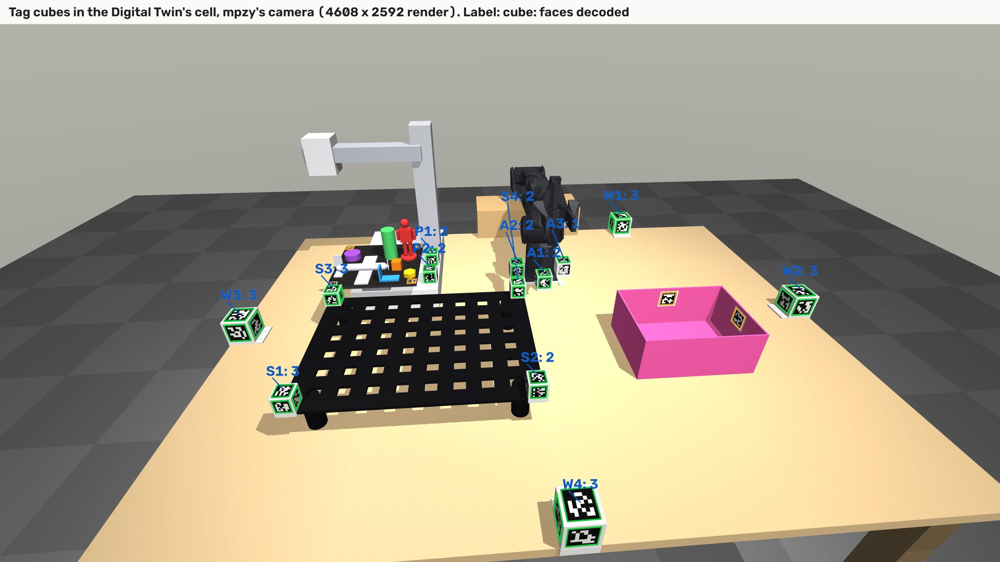
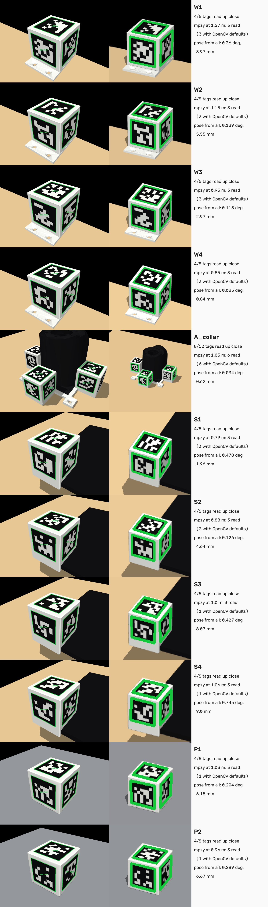

# AprilTag cubes

Black-and-white printed AprilTag cubes for the PiPER cell, each with a mount made for the spot it
goes. This follows Sterling's suggestion on PR #77. In byu-vcl PR 318 he asked why the VLM's docking
markers only faced up, and they became cubes with a tag on every side.



*Every cube where it goes in the Digital Twin's cell, rendered from mpzy's camera at full
resolution. A green outline means the detector read that tag. Each label gives the cube and how
many of its faces were read. (`cell_view.py`)*

## What they are

- **One print, two filaments.** Each part is a white body (the cube plus its mount) with the tag's
  black cells sunk 1 mm into the faces. The white body is the tag's quiet zone: one cell plus
  0.8 mm all round. Earlier on PR #77, a tag on the black bed with no white margin never decoded;
  the cubes can't have that problem.
- **A different tag36h11 ID on every face.** A cube's IDs are `first_id + 0..4` on its top,
  front, right, back and left faces. One face is enough to tell which cube the camera sees and
  from which side. A face with no tag, such as a mount side, keeps its ID unused.
- **A mount for each destination.** The mount fixes where the cube sits, so its tags' corners are
  known in the destination's own frame (the table edge, the arm's base frame, the shelf corner).
  `cube_tags.yaml` lists every corner.

| Part | Goes on | Mount | Tag (cube edge) | IDs | Prints |
|---|---|---|---|---|---|
| W1–W4 | the centre of each table edge (W1 to the right of the rest stand) | **table edge**: the flange takes two No. 8 or M4 wood screws into the plywood, and a lip hangs 12 mm down over the edge | 40 mm (51.6) | 100–119 | on its back |
| A_collar (A1–A3) | around the PiPER's base | **base collar**: one U-shaped part around the base's bottom flange, with cubes in front, left and right; two screws or VHB | 28 mm (36.6) | 120–134 | flat |
| S1–S4 | the black shelf's four corners | **shelf corner**: a notch in the cube's bottom fits over the plate's corner, so the cube caps it; no screws | 24 mm (31.6) | 140–159 | upside down |
| P1–P2 | the A1 mini's base, right of the plate | **adhesive**: VHB tape (there's no CAD for the A1 mini) | 24 mm (31.6) | 160–169 | upright |

`make_cubes.py` turns every part the way it should print, so none needs supports. The faces a
mount covers carry no tag: the collar side facing the base, and the faces taped down.

## Why cubes

A flat tag is a plane. On its own, its tilt is rough, and now and then the pose flips to the
mirror-image tilt (the planar ambiguity). A cube shows two or three faces at once, and solving
all their corners together removes the ambiguity. The Monte Carlo in `check_cubes.py` models
mpzy at full resolution, 1 m away and 30° above, with 0.5 px of corner noise and 40 mm tags:

| What the camera sees | Rotation error, median | 95th percentile | Flipped (> 10°) |
|---|---|---|---|
| one flat tag on the table | 0.69° | 1.51° | 3.2 % |
| one cube face on its own | 0.92° | 84° | 5.4 % |
| cube: top + front | 0.43° | 0.82° | 0 |
| cube: top + front + right | 0.33° | 0.62° | 0 |

In the twin's cell (`cell_view.py`, the figure above), mpzy reads every cube: 2 or 3 faces
of 12 of the 13, and the top of A3, which sits behind the arm's base. Each part's position, solved from all its faces, is off by 0.9–7.7 mm (median
2.7 mm), and its rotation by 0.06–0.9°. The twin's flat tags in the same 13 spots decode 11 of
13, and on their own their positions are off by 1.6–25 mm (median 8.6 mm).

## Printing

**Use the H2D, with black in one nozzle and white in the other.** Every layer that crosses a
side tag holds both colours: 210 layers at 0.2 mm on a W cube and 125 on the small ones
(`make_cubes.py` counts them). On the H2D each such layer costs two nozzle switches and a
little prime tower. On the A1 mini's AMS lite it costs two full filament swaps, each with its
purge: about 420 swaps for one W cube. That is hours of swapping and a lot of purged
filament, so use the A1 mini only for single parts and expect the waste.

- **Files** (in `print/`):
  - `all_parts_H2D.3mf`: all 11 parts on one H2D plate. The colour changes are per layer, not
    per part, so one plate costs about the same as one part.
  - `<part>.3mf`: one part on its own.
  - `<part>_white.stl` / `<part>_black.stl`: the same solids for other slicers. Load both at
    once and say yes to *load as a single object with multiple parts*.

  In every 3MF, the white body is filament 1 and the black cells are filament 2. Bambu Studio
  2.9.1 opens them that way: its command line loaded and re-exported `all_parts_H2D.3mf` as 11
  objects, each with a white part on filament 1 and a black one on filament 2.
- **Filament: matte PLA** (black and white). Shiny filament can throw glare that hides a tag;
  matte doesn't. Black PLA covers white within a layer or two, and the 1 mm inlay leaves margin.
- **Settings:** 0.2 mm layers, 3 walls, 15 % infill, no supports. Ironing on the top faces is
  optional. Leave *Flush into this object* off for these parts (it is off by default): it
  purges into the part itself, and the colours would mix in the faces.
- **Nozzles:** this print uses both of the H2D's nozzles, so by this repo's rule both must be
  0.2 or 0.4 mm. Read them off the printer before slicing (CLAUDE.md, *Printing*).
- **Measure first.** These dimensions are estimates, so check them before printing, edit
  `cubes.yaml`, and run `python make_cubes.py` again:
  - the shelf plate's thickness (the notch is cut for 5.0 mm + 0.3 mm);
  - the PiPER base's bottom flange (from AgileX's mesh: 95 × 80 mm, x −55..40 and y −40..40 in
    the base frame; the collar adds 0.4 mm of clearance);
  - that the W lip's edge is free: nothing in the way of the table's edge at the four spots.

  Then print one S cube first. It is the smallest, and it checks the colours, the fit and the
  detector before the big parts.

## Mounting

- **W1–W4:** push the lip against the table's edge, then drive two wood screws through the
  flange. Put the cube at the middle of the edge, or measure where it is along the edge; the
  camera fixes the rest.
- **A_collar:** it is open at the back, for the cables. Slide it on from behind the base, open
  end first, until its front stops against the flange, then screw or tape it down. Don't bump
  it afterwards: its cubes give the camera the arm's frame.
- **S1–S4:** set each cube on a corner of the shelf. One design fits every corner.
- **P1–P2:** VHB tape on the base's top, right of the plate. Pick spots that the bed, the
  toolhead and the cables never reach, and keep clear of the screen.

## Using the tags (pose estimation)

`cube_tags.yaml` lists, for every tag, its part, cube, face, size, centre and its four corners in
the part's frame. Corners are stored top-left, top-right, bottom-right, bottom-left of the black
square as printed. Detectors list them in their own order, so reorder them:

| Detector | Index the stored corners with |
|---|---|
| OpenCV `cv2.aruco` (`DICT_APRILTAG_36h11`) | `[2, 3, 0, 1]` |
| AprilRobotics `apriltag` / `pupil-apriltags` | `[3, 2, 1, 0]` |

`check_cubes.py` checks both orders on renders: every tag, every view.

```python
import cv2, numpy as np, yaml

tags = yaml.safe_load(open("cube_tags.yaml"))
part = tags["parts"]["A_collar"]          # its frame is the PiPER's base frame
order = [2, 3, 0, 1]                       # OpenCV's corner order
det = cv2.aruco.ArucoDetector(cv2.aruco.getPredefinedDictionary(cv2.aruco.DICT_APRILTAG_36h11))
corners, ids, _ = det.detectMarkers(gray)
obj, img = [], []
for c, i in zip(corners, ids.ravel()):
    t = part["tags"].get(int(i))
    if t:
        obj.append(np.array(t["corners"])[order])
        img.append(c.reshape(4, 2))
ok, rvec, tvec = cv2.solvePnP(np.vstack(obj), np.vstack(img), K, dist, flags=cv2.SOLVEPNP_SQPNP)
# rvec, tvec: the arm's base frame in the camera (mm), from every face in view at once.
```

- **Solve all of a part's tags together, then check the residuals.** If one tag's corners land
  more than ~2 px from where the solved pose puts them, drop that tag and solve again. In one
  close-up render the arm's black base, right behind a steeply seen top face, pulled a corner
  25 px.
- **Detector settings at full resolution.** By default, OpenCV ignores any tag less than about
  35 px across in a 4608 px frame (`minMarkerPerimeterRate` = 0.03). At 0.01, mpzy reads the
  24 mm cubes at 1 m on two or three faces instead of one.

## Changing them

- **Sizes, IDs, mounts and where each part goes:** `cubes.yaml`. Then run
  `python make_cubes.py`, `python check_cubes.py` and `python cell_view.py`.
- **A new kind of destination:** write a builder in `tag_cubes.py` and add it to `MOUNTS`. A
  builder places the cubes in the part's frame and returns the solids to add and to cut out.
- **The quiet zone:** set `border_cells` in `cubes.yaml`. It defaults to 1 cell; 1.5 gives a
  dark background behind a face more room, and makes each cube 1 cell bigger.

## Files

| File | What it is |
|---|---|
| `cubes.yaml` | the parts: tag sizes, IDs, mount settings, where each goes in the cell |
| `tag_cubes.py` | the geometry: tag bits, cube faces, inlays, mounts, 3MF and STL writers |
| `make_cubes.py` | writes `print/` and `cube_tags.yaml`; prints sizes, grams and two-colour layers |
| `cube_tags.yaml` | generated: every tag's corners in its part's frame |
| `check_cubes.py` | renders each part (MuJoCo), detects its tags, solves its pose; the flat-vs-cube Monte Carlo → `docs/cubes_sheet.jpg`, `docs/check_report.json` |
| `cell_view.py` | puts the parts in the Digital Twin's cell and looks through mpzy; compares with the flat tags; checks for collisions with the furniture → `docs/cell_mpzy.jpg`, `docs/cell_report.json` |
| `print/` | the 3MF and STL files |

```bash
pip install -r requirements.txt
python make_cubes.py
MUJOCO_GL=egl python check_cubes.py      # headless Linux; drop MUJOCO_GL elsewhere
MUJOCO_GL=egl python cell_view.py        # also needs ../../Digital Twin/requirements.txt
```



*Each part up close, next to what it mounts on, with the tags the detector read; mpzy's view of it
at its distance in the cell; and the result. (`check_cubes.py`)*

## Limits

- **The renders are ideal.** They have no blur, lens distortion, sensor noise or glare, so real
  errors will be larger. What carries over is the comparison: cube against flat tag, and one
  layout against another.
- **Not printed yet.** Printing needs an `@claude-print` run (CLAUDE.md, *Printing*), or a
  person at the H2D.
- **Not cubes:** the plate tags (B), the gripper (G), the bin (X), the doser (D) and its rack
  (R). The plate and the fingers have no room for a cube. The doser isn't in the cell yet,
  but the collar's approach would fit it too: a mount shaped from the destination's own CAD
  (its leg, `Digital Twin/assets/powder_doser/leg.stl`).
