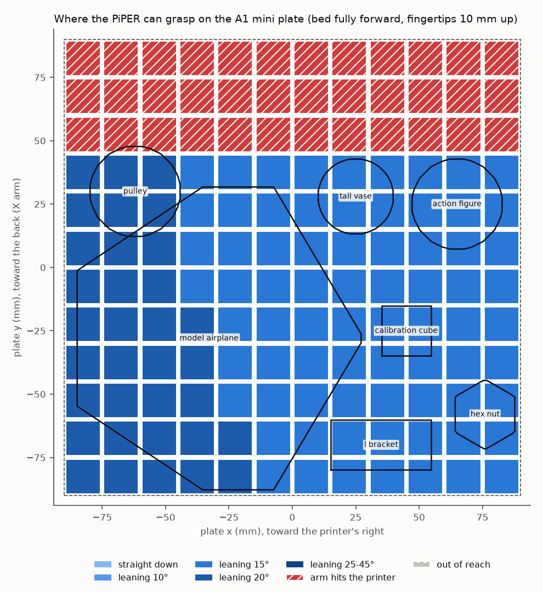
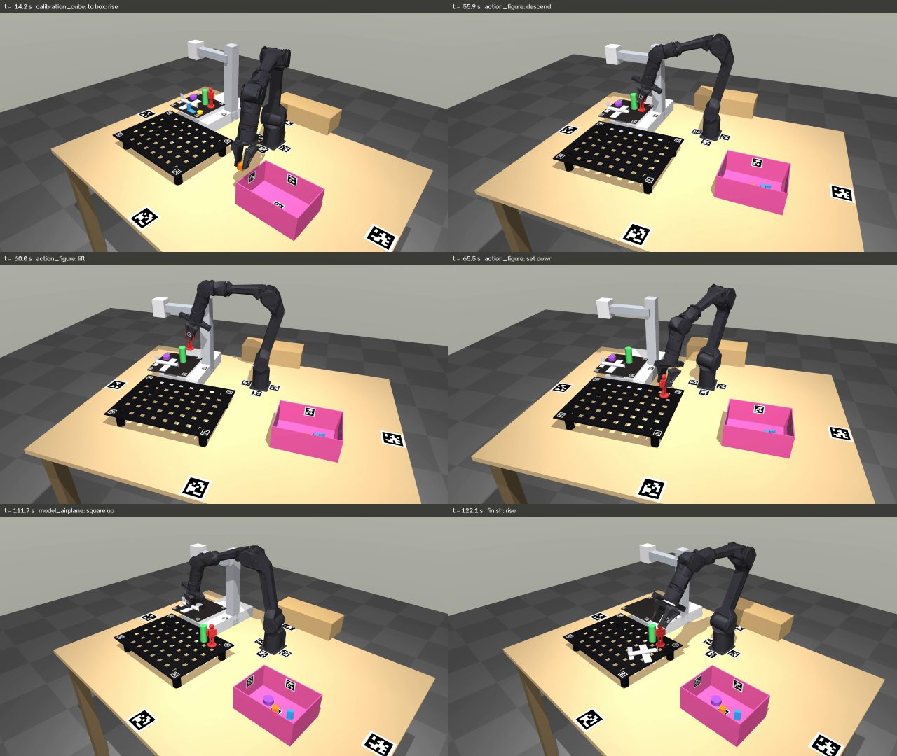
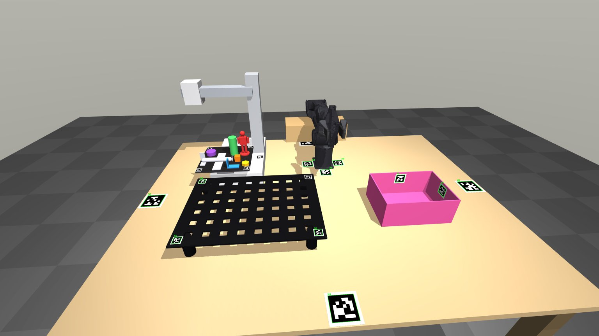

# Digital Twin of the PiPER cell

A physics simulation of the lab's AgileX PiPER clearing prints off the Bambu Lab A1 mini.
For each print it grips it, breaks it free of the plate, then drops it in a box or stands it
on the black perforated shelf. Everything is open-source Python. The physics engine is
[MuJoCo](https://mujoco.org) (Apache-2.0), and a numpy-only engine needs nothing else.
Started on [PR #77](https://github.com/vertical-cloud-lab/robot-arms/pull/77).



## Quick start

```bash
cd "PiPER Sandbox Scripts/Digital Twin"
pip install -r requirements.txt

python run_sim.py --viewer                       # watch the plate get cleared, live, in 3D
python run_sim.py                                # same, headless: prints a report
python run_sim.py --video output/clear_bed.mp4   # render mpzy's camera view to a video
python run_sim.py --video out.mp4 --camera orbit # a closer view from the front-right
python run_sim.py --engine kinematic --viewer    # no MuJoCo needed: numpy + matplotlib
python run_sim.py --scenario reach_map           # where on the plate the arm can pick
python run_sim.py --scenario camera_check        # mpzy's view and the AprilTags it finds
python run_sim.py --scenario compliance_demo     # impedance control: push and press tests
python -m pytest tests                           # 11 tests, about a minute
```

In the viewer, drag to orbit, right-drag to pan, scroll to zoom, double-click a body to
follow it, and Ctrl + right-drag to push things. On a headless Linux machine, set
`MUJOCO_GL=egl` (or `osmesa`) for `--video`. Every run writes
`output/<scenario>_report.json`, which records each print's result, when its bond broke
and under what load, and any planned move that touched the cell.

## What is simulated, and how exact it is

| Part | Model | Source | How sure |
|---|---|---|---|
| Arm kinematics | piper_sdk's modified-DH table, both firmware variants (`dh_is_offset` 0 and 1) | `Arm Control/Up_and_Down.py`, piper_sdk | Exact. Matches `Up_and_Down.fk()` to 1e-6 mm (tests), and MuJoCo's TCP matches the DH chain to 1e-6 m |
| Arm links | AgileX's meshes and inertias, re-expressed in the DH frames | MuJoCo Menagerie `agilex_piper` (MIT), from AgileX's URDF | Meshes good. The URDF's masses total 2.4 kg against AgileX's 4.2 kg, so torques are approximate |
| Joints | limits, max speeds, torque limits, friction, rotor inertia | `Up_and_Down.py`, AgileX spec sheets | Limits exact. Torque limits are estimates (AgileX doesn't publish them) |
| Gripper and sleeves | two coupled fingers (0–35 mm each), a 3.5 mm TPU sleeve on each gripping face, 63 mm max gap, TCP 140 mm from the flange | Teleoperation README (45.6 / 108.6 mm readings), `follower.py --tool-mm` | Derived from the lab's gripper readings. Sleeve width and length are estimates |
| A1 mini | base, Z column (right), cantilevered X arm, toolhead parked at X-13, bed on a slide joint (fully forward), 0.6 mm PEI sheet | Bambu spec sheet, BambuStudio profiles and G-code, forum measurement | Layout good. **The plate height (88 mm) is a guess: measure it first** |
| Black shelf | 400 × 300 mm plate, 8 × 6 grid of 20 mm holes at 45 mm pitch, on 4 feet; holes are real openings | photos | Sizes are estimates |
| Box, table, rest stand | boxes | photos | Estimates |
| Prints | 7 prints from convex parts, mass = density × volume × fill | `config/prints.yaml`, `world/print_library.py` | As designed |
| "Stick" | a stiff weld to the plate, which breaks when pull, shear, peel and twist (each against a capacity computed from the print's footprint) add up past 1 | `physics/adhesion.py` | Physically shaped, but the strength (kPa) is a guess: calibrate it with a luggage scale |
| Friction | per material (PLA, PETG, TPU, PEI, plywood …) | literature where it exists | Estimates; no published value for TPU on PLA |
| AprilTags | real tag36h11 images on 0.3 mm tiles, at the locations listed on PR #77 | `config/apriltags.yaml` | IDs: only P1 = 31 and the bed's 30/32/36 are known |
| Cameras | mpzy (Camera Module 3 Wide: 4608 × 2592, 67° vertical FOV) and a wrist camera | camera spec | Pose estimated from the photo |

**The layout (where the printer, shelf, box and arm sit) is estimated from mpzy's photos.** It
is all in `config/cell_layout.yaml`. Measure it with a tape or with the AprilTags and edit the
numbers there; nothing else needs to change.

## How it works

```
config/*.yaml ──> world/cell.py ──> Scene (engine-agnostic: Bodies, Geoms, Joints, tags, bonds)
                    │                    │
                    │                    └──> engines/mujoco_engine.py    (MJCF, contacts, bonds)
                    │                         engines/kinematic_engine.py (numpy only)
                    │                                  │
kinematics/ (DH, IK) ──> control/sim_robot.py ─────────┘   runs the loop: every 1 ms,
                    control/controllers.py                 controller -> torques -> physics step
                              │                            -> bond check
                    tasks/pick_place.py   (grasp, free, lift, deliver)
                              │
                    scenarios/*.py  <──  run_sim.py  ──>  viz/ (live viewer, videos)
```

1. **Configuration.** All numbers live in five YAML files, in mm and degrees like piper_sdk.
2. **Scene.** `world/cell.py` builds a scene graph from them. It is a tree of bodies made of
   primitive shapes, with joints, AprilTag tiles, cameras, and the print-to-plate bonds. It
   doesn't know which engine will run it.
3. **Engine.** An engine turns the scene into its own model. MuJoCo gets an MJCF file, which
   is written to `output/_build/scene.xml` so you can open it on its own with
   `python -m mujoco.viewer --mjcf=output/_build/scene.xml`. The engine steps the physics at
   1 ms. After every step it measures the load on each intact bond and breaks the bond
   once the load is too high.
4. **Control.** `SimRobot` runs the controllers at 1 kHz. Three are available:
   - joint impedance with gravity compensation. This is piper_sdk's `JointMitCtrl` law; with
     the default stiff gains it behaves like the firmware's position mode.
   - Cartesian impedance, a spring at the TCP, for compliant work.
   - a force-limited gripper.

   Moves are minimum-jerk in joint space, or straight lines solved by IK. Before a move
   runs, it is checked for collisions with the cell.
5. **Task.** `tasks/pick_place.py` takes each print in turn:
   - plans a grasp across the arm's reach. The wrist can't point straight down this low and
     this far out, so the gripper leans 10–20° toward the arm.
   - opens, descends and closes gently, then squeezes with 20 N.
   - twists, rocks and pulls until the bond lets go.
   - lifts, and checks that the print came along.
   - puts it upright on the nearest free solid spot of the shelf, or releases it 35 mm
     above the box rim.

   A print whose neighbours are in the way of the open fingers waits its turn. A print the
   arm can't reach without hitting the printer is reported as blocked.
6. **Scenario.** A scenario is any script in `scenarios/` with a `run(sim, args)` function.

## Where things are

```
Digital Twin/
├── run_sim.py                 entry point: picks a scenario, engine, viewer, video
├── requirements.txt
├── config/                    ALL the numbers (mm, degrees)
│   ├── robot_piper.yaml       DH table + variant, joint limits/speeds/torques, gains, gripper, sleeves
│   ├── cell_layout.yaml       table, arm pose, A1 mini, shelf, box, rest stand, cameras
│   ├── apriltags.yaml         every tag: id, size, which object it's on, where, facing which way
│   ├── prints.yaml            every print: shape, size, position on the plate, material, stick, grasp, destination
│   └── sim.yaml               engine choice, timestep, contact softness, task speeds and heights
├── digital_twin/              the Python package
│   ├── config.py              loads the YAML files
│   ├── sim.py                 make_sim(): config -> cell -> engine -> robot in one call
│   ├── transforms.py          rotation and pose helpers
│   ├── kinematics/            dh.py (FK, Jacobian), piper.py (the PiPER: FK, IK, limits)
│   ├── world/                 scene.py (Body/Geom/Joint), objects.py (Table, PrinterA1Mini,
│   │                          PerforatedShelf, Bin, Print), robot.py (the PiPER), cell.py,
│   │                          print_library.py (print shapes: action figure, airplane, ...)
│   ├── physics/               adhesion.py (the stick), materials.py (density, friction, softness)
│   ├── engines/               base.py (the interface), mujoco_engine.py, kinematic_engine.py
│   ├── control/               controllers.py, trajectory.py, sim_robot.py (+ a piper_sdk-style facade)
│   ├── tasks/                 pick_place.py
│   ├── perception/            apriltags.py (tag textures, detection, pose)
│   └── viz/                   recorders.py (viewer, video), matplotlib_view.py
├── scenarios/                 clear_bed, reach_map, camera_check, compliance_demo
├── assets/piper/              link meshes (STL, DH frames) + inertias + MIT licence
├── tools/build_piper_assets.py  regenerates assets/piper/ from MuJoCo Menagerie
├── tests/                     kinematics, world, tasks
└── docs/                      images used here
```

## Editing it

| To ... | Edit |
|---|---|
| move the printer, shelf, box, camera or the arm itself | `config/cell_layout.yaml` (`pose: [x, y, z, yaw]`, world = table centre) |
| add, move or remove a print; change its size, material or stick; say where it goes | `config/prints.yaml` |
| make a new kind of print (a new shape) | a function in `digital_twin/world/print_library.py`, added to `TEMPLATES` |
| change the bed's stickiness for everything | `stick_kpa` in `digital_twin/physics/materials.py` (or per print in `prints.yaml`) |
| change how the bond breaks | `digital_twin/physics/adhesion.py` |
| switch DH variant to match the arm's firmware | `kinematics.variant` in `config/robot_piper.yaml` |
| change the sleeves, gripper force or speed | `gripper:` in `config/robot_piper.yaml` |
| add or move an AprilTag | `config/apriltags.yaml` (parents: table, arm, printer, plate, shelf, box, finger1, finger2) |
| tune contact softness, timestep, solver | `config/sim.yaml` (`mujoco:`) and per material in `materials.py` |
| change approach heights, speeds, how prints are freed | `config/sim.yaml` (`task:`) |
| add an object to the cell | a `WorldObject` subclass in `world/objects.py`, added in `world/cell.py` |
| add a physics engine (PyBullet, Genesis, Drake, Isaac …) | subclass `engines/base.PhysicsEngine`, register it in `engines/__init__.py` |
| write a new experiment | a file in `scenarios/` with `run(sim, args)`, then `python run_sim.py --scenario <name>` |

From Python:

```python
from digital_twin.sim import make_sim, ready
sim = make_sim()                         # or make_sim(engine="kinematic")
ready(sim)                               # unfold from the rest pose
r = sim.robot
T = r.tcp_world()                        # 4x4 TCP pose in the world (table) frame
T[2, 3] -= 0.05
r.move_linear(T)                         # 50 mm straight down
r.set_gripper(width_m=0.04)              # 40 mm between the sleeves
r.grip(squeeze_n=15)                     # close, squeeze with 15 N per jaw
r.compliant(T, duration=2.0)             # hold T with the Cartesian spring
sim.engine.body_pose("action_figure")    # where a print is
```

`control/sim_robot.py` also has `PiperSDK`, a facade with piper_sdk's method names and units
(`JointCtrl` in 0.001°, `GripperCtrl` in 0.001 mm with the lab's 38.6 mm reading offset,
`JointMitCtrl`, `GetArmJointMsgs`, `GetArmEndPoseMsgs`, …). Code written against it can be
tried on the twin before it is pointed at the arm.

## Results so far

From `python run_sim.py` and the other scenarios, run on 2026-11-14 with MuJoCo 4.0.1 and
Python 3.14 and the `config/` files as committed.



**Clearing the plate: 7 of 7 prints delivered** in 122 s of simulated time (about 66 s of wall
time headless on a CI runner), and no planned move touched the cell.

| Print | Mass | Bond's pull capacity | Freed by | Gripper lean | Went to | Ended up |
|---|---|---|---|---|---|---|
| calibration cube, 20 mm | 3.5 g | 1.6 N | the squeeze | 15° | box | in the box |
| hex nut, 24 mm | 2.2 g | 2.0 N | the squeeze | 10° | box | in the box |
| L bracket (PETG) | 2.5 g | 4.0 N | the squeeze | 15° | box | in the box |
| action figure, 95 mm tall | 12.0 g | 4.1 N | the squeeze | 20° | shelf | standing, 0° tilt |
| tall vase, 30 × 70 mm | 21.5 g | 2.8 N | the squeeze | 20° | shelf | standing, 0° tilt |
| pulley, 36 × 14 mm | 6.2 g | 4.1 N | twist | 20° | box | in the box |
| model airplane, 110 mm long, 120 mm span | 15.8 g | 6.9 N (1.5 kPa) | twist (245 N·mm) | 15° | shelf | flat on the shelf |

What the runs showed:

- **A little stick barely holds small prints.** At 4 kPa a 20 mm cube resists only 5.5 N·mm of
  peel. The two sleeves never meet a print at exactly the same instant, so even the gentle
  2 N close tips it free. The large, flat airplane and pulley held on until the twist. If real
  prints hold harder, raise `stick_kpa`: the twist, rock and pull steps are already there, and
  the report says which one freed each print.
- **The back of the plate is out of reach** with the bed fully forward. Grasps behind about
  y = +45 mm put the arm into the X arm, toolhead or Z column (the map at the top).
- **The gripper leans 10–20°** everywhere on the plate, because J5's ±70° stops it pointing
  straight down this low.
- **Tags (`camera_check`):** at mpzy's full 4608 × 2592 resolution, the detector finds 11 of the 24
  tags from the estimated camera pose. It finds none of the 16 mm plate tags, which matches the
  real photo, where only P1 decoded. Single-tag position errors are 2–20 mm, worse for small
  and far tags.

  
- **Compliance (`compliance_demo`):**
  - Aiming the fingertips 10 mm into the shelf with K_z = 400, 800 and 1600 N/m gives 3.95, 8.11
    and 16.13 N, which is K_z × 10 mm. The stiffness sets the force.
  - A 5 N push at the fingertips moves them 4.4 mm, against F/K = 6.2 mm, because joint
    friction takes part of the load.

## Design decisions that differ from the request

- **The folder is `PiPER Sandbox Scripts/Digital Twin/`, not a top-level `Digital Twin/`.** This
  PR's rule is that every added file stays inside `PiPER Sandbox Scripts/`.
- **"P1, P1" is read as P1 and P2**, the two printer-body tags from the earlier graphic.
- **The box is a 220 × 160 × 90 mm bin, not the pink box** next to the printer, which is too
  small for the model airplane. It's one edit in `cell_layout.yaml` to use the real one.
- **"Sufficient tags in the box" is five:** one on each inner wall near the rim, which stay
  visible as the box fills, and one on the floor, which disappears under the first print and
  so works as a fill check.
- **One physics engine is implemented (MuJoCo), plus a no-physics engine,** not several.
  PyBullet is in maintenance mode and has no wheel for current Python (it failed to build
  here on 3.14), so I didn't ship an engine I couldn't run. The interface for adding one is
  `engines/base.py`, and the kinematic engine is the worked example.
- **The kinematics come from piper_sdk's DH table, not from the URDF.** The URDF (and
  MuJoCo Menagerie's model built from it) matches the SDK's *older* firmware table to 0.02 mm,
  while `Up_and_Down.py` uses the newer one, which moves J2's zero by 2° and the wrist by about
  10 mm. The twin uses the URDF only for masses and meshes.
- **The gripper leans 10–20° instead of picking straight down.** The real wrist (J5 within
  ±70°) can't point straight down at plate height from where the arm sits, so this is the
  arm's limit, not a simplification.
- **The prints sit in the front ~70 % of the plate.** With the bed fully forward, grasps behind
  about y = +45 mm put the arm into the X arm, toolhead or Z column. The reach map above
  shows this.
- **Holes in the shelf are square openings as wide as the round holes.** Convex shapes keep
  the contacts exact and fast; a mesh with round holes would collide as its convex hull, with
  no holes at all.
- **The planner reads print poses from the simulation (ground truth).** The tags and the
  detector are in place (`camera_check`), but closing the loop on tag-estimated poses is
  the next step, not done here.

## Next steps (with autonomy and compliance in mind)

1. **Measure the cell** (plate height first, then the positions in `cell_layout.yaml`), and
   calibrate `stick_kpa` and friction with a luggage scale and a tilted plate.
2. **Perception in the loop:** locate the plate from the B tags and the arm from the A tags in
   mpzy's rendered (later, real) frames, and plan from those estimates instead of ground
   truth. `camera_check` already reports how well each tag's pose comes out.
3. **Compliant grasping and freeing:** the Cartesian impedance controller already sets contact
   force by stiffness (`compliance_demo`). The same law runs on the real arm through
   `JointMitCtrl`.
4. **Learning:** wrap `make_sim()` as a Gymnasium environment for LeRobot policies, or move
   the MJCF to MJX / MuJoCo Playground to train on a GPU. The engine-agnostic scene makes
   both a new file, not a rewrite.
5. **Sim-to-real:** point a script at `PiperSDK` (the twin) first, then at piper_sdk (the arm).
