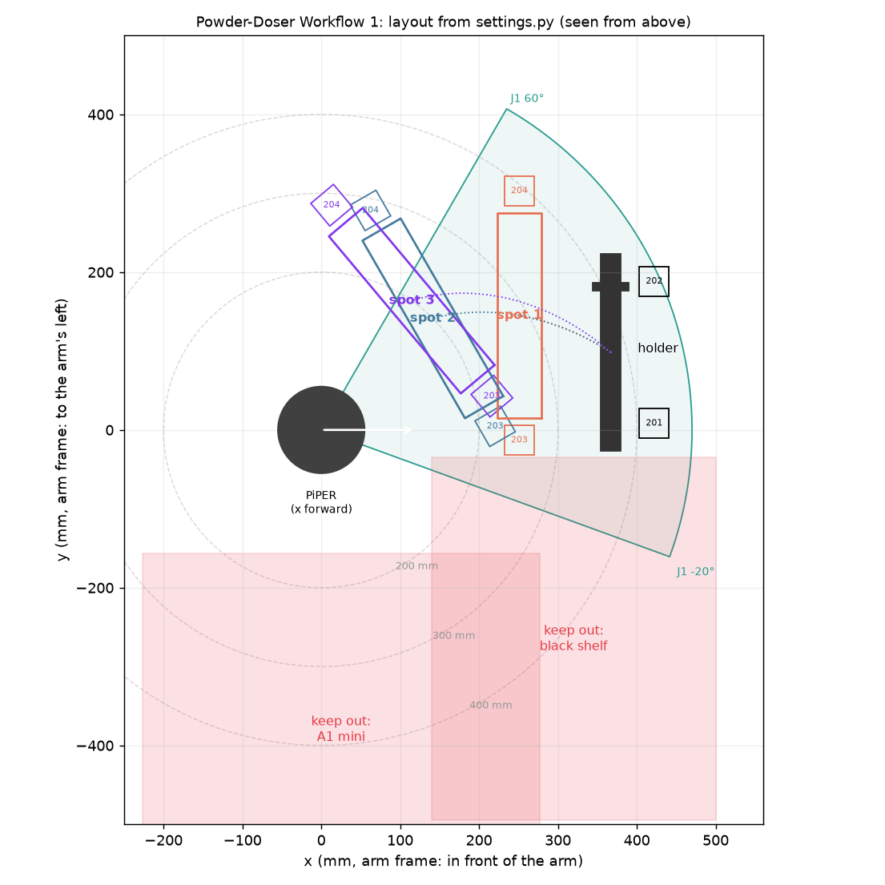
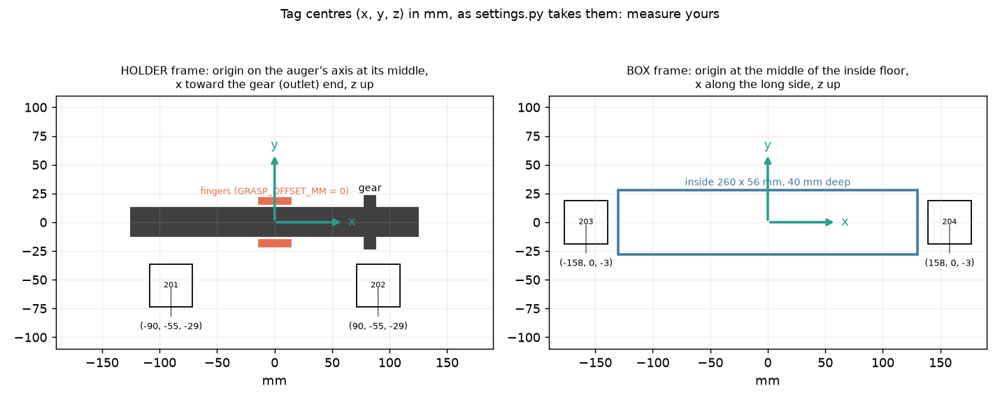

# Powder-Doser Workflow 1: auger pick-and-place

The PiPER finds the powder doser's auger in its test holder by AprilTags, pulls it out of the
holder's clips and puts it in a box, then grades the run A–F. Thirty runs at each of three
box spots measure how repeatable and accurate that is
([PR #83](https://github.com/vertical-cloud-lab/robot-arms/pull/83)).

**Status (2026-11-25): not yet run on the real arm.** Everything has run only on the
simulated arm (`Arm Control/fake_piper.py`) with rendered AprilTag images: the tests and
`--dry-run` sessions. Before the first real run, measure the numbers marked `MEASURE` in
[`settings.py`](settings.py), calibrate the camera, and work through [First runs](#first-runs-in-order).

## One run

1. **Look.** Take a still with mpzy's camera, and find the holder and the box by their tags.
2. **Plan.** Work out every pose and path, and check them all before the arm moves:
   - every point is within the joint limits;
   - J1 stays inside `J1_RANGE_DEG`;
   - J6, the gripper's twist, stays inside its 90° window;
   - J4 is held at 0°;
   - nothing goes into a keep-out box (the A1 mini, the black shelf) or below the table.

   If anything fails, the run is graded F and nothing moves.
3. **Pick.**
   - Go above the auger and open the gripper.
   - Go straight down and close on the tube. The fingers must stop at the tube's width;
     closing on nothing means no auger there.
   - Pull straight up 40 mm, slowly, out of the clips, and check it is still held.
4. **Place.** Carry it over the box, clear of the clips and the box's rim. Lower it straight
   down until it is 8 mm above the floor, let go, go straight up, then back to READY.
5. **Grade.** The script suggests a grade from what happened. The operator presses Enter to
   accept it, or types another letter and an optional note.
6. **Log.** It writes one row to `results/results.csv` and saves the before and after stills.

| Grade | Meaning (PR #83) | Suggested when |
|---|---|---|
| **A** | Found, picked up out of the holder, placed in the box | It was let go over the box with the gripper still holding the tube. If there is an auger tag, the auger must also lie inside the box. |
| **B** | Found and picked up, not placed in the box | It was dropped on the way, a move near the box stopped, or the auger's tag shows it outside the box. |
| **C** | Found, not picked up | The fingers stopped on something that wasn't the tube, the pull stopped, or the tube slipped out of the fingers during the pull. |
| **D** | Not found | The holder's tags weren't seen, or the gripper closed on nothing. |
| **F** | Test failed completely | There was no safe plan, the box wasn't seen, or the arm faulted (E-stop, power, CAN). |

## Try it without the arm

On any computer, with Python 3.9 or newer:

```bash
cd "PiPER Sandbox Scripts/Powder-Doser Workflow 1"
pip install -r requirements.txt
python layout.py                                               # plan every spot, draw layout.png
python auger_test.py --dry-run --spot 1 --runs 3 --go --yes    # a simulated session (~1 min a run)
python report.py                                               # results/report.md, results/grades.png
python tests/test_workflow.py                                  # the tests, ~5 min
```

## Files

| File | What |
|---|---|
| [`settings.py`](settings.py) | **Every number**: the auger, the tag IDs and where they sit, the gripper, J1's range, J6's window, the keep-out boxes, speeds, current limits, the camera. Edit this, not the scripts. |
| [`auger_test.py`](auger_test.py) | **The test.** Look, plan, pick, place, grade and log, for `--runs` runs at one `--spot`. Read-only without `--go`. |
| [`calibrate.py`](calibrate.py) | Measures where the camera is relative to the arm, and its lens. Writes `calibration.json`. |
| [`report.py`](report.py) | Grades and rates per spot with 95% intervals, and repeatability. Writes `results/report.md` and `grades.png`. |
| [`layout.py`](layout.py) | Plans each spot from `settings.py` with no arm or camera. Draws `layout.png`, and `frames.png` (what to measure). |
| [`make_tags.py`](make_tags.py) | Writes `tags_to_print.pdf`, this workflow's tags at their real size. |
| [`kinematics.py`](kinematics.py) | Inverse kinematics for picking from above, straight and swinging paths, and the reach, J1, J6, table and keep-out checks. Uses `Up_and_Down.fk`. |
| [`vision.py`](vision.py) | Takes stills (borrowing the camera from mpzy's livestream), detects tags, and finds the holder and the box from them. |
| [`arm.py`](arm.py) | Rises from the rest and parks the arm the way teleop does, using `Up_and_Down.py`. Streams the planned paths with snag checks, and opens and closes the gripper. |
| [`sim.py`](sim.py) | The simulated cell for `--dry-run` and the tests: an auger the gripper can hold, and a camera that renders the tags. |
| [`tests/test_workflow.py`](tests/test_workflow.py) | IK, the J6 window, the keep-out boxes, tag location (including tags stuck on turned), calibration, and recovering from a stop, and whole sessions: A twice in a row, D with no auger, C stuck in the clips, F with no box. |

The scripts import `Up_and_Down.py` and `fake_piper.py` from [`../Arm Control/`](../Arm%20Control/),
unchanged. Nothing in `Arm Control/` or `CAD/` was changed.

## Setting up the cell

### Where things go



`python layout.py` draws this from `settings.py`: the arm, J1's range, the keep-out boxes, the
holder and the box at each spot, and the gripper's path to each. It also prints whether each
spot has a safe plan. Edit `HOLDER_EXPECTED` and `SPOTS` until all three say OK, then put the
real holder and box there. The run finds them with the tags wherever they are. These expected
positions are only used to warn when something is more than 40 mm off, for example the box
on the wrong spot.

**Lay the auger and the boxes roughly across the arm's reach** (yaw ≈ J1 + 90°), for two
reasons:

- **J5.** Pointing the gripper straight down needs more J5 the higher it is. Above about
  100 mm it would pass J5's 70° limit, so the gripper tips outward there (`J5_COMFORT_DEG`). An
  auger lying across the reach is parallel to the J2, J3 and J5 axes. Tipping the gripper
  then only turns the auger about its own axis, so it stays level all the way.
- **J6's window.** J6 may only turn through 90°, from −52° to +38°, because of the wrist
  camera's cables. The window includes the park angle. Across that window, the fingers can turn
  from 62° one way to 28° the other from lined up along the reach. Fingers along the reach
  close across an auger lying across it.

The plan checks both, and if an object is turned too far it says how far to turn it back.

**J1's range and the keep-out boxes** (`J1_RANGE_DEG`, `KEEP_OUT_BOXES`) keep the arm, and the
auger it carries, away from the A1 mini and the black shelf. Their positions come from the
Digital Twin's estimate of the cell (PR #77), and mpzy's frame of 2026-11-24 agrees with them
roughly. Measure where they really are in the arm's frame and edit the numbers. The example
layout uses the table in front of and to the left of the arm, so move the big cardboard box
off it.

### Tags

`python make_tags.py` writes [`tags_to_print.pdf`](tags_to_print.pdf). Print it at 100% and
check the 50 mm scale bar. Cut each tag out with its white border; the border is part of the
tag. Stick the tags flat.



- **Holder, tags 201 and 202.** Put them flat on the holder, one near each end, on the side of
  the auger that faces the camera. Keep them clear of the tube and the gear, which stand up to
  52 mm above them and would hide them. Measure each tag's centre in the holder frame and
  put it in `HOLDER_TAGS`. The holder frame has its origin on the auger's axis at the auger's
  middle, x toward the gear end, and z up. A tag on the block's top is about 29 mm below
  the axis, which is where the clips hold it.
- **Box, tags 203 and 204.** Put them on the table against the middle of each short end. Measure
  them into `BOX_TAGS`, in the box frame: origin at the middle of the inside floor, x along the
  long side. The box's inside is 10 mm longer and 10 mm wider than the auger, which makes it
  260 × 56 mm for the 250 mm auger with its 46 mm gear (`BOX_INSIDE_MM`). Set
  `BOX_WALL_HEIGHT_MM` too.
- **Two tags per object, both seen.** All the corners are fitted together, so two tags act as
  one big tag. In the simulation the holder and box came out within 0.2–1.6 mm with two tags.
  A single tag on its own was 5–19 mm off in distance, so a lone tag is only used once that
  object's height is known from an earlier look that saw both. A tag stuck on turned by 90° or
  180° still works when both tags are seen.
- **Optional: a tag on the auger** (`AUGER_TAG`). Use a small flat flag on top of the tube, away
  from the grip. The script then measures where the auger landed in the box on every run,
  which gives placement accuracy and repeatability in mm (`report.py`), and checks the A.

### The grip

`GRASP_OFFSET_MM` sets where the fingers close, measured along the auger from its middle
(default 0, the middle). It must be between the two clips and clear of the gear; the finger
sleeves are about 28 mm wide. `TCP_MM` and `FINGERTIP_MM` set where the finger pads and
fingertips are, measured from the flange; measure them with the sleeves on. The gripper reads
45.6 mm with the sleeves touching (Teleoperation README), so on the 25 mm tube it should read
about 70.6 mm.

## On the arm Pi (mpzy)

Everything runs on mpzy, which has the arm's CAN adapter, its relay and the front camera. On
2026-11-25, `~/piper-venv` (Python 3.13) had `piper_sdk` but no numpy or OpenCV, so install
them once:

```bash
git clone https://github.com/vertical-cloud-lab/robot-arms ~/robot-arms   # or git pull
cd ~/robot-arms/"PiPER Sandbox Scripts/Powder-Doser Workflow 1"
~/piper-venv/bin/pip install -r requirements.txt
```

`~/robot-arms` and the packages would be new on mpzy; record them in CLAUDE.md, as its rules
ask for every change made on a Pi.

- **The camera.** mpzy's camera is the Camera Module 3 Wide (`imx708_wide`, 4608 × 2592), and
  its livestream holds it. Each still borrows it the way PR #81's `livestream/README.md`
  describes: write our PID to `/tmp/picam-pause-0`, wait for the stream to let go, then run
  `rpicam-still`. The stream shows "camera in use" for a few seconds and then takes the camera
  back. The focus is fixed (`CAMERA_LENS_POSITION`), because autofocus would change the
  calibration.
- **Power.** Anything that moves the arm runs through `arm_power.py run`, as in `Arm Control/`.
  The relay switches the arm off afterwards only if the script exits 0 with the arm parked.

## First runs, in order

Every step that moves the arm needs the workspace clear except for the holder and the box,
someone at the E-stop, and the arm resting on its rest with its motors off. `A=~/arm_power.py`
and `P=~/piper-venv/bin/python` below.

1. **Are the tags seen?** Run `$P auger_test.py --spot 1` (read-only). Before calibration the
   positions are rough, but it lists the tags it saw and saves `results/plan.jpg` with them
   outlined.
2. **Calibrate the camera.** The gripper holds a stiff card, about 60 × 130 mm and 2–3 mm
   thick, with tag 199 on one face and tag 200 on the other. Centre both tags about 40 mm from
   the bottom edge. The gripper grips the top 30 mm, and the tags hang below the fingers. Take
   the holder and the box off the table, then run
   `$P $A run -- $P calibrate.py --go`.
   - The arm rises to READY, opens, and waits while you put the card in, then closes.
   - It visits about 20 poses, turning the card to face the camera, and takes a still at each.
   - It parks, then fits everything at once: where the camera is, where the tags sit on the
     card, and the lens. Nothing has to be measured by hand.
   - It prints the fit's error. In the simulation that was 0.4 px and 0.3 mm at the card, with
     the camera found within about 2 mm. If yours is several pixels, look at the stills in
     `results/calibration/`.
   - Run it again whenever the camera moves.
3. **Check the plan.** Put the holder and the box back and run `$P auger_test.py --spot 1`
   again. Open `results/plan.jpg`: the red dot (grasp) should be on the auger between the
   clips, and the blue dot (release) at the box's middle.
4. **Check which way the fingers close.** Run
   `$P $A run -- $P auger_test.py --spot 1 --go --until above`. The arm stops above the auger
   with the gripper open. The fingers should be lined up to close across the tube, one on each
   side. If they are turned, change `FINGERS_ALONG_REACH_J6_DEG` by that angle; turning J6 up
   turns the fingers clockwise seen from above. Its value comes from PR #20's rest-pose photo
   and hasn't been checked with the gripper pointing down.
5. **Check the grip.** Run the same with `--until grasp`. It closes on the tube, prints the
   reading (expected about 70.6 mm), opens, backs up and parks. Neither step 4 nor step 5 is
   graded or logged.
6. **One full run**, watching it: `--runs 1`. If the pull stops (the clips hold too hard),
   that's a C. You can try `PULL_MAX_CURRENT_A` a little higher or a firmer `GRIP_EFFORT_NM`.
   The Digital Twin found the doser's clips need about 18 N each, and that pulling straight up
   can fail where peeling one end out first works (PR #77).

## Running the test: 3 spots × 30 runs

```bash
$P $A run -- $P auger_test.py --spot 1 --runs 30 --go
# move the box to spot 2, then:
$P $A run -- $P auger_test.py --spot 2 --runs 30 --go
$P $A run -- $P auger_test.py --spot 3 --runs 30 --go
```

- **Before the first run** it asks for a go, then rises to READY.
- **Between runs** it waits at READY with the motors on and asks you to put the auger back in
  the holder, empty the box and stand clear. Press Enter for the next run, or q to finish and
  park. `BETWEEN_RUNS = "park"` lands it on its rest with the motors off between runs instead,
  about 40 s slower per run.
- **After each run** it suggests a grade and you confirm it (Enter) or type a letter and a note.
- **Stopping and resuming.** Run numbers carry on from `results.csv`, so a spot's 30 runs can
  be split over several sessions.
- **When something stops it** (a snag, or Ctrl-C), the arm holds where it is with the motors on.
  It then asks whether to open the gripper, go straight up, go back to READY and park. Answer q
  to leave it holding instead. It exits 0 only once it has parked, so `arm_power.py` keeps the
  relay on otherwise: the PiPER has no brakes.
- **Left holding?** Once whatever stopped it is cleared, `$P $A run -- $P auger_test.py --recover`
  takes the arm over, goes straight up, back to READY and parks. `Up_and_Down.py --park` can't:
  it refuses poses this far out.

## Results

`results/results.csv` has one row per run with:

- the spot and run number;
- the grade, the suggested grade, why, and your note;
- where the holder and the box were found (x, y, z, yaw, and how well the tags fitted);
- the gripper's readings when it closed, after the pull and before release;
- where the auger landed in the box (with an auger tag);
- the run's duration;
- the before and after stills: 1600 px copies with the tags outlined, in `results/images/`,
  which git ignores.

Copy `results/` off the Pi, then run `python report.py`.

- **Per spot:** the count of each grade; the success rates with 95% intervals (A, A+B and
  A+B+C, from 0/30 to 30/30); and the median time per run.
- **Repeatability:** the run-to-run spread of the holder's and the box's measured positions,
  and of the grip on the tube.
- **Placement** (with an auger tag): the mean offset from the box's middle (accuracy), its
  spread (repeatability) and the worst run.
- Every run that wasn't an A, with why.

## How it works

- **One frame for everything.** All positions are in the arm's base frame, as `Up_and_Down.fk`
  uses it: x out in front of the arm, y to its left, z up, in mm.
- **Seeing.** `vision.py` detects tags with OpenCV's AprilTag 36h11 dictionary. For each
  object, it fits x, y, height and yaw to every corner of every one of its tags at once,
  through the calibrated camera. The tags lying flat is built into the fit.
- **Calibration.** OpenCV's hand-eye calibration gives a first estimate from the card's
  poses. A least-squares fit over every corner then refines the camera's pose, the tags' pose
  on the gripper, and the focal length and two distortion terms. A weak prior keeps the
  distortion terms from trading off against the rest.
- **Inverse kinematics.** J1 points at the target, and J4 is held. J2, J3 and J5 come from
  Newton's method on `Up_and_Down.fk`, with the gripper straight down unless J5 would pass
  `J5_COMFORT_DEG`; above that it tips outward. J6 is then turned so the fingers close across
  the auger, taking the solution that lies inside the window.
- **Moving.**
  - The arm rises from its rest and parks again exactly as teleop's `follower.py` does, with
    `Up_and_Down.py`'s moves. That includes widening J2 and J3's firmware limits to land on
    the rest and setting them back afterwards.
  - The rest is streamed at 50 Hz along the planned path, with a smooth start and stop, under
    the arm's own speed cap.
  - Near the objects the moves are straight lines. Carrying swings around the base at a fixed
    height.
  - A joint over its current limit, or more than 5° behind, is a snag, and the arm stops.

**What is not checked:**

- **The arm against itself, the holder or the box.** Only heights keep it clear of those: the
  carry height sits above the clips and the box's rim, and the release is checked against the
  box's width.
- **People.** Someone stays at the E-stop.
- **Anything on the table that isn't a keep-out box.**

## Still to do

- [ ] Measure everything marked `MEASURE` in `settings.py`: the tag offsets, the grip point, TCP
      and fingertip lengths, the box, and the A1 mini and shelf keep-out boxes.
- [ ] Install numpy and OpenCV in mpzy's `~/piper-venv`, clone the repo there, and record both
      in CLAUDE.md.
- [ ] Print the tags and the calibration card, then calibrate.
- [ ] Check `FINGERS_ALONG_REACH_J6_DEG` with `--until above`.
- [ ] First supervised runs. If straight pulls don't free the auger, add a peel (tip one end up
      first, as the Digital Twin did).
- [ ] 3 spots × 30 runs, then `report.py`.
