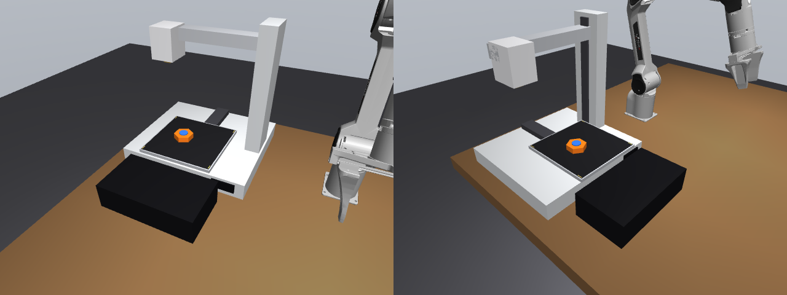
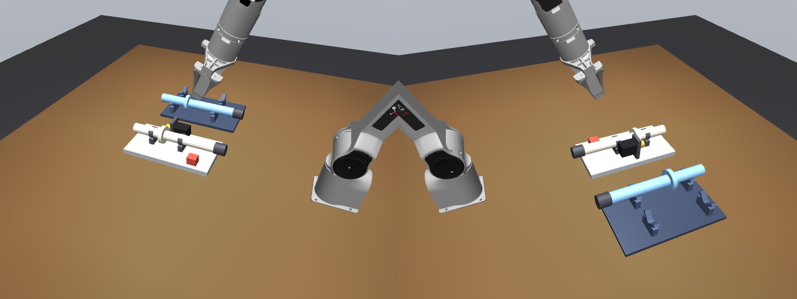
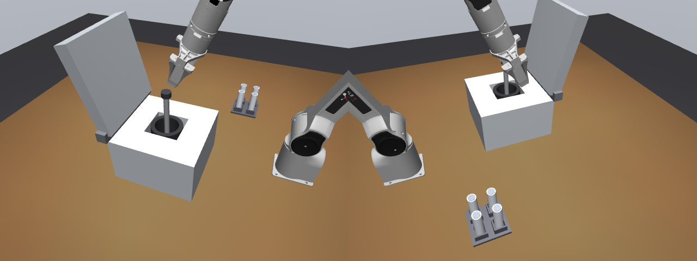

# AMP1 ("On Agentic Manipulation Policies", Apple 2026) on a CPU runner and a simulated PiPER

For [#85](https://github.com/vertical-cloud-lab/robot-arms/issues/85): explore
[apple-aiml-research.github.io/ml-amp](https://apple-aiml-research.github.io/ml-amp/), reproduce what
can be reproduced, then try it on this repo's tasks. [PR #87](https://github.com/vertical-cloud-lab/robot-arms/pull/87#issuecomment-7236408042)
adds three of the lab's workflows: clearing the A1 mini's plate, swapping the powder doser's auger and
charging the atomizer's crucible. Nothing here talks to the real arm.

**At a glance.** Apple's code runs unchanged on a CPU-only GitHub runner. Each episode's policy was
a fresh Claude Opus 5.5 agent, given only AMP1's own prompt and SDK reference, and each episode was
scored by the simulator's own check:

| Suite | Episodes | Scored a success | Paper (AMP1) |
|---|---|---|---|
| CaP-Gym robosuite: all 7 tasks, 1 episode each | 7 | **7** | 98.4% (Opus 5.5), 100% (Gemini 4 Argon) |
| CaP-Gym LIBERO-PRO: units drawn at random from the 3,000 | 4 | **4** | 95.2% |
| A simulated AgileX PiPER on this repo's tasks (#21 vials, #30 tape) and the paper's banana | 4 | **3** | (new tasks) |
| The simulated PiPER on three lab workflows (#87): [A1 mini print removal, auger swap, atomizer charge](#lab-workflows-on-the-simulated-piper-a1-mini-print-removal-auger-swap-atomizer-charge) | 7 | **4** | (new tasks) |

These are one or two episodes per task, so they are anecdotes, not success rates. Every miss and caveat is
written up below. Videos: [the first 15 episodes](https://www.youtube.com/watch?v=_PlBarOj3K4) and
[the seven lab-workflow episodes](https://www.youtube.com/watch?v=sYAtdW0rxBI), with real-time motion where the
frames were kept.

## What AMP1 is

[Paper (arXiv 2611.09892, v4, 31 pp)](https://arxiv.org/abs/2611.09892) ·
[code (apple-aiml-research/ml-amp)](https://github.com/apple-aiml-research/ml-amp).

A frontier model (Gemini 4 Argon or Claude Opus 5.5) is the controller. It doesn't output actions.
It writes Python in a **persistent kernel** against a robot SDK, looks at camera images when its code
calls `show()`, and decides the next step from what happened:

- **Sensing:** `observe()`, `rgb()`, `depth()`, `cloud()`, the camera calibration, and the robot's own
  description (joints, limits, gripper, TCP axes).
- **Perception:** depth-only segmentation of a fused point cloud into tracked objects (`objects()`).
  The model checks it against the images and edits it (`segment`, `define_object`,
  `forget_object`). It can also draw on real images (`annotate`) and render any view (`render`,
  `closeup`, `render_plan`).
- **Motion:** timed TCP waypoints with gripper commands. The harness interpolates them (min-jerk),
  solves damped-least-squares IK at each control step, and refuses a trajectory with a reason
  (`unreachable`, `velocity`, `joint_limit`, `singular`, held-object `collision`). `check_batch`
  tests arm-vs-scene collisions with sphere models.
- **No skills:** the basic harness has no grasp, place or push function. The model writes its own,
  anew each episode. An "assistive" harness adds them, and it helps weaker models but *hurts*
  Opus 5.5 and Gemini 4 Argon (up to −7.5 points).
- **Pause while thinking:** the simulator pauses while the model reasons, so only executed motion
  counts against the step budget.

Reported results:

| Benchmark | AMP1 | Best non-agent baseline |
|---|---|---|
| RoboLab-120 (Isaac Sim, 1,200 eps per instruction set) | **85.6%** Gemini 4 Argon, **82.8%** Opus 5.5 | 49.2% VLA, 42.9% WAM |
| CaP-Gym LIBERO-PRO (3,000 eps) | **95.2%** | π0.5 34.9% |
| CaP-Gym robosuite (700 eps) | **100%** Gemini, 98.4% Opus 5.5 | human-written programs 82.6% |
| CaP-Gym BEHAVIOR-1K (50 eps) | 96.0% | |
| RoboDojo, bimanual, RGB-only, no calibration | 26.4% zero-shot → **84.1%** with a persistent memory after practice | |
| Real world: Franka FR3 + Robotiq 2F-85 + 3 ZED cams, 12 tasks × 9 trials | **104/108** (Opus 5.5) | FLUX 3 Action 49/108, π0.5 30/108 |

Other findings:

- The model matters most: on RoboLab, Opus 5.5 82.8%, Haiku 5.5 51.6%, Opus 4.5 35.2%.
- More reasoning effort helped every model.
- Opus 5.5 copes with missing sensing: no depth 81.1%; no depth and no calibration 75.8%. It
  triangulates, and it self-calibrates the wrist camera from images taken at known gripper poses.
- Text descriptions instead of images collapse to 36.8%.
- It's slow. A real-world success averaged **280 s**: 69 s of motion and 211 s of reasoning.

Emergent behaviours with no prompt or skill for them:

- searching under occluders;
- using a spoon or spatula as a tool;
- pushing a bowl over a bin's edge to make it graspable;
- inferring an unseen shelf from a blocked motion;
- correcting a miscalibrated camera from commanded-vs-seen gripper motion.

### What a full reproduction needs (and why this runner can't)

- **Hardware:** Linux x86_64 with NVIDIA GPUs. The paper ran simulation on 8×H100 with driver 580,
  and RoboLab needs about 9 GB of VRAM per episode plus Isaac Sim 5.0. RoboLab, RoboDojo and
  BEHAVIOR-1K are Isaac Sim, so they need the GPU.
- **A model API key:** `ANTHROPIC_API_KEY` or `GEMINI_API_KEY`, or a self-hosted open-weights
  server. AMP's agent loop calls the model over the provider's API.
- **This runner:** 4 CPUs, 15 GB RAM, **no GPU** and **no model API key**. Its only Claude
  access is Claude Code's own login.

## What was run here

1. **AMP itself, unchanged.** `uv sync --frozen` works on this runner (Python 3.11). The robot
   server, the `amp1_basic` harness and SDK, perception, IK/planning and the collision model all run
   on CPU.
2. **CaP-Gym's two MuJoCo families on CPU: robosuite and LIBERO-PRO.** Both are installed exactly
   as [docs/capgym.md](https://github.com/apple-aiml-research/ml-amp/blob/main/docs/capgym.md)
   says: CaP-X at its pin, the Python 3.10 robosuite venv, and the Python 3.12 LIBERO-PRO venv with
   its dataset. They render through Mesa's EGL (llvmpipe) instead of an NVIDIA driver, and nothing
   in AMP or CaP-X was patched.
   - **robosuite:** `cube_lifting` loads through AMP's own adapter
     (`amp.robots.capgym.official_robosuite`) in 15 s, and `observe()` takes about 90 ms.
     [`capgym/env.sh`](capgym/env.sh) holds the environment the link client runs in.
   - **LIBERO-PRO:** set up by [`capgym/libero_setup.sh`](capgym/libero_setup.sh), docs steps 2, 4
     and 5. The dataset's `SHA256SUMS` check passed. `mv` refused exactly the 2 + 6 directories the
     docs call expected, those directories matched LIBERO-PRO's own copies, and the checkout stayed
     clean. [`capgym/env_libero.sh`](capgym/env_libero.sh) holds the client's environment. The
     catalog lists all 60 tasks (`libero_{object,goal,spatial}_{swap,task}.00`–`.09`, 50 initial
     states each).
   - **BEHAVIOR-1K** needs Isaac Sim and a GPU, so it wasn't attempted.
3. **The PiPER inside AMP's harness** ([`piper/piper_sim.py`](piper/piper_sim.py)).
   - The adapter wraps MuJoCo Menagerie's `agilex_piper` and declares an AMP embodiment: 6 joints,
     the 70 mm parallel jaw, the TCP 115 mm past `link6`, closing along `y` and approaching along `z`.
   - It sends the kinematic chain exported from the MJCF. AMP builds FK/IK and collision spheres
     from that chain itself.
   - Cameras: two RGB-D scene cameras over the shoulders and an RGB-D wrist camera.
   - AMP's robot server and SDK run it without changes, the same way they run CaP-Gym's Panda or
     RoboDojo's ARX arms.
4. **A Claude agent as the model.** With no API key, AMP's agent loop can't call a model.
   [`piper/kernel_bridge.py`](piper/kernel_bridge.py) gives a Claude Code agent AMP1's tools
   instead:
   - a persistent kernel with `rh`, `ep`, `np`, `Image` and `show` preloaded;
   - images saved and viewed;
   - `finish_episode`;
   - the budget line after every result.

   Each episode's agent was a fresh Opus 5.5 instance, the model behind AMP1's real-world results.
   Its system prompt was [`compose_prompt.py`](piper/compose_prompt.py)'s output: a short preamble
   mapping the tools, then AMP1's own `prompts/amp1.md` and the `amp1_basic` SDK reference,
   verbatim. The instruction came only through `ep.observe()`.

### Differences from the paper's setup (read before comparing numbers)

- **One episode per task (two for `tape_to_shelf` and for each lab workflow), and 4 of
  LIBERO-PRO's 3,000 units, where the paper ran 10 to 100 per task.** These are anecdotes, not
  success rates.
- **The model is called through Claude Code, not the API,** at Claude Code's default settings. The
  paper used `--reasoning high`. Images are viewed with a tool call, not attached to the tool result.
- **No bubblewrap sandbox and no gateway.** The kernel talks to the robot server directly
  (`Episode(worker_url=...)`). The information policy ("don't read the simulator") was a rule in
  the prompt, and the transcripts were audited afterwards.
- **PiPER tasks are new scenes,** not RoboLab's. Depth is exact and the cameras are calibrated, as
  in the paper's simulation runs.
- **Three runs, one runner each.** The first run (2026-11-25) ran nine episodes before it ran out of
  model credits. Its runner was then discarded, so its recorded frames and the simulator's result
  files were lost. Each of its episodes keeps the policy's report, every code cell with its output,
  the key images and the final frame, plus the score recorded at the time. The second run
  (2026-11-26) rebuilt everything from these instructions and ran the remaining episodes. Their
  motion is in the [video](#video). Their folders also keep the simulator's own result file
  (`scored_log_*.json`, or `truth.json` for the PiPER) and an
  [`audit.json`](piper/audit.py). The audit checks that each of the agent's tool calls stayed in
  its episode folder and that no kernel cell touched files or simulator internals.
- **The third run (2026-11-28, PR #87)** built the lab-workflow scenes and ran their episodes, on
  one runner across two sessions. The first session ran out of usage credits while two of its
  episodes (`auger_swap` 1 and `atomizer_charge_bare_rod` 0) were about 22 minutes in. A new
  agent can't take over an episode halfway, so the second session discarded both unscored and
  ran them again from the start, with fresh agents and the same seeds.
- **LIBERO-PRO ran from a copy of the pinned CaP-X checkout.** It was built while a robosuite
  episode was running from the original. The two venvs editable-install into the same checkout, and
  the docs warn never to build them side by side. The copy is at the same commits as the original,
  and `git status` shows nothing in it but the dataset's untracked files.

## Results

One episode per task (two for `tape_to_shelf` and for each lab workflow). Every policy was a fresh Opus 5.5 agent given only AMP1's prompt and SDK
reference; it got the instruction from `ep.observe()`. **Scored** is the simulator's own check: CaP-X's
for the CaP-Gym tasks, and [`piper_sim.py`](piper/piper_sim.py)'s `success()` for the PiPER tasks.
[`results/summary.json`](results/summary.json) has every row.
**Belief** is what the agent reported before it saw any score. **Cells** counts `python(code)` calls, from the kernel's transcript, not the agent's own count,
roughly the paper's "model calls". Each episode folder in [`results/`](results/) has the agent's
report, every code cell it ran with its output (`transcript.jsonl`), and its key images.

### CaP-Gym robosuite: the paper's benchmark, its own scenes and checks

| Task | Robot | Instruction | Scored | Belief | Steps used | Cells | Wall |
|---|---|---|---|---|---|---|---|
| [`cube_lifting`](results/capgym_cube_lifting-ep0/) | Panda | pick up the red cube and lift it. | ✅ | success | 251 / 1500 | 14 | 6 min |
| [`cube_stack`](results/capgym_cube_stack-ep0/) | Panda | Pick up the red cube and gently stack it on top of the green cube, then release it. | ✅ | success | 463 / 1500 | 18 | 8 min |
| [`cube_restack`](results/capgym_cube_restack-ep0/) | Panda | Gently place the red cube on top of the green cube and then open the gripper. Nothing should be dropped from a height. | ✅ | success | 581 / 1500 | 31 | 9 min |
| [`spill_wipe`](results/capgym_spill_wipe-ep0/) | Panda + wiper (no fingers) | wipe up the 'brown spill'. | ✅ | success | 587 / 4000 | 16 | 11 min |
| [`two_arm_lift`](results/capgym_two_arm_lift-ep0/) | two Pandas | The two arms should coordinate to lift a pot. … | ✅ | success | 267 / 5000 | 23 | 12 min |
| [`nut_assembly`](results/capgym_nut_assembly-ep0/) | Panda | grasp and insert the `brown square nut` onto the `brown square block`. | ✅ | success | 459 / 900 | 33 | 22 min |
| [`two_arm_handover`](results/capgym_two_arm_handover-ep0/) | two Pandas | Arm 0 should pick up the hammer, lift it, and hand it over to Arm 1. Arm 1 should then grasp the hammer handle (not hammer head). … | ✅ | success | 517 / 5000 | 29 | 23 min |

All seven robosuite tasks succeeded, one episode each. The paper reports 100% (Gemini 4 Argon) and
98.4% (Opus 5.5) over 700 robosuite episodes. Seven episodes can't confirm a rate, but in every task
here the policy did what the paper describes, with no skills supplied:

- it measured the table and objects from depth instead of trusting perception's boxes;
- it chose the wrist yaw by IK when the preview refused a half-turn;
- it judged the finger-sphere "contacts" geometrically;
- it found the table with the fingerless wiper from a 0.6 mm tracking shortfall;
- it found the pot's handles by colour after perception merged them into the pot;
- in the handover, it found that two top-down grips on a 19 cm handle put the two wrists into each
  other. Arm 0 held the hammer out along the line between the robots, and arm 1 came in tilted 45°
  and took the handle 2.6 cm from its end. It checked arm-to-arm clearance with both arms' collision
  spheres, because `check()` only tests against perceived objects. The instruction's "z between 0.15
  and 0.20" doesn't name a frame, so the policy read it in the robot's base frame and recorded the
  table-relative alternative in its report. CaP-X's check scored it a success.

### CaP-Gym LIBERO-PRO: the paper's headline CaP-Gym suite

LIBERO-PRO perturbs LIBERO so that a policy which memorised the demonstrations fails. *swap*
units move objects to new places; *task* units change the instruction while keeping the scene.
The paper reports AMP1 at 95.2% over 3,000 episodes, and π0.5 at 34.9%. Units were drawn with
`np.random.default_rng(85)` from all 60 tasks × 50 initial states, and run in the order drawn.
The Panda runs on CPU through AMP's `official` adapter, with the scene camera (`agentview`) and the
wrist camera.

| Unit (task, initial state) | Instruction | Scored | Belief | Steps used | Cells | Wall |
|---|---|---|---|---|---|---|
| [`libero_spatial_swap.02`, 34](results/capgym_libero_spatial_swap.02-ep34/) | Pick the akita black bowl from table center and place it on the plate | ✅ | success | 957 / 7990 | 28 | 18 min |
| [`libero_goal_swap.08`, 15](results/capgym_libero_goal_swap.08-ep15/) | Put the bowl on the plate | ✅ | success | 861 / 7990 | 22 | 14 min |
| [`libero_object_swap.02`, 32](results/capgym_libero_object_swap.02-ep32/) | Pick the salad dressing and place it in the basket | ✅ | success | 1229 / 7990 | 38 | 17 min |
| [`libero_spatial_task.05`, 39](results/capgym_libero_spatial_task.05-ep39/) (*task* perturbation) | Pick the akita black bowl on the cookie box and place it on the plate | ✅ | success | 1579 / 7990 | 38 | 28 min |

All four units succeeded. The paper's 95.2% is over 3,000 episodes, so four can't confirm it, but
none of the four needed anything the paper's harness doesn't give. The draw was
`rng.choice(3000, 4, replace=False)` over (suite, task, initial state), and units ran in the order
drawn; no unit was skipped or re-run.

- **Bowls wider than the gripper.** LIBERO's bowls are about 11 cm across, and the Panda opens to
  7.9 cm. All three bowl policies measured this from the cloud and pinched the rim instead.
  - In `goal_swap.08` the policy checked alignment first by projecting its fitted rim circle and
    planned fingertip points into the wrist image.
  - In `spatial_swap.02` the bowl slid to a lip grip and hung about 15° tilted. The policy
    estimated the bowl's centre from the rim circle instead of the lowest points, and the bowl
    levelled on release 1.6 cm off the plate's centre.
  - `spatial_task.05` is below.
- **Speed limits.** In `goal_swap.08` the harness refused the first, 3 s approach for exceeding
  joint speed limits, and the policy re-timed every move to the preview's `min_duration` (12.5 s
  for a 25 cm reach). The others did the same.
- **Held objects drop out of `objects()`.** The bowl policies found held objects in raw
  `ep.cloud()` points in a box under the TCP. After placing, perception merged the bowl with the
  plate, so they checked the result by fitting a circle to the points above the plate.
- **Correcting perception.** In the basket task, perception split the bottle into body and cap and
  then re-detected the hanging bottle as a new obstacle. The policy merged the parts with
  `define_object` and dropped the duplicate. It also redefined the held bottle where it actually
  hung, because an object the agent defines doesn't move with the gripper. It overrode a 1.5–1.9 cm
  "overlap" with a basket wall that neither camera could see, after checking the measured points.
  The bottle went in upright.
- **A task perturbation, a dropped bowl and a recovery.** In `libero_spatial_task.05` the
  instruction names "the bowl on the cookie box" in a scene built for another goal. The policy
  identified that bowl from the cloud, set the other black bowl aside as "not on the cookie box",
  and recorded the reasoning in its report. Its first attempt went wrong twice:
  - A straight-down pinch touched the flared rim at only two points, and the bowl slipped out
    during the lift.
  - The policy then descended again **without reopening the gripper**. The closed fingers shoved
    the bowl, and the cookie box tipped and settled 1 cm from where it started. Its report calls
    this "a careless re-grasp descent" and lists it as a lesson: check `gripper_cmd` after a failed
    grasp.

  It recovered by tilting the gripper so the pads lay flat on the bowl's wall. It measured how the
  bowl actually hung in the grip and corrected the tilt so the bowl went down upright, 3 mm from
  the plate's centre. It was scored a success, but it is the clearest example here of unplanned
  contact, the kind of error behind most of the paper's real-world failures.
- **CPU cost.** LIBERO-PRO's scenes are heavier than robosuite's. On this 4-core runner a 13.5 s
  motion took over 2 minutes of wall clock, which one policy noticed and handled with longer cell
  timeouts and `ep.wait()`.

### The simulated PiPER: this repo's tasks

| Task | Instruction | Scored | Belief | Steps used | Cells | Wall |
|---|---|---|---|---|---|---|
| [`vial_in_rack`](results/vial_in_rack-ep0/) (#21) | Put the vial with the red cap into the empty slot of the blue rack | ✅ seated 1 mm from the slot centre, upright | success | 446 / 2250 | 34 | 16 min |
| [`banana_in_bowl`](results/banana_in_bowl-ep0/) (paper's demo) | Pick up the banana and place it in the bowl | ✅ with a caveat (below) | success | 359 / 1800 | 25 | 18 min |
| [`tape_to_shelf`](results/tape_to_shelf-ep0/) (#30), episode 0 | Pick up the green tape and place it on the black shelf | ❌ on the shelf, but the gripper never let go (re-scored, below) | unsure | 559 / 2250 | 52 | 32 min |
| [`tape_to_shelf`](results/tape_to_shelf-ep1/) (#30), episode 1 | Pick up the green tape and place it on the black shelf | ✅ flat on the shelf 1.4 mm from its centre, released | success | 303 / 2250 | 21 | 11 min |

- **`vial_in_rack`** is the most instructive episode.
  - The 2.5 mm pocket clearance was smaller than the simulated PiPER's tracking error. Each joint stops
    short of its command, about 3 mrad on J1–J3, 6 on J4 and 30 on J5/J6. That is exactly
    `frictionloss`/`kp` in the Menagerie model (0.3/80, 0.3/40, 0.3/10).
  - The agent measured those deadbands from images and joint readings and overshot each command by its
    deadband. It came in from the robot's side of the rack so the hanging vial wouldn't drag through the
    seated ones, and it inserted to within 0.5 mm.
  - Nothing in the prompt mentions calibration. It is the same behaviour as the paper's real-robot
    calibration fixes, here against an actuator error rather than a camera error.
- **`banana_in_bowl`** is scored a success, but the banana leans out of the bowl. My banana model is
  about 20 cm long and my bowl's rim about 15 cm across, so no placement fits it fully inside. The agent
  worked that out before placing ("compare object length with the container's inner rim diameter"). It
  planned the resting configuration, one end on the bowl floor and the other leaning on the far rim, and
  released 5 mm above it after correcting an 8 mm sag under load. Fix the scene before reusing this task.
- **`tape_to_shelf`, episode 0, is the one miss**, and the agent's own report says why:
  - The 9 cm ring is wider than the gripper, so it gripped the 1.2 cm wall with one finger inside the
    hole.
  - Closing rotated the ring about 35° in the grip. The 13.5 mm gap against 12 mm expected, and the
    wrist images, showed it, but it carried on instead of re-gripping.
  - On release, the inner finger swung into the narrow part of the hole and jammed. Six ways of freeing
    it failed.
  - Two things in this sim may make the jam worse than reality: a ring built from 28 box segments, and a
    gripper that can only be commanded fully open or fully closed.
  - The first run's success check didn't require a release, so it scored this as a success. A person
    wouldn't. `success()` now also requires zero contacts between the object and the gripper
    (`link6`, `link7`, `link8`) for all three PiPER tasks. Under that check this episode is a
    failure, and the table says so. Its final state wasn't kept, so it was re-scored from the
    agent's own diagnosis and final frame (fingers locked in the ring's wall), not re-run. The
    other two PiPER episodes' final frames show the gripper open and clear of the object.
- **`tape_to_shelf`, episode 1** (a new scene: the tape and shelf moved by the episode's seed) was
  scored by the fixed check and **succeeded**: placed, zero gripper contacts, gripper open.
  - The policy found the problem the first episode never reached. On this PiPER a straight-down
    gripper can't hold the ring above the 8 cm shelf: `ik_batch` scans put the highest top-down TCP
    at z ≈ 0.09 m at x = 0.40 m and none at x = 0.50 m, against z ≈ 0.11 m needed. Joint 5 is
    limited to ±70°.
  - It tilted the approach 25° forward and pinched the ring's wall at its ±y side, where the
    closing axis stays horizontal and normal to the wall under that tilt. It kept the same
    orientation from grasp to release, so the ring stayed level.
  - After the lift it measured the ring's offset from the TCP in the point cloud and aimed the
    ring's centre at the shelf's. The ring landed 1.4 mm from the centre, and the arm then opened
    and retracted.
  - 21 code cells, 303 of 2,250 steps (20 s of motion), 11 minutes. Its
    [report](results/tape_to_shelf-ep1/report.json) has the IK scans and five lessons.

### Lab workflows on the simulated PiPER: A1 mini print removal, auger swap, atomizer charge

Requested in [PR #87](https://github.com/vertical-cloud-lab/robot-arms/pull/87#issuecomment-7236408042)
on 2026-11-28: "auto removal of prints from the A1 mini, the auger swapping workflow, interaction
with the atomizer for autonomous atomization runs". The three scenes come from the lab's own
threads in this repo, byu-vcl and digital-alloy-lab. Where the lab has a number, the scene uses
it; where it doesn't, the number is an estimate and is marked as one. The harness and the policy
setup are the same as above: a fresh Opus 5.5 agent per episode, given only AMP1's prompt and SDK
reference, and scored by `piper_sim.py`'s `success()`, which the policy never sees.

| `print_off_a1_mini` | `auger_swap` |
|---|---|
|  |  |
| **`atomizer_charge`** | **`atomizer_charge_bare_rod`** |
|  |  |

#### The scenes

**`print_off_a1_mini`**: *Take the finished print off the 3D printer's build plate and put it on
the black shelf. Leave the build plate on the printer.*

- **Layout: Thumbelina, the A1 mini on the robot table.** It sits about 380 mm to the arm's
  right and 20 mm behind its base, both facing the room
  ([twin's `cell_layout.yaml`](https://github.com/vertical-cloud-lab/robot-arms/blob/2600668/PiPER%20Sandbox%20Scripts/Digital%20Twin/config/cell_layout.yaml)).
  The Z column is on the arm's side, as in the
  [cell photo](https://github.com/vertical-cloud-lab/robot-arms/blob/e7fdcd6/PiPER%20Sandbox%20Scripts/AprilTags/printer_apriltags.jpg).
  jss265 placed it there so the gripper can be
  ["in plane with the print bed while reaching for print"](https://github.com/vertical-cloud-lab/robot-arms/pull/9#issuecomment-6452296809).
- **Printer:** footprint 347 × 315 mm. The bed is parked fully forward, the way the end G-code
  leaves it (X-13 Y180: toolhead far left, nozzle high). The 184 mm PEI sheet's top is 85 mm
  above the table; Bambu's drawing gives 80.5 mm and the twin 88 mm.
- **Shelf:** the black shelf in front of the printer, top 65 mm. jss265's twin task put prints
  ["into a bin or onto the black shelf"](https://github.com/vertical-cloud-lab/robot-arms/pull/77#issuecomment-6872959510).
- **Print:** a hexagonal part 44 mm across flats and 14 mm tall (toy-drive size). It is bonded to
  the sheet, and the bond breaks at about 5 N of pull or shear (the two add) or 0.06 N·m of
  twist. That is a little under the twin's guessed 4 kPa "stick" over the part's footprint
  (6.7 N), and it fits jss265's sequence: grasp, squeeze, then twist, rock or pull until the bond
  breaks.
- **Sheet:** held by a 25 N magnet force (an estimate) that fades over 3 mm of lift.
- **Success:** the print on the shelf (any face down) and released, and the sheet still seated
  (within 5 mm, 2 mm of lift and 3° of tilt). This is the scene's version of the "plate clear"
  frame in
  [byu-vcl PR #402](https://github.com/vertical-cloud-lab/byu-vcl/pull/402#issuecomment-7201185885).
- **Left out:** the AMS lite (unmeasured), the bed's Y motion (the printer is idle,
  `gcode_state FINISH`) and the bed temperature.

**`auger_swap`**: *Swap the powder doser's auger: put the auger that is in the doser's two clips
into the empty slot of the auger rack, then snap the new auger from the rack into the doser's
clips.*

- **Geometry:** [PR #44](https://github.com/vertical-cloud-lab/robot-arms/blob/2678913/end-effectors/auger-swap/README.md)
  and the twin's
  [`geometry.yaml`](https://github.com/vertical-cloud-lab/robot-arms/blob/72fcfcd/PiPER%20Sandbox%20Scripts/Digital%20Twin/assets/powder_doser/geometry.yaml).
  - The auger lies horizontal in two C-clips that open upward, and snaps in from above
    ([#42](https://github.com/vertical-cloud-lab/robot-arms/issues/42#issuecomment-6408942863)).
  - Tube 25.0 mm across and 250 mm long, cap 29 × 27 mm, gear 46 × 10 mm. Positions from the
    outlet: front clip 47–59 mm, gear 78–88 mm, back clip 129–141 mm.
  - Clip: 25.48 mm seat, about 18 mm mouth, 2 mm wall, 12 mm wide.
  - The gear sits beside the NEMA 11's pinion at 32 mm centre distance. The tapper is on the
    mounting plate, as in
    [powder-doser #203](https://github.com/vertical-cloud-lab/powder-doser/issues/203#issuecomment-6713576689).
- **Layout:** the doser lies on the board as in PR #44 (axis 43.25 mm up), its auger pointing at
  the arm with the cap end nearest, as in the twin. The open V-cradle rack comes from the
  [twin's swap](https://github.com/vertical-cloud-lab/robot-arms/pull/77#issuecomment-6873360279).
- **Clips:** each clip's two upper arcs are the snap arms. They hold a seated tube until it pushes
  on them with more than **10 N**, then let it through until it is seated again or clear. Pressing
  a tube in works the same way.
  - The twin uses about 18 N per clip.
  - PR #44 says the stock gripper only works if each clip lets go under about 5 N.
  - 10 N lies between the two. A 15 N straight pull leaves both clips shut (the real arm manages
    about 15 N at the flange), while peeling one clip at a time opens them at about 11 N.
- **Success:**
  - New auger: snapped into both clips (within 0.8 mm of each seat, the twin's 0.6 mm plus
    tracking error), gear within 3 mm of the pinion along the axis (the twin's check), cap end
    toward the arm.
  - Old auger: lying in the empty slot's two cradles.
  - Both released.

**`atomizer_charge`**: *Load the four charge cups from the tray into the atomizer's crucible,
standing upright around the sealing rod.*

- **Which step:** step 5 of the
  [rePowder SOP checklist](https://github.com/vertical-cloud-lab/digital-alloy-lab/blob/claude/issue-251-20261110-2340/SOP/atomizer-sop.md)
  (DAL PR #253), the one
  [byu-vcl PR #353](https://github.com/vertical-cloud-lab/byu-vcl/blob/5b40f3d/vertical-lab/notes/atomizer_automation.md)
  calls the easiest for an arm. The charge goes into the graphite crucible beside the sealing
  rod, through the open lid.
- **Cups:** 6063 aluminium, 19.05 mm across and 69.85 mm tall, plug up
  ([process sheet](https://github.com/vertical-cloud-lab/digital-alloy-lab/blob/claude/issue-248-20261005-1038/atomizer-charge/process-sheet/process_sheet.md)).
  Four fit around the rod
  ([DAL #152](https://github.com/vertical-cloud-lab/digital-alloy-lab/issues/152#issuecomment-6353386571)).
  Each has a 1.5 mm chamfer, which is an assumption.
- **Crucible:** 57.1 mm bore around a 12.6 mm rod (model values, never measured with calipers),
  110 mm deep (the manufacturer says 10–12 cm,
  [sop.md](https://github.com/vertical-cloud-lab/digital-alloy-lab/blob/claude/issue-126-20261013-2022/atomizer-training/sop.md)).
  That leaves each cup 1.6 mm of radial clearance on either side.
- **Rod:** in `atomizer_charge` it stands 80 mm above the rim with a 22 mm knob on top, standing
  in for the lever's attachment. I invented the knob: the lab hasn't measured the rod or its
  lever above the rim. **`atomizer_charge_bare_rod`** is the same task with a bare rod stub
  30 mm above the rim, added after the knob blocked episode 0.
- **Lid:** hinged on the far side and open 105°.
- **Mount (an assumption):** the real rim is about 1.3 m up. Here the arm's base is 120 mm below
  the rim, as if on a raised mount beside the furnace, which a real cell would need too.
- **Success:** all four cups inside the bore, on the floor (within 4 mm), tilted less than 6°,
  and released.
- **Not attempted:** the rest of the run is beyond a PiPER.
  - Closing the lid: PR #353 puts the over-centre latch's pull at about 100 N, and up to 200 N
    for a stiff latch.
  - The collection cup is about 6 kg; the arm is rated for 1.5 kg.
  - The ultrasonic stack needs 50–65 N·m of torque and trained people.
  - The HMI sequence would be touchscreen presses, where the lab would rather get an AMAZEMET
    interface ([DAL #151](https://github.com/vertical-cloud-lab/digital-alloy-lab/issues/151)).

[`piper/scene_checks.py`](piper/scene_checks.py) checks each scene's physics without the robot:
- the bond holds 4 N and breaks at 6 N or 0.06 N·m of twist;
- the sheet holds 12 N at its edge;
- a 15 N straight pull leaves both clips shut, and peeling opens the back clip at 11 N, then the
  front one;
- a pressed-in auger snaps into both clips and scores a success;
- cups released up to 2.5 mm off the annulus centreline land upright on the floor.

#### Results

Two episodes per workflow on its final scene, plus `atomizer_charge` episode 0 with the knob.
Four of the seven scored a success, and four of the six on the final scenes: both print removals,
and one of the two episodes of each of the others.

| Task | Episode | Scored | Belief | Steps used | Cells | Wall |
|---|---|---|---|---|---|---|
| [`print_off_a1_mini`](results/print_off_a1_mini-ep0/) | 0 | ✅ pushed onto the shelf, upside down; plate seated (0.1 mm) | success | 692 / 2700 | 56 | 32 min |
| [`print_off_a1_mini`](results/print_off_a1_mini-ep1/) | 1 | ✅ borderline: pushed onto the shelf, standing on edge against the bed's front edge; plate seated | unsure | 693 / 2700 | 57 | 32 min |
| [`auger_swap`](results/auger_swap-ep0/) | 0 | ❌ new auger snapped into both clips, but its gear is 10.5 mm from the pinion; the old auger rolled off the table | failure | 2488 / 4500 | 46 | 59 min |
| [`auger_swap`](results/auger_swap-ep1/) | 1 | ✅ old auger in the empty slot; new one snapped into both clips, gear 0.1 mm from the pinion | success | 2224 / 4500 | 76 | 53 min |
| [`atomizer_charge`](results/atomizer_charge-ep0/) | 0 | ❌ 2 of 4 cups in, upright; the rod's knob blocked the far side | failure | 1574 / 4500 | 77 | 55 min |
| [`atomizer_charge_bare_rod`](results/atomizer_charge_bare_rod-ep0/) | 0 | ✅ all four cups upright on the crucible floor | success | 2626 / 4500 | 83 | 49 min |
| [`atomizer_charge_bare_rod`](results/atomizer_charge_bare_rod-ep1/) | 1 | ❌ 3 of 4 cups in; the fourth slipped from a shallow grip and lies on the table | failure | 2330 / 4500 | 78 | 52 min |

**`print_off_a1_mini`: two scored successes, neither of them a pick-and-place.** Both policies
found what the twin had found: J5 stops at ±70°, so the gripper must lean, and the printer's Z
column and X arm block high-elbow approaches to the plate.
- **Grasps.** Every grasp came in tilted 15–30° from vertical, and every one failed (two per
  episode). The fingertips reached only the top few millimetres of the 14 mm print, rode up over
  its edge as the jaws closed (the TCP rose 3–6 mm), and pinched the 2 mm disc on top.
- **Finger reach.** Both policies measured the fingertips with the cameras: they taper, and
  episode 1 put their reach at 2.45 cm past the TCP, not the declared 2 cm.
- **Push.** Both then caged the print with the open gripper and pushed it off the plate's front
  edge, a 2 cm drop onto the shelf.
  - Episode 0 left it upside down, well on the shelf.
  - Episode 1 left it standing on one side face at the shelf's back edge, leaning on the bed's
    front edge. The check doesn't test contact with the printer. That episode's policy said
    "unsure", and a person would want the print moved further onto the shelf.
- **Bond and plate.** Both bonds broke in shear (5.0 N) when an off-centre close shoved the print.
  The plate never moved.
- **For the real cell:** a 14 mm part with this gripper and this reach calls for longer or flatter
  fingertips, a spatula, or the plate-flex approach from
  [byu-vcl PR #402](https://github.com/vertical-cloud-lab/byu-vcl/pull/402#issuecomment-7201185885).
  Of those, only flexing the plate also keeps the toy-drive prints' print-in-place joints from
  being pulled.

**`auger_swap`**
- **Episode 0** got the hard part right and lost the task on the easy part.
  - **The clips.** Lifting the old auger's far end levered it out of both clips (each opened at
    10–12 N). For the new auger, about 800 steps of see-saw presses with the closed gripper (on
    the collar, both ends and the far clip) snapped it into both, with its cap toward the arm.
  - **The grip.** A grip closing across the tube is a free hinge about the closing axis, which
    the policy showed with lift-and-tilt tests. So only a grip at the balance point (0.13 m from
    the cap end) carries an auger level. In the doser, the motor block 3 mm beside the tube kept
    one finger from going lower there.
  - **How it was lost.** The policy set the old auger down to regrip it, above bare table. It
    rolled across the table and out of both scene cameras' views. The regrip, planned on a point
    cloud taken while it was still rolling, closed on air.
  - **The miss on the new auger.** It went in 1.7 cm too far toward the outlet, was pressed back,
    and ended with its gear 10.5 mm from the pinion. The twin's check allows 3 mm.
- **Episode 1 succeeded** by avoiding both of episode 0's mistakes. 76 code cells, 2,224 of 4,500
  steps, 53 minutes.
  - **Out of the clips.** It gripped the tip end, the only spot clear of both clips and the motor
    block, tilted 25° because straight down was out of reach. It commanded a 6.5 cm lift, a
    deliberately large error so the controller would pull hard, and both clips opened at 10 N.
    Held 12 cm from its balance point, the auger then pivoted 16–48° in the fingers.
  - **No set-down on bare table.** It laid the auger back across the clips' lips, unsnapped, and
    regripped it near the cap end, about 4 cm from its balance point.
  - **Into the rack.** It levelled the drooping auger by pitching the gripper from 15° to 37°, set
    it into the slot 3 cm short so the fingers cleared the near cradle, then pushed it along its
    axis to where the slot's first auger had sat.
  - **Snapping in.** Pushing down at the grip only levered the auger's far end up. Pressing on the
    collar between the clips, then beside the clip nearest the arm, snapped both. The auger sat
    18 mm too far along its axis, so the policy gripped its tip and pulled it back, leaving the gear
    0.1 mm from the pinion.

**`atomizer_charge`**
- **Episode 0 (with the knob)** loaded two cups, upright on the floor on the arm's side of the
  rod, then gave up on the far side.
  - **Leaning.** At about 18 cm above the crucible the PiPER can't point the gripper straight
    down (J5), so it must lean. Leaning away from the rod is reachable only for slots on the
    arm's side.
  - **The far side.** There the gripper has to lean over the rod, and its finger carriages hit the
    22 mm knob, about 8 mm short of the slot. The wrist camera can't see those faces, so the
    policy's finger-geometry estimate missed them.
  - **The vertical window.** The policy worked out that a 70 mm cup had only about a 6 mm window
    under the knob, so it had to slide each cup in sideways.
  - **What it would do differently:** check early whether the rod or knob lifts out ("a knob on a
    rod looks like a handle"). In this scene the rod is fixed.
- **`atomizer_charge_bare_rod`, episode 0: all four cups in.** 83 code cells, 2,626 of 4,500
  steps, 49 minutes.
  - **Drop, don't push.** Lowering the first cup into the 1.5 mm clearance jammed: joint lag and
    the cup swinging in the grip moved it 2–5 mm. After that the policy measured the held cup's
    bottom in the point cloud (leaving out the rod's points), held it over a slot just above the
    rod's top, and opened the gripper. Each cup fell in, guided by the rod and the wall.
  - **Grip height.** A cup pinched near its top swings about the closing axis, up to 11° here, and
    rotating the wrist to straighten it overshot every time. Standing the cup on the atomizer's top
    and regripping it at mid-height fixed that. The last cup was gripped at mid-height straight
    from the tray.
  - **Tracking error.** Like `vial_in_rack`'s policy, it measured the joints' deadbands (J5 and J6
    stop about 0.03 rad short, 4–5 mm at the TCP) and pre-compensated every waypoint, to about
    1 mm.
  - **Checking.** The scene cameras can't see the crucible's floor, so it looked down with the
    wrist camera, from two positions because the rod hid one cup. All four tops sat at the floor
    plus a cup's height.
- **`atomizer_charge_bare_rod`, episode 1: three of four.** 78 code cells, 2,330 steps, 52 minutes.
  - **The lost cup.** It gripped cup C by only its top 1.7 cm and turned it through 105° of yaw in
    5 s. The cup slipped out and landed on its side on the table. Gripped over about 4 cm, the
    next two cups held.
  - **A near miss.** The last cup's bottom edge caught the rod's top on a single 3.6 cm descent and
    pivoted 30° in the grip. The policy straightened it by rotating the gripper about its closing
    axis until the cup hung vertical, then descended in short steps with a stall check and placed
    it.
  - **The recovery it didn't finish.** Picking up the lying cup meant turning it end over end. The
    first move drove the open jaws onto the atomizer's edge, which the policy's own collision check
    missed because it had filtered out the gripper's contacts. It stopped there, with 18 minutes
    left, rather than risk the three cups already in.
- **Both bare-rod episodes** released every cup above the rim and let it fall into the annulus,
  instead of pushing it down the 1.5 mm gap. Their difference was the grip: a cup held near its top
  swings, or slips out.

### Video

[youtube.com/watch?v=_PlBarOj3K4](https://www.youtube.com/watch?v=_PlBarOj3K4) (public, 8 min 14 s,
on the BYU Vertical Cloud Lab YouTube channel) shows the 15 episodes before the lab workflows.
[youtube.com/watch?v=sYAtdW0rxBI](https://www.youtube.com/watch?v=sYAtdW0rxBI) (public, 14 min 40 s,
same channel) shows the seven lab-workflow episodes, all with their motion. Each episode starts
with a card giving the instruction and the simulator's verdict.

- **Episodes from the second and third runs** show their executed motion in real time, from the
  frames recorded during the episode. The simulator pauses while the model thinks, so a 15–60
  minute episode plays in 20 s to 3 minutes.
- **The first run's episodes** lost their frames with that runner. They show a slideshow of the
  images the policy itself looked at, with the policy's own captions, then the final frame.

[`piper/playlist.py`](piper/playlist.py) and [`piper/make_video.py`](piper/make_video.py) build them
from `results/`; `playlist.py ... 5 "Lab workflows"` keeps only that section.

### Cost and speed

- **Agent work:** each agent took 6–32 minutes of wall clock. The second run's six agents used
  125k–212k tokens each, and the first run's roughly 100k–300k. The lab workflows took longer:
  32–59 minutes, 46–83 code cells and 271k–410k tokens per agent.
- **Simulated motion:** 13–79 s per episode; LIBERO-PRO's were the longest. The lab workflows
  used 46–175 s. The paper's real-world average was 69 s of motion and 211 s of reasoning.
- **What the time went to:** for robosuite and the PiPER, almost all of the wall clock was the model
  reading images and writing code. One PiPER control step with three 640×480 RGB-D renders takes
  about 0.2 s. LIBERO-PRO is the exception: on CPU its motion ran several times slower than real
  time, with 13.5 s of motion taking over 2 minutes.

### Toward the real PiPER

What carries over:

- **Embodiment:** AMP's embodiment contract fits the PiPER as is, and the description in `piper_sim.py`
  is the arm's own URDF via MuJoCo Menagerie. Its joint zeros and limits are `piper_sdk`'s: J2 0–180°,
  J3 −170–0°, and the parked arm reads about 0 on both (`arm_home.json`).
- **Actions:** AMP's action is six absolute joint targets plus a 0/1 gripper command every
  `control_dt`. A real backend would send what `Up_and_Down.py` and the teleop follower already send:
  `MotionCtrl_2(0x01, 0x01, speed, 0x00)`, then `JointCtrl(*[round(deg * 1000)])`, plus
  `GripperCtrl(gripper_angle=round(mm * 1000))`. It would run under `arm_power.py run` so the
  relay/`can0` protocol and the parking checks stay in force.

What has to change first:

- **Gripper.** The lab's sleeved gripper reads 45.6 mm touching and 108.6 mm open, not 0–70 mm, so the
  `GripperSpec` (stroke, `max_width_m`, `closed_empty`, `held_below`) and the finger geometry need
  re-measuring. Enable joints 1–6 one at a time, never `EnablePiper()`, which sends this gripper hunting
  for its zero.
- **Cameras.** AMP1 expects RGB-D with calibration. The cell has RGB Pi cameras: the HQ camera on the
  gripper Pi, plus the fixed camera Pis. The paper's `rgb_only` and `no_calibration` overlays still
  reached 75.8% with Opus 5.5 on RoboLab, by triangulating and self-calibrating the wrist camera from
  known gripper poses. Adding a depth or stereo camera, or the fiducial calibration from #21/#24, would
  help more.
- **Collision model.** The paper's main real-world failure was collisions with hardware the model
  didn't include: mounts, cables, the table. The gripper-Pi pod and its cable belong in the PiPER
  description before any real motion.
- **Error recovery.** The paper added SDK calls to read the arm's state and recover after the Franka's
  collision reflex. The PiPER equivalents are `GetArmStatus` and re-enabling joints 1–6.
- **Tracking error.** If the real arm stops short of its commands the way this model does, AMP1
  compensated for it here. That should be measured on the real arm before relying on it.
- **Reach for #30.** The tape episodes found that this model's top-down gripper can't hold a part
  above an 8 cm shelf 0.43 m out, because joint 5 stops at ±70°. The real arm is no better: the
  teleop follower's envelope uses J5 ±70°, and its firmware allows −75° to 76°
  ([`follower.py`](../PiPER%20Sandbox%20Scripts/Teleoperation/follower.py)). A tilted approach
  worked. Check the real cell's shelf height and distance against that before planning top-down
  placements.
- **The lab workflows** ([above](#lab-workflows-on-the-simulated-piper-a1-mini-print-removal-auger-swap-atomizer-charge))
  point at fixtures and fingers as much as software:
  - **A1 mini.** Past the Z column and X arm, the leaning gripper reached only the top few
    millimetres of a 14 mm print, so both successes pushed it off the plate. Push-off leaves the
    part wherever it lands. Longer or flatter fingertips, a spatula, or flexing the plate
    (byu-vcl PR #402) are worth trying first.
  - **Auger swap.** Only a grip near the auger's balance point carries it level, and the motor
    block crowds that spot. Episode 1 succeeded by regripping on the clips' tops, where the auger
    couldn't roll. A grip feature at the balance point, or PR #44's tool, would remove the
    improvising.
  - **Atomizer.** Measure the sealing rod and its lever above the rim first: the invented knob
    alone blocked half the annulus. With a bare rod, dropping each cup in from just above the rim
    worked, but only with a deep grip. The rest of the run is beyond a 1.5 kg arm: the lid's latch,
    the 6 kg collection cup and the stack's torques.
- **A model API key** (`ANTHROPIC_API_KEY`) for AMP's own loop, or this repo's bridge.
- **Speed.** Expect minutes per task.

None of this was tried on the arm. This request didn't say the workspace is clear.

## Files

| Path | What it is |
|---|---|
| `piper/piper_sim.py` | The PiPER as an AMP `SimAdapter`: scene builder, embodiment, exported chain, cameras, tasks, scoring |
| `piper/piper_link.py` | Runs the adapter as AMP's link client (`amp.robots.capgym.client.run_benchmark`) |
| `piper/stack.py` | AMP's robot server with the `amp1_basic` config + the link client; queues an episode |
| `piper/episode_up.sh` | One PiPER episode end to end: server, link client, kernel bridge, the agent's `py` and `finish_episode` commands |
| `piper/capgym_up.sh` | The same for a CaP-Gym unit (robosuite or LIBERO-PRO), with CaP-X's own env through AMP's official adapter, a frame recorder and the agent's prompt |
| `piper/kernel_bridge.py` | AMP1's tool surface for a Claude Code agent |
| `piper/compose_prompt.py` | The agent's system prompt: preamble + AMP1's prompt + SDK reference |
| `piper/capgym_next.sh` | Queues the next CaP-Gym episode on a running stack |
| `piper/recorder.py` | Saves a camera's frames from the robot server, for videos |
| `piper/summarize.py` | One row per finished episode (cells, steps, belief, the simulator's score) and its motion video |
| `piper/collect.py` | Copies an episode's report, transcript, key images and final frame into `results/` |
| `piper/audit.py` | Checks a policy agent's tool calls and kernel cells against the information policy |
| `piper/playlist.py`, `piper/make_video.py` | The compilation video: motion clips, or the policy's own images where frames weren't kept |
| `piper/scene_checks.py` | Robot-free physics checks for the lab-workflow scenes: the print's bond, the magnetic sheet, the auger clips, the cups in the crucible |
| `piper/sdk_smoke.py` | A scripted SDK check (not a policy) |
| `capgym/env.sh`, `capgym/install_env.sh`, `capgym/smoke.py` | The CaP-X robosuite environment and smoke test for this runner |
| `capgym/libero_setup.sh`, `capgym/env_libero.sh` | The CaP-X LIBERO-PRO venv, dataset and config, and its client environment |
| `results/summary.json` | Every episode's row: instruction, cells, steps, wall time, belief, score (and re-score) |

## Running it

```bash
# AMP (Python 3.11 venv) and the PiPER model
curl -LsSf https://astral.sh/uv/install.sh | sh
git clone https://github.com/apple-aiml-research/ml-amp /tmp/ext/ml-amp && (cd /tmp/ext/ml-amp && uv sync --frozen)
uv pip install --python /tmp/ext/ml-amp/.venv/bin/python mujoco imageio-ffmpeg
git clone --depth 1 --filter=blob:none --sparse https://github.com/google-deepmind/mujoco_menagerie /tmp/ext/menagerie/mujoco_menagerie
git -C /tmp/ext/menagerie/mujoco_menagerie sparse-checkout set agilex_piper
sudo apt-get install -y libegl1 libegl-mesa0          # MuJoCo renders through Mesa EGL on CPU
mkdir -p /tmp/amp-piper && cp amp1/piper/*.py amp1/piper/*.sh /tmp/amp-piper/   # the scripts expect /tmp/amp-piper
/tmp/amp-piper/episode_up.sh tape_to_shelf 8766 0       # server + link client + kernel; prints the episode dir
python /tmp/amp-piper/compose_prompt.py /tmp/amp-episodes/tape_to_shelf-ep0 45
# then give an agent the system prompt in that directory; it acts with ./py and ./finish_episode
# the lab workflows (70-minute wall limit); PIPER_RUN_NAME gives a stack its own directory, so two
# episodes of one task can run side by side
python /tmp/amp-piper/scene_checks.py                    # their physics, without the robot
AMP_WALL_LIMIT_MIN=70 PIPER_RUN_NAME=auger_swap.ep1 /tmp/amp-piper/episode_up.sh auger_swap 8791 1
python /tmp/amp-piper/compose_prompt.py /tmp/amp-episodes/auger_swap-ep1 70

# CaP-Gym: CaP-X at its pin, then the robosuite venv (docs/capgym.md step 3)
(cd /tmp/ext/ml-amp && make capx-sim)
source amp1/capgym/install_env.sh && uv python install 3.10 && uv venv $C/venv-robosuite --managed-python --python 3.10
(cd $X && VIRTUAL_ENV=$C/venv-robosuite uv sync --frozen --active --extra robosuite)
mkdir -p /tmp/capgym_test && cp amp1/capgym/env*.sh /tmp/capgym_test/
/tmp/amp-piper/capgym_up.sh two_arm_handover 8772 0 capgym_robosuite_two_arm_handover agentview
# LIBERO-PRO: its venv, dataset and config (steps 2, 4, 5), then one unit (task, initial state)
amp1/capgym/libero_setup.sh
/tmp/amp-piper/capgym_up.sh libero_goal_swap.08 8774 15 capgym_libero agentview /tmp/capgym_test/env_libero.sh

# after an episode: its row and motion video, the information-policy audit, the compilation video
python amp1/piper/summarize.py /tmp/amp-results /tmp/amp-episodes/EPISODE
python amp1/piper/audit.py AGENT_TRANSCRIPT.jsonl /tmp/amp-episodes/EPISODE
python amp1/piper/playlist.py amp1/results /tmp/amp-results /tmp/playlist.json 5
python amp1/piper/make_video.py amp1_episodes.mp4 /tmp/playlist.json
```

With an `ANTHROPIC_API_KEY`, AMP's own loop can drive the same robot server instead of the bridge.
