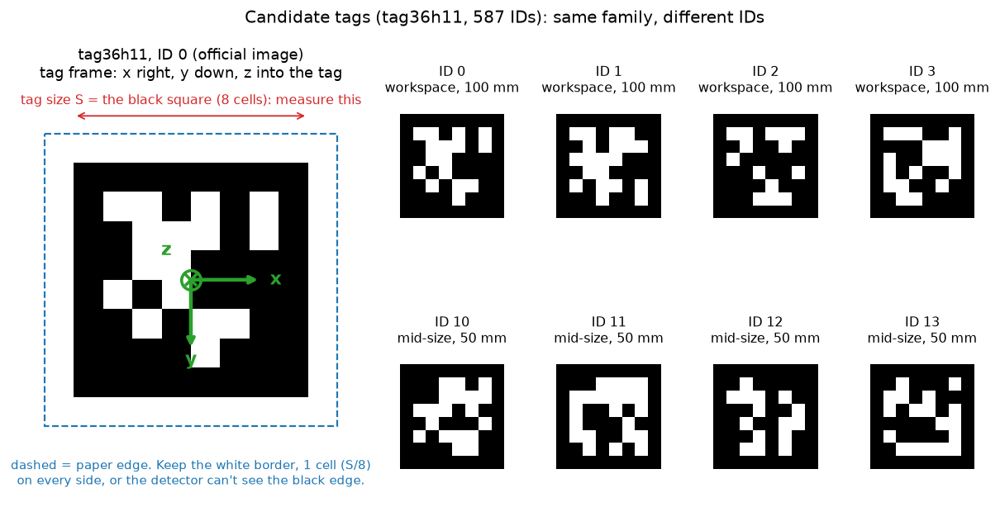
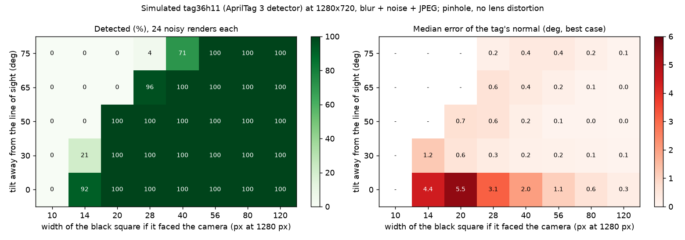
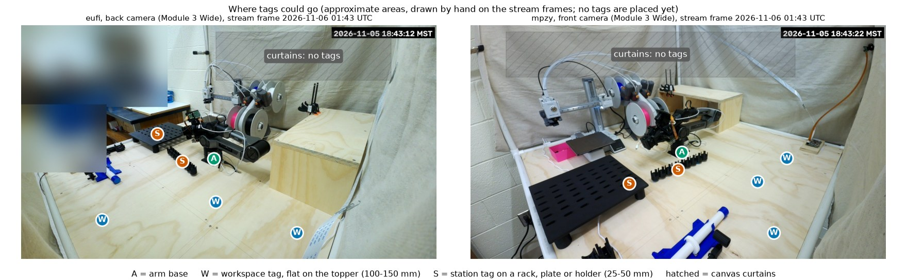

# AprilTags for the PiPER cell (issue #24, PR #40)

Asked for by @chris-policky on [PR #40](https://github.com/vertical-cloud-lab/robot-arms/pull/40): how
AprilTags are used, how to print them for the enclosure, which tags to use, and where to put them
given the cameras. Nothing here moved the arm or changed a Pi: `table_camera_frames.sh` listed the stream
units and copied the last frame each running stream had saved. No tags have been printed or placed yet.

| File | What it is |
|---|---|
| [`tag36h11_print_sheets.pdf`](tag36h11_print_sheets.pdf) | Seven US Letter pages, true scale, vector: IDs 4-5 at 150 mm (one per page), IDs 0-3 at 100 mm (two per page), IDs 10-18 at 50 mm, IDs 30-53 at 25 mm and IDs 60-107 at 10 mm (page 7, added 2026-11-12). PNG previews: `sheet_page1.png` to `sheet_page7.png`. |
| [`tag_candidates.png`](tag_candidates.png) | What the tags look like and what "tag size" means. |
| [`placement_zones.jpg`](placement_zones.jpg) | Where tags could go, on the current frames of the two side cameras. |
| [`detectability.png`](detectability.png), [`detectability.json`](detectability.json) | How small and how tilted a tag can be and still be read at 1280 x 720 (simulation). |
| [`sheet_check.json`](sheet_check.json) | The PDF rasterised at 300 dpi and read back by the detector: IDs and black-square sizes. |
| [`tags/`](tags/) | The official 10 x 10 px images the sheets are built from. |
| [`frames/`](frames/) | The two stream frames used for the placement figure (2026-11-06 01:43 UTC). A person in the eufi frame, already pixelated by the stream, is blurred further. |
| [`scripts/apriltag_tools.py`](../../../scripts/apriltag_tools.py) | Builds the sheets, detects tags in images, runs the simulation, draws the figures. |

## How tags are used

A tag is a square barcode of known physical size with an ID. The detector finds its four corners to
a fraction of a pixel. With the camera's intrinsics (focal length in pixels and principal point) and the
tag's side length, it computes the tag's full 6-DoF pose in the camera frame: where it is and which
way it faces. For tag36h11 the tag frame is x to the right as you read the tag, y down, z into the
tag (checked with `pupil-apriltags`: a tag facing the camera upright gives the identity rotation).
In this cell that gives four jobs:

1. **A shared world frame.** Tags fixed to the topper define one frame. Any camera that sees two or
   three of them (more, and more spread out, is better) gets its pose in that frame, so the two side
   cameras and the overhead one need no overlapping view of a calibration target.
2. **Camera pose in the robot's base frame (eye-to-hand).** A tag on the gripper, the arm moved
   through 10-20 poses, then `cv2.calibrateHandEye`. [The recipe below](#camera-to-robot-calibration-recipe-checked-on-synthetic-data)
   is checked on synthetic poses. This moves the arm, so it is a separate request that says the
   workspace is clear.
3. **Where things are, for the gripper cameras.** A tag on a rack, plate or holder gives its pose
   relative to the gripper camera, so the arm can approach it. Tags on the objects move with them.
4. **A drift check.** Re-detect the fixed tags now and then: if a camera was bumped, their pixel
   positions and estimated poses move.

**Orientation is the weak spot of a single flat tag.** Seen face-on, the pose of a planar tag is
ambiguous, so its estimated tilt is noisy. In the simulation below (a best case: ideal pinhole, known
intrinsics), a face-on tag 40 px wide has a median normal error of 2.0 deg (90th percentile 4.3 deg);
tilted 30 deg from the line of sight, 0.2 deg (0.3 deg). That is 6-11 times worse face-on at every
size from 28 to 80 px. So aim for **30-60 deg between the line of sight and the tag's normal**, make the
tags big, or read several tags rigidly attached to one another as one marker. The #24 literature review
reports the same effect: a planar tag seen face-on gave 1.50 mm RMSE against 0.17-0.20 mm for a
non-coplanar four-tag marker (Wakiuchi et al. 2026; see
[`camera-literature`](../camera-literature/README.md)).

## Which tags



- **Family `tag36h11`, IDs 0-586.** It is what every tool reads: AprilTag 3, OpenCV's
  `DICT_APRILTAG_36h11`, ROS `apriltag_ros`, and tagslam, whose [tag guide](https://berndpfrommer.github.io/tagslam_web/making_tags)
  prefers it. The AprilTag authors recommend the newer `tagStandard41h12` for most new uses
  ([user guide](https://github.com/AprilRobotics/apriltag/wiki/AprilTag-User-Guide)); it also works with
  `pupil-apriltags` if you ever need more IDs, but OpenCV's ArUco module doesn't read it.
- **Official images:** [`AprilRobotics/apriltag-imgs`](https://github.com/AprilRobotics/apriltag-imgs/tree/master/tag36h11)
  holds `tag36h11/tag36_11_00000.png` to `00586.png`, for example
  [ID 0](https://github.com/AprilRobotics/apriltag-imgs/blob/master/tag36h11/tag36_11_00000.png),
  [ID 1](https://github.com/AprilRobotics/apriltag-imgs/blob/master/tag36h11/tag36_11_00001.png),
  [ID 2](https://github.com/AprilRobotics/apriltag-imgs/blob/master/tag36h11/tag36_11_00002.png),
  [ID 3](https://github.com/AprilRobotics/apriltag-imgs/blob/master/tag36h11/tag36_11_00003.png).
  Each is 10 x 10 px: a 1-px white border around 8 x 8 cells of black border and data. Enlarge with
  nearest-neighbour scaling only, or use the repo's `tag_to_svg.py`. The PDF here is already built from
  these, as vector shapes.
- **Don't make them with `cv2.aruco.generateImageMarker`.** For the AprilTag dictionaries its image is the
  official one rotated 180 deg (checked for IDs 0, 1 and 7). Every detector still reads the ID, but the
  pose frame comes out turned 180 deg about the normal compared with every tag from the official images.
- **ID plan** (every ID is on the sheets; never use one ID twice, and write ID and size on the back):

| IDs | Use | Size |
|---|---|---|
| 0-3 | Workspace tags on the topper | 100 mm |
| 4-5 | Workspace tags far from a camera | 150 mm |
| 10-11 | Arm base | 50 mm |
| 12-15 | Gripper, for hand-eye calibration (four faces of one bracket, not one flat tag) | 50 mm |
| 16-18 | Spare | 50 mm |
| 30-53 | Stations: racks, plates, holders | 25 mm |
| 60-107 | Close range only: 3D printer corners (four per printer: 60-63, 64-67, ...) and other small parts | 10 mm |

## How big

`tag size` means the **black square** (8 cells), the edge between the black and white borders, **not**
the paper ([user guide](https://github.com/AprilRobotics/apriltag/wiki/AprilTag-User-Guide)). The white border
(1 cell, S/8) is extra and must stay.

Width in pixels of a face-on tag in the 1280 x 720 livestream frames, for a Camera Module 3 Wide
(nominal f = 546 px at 1280 px; the real value comes from calibration):

| Tag S | 0.2 m | 0.3 m | 0.5 m | 1.0 m | 1.2 m | 1.5 m | 2.0 m |
|---|---|---|---|---|---|---|---|
| 10 mm | 27 | 18 | 11 | 5 | 5 | 4 | 3 |
| 25 mm | 68 | 45 | 27 | 14 | 11 | 9 | 7 |
| 50 mm | 136 | 91 | 55 | 27 | 23 | 18 | 14 |
| 100 mm | 273 | 182 | 109 | 55 | 45 | 36 | 27 |
| 150 mm | 409 | 273 | 164 | 82 | 68 | 55 | 41 |

px = 546 x S / distance. A tag that is turned away from the camera is narrower than this by the cosine of
the tilt. From the simulation:



- **Detected (24 noisy renders each, tag36h11, AprilTag 3 detector):** 100 % from 20 px up to 50 deg
  tilt, from 28 px up to 65 deg (96 %), and from 56 px at 75 deg. Below that it falls off fast: 40 px at 75 deg
  is 71 %, 28 px is 4 %.
- **Design target: at least 40 px wide and at most 65 deg tilted**, so there is margin for lens
  distortion, focus and compression, none of which the simulation has. SynthEyes' tag guide asks for
  60-100 px across for clean tracking ([source](https://borisfx.com/documentation/syntheyes/SynthEyesUM_files/printing_and_mounting)).
- **The simulation is a best case.** It uses an ideal pinhole with known intrinsics, blur 0.8 px,
  noise 3/255 and JPEG quality 85. Real accuracy is dominated by calibration, print scale and flatness.

### 10 mm tags (page 7)

Asked for on 2026-11-12, to fit on the corners of a 3D printer. Page 7 has IDs 60-107 with a 10 mm
black square, 48 on one page. With its white border each tag is 12.5 mm square; trimmed to 10 mm overall
it would lose the border and stop being read. If a corner only has room for 10 mm in all, the black
square has to be 8 mm.

- **Gripper cameras only.** In a 1280 px frame of a Camera Module 3 Wide, a 10 mm tag is 55 px wide at
  0.1 m, 27 px at 0.2 m and 5 px at 1 m. The side cameras and the overhead camera, 1-2 m away, can't read it.
- **How close, from the simulation:** within 0.27 m (20 px) it is read face-on and up to 50 deg of tilt,
  within 0.19 m (28 px) up to 65 deg, and it meets the 40 px design target within 0.14 m. At 0.39 m
  (14 px) a face-on tag is read 92 % of the time and one tilted 30 deg only 21 %.
- **The pose gets worse quickly with distance.** The median position error is 0.1-0.2 % of the distance at
  40 px, 0.2-0.7 % at 28 px and 1.1-1.7 % at 20 px, and a face-on tag's tilt is off by 2-5.5 deg at
  40-20 px (all best case). To line up on a corner, get within about 0.15 m. When two or more of these
  tags are in view and their positions relative to each other are measured, solve for them together.
- **More pixels reach farther.** A full-resolution still (4608 px wide) makes every tag 3.6 times wider,
  so a 10 mm tag is 40 px at about 0.5 m. The streams run at 1280 px.
- **Cells are 1.25 mm,** which a laser printer handles. Measure the black square with calipers: 0.1 mm off
  is 1 % in every distance.

## Printing and mounting

| Option | When | Notes |
|---|---|---|
| **Laser print on matte white paper or label stock, stuck to a rigid flat board** | First tests, today | Use [`tag36h11_print_sheets.pdf`](tag36h11_print_sheets.pdf) at 100 % / Actual size. Board: foam core, 3 mm hardboard or acrylic with a matte face. Tagslam's guide warns that paper tags must be really flat ("this will greatly affect the pose estimation") and that "Readi" board warps; SynthEyes notes paper on foam core can bubble over time unless kept flat. |
| **3D-printed two-colour plate on the Bambu printers** | Tags that belong to a fixture, or must be repeatable | Not tested here. Model the black cells and the white ground as two bodies, with the tag face on the (textured) build plate for a matte face, and a few layers of white backing. A 100 mm tag has 12.5 mm cells and a 25 mm tag has 3.1 mm cells, which 0.4 mm nozzles handle; a 10 mm tag's 1.25 mm cells are only about three 0.4 mm lines wide, so print those on paper. The big benefit is that the tag's pose relative to the part is known from the CAD. Prep can be done in a normal run; sending a print needs `@claude-print`. |
| **Printed on aluminium composite or engraved metal by a sign shop** | Permanent tags | Tagslam's guide recommends DiBond for durable tags. Check the black square afterwards. |

Rules for every option:

1. **Print at 100 %, then measure the black square** with calipers or a ruler (the check bar on each
   page is 100 or 50 mm). Pass the measured size, in metres, as `tag_size`. A 0.5 mm error on a 100 mm tag
   is a 0.5 % error in every distance.
2. **Matte, not glossy,** paper and finish, and no shiny lamination: glare turns the black cells white.
   ([ReUseX](https://pfmephisto.github.io/ReUseX/md_docs_2guides_2apriltag-36h11-printing.html), tagslam)
3. **Keep the white border.** Cut at the dashed line or outside it, never into it. On the black plate, rack
   and printer, the border is what separates the tag from the background.
4. **Flat and rigid, no curve and no curl.** Not on the canvas curtains, and not directly on the round PVC
   pipes: fix a small flat board to them.
5. **Don't trust the nominal size:** print, measure, and keep the measured number with the ID.

## Where to put them



The enclosure is a plywood topper in a PVC frame with canvas curtains, and the table's contents move
(the plywood box on the right wasn't in the 2026-11-05 00:13 UTC frames). So **fixed tags go only on things that don't
move: the topper and the arm base. Tags on racks, plates and holders go on those objects**, so they move
with them.

| Zone | Where | Why | Tags |
|---|---|---|---|
| **W** workspace | Flat on the topper, one in each free area around the arm, as spread out as you can (a bigger quadrilateral gives a better frame) | The topper is the only large rigid flat surface; the overhead camera will see them near face-on, so use all of them together as one marker rather than one by one | IDs 0-3 at 100 mm. At 1.5 m or more from a side camera, use 150 mm (IDs 4-5) |
| **A** arm base | A flat face of the base or its mounting plate | Ties the arm's frame to the table's | IDs 10-11 |
| **S** stations | Top or front face of each rack, plate and holder the gripper uses, on a white label | The gripper cameras read them at 0.2-0.5 m: 27-136 px for 25-50 mm tags | IDs 30-53 |
| **G** gripper | Four faces of one small bracket on the gripper (not one flat tag) | Hand-eye calibration; a non-coplanar marker avoids the face-on ambiguity | IDs 12-15 |
| **P** small parts | Corners of a 3D printer, or another small part the gripper works at, flat, on a white label | Gripper cameras only, within about 0.25 m: a 10 mm tag is 27 px at 0.2 m | IDs 60-107 (10 mm) |
| curtains | Nowhere | They move and wrinkle | none |

What the cameras see, by eye on the 2026-11-06 frames:

- **Side cameras (eufi, mpzy)** look at the topper from low corners, so a flat tag in the middle or far
  half of the table is roughly 60-75 deg off its normal. At 100 mm and 1.5 m that is 36 px wide at that
  tilt: marginal. Either use 150 mm tags there, or stand the tag on a 45 deg wedge so both side cameras
  see it at about 45 deg (a tag whose normal points between the two cameras; the fixture design puts them
  about 90 deg apart as seen from J1, but the installed positions haven't been measured). Anything standing above the topper must stay outside the arm's reach: the corners
  are 862 mm from J1 and the fingertips reach about 750 mm at table height
  ([`camera-fixtures`](../camera-fixtures/README.md), which assumes J1 at the topper's centre).
  Flat labels are fine anywhere.
- **Overhead camera (not installed yet)** sees flat tags face-on, where one tag's tilt is least reliable
  but the corners of the four widely spaced W tags still fix the table's plane well. At 1.2 m a 100 mm tag is 45 px wide.
- **Gripper cameras (76zj)** were offline on 2026-11-06, so there are no frames for them. The advice
  above comes from the table, not from their images. Camera Module 3 Wide at 0.2-0.5 m sees 25-50 mm tags
  at 27-136 px. The HQ camera's lens isn't recorded here, so its sizes need a test.
- **Avoid** tags near the image corners (the wide lens bends them), where an arm link will hide them in
  common poses, and under a bright light that reflects off the print.

Positions only help the robot if they are known: **measure each W tag's centre and rotation relative to
J1 and the plywood's edges** (a ruler to 1 mm, or a printed jig), and record them with the ID. Without
that the tags still tie the cameras to each other, but not to the arm.

## After placing tags

```bash
pip install numpy "opencv-python-headless<5" pupil-apriltags     # reportlab and pymupdf only for `sheet`
bash scripts/table_camera_frames.sh /tmp/frames                  # copies each stream's last frame; opens no camera
python scripts/apriltag_tools.py detect /tmp/frames/*.jpg --size-mm 100 --annotate-dir /tmp/annotated
```

For each tag it prints the ID, its size in pixels, and with `--size-mm` the distance and tilt. The size
applies to every tag in the call, so run 150 mm and 100 mm tags separately. Both current frames
(`frames/`) contain no tags, which is the baseline. The stream frames are 1280 x 720 and up to 30 s old: fine for
checking visibility, not for calibrating.

**Calibrate each camera's intrinsics first** (a ChArUco or checkerboard sheet at the stream's resolution,
undistorting before the pose step). The Wide lens is strongly barrelled, and the repo's nominal
intrinsics (`camera_*.json`) are not a calibration. Lock the focus while calibrating
(`--autofocus-mode manual --lens-position`), because autofocus changes the intrinsics.

### Camera-to-robot calibration recipe (checked on synthetic data)

For a fixed camera and a tag on the gripper, give `cv2.calibrateHandEye` the **inverted** gripper poses
(base to gripper) together with the tag-in-camera poses; the "cam2gripper" it returns is then the
camera's pose in the robot's base frame. `python scripts/apriltag_tools.py handeye-selftest` checks it with
a known answer (OpenCV 4.14):

| | Camera pose error |
|---|---|
| exact tag poses, 20 poses | 0.000 deg, 0.00 mm |
| 0.5 deg and 2 mm of noise on every tag pose, 20 poses | 0.18 deg, 3.4 mm |
| the same noise, 8 poses | 0.36 deg, 3.3 mm |

The noise levels are assumed, not measured. The OpenCV 5.0.0 Python wheel (checked 2026-11-06) does not
expose `calibrateHandEye`, so pin `opencv-python-headless<5`. AgileX's PiPER hand-eye tool,
[`handeye_calibration_ros`](https://github.com/agilexrobotics/handeye_calibration_ros), is built on `aruco_ros`
with an "Original ArUco" board and doesn't read AprilTags.

## Checks made, and limits

- The seven sheet pages were rasterised at 300 dpi and read back with the AprilTag 3 detector: every ID
  matched, and the black squares measured 150.02, 100.01-100.02, 50.00-50.03, 25.00-25.02 and
  10.00-10.01 mm. Adding page 7 left pages 1-6 pixel-identical at 300 dpi.
- `pupil-apriltags` 1.0.4.post11 frees a detector in the wrong order: the tag family first, then the
  detector that still lists it. On 2026-11-12 that segfaulted the sheet check on Python 3.14 after detection
  had finished, before anything was written. `make_detector()` in the tool detaches the family first; use
  it, or the same fix, in other scripts.
- `detect` was checked on a synthetic 150 mm tag at 1.406 m and 40 deg: it returned 1.406 m and 40.0 deg.
- The placement figure is hand-drawn on two frames. The table's contents move, so read the markers as areas.
- The simulation is an ideal pinhole: no lens distortion, rolling shutter, glare or print error.
- Nothing was printed, placed or measured, and no calibration was done.
