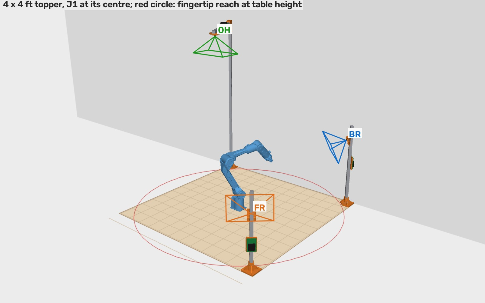
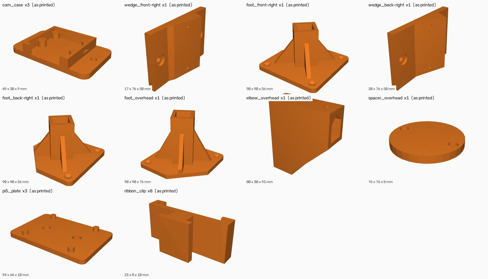
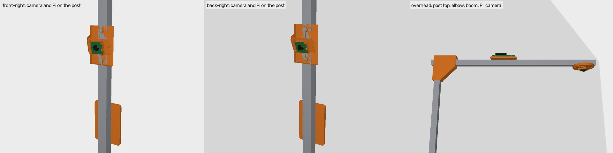

# Fixtures for the PiPER cell's three fixed cameras (issue #24)

This replaces the taped side camera and the 2026-10-14 placement
([`camera-placement`](https://github.com/vertical-cloud-lab/robot-arms/tree/claude/issue-24-20261014-1347/docs/issue-24/camera-placement))
with three cameras on posts at the corners of the 4 x 4 ft topper. Everything here comes from
[`scripts/piper_camera_fixtures.py`](../../../scripts/piper_camera_fixtures.py):

    python scripts/piper_camera_fixtures.py --out docs/issue-24/camera-fixtures --render --animate --score 300

It is all simulated: nothing has been printed or test-fitted, and the arm and the Pi were not
touched.

## Where the cameras go

The frame is the arm's base frame in mm. x points the way the arm faces at J1 = 0, toward the
topper's right-hand end as seen from the room. y points toward the wall and z up from the topper.
J1 is assumed to stand at the topper's centre.

| | **FR: front-right corner** | **BR: back-right corner** | **OH: overhead** |
|---|---|---|---|
| Post | 2020 extrusion, 500 mm, centre 45 mm in from both edges | 2020, 600 mm, the same inset | 2020, 1200 mm, at the back-left corner, plus a 620 mm boom |
| Lens | 350 mm above the topper | 500 mm up, to see over the shelf | 1.2 m up, above (-300, 100): 30 cm left of J1 and 10 cm toward the wall |
| Aim | at a point 6 cm behind J1 and 18 cm up, **11.9° down** | at the same point, **23.9° down** | straight down, with the image's long side along the wall |
| Set by | the foot turns the post 132° toward the arm, and the wedge sets the pitch | the same, with the post turned −138° | the foot turns the post so the elbow sends the boom out at −60° |
| Wedge centre height | 353 mm | 506 mm | (none) |
| Pi 5 | on the post's back face, about 18 cm up | on the back face, about 33 cm up | on top of the boom, about 24 cm from the post |

**Why the corners:** they are the only places on the topper that the fingertips can't reach. The
fingertips reach about 760 mm from J2, which is 750 mm at table height. The middle of each edge is
only 610 mm from J1, and the corners are 862 mm away. Every printed part, post and camera is
outside that reach (`outside_reach_by` in [`summary.json`](summary.json)): the feet by at least
10 mm, the posts and cameras by 35 mm or more, and the boom by 375 mm. A fully stretched arm still
comes within about 4 cm of the two right-hand cameras, though, so don't send it to full stretch
toward those corners.

**Why both side cameras go at the right-hand end:** the scores below come from 300 random arm
poses with the fingertips over the topper (J1 within ±120°, so most of the work is toward the
right-hand end). The two right-hand corners look at the arm from about 90° apart, and the overhead
camera adds the third direction. A front-left camera sees the fingertips in 64 % of the poses,
against 78 % for FR and 82 % for BR, so the front pair (FR + FL) scores lower.

| Cameras | Fingertips seen by 2+ | Seen by any | Median 3D error at 1 px | Within 2 mm |
|---|---|---|---|---|
| **OH + FR + BR (this layout)** | **88.7 %** | **98.0 %** | **1.00 mm** | **88.3 %** |
| OH centred over J1 + FR + BR | 88.7 % | 98.3 % | 0.96 mm | 88.3 % |
| OH + FR + BR at 350 mm | 90.7 % | 97.7 % | 1.02 mm | 90.0 % |
| OH + FR at 500 mm + BR | 89.3 % | 98.7 % | 0.99 mm | 89.3 % |
| OH + FR + front-left at 350 mm | 78.0 % | 97.3 % | 1.06 mm | 75.7 % |
| FR + BR, no overhead | 63.7 % | 97.0 % | 1.07 mm | 63.0 % |

The first four rows tie within the noise of 300 poses, so the heights and the overhead offset were
chosen for practical reasons:

- **BR at 500 mm:** it sees over the shelf.
- **FR at 350 mm:** it sees under the arm's elbow.
- **OH 30 cm off-centre:** that keeps the boom 535 mm long instead of 850 mm. With the image's long
  side along the wall, the camera still sees the whole topper.

## Cables: one Pi per camera

Each camera's Raspberry Pi 5 rides on that camera's own post, so a 200 or 300 mm cable is enough.
The 500 mm cables you have also work, with a loop clipped to the post.

One Pi can't drive both side cameras on 500 mm cables:

- **The posts are too far apart.** No two spots outside the reach are less than 1.13 m apart (the
  FR and BR posts, for example).
- **Hanging the Pi between them doesn't fix it.** With the Pi below the topper's surface at the
  middle of the right-hand edge, where the arm can't reach it, each cable needs about 565 mm along
  the edge plus the 350–500 mm climb up the post. That's about 1.0–1.1 m each.
- **Moving the cameras closer puts them in reach.** Any point that brings them within 1 m of each
  other is somewhere the arm can hit.

The overhead Pi could also be replaced with a USB camera, as the 2026-10-14 comment suggested.

## Parts

Every file in [`cad/`](cad/) is exported in its print orientation and needs no supports
(STL for slicing, STEP for editing).

| File | Qty | What it does | Prints |
|---|---|---|---|
| `cam_case` | 3 | Holds a Camera Module 3 on four M2 standoffs (the 21 × 12.5 mm hole pattern). The ribbon leaves through the bottom, and two M3 ears 40 mm apart are the interface every adapter uses. | back down |
| `wedge_front-right` / `wedge_back-right` | 1 + 1 | Fixed-pitch blocks (11.9° and 23.9°), 17 and 20 mm thick, so they're easy to tell apart. Two M5 screws go into T-nuts in the post's front slot, a key on the back keeps them from twisting, and two M3 screws hold the case. | on its side |
| `foot_front-right` / `foot_back-right` / `foot_overhead` | 1 each | A 90 × 90 mm plate. Its two outer edges sit flush with the topper's corner edges, and the corner facing the arm is cut off. A socket for the post is turned to that corner's yaw, and two M5 screws through the socket's back wall and one side wall go into T-nuts. Three countersunk wood screws hold it down. The overhead foot's socket is 70 mm deep instead of 50. | plate down |
| `elbow_overhead` | 1 | Caps the overhead post. The boom slides through its sleeve and locks with two M5 screws from the top. A 45° knee braces the sleeve, and peaked socket roofs avoid supports. | standing |
| `spacer_overhead` | 1 | Sits under the end of the boom (two M5 into its bottom slot) and holds the overhead case, turned so the image's long side runs along the wall. | flat |
| `pi5_plate` | 3 | Pi 5 carrier with M2.5 standoffs. Two M5 screws into the slot sit counterbored under the board. | flat |
| `ribbon_clip` | 8 | Slides into a T-slot from the open end and holds a ribbon flat against the post. | flat |

Print in PETG or PLA at 0.2 mm, with 4 walls and 40 % infill (100 % for the wedges, so the angle
can't creep). The files are in mm.

**Check the camera before printing all three cases.** The hole pattern (21 × 12.5 mm, Ø2.2 mm,
2 mm in from the edges) is the Camera Module 3 drawing as I know it. I haven't checked it against a
board. Print one `cam_case` and make sure a board drops onto its standoffs.

### Hardware

| Item | Qty |
|---|---|
| 2020 aluminium extrusion, 6 mm slot (B-type or V-slot), cut to 500, 600, 1200 mm (posts) and 620 mm (boom) | about 3 m |
| M5 drop-in (spring) T-nuts | 22, buy 30 |
| M5 × 10 button-head screws (wedges, Pi plates, spacer) | 12 |
| M5 × 12 button-head screws (foot and elbow socket walls) | 10 |
| M3 × 12 screws, self-tapping into the 2.6 mm holes (case ears) | 6 |
| M2 × 6 self-tapping screws (camera boards) | 12 |
| M2.5 × 6 self-tapping screws (Pi boards) | 12 |
| #8 × 3/4" (4 × 20 mm) flat-head wood screws (feet) | 9 |
| Camera Module 3 Wide, Pi 5 camera cable (22-pin to 15-pin) 200–300 mm, Raspberry Pi 5 + supply | 3 each |

## Installing

Install with the arm powered off and parked, and keep the POWERTEC pressed while anyone is within
reach.

1. **Mark J1's centre and the corners.** Check the assumption the whole layout rests on: J1 is at the
   topper's centre. If it isn't, measure J1 from the right-hand and front edges, set `J1_XY_MM` in
   the script and regenerate. The feet stay at the corners, but the wedges and aims change.
2. **Feet.** Put each foot in its corner with its two straight outer edges flush with the topper's
   edges and the cut corner toward the arm. Front-right, back-right and back-left (overhead) are
   not interchangeable, so label them as they come off the printer. Pre-drill 3 mm pilots and
   drive the three wood screws.
3. **Posts.** Drop two T-nuts into the two slots facing the foot's screw holes, about 27 mm from the
   post's end (38 mm for the overhead post). Push the post into the socket and tighten the two M5
   × 12 screws. A 2020 post fits any of four ways; the faces are identical.
4. **Side cameras.**
   - Fit the ribbon to the camera board first, then screw the board into a `cam_case` with four M2
     screws, ribbon out of the bottom gap.
   - Drop two T-nuts into the post slot that faces the arm (the face the foot's socket points at
     J1). Screw the right wedge on with its thick end up, so its centre is 353 mm (FR) or 506 mm
     (BR) above the topper.
   - Screw the case onto the wedge with two M3 × 12, ribbon down.
5. **Pi plates** go on the back face, the one away from the arm. Run the ribbon round the side of
   the post under two `ribbon_clip`s.
6. **Overhead.**
   - Slide the T-nuts in first: two in the post's slots about 20 mm from its top, for the elbow.
   - Put the elbow on the post with the sleeve pointing toward the table.
   - Load the boom:
     - one T-nut in its top slot, under each elbow screw
     - two in the bottom slot near the far end, for the spacer
     - two in the top slot mid-way, for the Pi
   - Slide the boom through the sleeve until the spacer's centre is 535 mm from the post's axis.
     A plumb line from the lens should land 300 mm left of J1 and 100 mm toward the wall.
   - Tighten the elbow screws, screw the spacer on, then the case under it with the ribbon toward
     the post, then the Pi on top of the boom.
7. **Check the views.** On each Pi, `rpicam-still -o view.jpg` should frame the arm the way
   [`views.jpg`](views.jpg) does. If the overhead image comes out upside down, add `--rotation 180`.
8. **Calibrate.** [`camera_front-right.json`](camera_front-right.json),
   [`camera_back-right.json`](camera_back-right.json) and
   [`camera_overhead.json`](camera_overhead.json) are the nominal poses from the CAD, and
   `piper_twin.py` can load them. They are close, but they are not a calibration. The real poses
   need the checkerboard-on-the-gripper step from the 2026-10-14 comment: move a ChArUco board
   through a dozen poses and fit all three cameras in the arm's frame.

*What each mount looks like from the arm's side (simulated).*

## Figures

- [`overview.jpg`](overview.jpg), [`plan.jpg`](plan.jpg): the cell and the cameras' fields of
  view. The red circle is the fingertips' reach at table height.
- [`views.jpg`](views.jpg): what each camera sees at four arm poses, with the other cameras' posts
  in view.
- [`views.mp4`](views.mp4) ([GIF](views.gif)): the three views and the overview as the twin tours
  the topper.
- [`assembly.mp4`](assembly.mp4) ([GIF](assembly.gif)): the front-right head going together.
- [`summary.json`](summary.json): every position, angle and clearance, plus the scores.

## Caveats

- **J1 at the topper's centre is assumed.** #9's model puts it 606 mm from the wall, which matches
  a 1219 mm topper against the wall. The left-right position is a guess.
- **The shelf isn't modelled,** so nothing checks whether it blocks a view. BR is set high to look
  over it.
- **The 2020 extrusion is assumed to have the common 6 mm slot,** and the sockets are 20.5 mm for
  print clearance. Print one foot first if your printer runs tight.
- **The scores are optimistic.** They use the Camera Module 3 Wide's nominal lens (102 × 67°, no
  distortion) and 1 px of image noise. The tracker in the #24 synthetic test managed 2–4 px, so
  compare the rows; don't read them as accuracy.
- **The renders are painter's-algorithm drawings of the twin,** so expect the odd misdrawn
  triangle where parts overlap.
