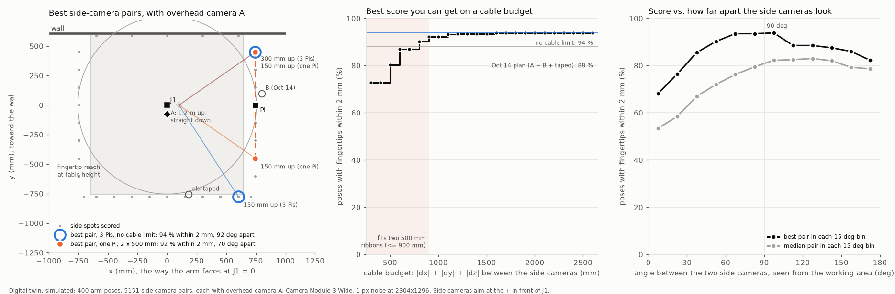

# Do the three fixed-camera positions hold up? (issue #24, 2026-10-21)

The question: do the literature and other people's setups support the overhead camera (A) and
two side cameras proposed in #24, and can the two side cameras share one Raspberry Pi 5 over two
500 mm ribbon cables (so at most ~1 m apart), or should each camera get its own Pi?

Sources: four Edison Scientific queries ([`edison/`](edison/)), a GitHub search of other arm
setups, a manuscript search, and a re-score with the digital twin
([`scripts/piper_camera_cable_check.py`](../../../scripts/piper_camera_cable_check.py)). The
manuscript search ran from the Actions runner: the arm Pi has been offline on the tailnet since
2026-10-21 13:50 UTC, so it could not be used as a proxy.

## Verdicts

| Recommendation | Verdict | Main evidence |
|---|---|---|
| An overhead camera looking straight down | Supported | Chen & Davis's camera-placement optimiser, given three ceiling cameras, put two about 90 deg apart and "placed [the third] on the ceiling looking straight down". ALOHA has a top camera, and ACT's simulated cell uses a straight-down camera plus two side pillars. In the twin, tilting A 20-30 deg toward the room (as ALOHA 2 does) gains nothing; raising it to 1.5 m gains ~3 points. |
| Side cameras looking from directions ~90 deg apart | Supported, and the optimum is broad | Chen & Davis: for resolution, "the best configuration occurs when the two cameras are oriented perpendicular to each other". robosuite's two views are 92.5 deg apart, and ACT's side pillars ~103 deg. In the twin the best pairs are 60-105 deg apart: the error goes roughly as 1/sin(angle), so 70 deg costs ~6 %. |
| Side cameras raised, not at table height (the old taped camera was 3 cm up) | Supported: the taped spot was poor | Near-parallel, low views give poor depth. Adding oblique images to near-parallel ones "can reduce DEM error by up to two orders of magnitude", mostly by fixing the lens-distortion estimate (James & Robson 2014). Obliques at 20-35 deg improved accuracy by nearly 50 % over nadir-only blocks (Nesbit & Hugenholtz 2019). |
| Both side cameras on one Pi, at most 900 mm apart along the cables | Fine | Twin: the best pair that fits scores 92 % of poses within 2 mm, against 94 % with no cable limit. That gap is within the ±2-3 point noise of 400 poses. On one Pi, Raspberry Pi's software sync aligns frame starts to "several tens of microseconds". |
| Three fixed cameras are enough | Partly: three is the minimum, with no spare | A point is triangulated only when two cameras see it (Rahimian & Kearney 2017). Chen & Davis: "Many more cameras are needed to robust insure against occlusion." ALOHA, DROID, BridgeData V2 and FurnitureBench all add a wrist camera, and #10's gripper mount already carries two. |
| Rigid mounts that never move | Supported | For learned policies, new camera positions were the hardest change to generalise to: success fell from 91.7 % to 45.8 % (Xie et al. 2024). |

## Where to put them

Arm base frame, mm: x is the way the arm points at J1 = 0 (toward the table's right-hand end), y
is toward the wall, and z is up from the arm's plate.

| Camera | Position | Aim | Notes |
|---|---|---|---|
| A: overhead | (0, -75, 1200) | Straight down | Unchanged from 2026-10-14. 1.5 m is slightly better if a mount allows it. |
| S1: right-hand end, room side | (745, -450, 300) | (100, 0, 150), 10 cm in front of J1 | 0.89 m from J2, outside the reach |
| S2: right-hand end, wall side | (745, +450, 300) | (100, 0, 150) | 0.89 m from J2, 16 cm in front of the wall |
| Pi for S1 and S2 | (745, 0, ~300) | – | On J1's line, where B was. Each ribbon runs ~450 mm along the end. |

- **Heights:** anything from 150 to 450 mm up scores the same within noise (90.8-92.2 %). I'd use about 300 mm, which also sees over objects on the table.
- **Spacing:** keep the side cameras about 900 mm apart, which puts their views about 70 deg apart at the arm. At 600 mm apart the score drops to 87 %, and at 300 mm (both cameras on one post) to 73 %.
- **The spots overhang the table:** they are about 10 cm past the right-hand end of #9's 1290 mm table model, and about 13.5 cm past the end of the 4 x 4 ft topper. They need a ~900 mm bar across the end, held by arms clamped to the table, with the Pi in the middle of the bar. A single rigid bar also keeps the two cameras' relative pose fixed.
- **If everything has to stay on the topper:** the run that designed the fixtures
  ([`claude/issue-24-20261021-2052`](https://github.com/vertical-cloud-lab/robot-arms/tree/af6e7a6/docs/issue-24/camera-fixtures))
  found that only the topper's corners are outside the reach. It put the side cameras on posts in
  the two right-hand corners, with the overhead camera on a boom. Those lenses are 1.09 m apart,
  too far for two 500 mm ribbons, so that layout needs a Pi per camera. On the same 400 poses it
  scores 90.2 % within 2 mm, the same as the bar within noise.

*Simulated with the digital twin: 400 arm poses and 5,151 side-camera pairs, each scored together
with A. Left: the best pair with no cable limit (blue rings) and the best pair that fits two
500 mm ribbons (orange), plus the ribbon route. Middle: the best score available within a given
cable budget. Right: score against the angle the two side cameras make at the arm.*

| Layout (all with A overhead) | Side cameras apart (along edges / straight) | Angle at the arm | Within 2 mm | Within 1 mm | Median error |
|---|---|---|---|---|---|
| 2026-10-14 plan: B + taped camera | 1.86 m / 1.12 m | – | 88.2 % | 43.0 % | 1.02 mm |
| Best, no cable limit: room edge near the corner (150 mm up) + right-hand end, wall side (300 mm up) | 1.52 m / 1.24 m | 92 deg | 93.8 % | 25.8 % | 1.12 mm |
| **Best on one Pi:** S1 + S2 at 150 mm | 0.90 m / 0.90 m | 70 deg | **92.2 %** | 36.8 % | 1.05 mm |
| S1 + S2 at 300 mm (recommended) | 0.90 m / 0.90 m | 68 deg | 91.8 % | 43.0 % | 1.02 mm |
| Fixture run's corner posts (front-right 350 mm up, back-right 500 mm up, its overhead) | 1.23 m / 1.09 m | 93 deg | 90.2 % | 44.2 % | 1.02 mm |
| One Pi, cameras 600 mm apart | 0.60 m | 49 deg | 87.0 % | | |
| One Pi, cameras 450 mm apart | 0.45 m | 35 deg | 80.2 % | | |

`cable_check.json` has the top 25 pairs with and without the cable limit, the cable-budget curve
and the angle bins. `overhead_check.json` has the overhead variants.

## One Pi or three

- **The side pair on one Pi costs no measurable accuracy**, as long as the Pi sits between the two
  cameras and they go on either side of J1's line, not both in one corner.
- **The overhead camera can't share that Pi over a ribbon**, because 1.2 m up is out of reach of a
  500 mm cable. So "one Pi for the sides" means two Pis in total. Alternatively, A can be a USB
  camera on the same Pi, which puts every camera on one clock. A USB camera can't join
  rpicam's frame sync, but its timestamps come from the same clock.
- **Sync only matters while the arm moves.** For the drift check the arm holds still, so even a
  0.2 s trigger spread "can be neglected for static objects" (Kersten et al. 2024, with 24
  Camera Module 3s on Pi Zeros).
  - **On one Pi:** rpicam's software sync aligns frame starts to tens of microseconds.
  - **Across Pis:** the same sync works over a shared LAN via UDP multicast, but "any discrepancy
    between system clocks will feed directly into extra error". NTP is the default.
    mocap-toolkit reports 5-25 µs across Pi 5s using PTP on an unmanaged gigabit switch.
- **Three Pis are also fine**, and they free up the placement: the 92 deg corner layout fits only
  with longer cables or separate Pis. They cost two more boards and power supplies, plus a wired
  switch if moving-arm sync matters.
- **Ribbon caveats:**
  - A Raspberry Pi engineer lists ribbon length among the "known sources of intermittent problems".
  - One user runs a Camera Module 3 on a Pi 5 over 50 cm without trouble.
  - Route the ribbons along the table's end, away from the arm's 24 V and CAN cables, with strain
    relief at both connectors.
- **Either way:**
  - Lock the focus. Camera Module 3 autofocus moves the lens, which changes its calibration
    (Kersten et al.).
  - Set exposure and white balance by hand. Two cameras in separate processes can't share
    auto-exposure ("there is no way to synchronise 3A operation between them").

## What the twin can't tell

- The twin uses nominal Camera Module 3 Wide intrinsics with no distortion, and 1 px of noise; a
  real tracker managed 2-4 px in #24's synthetic test. Read the scores as relative.
- The table and wall come from #9's spot D model. The 4 x 4 ft topper and the shelf are not
  modelled.
- Every side spot aims at one point, 10 cm in front of J1 and 15 cm up.
- The cable model routes each ribbon along the edges, |dx| + |dy| + |dz|, with 50 mm of slack at
  each end. Straight-line spans can be a little longer.

## Edison Scientific

All four tasks succeeded. Each answer is in `edison/<query>.md`, next to its full trajectory
(`*_trajectory.json`) and small artifacts. The PaperQA document indexes attached to each
trajectory (47-197 MB pickles) are not committed; `*_files.json` keeps their IDs.

- **[Triangulation geometry](edison/q1_triangulation_geometry.md)** (high effort): **supports the layout.**
  - **Angle:** about 90 deg between rays is ideal, and 60-120 deg is the practical band. Height error is smallest near 90 deg and overall position error near 60 deg (Di et al. 2016). Rover studies put the optimum at 99-108 deg (Li et al. 2014).
  - **Network shape:** a mixed normal-plus-convergent network is strong, and convergent views make precision even in all directions (Fraser).
  - **Obliques:** oblique views 20-35 deg from nadir improve a nadir block by ~50 %.
  - **More cameras:** past two, error falls roughly as 1/sqrt(number of cameras).
  - **Limit:** very wide angles stop helping once foreshortening degrades target detection.
  - Summary tables: [rules](edison/q1_triangulation_geometry_artifact3_Quantitative_Camera_Placement_Rules.txt), [Fraser networks](edison/q1_triangulation_geometry_artifact2_Fraser_Imaging_Geometry_Comparison.txt).
- **[Robot-learning viewpoints](edison/q2_robot_learning_viewpoints.md)**: **supports the layout, with nuance.**
  - Overhead plus two oblique cameras is "a defensible design for workspace monitoring and independent fingertip triangulation".
  - It is "not an arrangement that the policy-learning literature has established as uniquely optimal". Most systems pair a global view with a front or low view, plus wrist cameras.
  - More views are not automatically better for a policy: in AV-ALOHA, adding views sometimes lowered success.
  - It flags that at 1.2 m the overhead camera covers the 1.36 m table depth with only ~0.12 m to spare at each edge (1.03 m is the minimum), so 1.5 m gives margin.
  - Aim the side cameras at the middle of the fingertips' working volume, not at the base.
- **[Camera-based arm calibration](edison/q3_vision_calibration_accuracy.md)**: **supports two widely separated views.**
  - Two calibrated, well-separated views beat one, and a third mainly buys coverage against occlusion.
  - **Raspberry Pi cameras:** LARK (Sideris et al. 2026), with five Raspberry Pi global-shutter cameras ~1 m away, reached ~1.0 mm with 2-3 cameras and 0.75 mm with 5 on a grid target. On a harder head phantom it reached 1.7 mm with 2 cameras and 1.3 mm with 5.
  - **Marker choice:** a planar tag seen face-on is ill-conditioned: 1.50 mm RMSE, against 0.17-0.20 mm for a non-coplanar four-tag fiducial (Wakiuchi et al. 2026). A 3D marker or spheres on the gripper is better than one flat tag.
  - [Summary table](edison/q3_vision_calibration_accuracy_artifact2_Quantitative_Camera-Tracking_Evidence.txt).
- **[Raspberry Pi multi-camera precedent](edison/q4_pi_multicamera_sync.md)**: **no direct precedent for the ribbons; supports wired Ethernet for separate Pis.**
  - It found no published build with several cameras on one Pi over 0.5 m or longer ribbons, and no measured ribbon-length limit.
  - Networked Pi arrays are well documented. A 14-Pi cluster (Ren 2024) held NTP clock offsets of -0.16 to +0.77 ms over wired Ethernet, but -17 to -2 ms with up to 15 ms jitter over Wi-Fi.
  - So if you use three Pis, wire them.

## Sources

GitHub (checked at the linked commits):

- **ACT simulation** ([scene.xml](https://github.com/tonyzhaozh/act/blob/742c753/assets/scene.xml#L28-L30)): `top` looks straight down from 0.8 m, and `left_pillar` / `right_pillar` are ~103 deg apart at 43 deg elevation.
- **ALOHA:** [constants.py](https://github.com/tonyzhaozh/aloha/blob/06369f0/aloha_scripts/constants.py#L9). ALOHA 2: [specifications](https://github.com/TrossenRobotics/aloha_docs/blob/07cf5f4/docs/specifications.rst#L87-L91) and the [MuJoCo scene](https://github.com/google-deepmind/mujoco_menagerie/blob/cda5236/aloha/scene.xml#L54-L57), whose overhead camera is tilted 25 deg toward the operator.
- **DROID:** "Cameras are mounted to the sides of the desk" ([assembly.md](https://github.com/droid-dataset/droid/blob/33ae6a6/docs/hardware-setup/assembly.md#L110)). It has no overhead camera.
- **FurnitureBench:** front, rear and wrist cameras ([install docs](https://github.com/clvrai/furniture-bench/blob/4b22852/docs_source/getting_started/installing_furniture_bench.rst#L213-L264)).
- **robosuite:** `agentview` and `sideview` are 92.5 deg apart ([table_arena.xml](https://github.com/ARISE-Initiative/robosuite/blob/5ce6643/robosuite/models/assets/arenas/table_arena.xml#L43-L49)).
- **BridgeData V2:** a fixed over-the-shoulder camera, two randomised cameras and a wrist camera ([site](https://github.com/rail-berkeley/bridgedata/blob/6d77a3b/index.html#L382-L384)).
- **LeRobot:** "you should be able to do the task yourself by only looking at the camera images" ([il_robots.mdx](https://github.com/huggingface/lerobot/blob/8a12558/docs/source/il_robots.mdx#L407)).
- **Raspberry Pi multi-camera and sync:**
  - [rpicam_apps_multicam.adoc](https://github.com/raspberrypi/documentation/blob/ddea98e/documentation/asciidoc/computers/camera/rpicam_apps_multicam.adoc).
  - Camera Module 3 supports it: [imx708.json](https://github.com/raspberrypi/libcamera/blob/c682979/src/ipa/rpi/pisp/data/imx708.json#L1369).
  - UDP multicast: [sync.cpp](https://github.com/raspberrypi/libcamera/blob/c682979/src/ipa/rpi/controller/rpi/sync.cpp#L49-L53).
- **Ribbon length:** [picamera2#905](https://github.com/raspberrypi/picamera2/issues/905#issuecomment-2213638707) and [picamera2#952](https://github.com/raspberrypi/picamera2/issues/952#issuecomment-2083175033).
- **PTP across Pi 5s:** [mocap-toolkit](https://github.com/AlecFessler/mocap-toolkit/blob/f832509/README.md#L11-L13).
- **Calibration without overlapping views:**
  - DROID calibrates each camera with a ChArUco board in the gripper ([text.py](https://github.com/droid-dataset/droid/blob/33ae6a6/droid/user_interface/text.py#L65-L67)).
  - AgileX's PiPER hand-eye tool ([readme](https://github.com/agilexrobotics/handeye_calibration_ros/blob/3f8e296/readme.md#L9-L11)).

Manuscripts ("abstract only" means the full text wasn't read):

- X. Chen and J. Davis, "Camera placement considering occlusion for robust motion capture",
  Stanford CS-TR-2000-07 ([PDF](http://graphics.stanford.edu/papers/OcclusionMetric/occlusion_metric.pdf));
  journal version Machine Vision and Applications 19 (2008), doi:10.1007/s00138-007-0094-y.
- P. Rahimian and J. K. Kearney, "Optimal camera placement for motion capture systems", IEEE TVCG
  23(3), 2017, doi:10.1109/TVCG.2016.2637334 (abstract only).
- M. R. James and S. Robson, ESPL 39(10), 2014, doi:10.1002/esp.3609 (oblique images vs. doming).
- P. R. Nesbit and C. H. Hugenholtz, Remote Sensing 11:239, 2019, doi:10.3390/rs11030239 (abstract
  only).
- T. Zhao et al., ALOHA, arXiv:2304.13705; A. Khazatsky et al., DROID, arXiv:2403.12945;
  H. Walke et al., BridgeData V2, arXiv:2308.12952; M. Heo et al., FurnitureBench, arXiv:2305.12821.
- K. Hsu et al., "Vision-based manipulators need to also see from their hands", ICLR 2022,
  arXiv:2203.12677 (abstract only).
- A. Xie et al., "Decomposing the generalization gap in imitation learning for visual robotic
  manipulation", arXiv:2307.03659.
- M. Murooka et al., arXiv:2509.17057 (preprint): in simulation "the highest success rate is
  obtained when using two cameras, Front and Side".
- T. P. Kersten, F. Timm and K. Zobel, ISPRS Archives XLVIII-2/W8, 2024,
  doi:10.5194/isprs-archives-XLVIII-2-W8-2024-219-2024 (24 Camera Module 3s).
- S. Ansari et al., "Wireless software synchronization of multiple distributed cameras", ICCP 2019,
  arXiv:1812.09366 (abstract only): under 250 µs over Wi-Fi.
- F. Švaco et al., Procedia Engineering 2014, doi:10.1016/j.proeng.2014.03.012 (abstract only):
  stereo calibration of a KUKA arm cut its maximum error from 3.63 to 1.29 mm.
