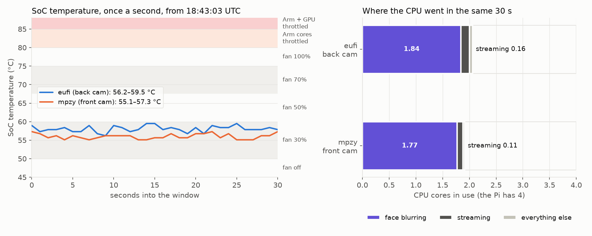

# Table Pi temperatures while streaming (2026-11-05)

Asked in [PR #40](https://github.com/vertical-cloud-lab/robot-arms/pull/40): how hot the table Pis
run, whether that is safe long term, and whether face blurring is what heats them.



| | eufi (back cam) | mpzy (front cam) |
| --- | --- | --- |
| SoC, 18:43:03–18:43:33 UTC, once a second | 56.2–59.5 °C, mean 58.0 | 55.1–57.3 °C, mean 56.0 |
| PMIC | 59.5 °C | 58.6 °C |
| ARM clock | 2400 MHz (the maximum) throughout | 2400 MHz throughout |
| `get_throttled` | `0x0`: no throttling, frequency cap or under-voltage since boot (2026-10-30 02:12 UTC) | `0x0` since boot (2026-11-03 01:04 UTC) |
| Fan (Active Cooler) | 30 % PWM, about 3280 rpm | 30–50 % PWM, 3250–5350 rpm |
| Face blurring (`device.py`) | 1.84 cores | 1.77 cores |
| Streaming: capture (`rpicam-vid`) + encode and send (`ffmpeg`) | 0.02 + 0.14 = 0.16 cores | 0.01 + 0.10 = 0.11 cores |
| Everything else | 0.06 cores | 0.03 cores |
| Stream unit's average since it started (19.5 h) | 1.87 cores | 1.87 cores |

**76zj (gripper cams) is not in it.** It dropped off Tailscale at 18:41:18 UTC, two minutes before
this sample, and was still off at 18:55. [#61's notes](https://github.com/vertical-cloud-lab/robot-arms/blob/d5ba8f7/livestream/README.md#gripper-cameras-two-streams-on-76zj)
measured it at 60 °C, unthrottled, with the fan at about 5000 rpm, while its two blurred streams
filled all four cores.

**Limits from Raspberry Pi's [documentation](https://www.raspberrypi.com/documentation/computers/raspberry-pi.html#frequency-management-and-thermal-control):**
the Arm cores are throttled progressively from 80 °C, and the Arm cores and GPU at 85 °C. The Pi 5
fan turns on at 50 °C (30 %) and steps up at 60 °C (50 %), 67.5 °C (70 %) and 75 °C (100 %), with
5 °C of hysteresis; the kernel's trip points on both Pis match. The kernel shuts down at 110 °C.

**Files.** `eufi.json` and `mpzy.json` are what
[`pi_thermal_sample.py`](../../../scripts/pi_thermal_sample.py) printed on each Pi: the 31 samples,
CPU time per process and per thread of the stream units, systemd's CPU total per unit, the streams'
2-minute `fps out` log lines for the 16 hours before, and kernel messages about voltage or
temperature since boot (none on eufi; on mpzy only the thermal governor registering at boot).
[`pi_thermal_plot.py`](../../../scripts/pi_thermal_plot.py) made `summary.json` and the figure.
To repeat it, read-only and with no restart:

```bash
ssh "$ARM_PI_USERNAME@$ARM_PI_HOSTNAME" 'python3 - --seconds 30' < scripts/pi_thermal_sample.py > eufi.json
ssh "$CAM2_PI_USERNAME@$CAM2_PI_HOSTNAME" 'python3 - --seconds 30' < scripts/pi_thermal_sample.py > mpzy.json
ssh "$CAM_PI_USERNAME@$CAM_PI_HOSTNAME" 'python3 - --seconds 30' < scripts/pi_thermal_sample.py > 76zj.json
python scripts/pi_thermal_plot.py .
```

Run the three at once so they share a window. The sampler needs no sudo, never opens a camera and
prints no hostname or command line.
