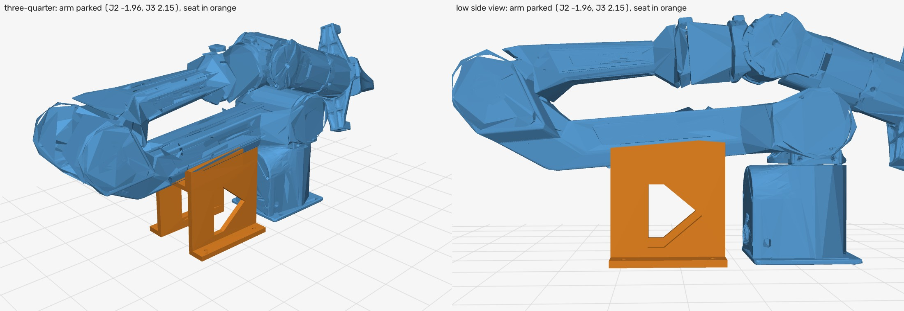
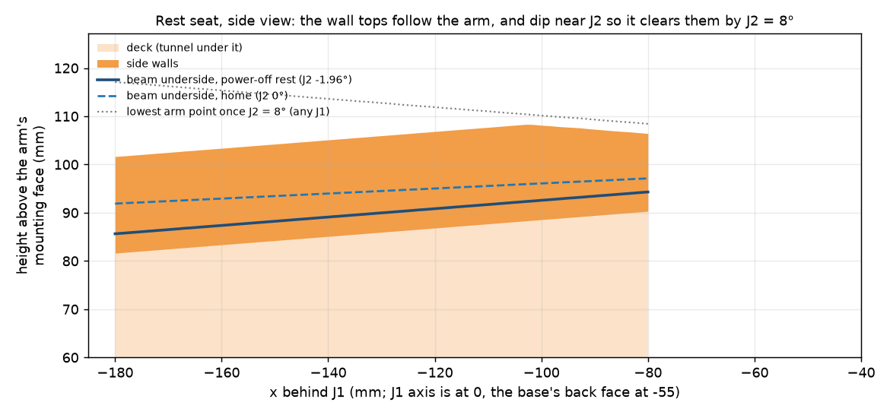
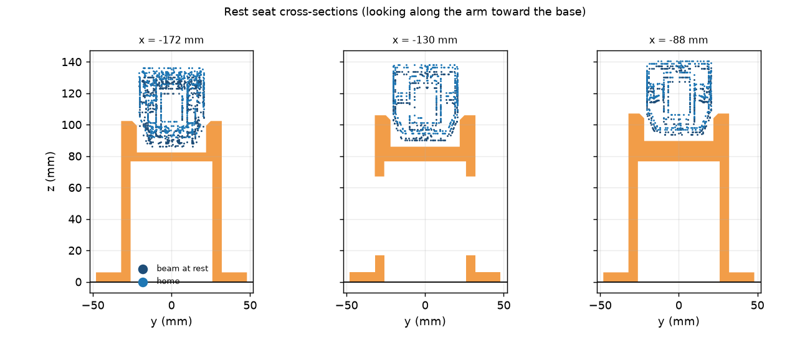
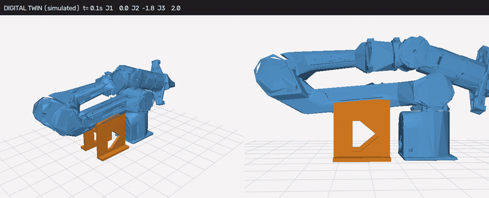

# PiPER rest seat (#24)

A printed seat that sits on the table behind the PiPER's base, under the upper arm (the J2–J3
link). When the arm parks at home, the upper arm drops between two short side walls. J1 then
can't be turned while the motors are off, so the arm powers up on its J1 zero mark, which
AgileX's manual says must be lined up before every power-on.

*Simulated with the digital twin (AgileX's URDF meshes); nothing has been printed yet.*

## What it does
- **Locates J1.** The walls' inner faces are 1.5 mm from each side of the 41 mm wide upper arm.
  That holds J1 within ±0.48° while the arm is parked.
- **Walls only as deep as needed.** The walls rise 16 mm past the arm's underside at the far end
  and 12 mm near the base.
- **Wall tops are not level.** They run parallel to the arm's underside, which slopes 5° down
  away from J2 when the arm is parked. Near the base they dip further, because a J2 lift raises
  the arm least there. As a result, every part of the arm clears the walls once J2 reaches 7°
  (designed for 8°, with 2 mm to spare).
- **Never lifts the arm.** The floor between the walls is 4 mm below the arm at rest and 6.8 mm
  below it at home. The parked arm still rests on its own J2 stop (about −2°), so the seat can't
  push on the arm while it's powered at home.
  - To have the arm rest on the seat instead, stick 3 mm felt pads on the floor.
- **Room for the cables.** Under the cradle is a tunnel 52 mm wide and 77 mm tall, open at both
  ends.
  - The base connector and **cable A** run through it and out of the far end.
  - **Cable B** leaves through the window on whichever side it goes. Both walls have one.

## Before printing: one measurement
- **What to measure:** with the arm at home (J2 = 0), measure from the table up to the underside
  of the upper arm, 95 mm behind the base's back face (150 mm behind the J1 axis).
- **What the model expects:** 93.5 mm, which assumes the arm's base sits straight on the table.
- **If yours is higher,** for example because the arm stands on a plate, regenerate with the
  difference:

      python scripts/piper_rest_seat.py --base-z-mm <difference> --out docs/issue-24/rest-seat

- **The default is the safe way round.** If the arm turns out to be higher than modelled, the
  seat only sits low and holds less. It never ends up pushing on the arm.

## Printing
- **Orientation:** `piper_rest_seat.stl` / `.3mf` are already oriented to stand on the seat's
  far end. The print is 100 mm tall on a 108 × 96 mm footprint, so it fits the A1 mini as well
  as the H2D.
- **No supports:** in that orientation no face overhangs more than 45°. The windows and screw
  holes are pointed toward the top for that reason.
- **Settings:** PETG or PLA, 0.2 mm layers, 3–4 walls, 15–20 % infill. The model is 188 cm³
  solid (about 230 g of PLA). Its plates are only 5–10 mm thick, so most of it prints as
  perimeter anyway; check the slicer's estimate.
- **Other file:** `piper_rest_seat_arm_frame.stl` is the same part placed in the arm's base frame
  (x forward, z up, mm, origin under J1), for checking fit in CAD.

## Installing
1. Power the arm, send it home (J1 = 0, J2 = 0) with the motors on, and check that J1's zero
   mark is lined up.
2. Slide the seat under the upper arm from behind:
   - Thread cable A through the tunnel and out of the far end.
   - Route cable B out of the window on its side.
3. Centre the seat so that:
   - the gap to each wall is the same (about 1.5 mm; a 1.5 mm hex key should just slide in),
   - and the arm doesn't touch the floor.
4. Mark the four holes, drill pilot holes, and screw the seat down with #8 (M4) pan-head wood
   screws.
5. Park the arm (motors off). Check two things:
   - it drops about 2° and stops with a few mm under it,
   - and J1 can't be turned by hand.

## Using it
- **Leaving the seat:** lift J2 to at least 8° before moving J1. The #24 protocol's READY pose
  (J2 15°, J3 −15°) already does that.
- **Big J1 swings:** unfold the arm before swinging J1 past −130°. At J2 = 8° with the arm still
  folded, the gripper swings over the seat at J1 ≤ −135°. Unfolded to READY, the whole J1 range
  (±150°) clears the seat by at least 11.8 mm.
- **Coming home:** set J1 = 0 first, then lower J2 last.
- **If the arm can't come down into the seat,** J1's zero is off. Stop and check the mark rather
  than forcing it.

## Checks (from `summary.json`, all in the digital twin)
| Check | Result |
| --- | --- |
| Clearance at home / parked | 2.9 mm / 1.7 mm (the side gap) |
| J2 lift from parked to 20°, J1 at 0 | never closer than 1.7 mm |
| J2 above which J1 swings freely (links 1–3) | 7.0° |
| J1 sweep ±150°, folded, J2 8° | clear from −132° to +150°; gripper reaches the seat at ≤ −135° |
| J1 sweep ±150° at READY | clear by ≥ 11.8 mm |
| 437 random poses (J2 ≥ 8°, arm above the table) | 1 touches: J1 −142°, reaching down behind the base |
| Overhang when printed on end | no face steeper than 45° |

## Limits
- **Geometry source:** the shapes come from AgileX's CAD (URDF meshes, piper_ros pinned in
  `scripts/piper_twin.py`), not from measuring this arm.
- **Not fitted:** it hasn't been printed or test-fitted.
- **Estimated from photos:** where the connector sits on the base's back face, and whether
  there's a plate under the base. The tunnel is sized generously because of that.
- **Not an E-stop:** the seat holds J1 only while the arm is parked. It doesn't stop a moving
  arm, and an arm that swings J1 before lifting J2 will push against a wall.

Regenerate everything (STL, 3MF, checks, renders, animation) with
`python scripts/piper_rest_seat.py --out docs/issue-24/rest-seat`. It needs numpy, scipy,
opencv-python-headless, trimesh, manifold3d, matplotlib, imageio, imageio-ffmpeg, rtree and
lxml, and takes about a minute.
