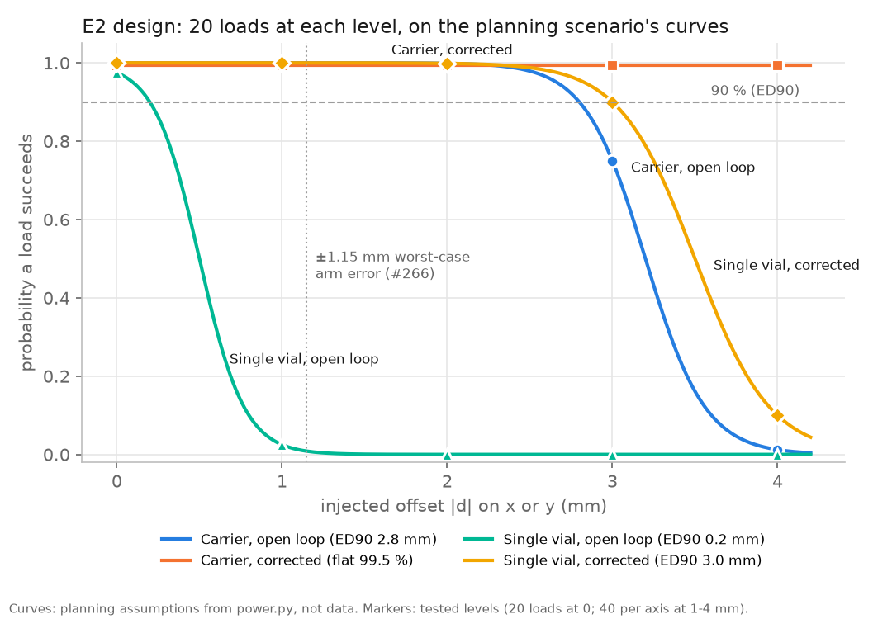
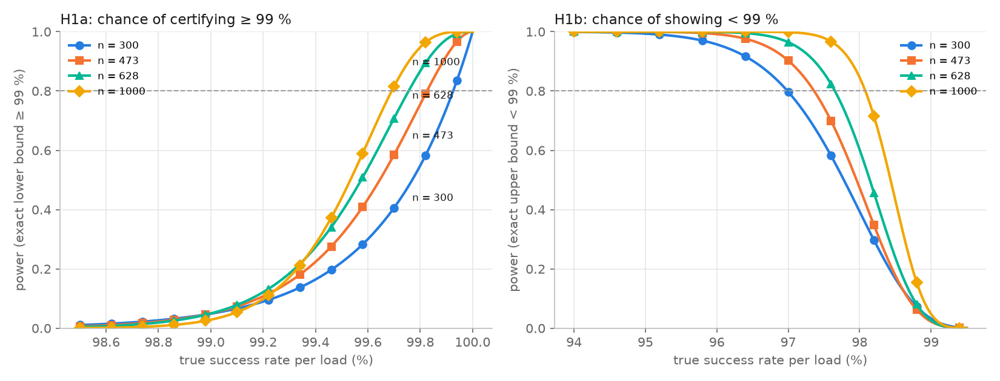

# Pre-registration: how reliably can the PiPER load a CubXL deck with vial carriers and single vials?

**Status: v2 draft, not locked.** No counted trial may run until this file is locked and registered.
To lock it, make every decision in [§0](#0-decisions-before-locking), commit, tag the commit
`prereg-v1`, and register it as described in [`README.md`](README.md#how-to-register-once-the-before-registration-gates-are-met).
Changes made after the lock go in [§16](#16-amendments), dated and with a reason. Never rewrite the
original text.

| | |
|---|---|
| Version | v2, 2026-11-27. It replaces v1 of 2026-10-10 (`9652c43`, never registered). What changed is listed in [§16](#16-amendments) |
| Locked commit / tag | `____` / `prereg-v1` |
| Registry | [OSF Registries](https://osf.io/registries), *OSF Preregistration* template (v4). **A**: E1 and E2, H1–H3 ([form answers](osf/A-transfer-reliability.md)). **B**: E3, H4 ([form answers](osf/B-pose-repeatability.md)) |
| Registration DOIs | A: `____` · B: `____` |
| Campaign issue | [#21](https://github.com/vertical-cloud-lab/robot-arms/issues/21) |
| Arm | AgileX PiPER, 6-DOF, on loan to the lab. Vendor figures: 1.5 kg payload, 626 mm reach (reseller listing), 0.1 mm repeatability. None has been measured here; E3 measures the last |
| Design under test | The dock blocks (3 mm × 45° lead-in, cone pins 250 mm apart), the 8 + 1 carrier, the finger inserts and the offset plates of [byu-vcl#266](https://github.com/vertical-cloud-lab/byu-vcl/issues/266) and [byu-vcl PR 272](https://github.com/vertical-cloud-lab/byu-vcl/pull/272) |
| Safety documents | [PR 23](https://github.com/vertical-cloud-lab/robot-arms/pull/23) (`docs/safety/`: hazard analysis, SOP, checklist). Still a draft; it must be reviewed before the first counted block ([`bench-readiness.md`](bench-readiness.md)) |
| Analysis code | [`analysis/prereg_stats.py`](analysis/prereg_stats.py) implements every confirmatory rule below; [`analysis/simulate_and_check.py`](analysis/simulate_and_check.py) runs it on a synthetic campaign |

This is the plan for the PiPER reliability paper. Before any counted trial, it fixes what we
measure, how each hypothesis is decided, and when we stop. Later pieces of the campaign must do
what this file says: the trial harness, the repeatability fixture and the fiducial correction.
Where one can't, amend this file first. Nothing in this document moves the arm.

---

## 0. Decisions before locking

Two kinds of blank remain. **Decisions** (D) are for the PI to make before registering.
**Rules** (R) are already fixed here; the *values* they produce are measured in the pilot and
written into the `cfg-1` record before the first counted trial, so registration doesn't wait for
them.

### Decisions for the PI

| ID | Decision | Where | Suggestion |
|---|---|---|---|
| D1 | Setting: the mock-up v2 deck (real deck's 25 mm pitch, PR 272) or the real CubXL | §4 | Mock-up v2. No CubXL is in or near the cell, and the v1 mock-up's 35.6 mm pitch doesn't match the real 25 mm |
| D2 | Vials: printed dummies or glass; which height | §4 | Printed dummies of Chris's vial (64.2 mm, Ø27 body, Ø28 cap), solid (46.8 g). PR 272 notes the CubOS deck files say 83 mm; settle which before printing |
| D3 | Carrier load | §4 | Both carriers full: 8 dummies each. PR 272 gives 485 g per carrier with solid dummies (its slicer estimate) and 0.53–0.66 kg depending on the holder's infill; weigh them (HW6) |
| D4 | How E2's offsets are made: in software (the arm's belief about the dock) or with PR 272's offset plates | §8 | Software, with the plates as a physical cross-check (§15). Plates need a person to swap them, which rules out randomizing levels within a block |
| D5 | *n* for the carrier, open-loop cell of E1 | §8 | **628** (2 failures may still certify 99 %), if the arm time is there. 300 is the minimum #21 sets, and gives H1a 55 % power at a true 99.8 % |
| D6 | Single-vial open-loop levels in E2: all 21, or only 0, ±1, ±2 mm and ±2° | §8 | All 21, as #21 asks, unless operator time is short. The trimmed set saves about 200 resets for almost no information (§8) |
| D7 | Predictions for H1–H4 (blanks Pred-1 to Pred-8 in §2) | §2 | Yours. They're recorded for calibration only and enter no decision |
| D8 | The time-cost cap for H3c, in seconds per loading transfer | §2 | 5 s |
| D9 | E3's loaded payload | §8 | A dummy mass equal to a full carrier, at the carrier's centre of gravity |
| D10 | E3's instrument, with its expanded uncertainty *U* (k = 2) | §8 | Three 0.001 mm digital indicators on a sphere or cube target. *U* must be ≤ 0.025 mm; aim for ≤ 0.010 mm, because the instrument's noise inflates measured RP (an arm at 0.10 mm reads 0.110 mm at *U* = 0.025, 0.102 mm at *U* = 0.010) |
| D11 | Run-of-failures stop. It counts failed loads, never deliberate E2 offsets | §10 | In E1, 3 failed loads in a row in one cell. In E2, 2 failed zero-offset loads in one block. This rarely stops a healthy cell, but is slow to flag one that fails 15–20 % of its loads, in E2 above all ([§8.4](#84-power)). For earlier warning in E1, add a clause such as 5 failed loads among a cell's last 20 |
| D12 | Campaign end date (cells still short then are reported as they stand) | §10 | 16 weeks after the first counted block |
| D13 | MTBI horizon τ in transfers | §14.4 | 300 |
| D14 | Where raw logs and videos live | §11 | A Hugging Face dataset under `byu-vcl`, made public with the paper |
| D15 | People: the operators, the blind reviewer of failures, the adjudicator, and who is called after a Catastrophic event | §7, App. A | The reviewer must not have operated the blocks they review. Call the PI and the College Health & Safety Officer |
| D16 | Registration contributors, and public or embargoed | README | Public at registration |

### Rules whose values come from the pilot

Each value goes into the `cfg-1` record, with its measurement, before the first counted trial.
If a rule can't be met (for example the pocket's clearance is over 1 mm), stop and amend before
counting anything.

| ID | What | Rule |
|---|---|---|
| R1 | T2's pocket: diametral clearance *c* and entry chamfer | Measured on the printed part with pin gauges and calipers, not taken from CAD. H1b needs *c* ≤ 1.0 mm; PR 272's Cubware pocket squeezes the vial by 0.57 mm, which qualifies |
| R2 | Dock datum, cone-pin spacing, pocket distance *r* from the datum | Measured as printed. The datum is the midpoint of the cone pins; the design spacing is 250 mm |
| R3 | AprilTags and the look | `tag36h11`, the largest size with a full white border that fits on the dock blocks, and at least 25 mm (10 mm tags decoded in 0 of 48 frames from the fixed camera in PR 40). 5 frames per look, 3 looks at most. The correction is capped at 6 mm and 6°, beyond the largest injected offset (the ±6 and ±8 mm extension in §15 raises it by the same amendment). The reprojection-error limit is the 99th percentile of 100 pilot looks |
| R4 | Seat check (T1) and cap height (T2) | A 0.2 mm feeler gauge at the four corners of each dock block, or a seat switch if one is fitted. Cap-top height within ±0.5 mm of nominal, by gauge |
| R5 | Speed | One speed in every condition and experiment: the pilot speed at which 20 nominal carrier loads all succeed, and never above the SOP's cap |
| R6 | Check delay; timeout | Check 2 s after the arm reaches its clear pose. Timeout per transfer: 3 × the pilot median, rounded up to 5 s |
| R7 | Units per block | Whole sub-blocks that fit in 50 minutes at the pilot's median unit time. A person can end a session sooner, between units |
| R8 | Contact stop on the place descent | The descent stops and the transfer aborts when any joint effort exceeds 1.5 × the largest effort in 20 nominal pilot places. It must stop a ±4 mm carrier place on a cone-pin tip before anything breaks, tested in the pilot at the campaign speed |

---

## 1. Question, estimands and scope

**Question.** How reliable is this arm at loading a CubXL deck with vial carriers and with single
vials? And how much of the gap to 99 % per transfer does each of these close: (a) a lead-in dock,
and (b) wrist-camera AprilTag correction?

**Why 99 %.** A self-driving-lab run is a chain of transfers. The chance that 50 transfers
finish untouched is *p*⁵⁰:

| Per-transfer success | 97.5 % | 99 % | 99.5 % | 99.9 % |
|---|---|---|---|---|
| 50 transfers with no intervention | 28 % | 61 % | 78 % | 95 % |

97.5 % is the per-sample rate that the literature scan on #1 attributes to the Ada self-driving
lab (about one run-ending failure per 40 samples). That figure hasn't been checked against the Ada
papers yet; check it before the paper cites it ([`references.md`](references.md), item 26). 99 % is
roughly where an overnight run becomes more likely than not to finish.

**Why these two interventions.** #266 estimates the arm's placement error at ±0.64 mm combined
(RSS) and ±1.15 mm worst case. That is an estimate from parts of a budget, not a measurement: the
linear sum of ±0.10 mm repeatability, ±0.50 mm gripper, ±0.30 mm teaching and registration, and
±0.25 mm structure and humidity. A tight pocket captures about ±0.6 mm, and a 3 mm × 45° lead-in
nest about ±3 mm (PR 272). So the two fixes attack the problem from opposite sides:

- **The dock widens capture.**
- **The correction shrinks error.** It measures where the dock really is, which removes the
  teaching, registration and structure terms. It can't see the vial's position in the fingers,
  so the ±0.5 mm gripper term stays. Once corrected, the worst case is about ±0.6 mm plus the
  tag-pose error, against ±0.5 mm in a pocket with 1 mm diametral clearance. So correction should
  help single vials without guaranteeing 99 %. This is an expectation, not a hypothesis.

**Estimands.** *T* is the task (C = carrier, V = single vial). *K* is the condition (OL = open
loop, AT = AprilTag-corrected).

- *p*(*T*, *K*): the probability that a loading transfer succeeds at zero injected offset. The
  primary endpoint.
- Gap to 99 %: *g*(*T*, *K*) = max(0, 0.99 − *p*(*T*, *K*)).
- Share of the gap closed by correction: *G*(*T*) = [*p*(*T*, AT) − *p*(*T*, OL)] /
  [0.99 − *p*(*T*, OL)], defined only when *p*(*T*, OL) < 0.99.
- Contribution of the lead-in dock, two ways:
  - (i) the task contrast *p*(C, OL) − *p*(V, OL), which the object confounds (§15);
  - (ii) the mechanism: the dock's ED90 capture radius against the arm's error budget (H2).
- ED50 and ED90: the injected offset at which predicted success falls to 50 % or 90 %.
- MTBI: the mean number of transfers between interventions.
- RP: pose repeatability as ISO 9283 defines it.

**Scope.** The claims are about this arm, this dock design and these objects, at spot D:

- **The deck is a mock-up** unless D1 says otherwise. Nobody has put a real CubXL in the cell.
- **The vials are printed dummies** unless D2 says otherwise. A dummy doesn't slip, chip or
  shatter like glass.
- **The arm is the borrowed PiPER** with its firmware as recorded in each configuration.
- **The CubXL's own motion is out of scope**, and so is anything a vial would hold.

---

## 2. Hypotheses and decision rules

Each hypothesis gets its own α = 0.05, one-sided where stated. There is no correction across
hypotheses, because each answers a separate question fixed here in advance. Within a hypothesis,
*support* that needs both axes (H2, H3b) or all five poses (H4a) is an intersection–union test,
which needs no correction. *Refutation* by either axis (H2) or any pose (H4a) is a union, so its
bounds are tightened: 99 % per pose for H4a (Bonferroni over five), and 99 % per axis for H2.
For H2, Bonferroni's 97.5 % was not enough in simulation (§2, H2).

Every hypothesis has a fixed set of outcomes, and every one is reported whatever it is:
**supported**, **refuted** or **inconclusive** for H1a, H1b, H2 and H4a; **supported**,
**contrary** or **not supported** for H3a; **supported** or **not supported** for H3b, H3c, H4b
and H4c. Each label comes from a `h*_decision` function in
[`analysis/prereg_stats.py`](analysis/prereg_stats.py). The predictions (Pred-1 to Pred-8) are
recorded for calibration only and enter no decision. The power of each rule is in
[§8.4](#84-power).

### H1: the dock reaches 99 %, the tight pocket does not

- **H1a.** Open-loop carriers loaded into the 3 mm lead-in dock succeed at 99 % or better.
  - Prediction: *p*(C, OL) = `Pred-1: ____ %`.
  - **Supported** if the exact (Clopper–Pearson) one-sided 95 % lower bound is ≥ 0.99. At
    *n* = 300 that allows no failures (0/300 gives 0.9901, 1/300 gives 0.9843). At *n* = 628
    it allows two.
  - **Refuted** if the exact one-sided 95 % upper bound is < 0.99: at least 7 failures at
    *n* = 300, or 12 at *n* = 628.
  - **Inconclusive** otherwise. The cell is never extended to resolve it (§10, rule 4).
- **H1b.** Open-loop single vials loaded into a pocket with ≤ 1 mm diametral clearance (R1)
  stay below 99 %.
  - Prediction: *p*(V, OL) = `Pred-2: ____ %`.
  - **Supported** if the exact one-sided 95 % upper bound is < 0.99 (at *n* = 300, at least 7
    failures). **Refuted** if the exact one-sided 95 % lower bound is ≥ 0.99 (no failures).
    **Inconclusive** otherwise.

### H2: the dock's capture radius exceeds the arm's worst-case error

- **Claim.** For open-loop carriers, ED90 is larger than the ±1.15 mm worst-case arm error from
  #266, on both x and y. The capture radius is min(ED90ₓ, ED90ᵧ).
- **Prediction.** ED90ₓ = `Pred-3: ____ mm`, ED90ᵧ = `____ mm`, ED90 for yaw = `____°`.
- **Decision, per axis** (x and y; yaw is reported but not tested):
  - **The axis supports H2** if either of these holds.
    - The capture curve is **censored** (§14.3): no failures at 4 mm, or a fitted success at
      4 mm still ≥ 90 %. The logistic fit can't place ED90 then, so monotonicity decides instead.
      Success at 1.15 mm is at least the average success over the 2, 3 and 4 mm levels, so the
      exact one-sided 95 % lower bound of the pooled success at |*d*| ≥ 2 mm (120 trials) must be
      ≥ 0.90.
    - The curve is **not censored**, its slope is significantly negative (the one-sided 95 %
      upper bound of β₁ is below 0), and the Fieller one-sided 95 % lower bound of ED90 exceeds
      1.15 mm.
  - **The axis refutes H2** if either of these holds, each at one-sided 99 %. Bonferroni over
    the two axes would give 97.5 %, but Fieller bounds undercover when ED90 falls between the 1
    and 2 mm levels: at 97.5 %, H2 was refuted 5.1–10.4 % of the time on synthetic data whose
    true ED90 was exactly 1.15 mm, and at 95 % up to 16.4 %. At 99 % that rate is 1.0–5.1 %
    (10,000 simulated campaigns for each of three curve shapes,
    [`out/power.md`](analysis/out/power.md)).
    - The dock misses 90 % even at zero offset: the exact upper bound of success over E2's 20
      zero-offset loads is below 0.90, so the capture radius is 0.
    - The curve is not censored, its slope is significantly negative, and the Fieller upper
      bound of ED90 is below 1.15 mm.
  - **If an axis meets both a support rule and a refutation rule,** the data contradict a
    monotone capture curve, and that axis is inconclusive.
- **Supported** if both axes support it. **Refuted** if either axis refutes it. **Inconclusive**
  otherwise.
- **What the offset means.** It is injected on top of the arm's own error. "ED90 > 1.15 mm"
  therefore means the dock still catches 90 % of carriers after the arm has been pushed a further
  1.15 mm off.
- **Secondary check (reported, not decisive).** Whether the four ±2 mm translation levels
  together (80 trials) have an exact one-sided 95 % lower bound of at least 0.90, which allows 3
  failures. v1 made this part of the decision. The power analysis showed that the combination
  tests "ED90 > about 2.5 mm", not "> 1.15 mm": at a true ED90 of 2 mm the combined rule passes
  3–4 % of the time, the registered rule 97–100 % ([`out/power.md`](analysis/out/power.md)).

### H3: correction raises single-vial success and widens ED90, at a cost of a few seconds

- **H3a.** *p*(V, AT) > *p*(V, OL).
  - Prediction: OL `Pred-4: ____ %`, AT `____ %`.
  - **Supported** if the one-sided Boschloo exact test gives *p* < 0.05. **Contrary** if the
    same test in the other direction gives *p* < 0.05. **Not supported** otherwise.
- **H3b.** For single vials, correction widens ED90 on both x and y.
  - Prediction: `Pred-5: ____ mm` wider.
  - **Decision, per axis.** Each condition's capture radius is its ED90 floored at 0, and 0 if
    the fitted success is below 90 % even at zero offset ("not reached", §14.3).
    - If the AT curve is censored (§14.3), H3b holds on that axis when the Fieller one-sided
      95 % upper bound of ED90_OL is below 4 mm.
    - Otherwise the one-sided 95 % lower bound of radius_AT − radius_OL must be > 0. The bound
      uses the delta-method standard errors of the two ED90s; a radius of 0 contributes no
      variance.
    - v2 first registered a percentile bootstrap here. It was replaced before any registration
      because, with equal ED90s but different slopes, it claimed a difference on both axes 10 %
      of the time on synthetic data. The delta-method rule did so 1.0–1.4 % of the time
      ([`out/power.md`](analysis/out/power.md)).
  - **Supported** if both axes pass, **not supported** otherwise.
- **H3c.** The correction costs no more than `D8` seconds per single-vial loading transfer.
  - Prediction: `Pred-6: ____ s`.
  - **Supported** if the one-sided 95 % upper bound of the Hodges–Lehmann shift in transfer time
    (AT − OL, successful E1 loads only) is ≤ D8, **not supported** otherwise.
- **Also reported, not tested.** The same three contrasts for carriers.

### H4: ISO 9283 RP is within ±0.1 mm unloaded and grows with payload and reach (registration B)

- **H4a.** Unloaded RP ≤ 0.10 mm at all five poses. The rules apply in this order:
  1. **Inconclusive** if the instrument's expanded uncertainty *U* (k = 2, measured on a static
     target) is above 0.025 mm. ISO 9283 §6.5 caps the total measurement uncertainty at 25 % of
     the characteristic under test.
  2. **Refuted** if at any pose the bootstrap-t one-sided 99 % lower bound (§14.5) exceeds the
     RP that an arm exactly at 0.10 mm would show through this instrument:
     3.616 × √((0.10 / 3.616)² + *u*²), with *u* = *U*/2 per axis. That is 0.110 mm at
     *U* = 0.025 mm and 0.102 mm at *U* = 0.010 mm. The instrument's noise inflates measured RP,
     so refuting against 0.10 mm itself would refute an arm that is within spec.
  3. **Supported** ("meets the spec") if the ISO 9283 point estimate is ≤ 0.10 mm at every pose.
     The instrument can only inflate the estimate, so this is conservative. It is how
     manufacturers report RP. It is also reported as **certified** if every pose's one-sided
     95 % bootstrap-t upper bound is ≤ 0.10 mm.
  4. **Inconclusive** otherwise.
- **H4b.** RP grows with payload.
  - Prediction: `Pred-7: +____ mm` loaded vs unloaded.
  - **Supported** if the mean over poses of RP(loaded) − RP(unloaded) has a one-sided 95 %
    bootstrap lower bound > 0, **not supported** otherwise.
- **H4c.** RP grows with reach (the horizontal distance from the J1 axis to the TCP).
  - Prediction: `Pred-8: +____ mm per 100 mm`.
  - **Supported** if, regressing RP on reach over 5 poses × 2 payloads with payload as a
    covariate, the slope's one-sided 95 % bootstrap lower bound is > 0, **not supported**
    otherwise.

---

## 3. Outcomes

**Primary outcome.** Success or failure of each *loading* transfer in E1, scored as in §7, per
task × condition.

**Secondary outcomes.**
- Success of each *unloading* transfer in E1.
- Success of each loading transfer in E2, against the injected offset (for ED50 and ED90).
- Transfer time: from the start of the pick approach to the arm reaching its clear pose after the
  release.
- Interventions, for MTBI and S(50).
- The LabRobFail category, subtype and severity of each failure (§13).
- ISO 9283 RP per pose and payload (E3, registration B).

**Exploratory, not tested.** Joint efforts and positions over time, the correction applied under
AT and its residual, tag-detection quality, temperature and humidity effects, drift within a
block, and anything else in the logs.

---

## 4. Set-up (the configuration)

Everything below is part of the **configuration** (§9). Changing any of it starts a new block,
and most changes start a new configuration.

| Item | Specification |
|---|---|
| Arm | AgileX PiPER at spot D, upright on the 48 × 48 in plywood top. Serial, firmware (S-V1.8-1 when last read), joint zero offsets (J1 was re-zeroed on 2026-11-14) and how the base is fixed are recorded per configuration |
| Controller | Driven over CAN (`can0`, 1 Mbit/s) from the Raspberry Pi 5 `rpi-5-mpzy`, which also switches the arm's supply through an IoT Relay II (`arm_power.py`). The POWERTEC 71970 E-stop is in the same supply. The order of relay and E-stop is recorded |
| Gripper | AgileX's gripper with PR 272's finger inserts (90° V-blocks with a rib) and 1.5 mm silicone pads, Shore 30–50A. The printed auger sleeves now on the gripper come off for the campaign. Motor 7 (the gripper) must home and enable with the inserts fitted |
| Wrist camera | The wrist Raspberry Pi (`rpi-5-76zj`) with the HQ camera (6 mm lens, focused and locked) and Camera Module 3 Wide, on PR 10's mount. Mounted and powered in **both** conditions, so the mass and cable drag are the same. Intrinsics and hand–eye calibration are part of the configuration |
| Dock | PR 272's two dock blocks on `plate_0`, bolted through to a deck strip with the real deck's 25 mm pitch, and the dock's single-vial pocket (R1, R2). AprilTags on the blocks (R3) |
| Carriers | Two identical PR 272 carriers, A and B, with the handle post at slot 5. Load and mass: D3. Each is weighed |
| Vials | D2. Each is numbered and weighed |
| Shelf | At spot D, two carrier nests and one single-vial pocket, each with a generous chamfer so the shelf is never the bottleneck. Geometry recorded. The shelf pocket and nests must be reachable with J1 inside the window that keeps the arm clear of the A1 mini (−20° to +60° in PR 83) |
| Layout | Each carrier points at J1 at the place (PR 272 found no IK solution for a carrier across the arm's line). Joint margins at every taught pose are recorded |
| Witness camera | Fixed, looking at the dock. The front camera on `rpi-5-mpzy` if its view covers the dock, otherwise a dedicated one. It takes a still at every check (R4) |
| Speed | R5 |
| Software | The trial harness commit is recorded per block. It logs joint positions, efforts and gripper state at ≥ 50 Hz (`Up_and_Down.py --trace` on main runs at 50 Hz; PR 20's runs at 100 Hz) |
| Environment | Temperature, relative humidity and illuminance at the dock, logged per block |
| Setting | D1 |

**Payload.** A full carrier (485 g with solid dummies by PR 272's slicer estimate, 0.53–0.66 kg by its README depending on infill) plus the finger inserts (67 g) rides on a
gripper of about 0.5 kg, and the wrist also carries a Pi, two cameras and their mount. #42 reads
the 1.5 kg rating as including the gripper. The masses are weighed and the total recorded before
the pilot (bench gate HW6).

---

## 5. Tasks

Each task runs in **units**. Every unit holds exactly one *loading* transfer (into the dock: the
primary endpoint) and one *unloading* transfer (out of the dock: secondary). A unit leaves the
cell in a known state, so units of either task can be interleaved without anyone touching the
cell.

- **T1: carrier swap between the dock and the shelf.** Carrier A starts in the dock and B in shelf
  nest 2. Each unit swaps them:
  1. **Unload:** the carrier in the dock goes to the free shelf nest.
  2. **Load:** the other carrier goes from its shelf nest into the dock.

  The cell returns to its start state every two units.
- **T2: single vial between the shelf and the dock pocket.** One vial starts in the shelf pocket.
  Each unit:
  1. **Load:** shelf pocket → the dock's single-vial pocket (R1).
  2. **Unload:** dock pocket → shelf pocket.

A **transfer** is the pick at the source, the place at the destination, and the retreat to the
clear pose. If a leg fails, the person at the arm restores the cell to the state that leg should
have produced (App. A), and the unit goes on to its next leg, so every unit still has one load and
one unload. Before every unit the harness checks that the arm answers, has no driver fault, and
reads its rest pose to within 0.5° on every joint. If not, the unit doesn't start (§10, rule 3).

---

## 6. Conditions

- **OL: open loop.** Taught poses only. No camera data reaches the motion.
- **AT: AprilTag-corrected.**
  - At the look pose over the dock, the wrist camera grabs frames (R3), detects the dock's tags
    and estimates the dock's pose in the base frame through the hand–eye calibration.
  - The place pose is corrected in x, y and yaw before every dock-side place, and the pick pose
    the same way before every dock-side pick. z, roll and pitch stay as taught.
  - The shelf side is open loop in both conditions, because the question is about loading the
    deck.
  - If no valid pose arrives within the allowed looks, or the correction exceeds its cap (R3),
    the transfer aborts before descending. That counts as a failure. It never falls back to open
    loop, which would mix the conditions.

**Both conditions pass through the same look pose and stop there.** OL leaves at once. AT dwells
to capture and correct. The only differences between the conditions are the dwell and the
correction, so settling at a standstill can't pass for a benefit of vision.

**No automatic retries in either condition.** Each pick and each place is a single attempt. The
harness aborts a transfer it judges unsafe: a grip effort below threshold before the lift (#20),
or the contact stop on the place descent (R8). An abort counts as a failure.

---

## 7. Success and scoring

A transfer is scored at the **check**, 2 s after the arm reaches the clear pose (R6).

**Loading, T1: success requires all of these.**
1. The carrier is seated: both cone pins are engaged and it sits flat on the dock blocks (R4).
2. Every vial is still in its pocket, upright, with its cap on.
3. The gripper released cleanly, the arm reached the clear pose, and the carrier was not dragged
   out of its seat.
4. Nobody touched the cell between the start of the transfer and the check.
5. There was no fault: no controller or CAN error, no E-stop press, no contact stop (R8), and no
   contact with the enclosure.
6. The transfer finished within the timeout (R6).

**Loading, T2: success requires all of these.**
1. The vial sits fully in the pocket, with its cap-top height within ±0.5 mm of nominal (R4).
2. It is upright, capped and intact.
3. Criteria 3–6 from T1 hold.

**Unloading:** the same criteria, applied at the shelf.

**These still count as successes,** each flagged as a near miss:
- the lead-in doing its job, such as the carrier landing on the chamfer and sliding home before
  the check;
- an effort spike that didn't trip the contact stop.

**A planned E-stop is not a failure.** The SOP's lockout (§C of `docs/safety/sop.md`) has the
person at the arm press the E-stop before every reach-in. A press between transfers with the arm
parked, including the reset after a failed leg (§5), belongs to the intervention that caused it.
A press *during* a transfer fails that transfer.

**Scoring.**
1. The operator scores every transfer on the spot (App. A).
2. A second person (D15) re-scores every failure and a random 10 % of successes from the witness
   stills. The stills are taken after the arm has left, so they don't show the condition.
3. A third person resolves any disagreement. The adjudicated score is the one analysed.
4. Cohen's κ between the operator and the reviewer is reported.

---

## 8. Experiments, sample size and power

### 8.1 E1: nominal reliability (registration A)

- 2 tasks × 2 conditions, at zero offset.
- **Loading transfers per cell:** 300 for C-AT, V-OL and V-AT, and D5 (300 or 628) for C-OL.
  Each is paired with an unloading transfer.
- With D5 = 300: 1,200 loads and 1,200 unloads. With D5 = 628: 1,528 of each.

### 8.2 E2: capture envelope (registration A)

- **What is offset** (D4 = software). The dock frame the arm *believes* in. The physical dock does
  not move.
- **The dock frame.** Its origin is the dock datum (R2). x runs along the carrier's long axis, z
  points up, and yaw is about z through the origin.
- **Levels,** one axis at a time:
  - 0;
  - x = ±1, ±2, ±3, ±4 mm;
  - y = ±1, ±2, ±3, ±4 mm;
  - yaw = ±2°, ±4°.

  That is **21 levels × 20 trials = 420 loading transfers per task × condition**, 1,680 in all.
  With D6 trimmed, single-vial OL runs 11 levels (220 trials) and E2 totals 1,480.
- **Which leg is offset.** Only the loading leg. The unloading leg runs at the nominal frame:
  after a successful load the object sits where the dock put it.
- **Under AT,** the look pose moves with the believed frame, and the correction has to find the
  real dock from the image. The injected offset never reaches the correction code.
- **For T2,** a yaw of the dock frame moves the pocket sideways by about *r*·θ (R2).

*The planning scenario behind the power analysis and the reset estimate below. The curves are
assumptions, not data; the markers are the tested levels.*

**The yaw levels will saturate for open-loop carriers.** With the pins 125 mm either side of the
datum, a yaw of θ moves each pin 125·sin θ: 4.4 mm at 2° and 8.7 mm at 4°, both past the 3 mm
lead-in, which covers about ±1.4° (PR 272). The OL carrier's yaw curve will have no informative
points. §15 lists an optional ±0.5° / ±1° extension.

**Expect many failed loads, and a reset for each.** Under one plausible scenario
([`out/power.md`](analysis/out/power.md)), the one the figure above draws, E2 produces about 660
failed loads: about 180 for carriers OL, about 400 for single vials OL, about 80 for single vials
AT (its curve falls past 3 mm) and about 2 for carriers AT. Each needs a
person to park the arm, press the E-stop, restore the scene and restart (§C of the SOP). Trimming
single-vial OL to 0, ±1, ±2 mm and ±2° (D6) would cut its failures to about 200. Its ED90 is
expected below 1 mm, so the dropped levels carry almost no information.

### 8.3 E3: ISO 9283-style metrology (registration B)

- **Size.** 5 poses × 30 cycles × 2 payloads: 300 measured pose visits.
- **Poses.** P1–P5 lie on a diagonal plane of the largest cube that fits the volume the campaign
  uses, around the dock and the shelf. P1 is at the plane's centre and P2–P5 sit near its
  corners. Secondary sources put them 10 % ± 2 % of the diagonal in from the corners; check that,
  and the order of visits, against §6.8 of the standard before building the fixture.
- **Cycles.** Each cycle visits every pose in a fixed order, approaching each from the same
  direction, which keeps backlash out of RP. Dwell before measuring: 2 s after the arm reports
  arrival.
- **Payloads.** (1) Unloaded: the gripper, inserts and the measuring target. (2) Loaded: D9.
  ISO 9283 makes 100 % rated load mandatory and 10 % an optional extra, so E3 is ISO 9283-*style*,
  not conformant. Instrument parts carried by the arm count toward the payload (§6.6).
- **Speed.** R5, so RP describes the motion the trials use. A third run at 100 % override may be
  added by amendment.
- **Warm-up.** 15 minutes cycling over P1–P5 before the first measured cycle. ISO 9283 §6.2 asks
  for a warm-up if the manufacturer specifies one.
- **Instrument.** D10, with *U* ≤ 0.025 mm (k = 2), checked on a static target before E3.
- **Order.** Both payloads in one session, in random order, with temperature logged.

Only positional RP is measured. Orientation repeatability and pose accuracy (AP, which needs an
absolute reference such as a laser tracker) are out of scope.

### 8.4 Power

The full tables are in [`analysis/out/power.md`](analysis/out/power.md), from
[`analysis/power.py`](analysis/power.py) (fixed seeds, the registered rules from
`prereg_stats.py`), rerun on 2026-11-27 after the independent review's corrections. Binomial and
Boschloo powers are exact; the Boschloo power comes from the test's critical region, computed in
`power.py` and checked against `scipy.stats.boschloo_exact`, which the registered analysis calls. The rest are simulated: 2,000 campaigns per scenario for H2 and H3b
(10,000 for H2's false-refutation rate at the boundary), 500 for H3c and H4a, 300 for H4b and
H4c. `power.py --check-rejected` also simulates the rules that were replaced (§16) on the same
draws, and checks its copies of the registered rules against `prereg_stats.py`.

| Rule | What *n* buys |
|---|---|
| **H1a** (certify ≥ 99 %) | At *n* = 300 the cell must be perfect. Power: 22 % if the true rate is 99.5 %, 41 % at 99.7 %, **55 % at 99.8 %**, 74 % at 99.9 %. At *n* = 628 (D5): 39 %, 71 %, **87 %**, 97 %. 80 % power at 99.7 % would need 913 |
| **H1b** (show < 99 %) | At *n* = 300: 99 % power if the true rate is 95 %, 80 % at 97 %, 39 % at 98 % |
| **H3a** (Boschloo, 300 per arm) | OL → AT: 95 % → 99 %: 90 %. 97 % → 99.5 %: 72 %. 97 % → 99 %: 48 %. So a gain is only reliably detectable if open-loop single vials sit near 95 % or below |
| **H2** (ED90 > 1.15 mm) | Supported 97–100 % of the time if the true ED90 is 2 mm or more; 0–20 % at 1.5 mm, because no level lies between 1 and 2 mm; ≤ 0.2 % at or below 1.15 mm. Refuted 1.0–5.1 % of the time at exactly 1.15 mm (10,000 campaigns per curve shape), 79–100 % at 0.8 mm, 100 % at 0.5 mm |
| **H3b** (AT widens ED90) | 100 % when AT's ED90 is 1 mm or more against an OL pocket's 0.3 mm. 2.5 % for 0.6 vs 0.3 mm, which the 1 mm level spacing can't resolve. With no true difference it claims one 0–1.4 % of the time, including when the slopes differ |
| **H3c** (time cap 5 s) | ≥ 99.6 % if the true extra time is 4 s or less, 73 % at 4.5 s |
| **H4a** (30 cycles, *U* = 0.025 mm) | Supported ("meets"): 94 % if the true RP is 0.07 mm, 54 % at 0.08 mm, 5 % at 0.09 mm, because the instrument's noise inflates RP. "Certified": 89 % at 0.04 mm, 62 % at 0.05 mm, 26 % at 0.06 mm; a valid upper bound from 30 cycles is wide. Refuted: 5.0 % for an arm exactly at 0.10 mm, 37 % at 0.11, 81 % at 0.12, 99 % at 0.13 mm |
| **H4b, H4c** | 61 % and 83 % power for a 0.01 mm payload effect and 0.01 mm per 100 mm; 98–100 % at 0.02 mm |
| **MTBI** (600 E1 transfers per cell) | Imprecise by design: at 1 intervention per 100 transfers, the 95 % interval runs from 46 to 272 transfers |
| **D11** (run-of-failures stop; not a hypothesis) | **It rarely stops a healthy cell:** over 300 loads there's a 0.5 % chance at 97.5 % success and 9 % at 93 %, and over a task's E2, 0.1 % in the E2 planning scenario or 3.4 % at the synthetic E1 campaign's single-vial rates (93 % OL, 98.5 % AT). **E1 catches a cell failing half its loads fast,** within about 14 loads. **It's slow at 15–20 % failure:** 347 loads on average in E1. In E2, most blocks hold one zero-offset pair or none. If both conditions fail 20 % at zero offset, only 63 % of tasks see a stop; if only the open-loop condition does, 15 %. Even at 50 % in both conditions, the median is 45 pairs, about 3 blocks. **An extra E1 clause**, 5 failed loads among a cell's last 20, would flag a 15 % cell within a median 48 loads, but would also stop a 93 % cell 38 % of the time |

**Why these sample sizes.** #21 fixes the minimum: 300 per task and condition, 20 per offset
level, 30 cycles per pose. The tables show what that buys. The one place it falls short of what
the question needs is H1a: 300 can only certify 99 % if the dock is close to perfect, so D5 offers
628 for that cell alone (328 more units, about 5.5–8 hours of arm time).

### 8.5 Budget

| | Scored | Transfers, including resets of the cell |
|---|---|---|
| E1 (D5 = 300) | 1,200 loads + 1,200 unloads | 2,400 |
| E1 extra if D5 = 628 | 328 loads + 328 unloads | 656 |
| E2 | 1,680 loads | 3,360 |
| E3 | 300 pose measurements | — |
| **Total (D5 = 300)** | | **5,760 transfers** |

At 30 s per transfer that is about 48 h of arm time; at 45 s, about 72 h. Add the human resets:
about 660 in E2 at 2–3 minutes each, or 22–33 hours. Sessions are about an hour (R7), so the
campaign is roughly 70–100 sessions.

---

## 9. Configurations, blocks and randomization

- **Configuration.** Everything that can change how the arm behaves:
  - the harness commit, including any code, configuration or calibration file on the trial path;
  - the arm, its firmware, its joint zeros and its mounting;
  - the fingers and pads;
  - the cameras, their mounts and calibrations;
  - the dock, carriers, vials and shelf, and where each of them sits;
  - the taught points.

  Each configuration gets an ID (`cfg-N`) and a record of its commit, hardware, measured values
  (R1–R8) and photos. The record may list **spares**, parts identical to ones in use, that can
  replace a broken part without creating a new configuration.
- **Block.** A contiguous run of units in one session, under one configuration, following one
  schedule. A new session always starts a new block. A block is one "run" under the SOP: the
  person at the arm gives the "workspace clear" before it starts and again before it resumes after
  any reset, and stays at the E-stop throughout. The person at the cell starts a counted block from
  the harness, or a remote operator does who is in contact with them. An `@claude` run does not
  start counted blocks (its job lasts at most six hours and its token one).
- **Ledger.** A committed file keeps the trials still owed to each task × condition × level.
  Each block's schedule is drawn from it, so a block that ends early just leaves its unrun units
  in the ledger.
- **Randomization.** Each block's schedule is generated and committed before its first unit, by
  the harness's schedule generator, from a seed equal to the block ID. Units run in that order.
  The operator doesn't choose, skip or reorder them.
  - **E1 sub-blocks:** C-OL, C-AT, V-OL and V-AT once each, in random order. With D5 = 628, C-OL
    appears twice in every sub-block, and 28 sub-blocks chosen by the seed carry a third C-OL.
  - **E2 sub-blocks:** for one task, the pair (level ℓ, OL) and (level ℓ, AT), in random order,
    with the levels taken in random order without replacement until all 21 have run once. Pairs
    keep the two conditions side by side in time at every level. If D6 trims single-vial OL, the
    10 levels it drops run as single AT units in the same random sequence.
  - **Block size:** R7. A block is made of whole sub-blocks.
- **Session types.** E1 and E2 run in separate blocks. A seeded random sequence assigns each
  session to E1 or E2 in proportion to the work left, so wear, drift and season fall on both. E2
  sessions alternate tasks in the same way. E3 runs in its own sessions.

---

## 10. Starting and stopping rules

**Pilot and start.** Everything before the first counted block is pilot. Pilot runs set R1–R8 and
prove the harness, and their data are never pooled with counted data. Counting starts with the
first block whose schedule is committed as counted, after (a) the registration is approved and
(b) every "before the first counted trial" gate in [`bench-readiness.md`](bench-readiness.md) is
met and recorded.

1. **Any change to code or hardware ends the block.** The next unit starts a new block.
   - **The count restarts.** If the change makes a new configuration, its counts start at zero.
     Each cell's *n* must be reached within one configuration. Earlier configurations are
     reported as development history and never pooled into the primary estimates.
   - **These are changes:**
     - any commit on the trial path;
     - re-teaching a point or recalibrating;
     - replacing, re-printing, re-gluing, tightening or adjusting a part;
     - moving the arm, table, dock, shelf or deck;
     - a firmware update, or setting a joint zero;
     - new pads, or swapping the finger inserts for the auger sleeves and back;
     - cleaning or refocusing a camera.

     Swapping in a declared spare ends the block but keeps the configuration.
   - **These are not changes:** restoring the scene after a failure without adjusting anything
     (re-seating an object, re-homing, a power cycle by the E-stop or the relay). They are
     interventions (§14.4), logged, and the block continues.
2. **Safety.** A **Critical** or **Catastrophic** event (§13.4) stops the block at once. Make the
   cell safe per the SOP and record what happened. Resuming always starts a new block.
3. **Run of failures, or the arm not at rest.** D11 stops the block for an inspection: in E1,
   3 failed loads in a row in one cell; in E2, 2 failed zero-offset loads in one block. E2's
   offset loads fail by design, so they never count toward it. A unit that can't start because
   the arm doesn't read its rest pose (§5) also stops the block. Anything the inspection fixes is
   a change under rule 1. Trials before the stop stay in the data.
4. **No stopping on results.** Each cell's *n* is fixed. Don't stop early because it looks good
   or bad. Don't extend past *n* because one failure spoiled the bound: that is optional stopping,
   and it voids the exact bounds. Rules 2 and 3 are the only interim looks, and both are for
   safety and upkeep. Nobody computes a cell's running success rate during the campaign; the
   harness shows counts done and counts owed, not rates.
5. **End.** A cell ends at its *n*, or at D12. Cells still short then are reported with their
   actual *n*. Sessions end between units, never in the middle of one.
6. **Which configuration is primary.** Each cell's primary estimate comes from the configuration
   in which that cell has the most counted loads (the later one if tied). The others are reported
   as development history.

---

## 11. Data recorded and availability

- **Per block:**
  - block ID, configuration ID, harness commit and hardware record;
  - seed, schedule file and ledger state;
  - operator, start and end times;
  - temperature, relative humidity and illuminance.
- **Per transfer:**
  - unit ID, task, condition and leg (load or unload);
  - offset axis and value;
  - start, look, release and check timestamps;
  - under AT, the tag detections and the correction applied;
  - success, and which criterion failed if any;
  - LabRobFail category, subtype and severity, from both scorers and after adjudication;
  - whether there was an intervention, with a one-line description;
  - near-miss flags;
  - the witness still.
- **Streams:** joints, efforts and gripper at ≥ 50 Hz; wrist frames at the look pose; witness
  video.
- **Storage.** Raw logs, stills and video go to D14. Schedules, the ledger, configuration records
  and the block log are committed to this repository as the campaign runs.

**Availability (the statement the paper will carry).** All counted and pilot data, the schedules
and ledger, the configuration records and every analysis script are public by the time the paper
is submitted: data on D14 with a DOI, code in this repository at a tagged commit archived with a
DOI. The confirmatory analysis is `analysis/prereg_stats.py` at the registered commit; any change
to it after registration is an amendment (§16). Witness stills and video are checked before
release so that no person appears in them.

---

## 12. Exclusions and missing data

**Exclusions.** Only these two kinds are allowed. Each is logged with a reason, the unit is
re-queued in the ledger, and its transfers leave the primary analysis:
- (a) **An external interruption:** a person entering the workspace, an alarm, a building power
  cut, or a network outage that stops the harness between transfers.
- (b) **An operator error while restoring the scene:** the wrong object, the wrong place or the
  wrong orientation, confirmed by the reviewer from the stills.

Nothing else is excluded. There is no outlier rule: every counted transfer under the arm's
control counts, including aborts, timeouts and faults. If exclusions exceed 5 % of any cell, the
report says so up front, and a sensitivity analysis counts the excluded units as failures.

**Missing data.** A transfer whose outcome can't be scored (no operator score and no usable
still) is missing. Its unit is re-queued in the ledger like an excluded one, so every cell still
reaches *n* scored loads: at *n* = 300, H1a can't be supported with fewer than 299 scored loads,
because 0.05^(1/298) is below 0.99. The primary analysis uses the scored transfers. A sensitivity
analysis counts missing transfers as failures. More than 2 % missing in any cell is reported up front. In E3, a
missed reading is retaken in the same cycle if the arm hasn't moved; RP is computed from the
available cycles if at least 27 of 30 remain, and otherwise that pose × payload run is repeated in
a new session.

---

## 13. Failure coding: LabRobFail

**Source.** Wang, H., Sun, B., Zou, A., Huang, D., Lv, Z., Wang, N., Li, R., Zhou, D., Guo, W.,
Wang, Z. and Ouyang, W. (2026). *LabRobFail: A Benchmark for Robotic Failure Analysis in
Chemical Self-driving Laboratory.* arXiv:2607.23704v2 (29 Jul 2026),
[doi:10.48550/arXiv.2607.23704](https://doi.org/10.48550/arXiv.2607.23704). The code is at
[Su-ISE-2001/SciRobo](https://github.com/Su-ISE-2001/SciRobo), which now redirects to
`Su-ISE-2001/LabRobFail`.

LabRobFail's 20,000 trajectories are failures injected in simulation, so we take its labels
and none of its rates. Text in quotation marks is verbatim from v2. Everything labelled *ours*
is this campaign's rule.

### 13.1 Five categories

From *LabRobFail-Data → Fine-grained Failure Taxonomy*:

> "We design a systematic taxonomy covering 5 major categories and 11 fine-grained types
> (Fig. 3(b)), spanning the full spectrum of anomalies: (1) Perception Failure (PF): Arises
> from the challenging optical properties of materials. It includes Target Position Deviation
> and failures caused by transparent glassware or reflective fluid surfaces. (2) Grasping
> Failure (GF): Reflects end-effector control deficiencies, such as Object Slippage due to
> varying friction coefficients of wet surfaces or insufficient gripping force. (3) Motion
> Failure (MF): Corresponds to trajectory execution anomalies. A domain-specific highlight is
> Incomplete Trajectory, where premature termination of motion sequences leads to experimental
> failure. (4) Logic Failure (LF): Captures semantic planning errors (e.g., Step Omission,
> Sequence Reversal) that invalidate experimental outcomes. (5) Safety Failure (SF): This
> category covers Improper Handling and Protocol Violations (e.g., hazardous mixtures). Unlike
> reversible household failures, these pose risks of catastrophic damage or injury in chemical
> settings."

The annotation definitions, from Appendix A, Table 8 (Q5, Failure Classification):

| Option | Definition |
|---|---|
| (1) Perception Failure | "Failed to locate target objects or positions" |
| (2) Grasping Failure | "Object slippage or unstable grasp" |
| (3) Motion Failure | "Motion execution incomplete" |
| (4) Logic Failure | "Incorrect order or omitted steps" |
| (5) Safety Failure | "Violating laboratory safety protocols" |

### 13.2 Eleven subtypes

From Appendix B:

> "The 11 failure types include: (1) Protocol Violation and Improper Handling under Safety;
> (2) Sequence Reversal and Step Omission under Logic; (3) Pose Control Error and Incomplete
> Trajectory under Motion; (4) Gripper Control Failure and Object Slippage under Grasping; and
> (5) Target Positioning Deviation, Operation Position Error, and Grasp Target Misalignment
> under Perception."

The main text calls one of these "Target Position Deviation". Fig. 3(b) and Appendix B both say
"Target Positioning Deviation", and that is the name we use. Each row below gives the paper's
own example from Appendix B, then the rule we apply to this cell.

| Category | Subtype | Paper's example (verbatim, App. B) | Our coding rule for this cell |
|---|---|---|---|
| Safety | Protocol Violation | "A Protocol Violation occurs during the insertion phase, where an angular misalignment prevents the glass rod from being correctly inserted into the beaker, resulting in insufficient stirring that violates laboratory operation protocols." | The arm breaks a cell rule. Examples: entering the CubXL's keep-out while the gantry isn't parked, moving while the workspace isn't clear, exceeding the speed limit, or any step against the SOP (#22) |
| Safety | Improper Handling | "An Improper Handling event occurs during the returning phase, wherein the flask fails to be placed back at its designated original position, violating the chemical laboratory requirement for proper equipment placement after use, thereby leading to an abnormal task outcome." | The object ends up somewhere other than its destination: the wrong nest, the wrong pocket, or left on the deck |
| Logic | Sequence Reversal | "A Sequence Reversal event occurs at the beginning of the task, where the robotic arm executes a stirring motion without the glass rod prior to grasping it, leading to an incorrect task execution." | The harness runs steps out of order. Examples: descending to place before anything is picked, or loading into an occupied nest |
| Logic | Step Omission | "Step Omission occurs during the initial phase of the task when the robotic arm proceeded directly to stirring without gripping the glass rod." | The harness skips a step: no close, no open, no lift before travel, or no look under AT |
| Motion | Pose Control Error | "A Pose Control Error occurs during the beaker placement phase, where an abnormal twist in the robot arm’s pose leads to unsuccessful placement of the beaker at the target location, resulting in task failure." | The object reaches its destination tilted or twisted and doesn't seat, or the arm visibly leaves its planned path |
| Motion | Incomplete Trajectory | "An Incomplete Trajectory occurs during the approach phase: the arm stops prematurely and remains stationary in front of the button, causing task failure." | Motion stops before the transfer completes: a controller or CAN fault, a joint-limit or collision stop, a harness crash or the timeout |
| Grasping | Gripper Control Failure | "A Gripper Control Failure manifests during the grasping phase. Inadequate gripper closure aperture prevents successful object acquisition, leading to task failure." | The fingers are correctly placed but don't close, close too little, or miss the grip-effort threshold |
| Grasping | Object Slippage | "An Object Slippage event occurs during the transport phase, where insufficient gripper force causes the beaker to slip and fall, resulting in task failure." | After a good grasp, the object, or a vial it carries, moves in the fingers or falls during the lift, transport or descent |
| Perception | Target Positioning Deviation | "A Target Positioning Deviation occurs during the final phase of the task, where the beaker is not placed within the designated target region, resulting in an abnormal outcome." | The object is at the right destination but not seated: resting on the lead-in, on a cone-pin tip or on the pocket rim. Expected to be the most common open-loop failure |
| Perception | Operation Position Error | "An Operation Position Error occurs when the gripper moves to the front of the door handle, where misalignment between the gripper and the handle position causes the door-opening operation to fail." | The grasp happens but off-centre, and the transfer fails because of it. Example: the finger rib misses the post's groove and the carrier hangs tilted |
| Perception | Grasp Target Misalignment | "A Grasp Target Misalignment manifests during the grasping phase: the estimated target position deviates from the actual object position, so the gripper closes beside the object and fails to acquire it, leading to task failure." | The fingers close beside the object, or strike it on the way down, and nothing is picked |

### 13.3 Coding rules (ours)

- **Code what was seen, not the presumed cause.** The category names imply causes ("Perception")
  that an open-loop arm doesn't have. We follow the paper's definitions of the observed event,
  and record the suspected root cause in a separate free-text field.
- **One primary subtype per failure:** the first thing that went wrong in time. Secondary
  subtypes are optional.
- **When nothing fits,** code `Other (<category>)` with a description. Example: under AT, the
  tag can't be detected, which is `Other (Perception)`. If more than 10 % of failures are
  `Other`, that gap in the taxonomy's coverage is reported as a finding.
- **Two coders,** the operator and the reviewer from §7, code every failure. κ is reported.

### 13.4 Four severities

The paper names its severity levels two different ways, and never maps one onto the other.

The main text, under *LabRobFail-Bench → L3*:

> "Q4 assigns failures to four severity levels: Minor, Recoverable, Critical, and
> Catastrophic."

The annotation options, from Appendix A, Table 8 (Q4, Severity Assessment). These are the
labels the released data actually carries:

| Option | Definition |
|---|---|
| (1) Risk Level | "Collision, liquid spillage, or potential falling" |
| (2) Dangerous Level | "Requires manual intervention to proceed" |
| (3) Fatal Level | "Equipment damage, requiring manual intervention" |
| (4) Management Incident | "Non-compliant operations (e.g., unclosed cabinet)" |

**We log the main-text names.** They are ordinal, which suits a reliability log. The
operational definitions are ours, because the paper gives none:

| Severity | Definition for this cell (ours) | What happens |
|---|---|---|
| Minor | The transfer failed its criteria, but the cell could carry on untouched. Example: it finished but ran past the timeout | Log it and continue |
| Recoverable | A person has to restore the scene, but nothing is damaged and nothing needs changing. Examples: re-seating a carrier, picking up a dropped printed vial, re-homing | An intervention. Restore, log, continue |
| Critical | The cell can't continue in its current configuration. Examples: something needs repair, adjustment, re-teaching or recalibration; a fault needs diagnosis; glass broke outside the CubXL | Stop the block (§10, rule 2) |
| Catastrophic | Damage to the CubXL or the arm, or a person at risk. Examples: an injury or near miss, glass or sample spilled inside the CubXL, a collision with the gantry | E-stop, make safe, stop the campaign until reviewed with the safety officer (#22) |

For comparison with LabRobFail-Data, the reviewer also assigns each failure a Table 8 option.
That is a second field, filled in at review and never by the operator.

---

## 14. Analysis plan

[`analysis/prereg_stats.py`](analysis/prereg_stats.py) implements this section, and
[`analysis/simulate_and_check.py`](analysis/simulate_and_check.py) shows it recovering known
values from a synthetic campaign ([`out/recovery.md`](analysis/out/recovery.md)). The analysis
runs on the adjudicated scores. Variables are coded success = 1, failure = 0; offsets enter as
the magnitude |*d*| in mm (or degrees for yaw); nothing else is transformed.

### 14.1 Success rates

For each cell, report *k*/*n* with:
- the **Wilson** 95 % interval;
- the **exact (Clopper–Pearson) one-sided 95 % lower and upper bounds**. When *k* = *n* the lower
  bound is 0.05^(1/*n*).

| Failures in 300 | Point estimate | Wilson 95 % | Exact one-sided 95 % lower bound |
|---|---|---|---|
| 0 | 100 % | 98.74–100 % | **99.01 %** |
| 1 | 99.67 % | 98.14–99.94 % | 98.43 % |
| 2 | 99.33 % | 97.60–99.82 % | 97.92 % |
| 3 | 99.00 % | 97.10–99.66 % | 97.44 % |

Certifying 99 % takes 299 transfers with no failures, 473 with one, 628 with two. Certifying
99.9 % takes 2,995 with no failures.

### 14.2 Comparisons between conditions

- **Difference in proportions,** AT − OL, with **Newcombe's** hybrid-score 95 % interval, built
  from the two Wilson intervals.
- **H3a:** a one-sided **Boschloo** exact test (`scipy.stats.boschloo_exact`).
- **Gap closed, *G*:** a percentile-bootstrap 95 % interval from 10,000 resamples. Not reported
  when *p*(OL) ≥ 0.99.
- **Transfer time (H3c):** the two-sample **Hodges–Lehmann** shift with its Moses (Mann–Whitney)
  one-sided 95 % upper bound, on successful loads.
- **Sensitivity check:** a logistic regression with a random intercept per block, plus time
  since power-on and temperature as covariates. If it disagrees with the primary result about
  the sign of AT − OL, the report says so.

### 14.3 Capture envelope (ED50 and ED90)

- **Model.** For each task × condition × axis (x, y, yaw), **logistic regression** of success on
  |*d*|, with both signs pooled and the zero level included. The fit uses **Firth's**
  bias-reduced likelihood, so complete separation (all successes to 3 mm, all failures at 4 mm)
  still gives finite estimates.
- **Estimate.** ED_q = (logit *q* − β₀) / β₁, for *q* = 0.5 and 0.9.
- **Slope.** The rules that use ED90 bounds (H2) need the slope to be significantly negative:
  the one-sided 95 % Wald upper bound of β₁ below 0. A flat or rising curve says nothing about
  where success falls to 90 %.
- **Intervals.** **Fieller** intervals from the inverse Fisher information at the estimate: 95 %
  two-sided for reporting; the lower end of the 90 % interval is the one-sided 95 % bound that
  supports H2, and the one-sided 99 % upper bound refutes it. If the slope can't be told from zero at that level, the interval is unbounded and the rule
  that uses it is not met. H3b uses delta-method standard errors (§2). As a check, a percentile
  bootstrap that resamples trials within each level, 10,000 times.
- **Censoring.** A curve is right-censored if it has no failures at its largest offset, or if its
  fitted success there is still ≥ 90 %. Its ED90 is reported as "> 4 mm" (or "> 4°"), with the
  exact lower bound of success at that level and pooled over |*d*| ≥ 2 mm, and never
  extrapolated.
- **Not reached.** If fitted success at zero offset is already below 90 %, ED90 is reported as
  "not reached" and its capture radius is 0.
- **Capture radius:** min(ED90ₓ, ED90ᵧ), each floored at 0, and 0 when not reached.
- **Secondary.** Separate slopes for + and − offsets, to show asymmetry; a probit link as a
  sensitivity check; the ±2 mm model-free check (H2).
- **Consistency check.** The zero-offset level of E2 is compared with E1 (Newcombe interval).

### 14.4 MTBI (Kaplan–Meier)

- **Intervention.** Any unscheduled human action needed to keep the cell running: touching the
  arm, an object or a fixture; an E-stop press; restarting software; re-homing. Each is
  attributed to the task × condition whose failure caused it.
- **Clock.** Each task × condition counts its own transfers (loads and unloads). Interventions
  caused by another cell don't reset it. An intervention no cell's failure caused, such as
  restarting a harness that crashed between units, counts for every cell. Planned breaks and
  session ends are not interventions.
  - An interval starts at the cell's first counted transfer in a configuration, or right after
    one of the cell's interventions.
  - It ends at the cell's next intervention, which is an event. Session ends and planned
    power-downs are pauses, not ends: the clock runs on across sessions within a configuration,
    and is censored when the configuration or the campaign ends. (Censoring at every block end,
    as v1 did, would cap every interval at about 20 transfers, and neither S(50) nor the
    restricted mean could be estimated.)
  - The primary analysis uses E1 only. E2 provokes failures on purpose, so its interventions are
    reported separately.
  - A secondary analysis counts operating hours instead of transfers.
- **Estimator.** A **Kaplan–Meier** curve of transfers between interventions.
  - **MTBI** is the restricted mean up to τ = D13 transfers, with a Greenwood-based 95 %
    interval. The plain KM mean is undefined when the longest interval is censored. If a cell's
    longest observed interval is shorter than τ, the curve isn't observed past it, so the
    restricted mean is taken to that length instead and reported with it.
  - **Cross-check:** total transfers ÷ interventions, with an exact Poisson (Garwood) interval.
    With the horizon capped as above, the Greenwood interval covered 93–97 % in simulation (600
    transfers, 1–4 % interventions per transfer). With fewer than 10 interventions its normal
    approximation is rough, so the Garwood interval is reported first then.
  - Also **S(50)**, the chance of 50 transfers without an intervention, to set against the Ada
    figure in §1.
- **Assumption.** Each restore leaves the cell as good as before (a renewal process). Checked by
  plotting the hazard against transfers since the block start.
- **Secondary analyses.** Cumulative incidence for each LabRobFail category (Aalen–Johansen), and
  a log-rank test of OL against AT.

### 14.5 Metrology (RP, registration B)

For each pose and payload, with the *n* = 30 attained positions (*x_j*, *y_j*, *z_j*) and their
barycentre (x̄, ȳ, z̄), as ISO 9283 defines it:

$$l_j=\sqrt{(x_j-\bar x)^2+(y_j-\bar y)^2+(z_j-\bar z)^2},\quad \bar l=\frac1n\sum_j l_j,\quad S_l=\sqrt{\frac{\sum_j (l_j-\bar l)^2}{n-1}},\quad RP=\bar l+3S_l$$

- **Intervals for RP (H4a).** A studentized bootstrap (bootstrap-t): 10,000 resamples of the 30
  cycles, each studentized by its own jackknife standard error. H4a uses the one-sided 95 %
  upper bound (certified) and the one-sided 99 % lower bound (refuted, Bonferroni over five
  poses), against the instrument-adjusted threshold in §2. The plain percentile bootstrap was
  rejected after the synthetic check: on 30 Gaussian points its upper bound covered only 72–76 %
  of the time; the bootstrap-t's covers 91–93 % (85 % with heavy-tailed Student *t*₅ errors,
  against 61 % for the percentile bootstrap), so "certified" is reported with that caveat
  ([`out/recovery.md`](analysis/out/recovery.md)). Each RP is reported next to the instrument's
  *U*.
- **H4b and H4c** use percentile-bootstrap bounds on the difference and the slope (10,000
  resamples of cycles within each pose × payload). With no payload or reach effect, H4b was
  supported 4.7 % and H4c 5.4 % of the time on 1,000 synthetic data sets, so their false-positive
  rates are about the nominal 5 %.
- **Drift.** Position is regressed on cycle number. Any drift of the barycentre during a run is
  reported. ISO 9283 tests drift separately, from a cold start.

### 14.6 Outcome-neutral checks

These show whether the data can test the hypotheses at all. They are reported whatever the
results, and none of them is a reason to drop data.
- **Offsets reach the arm.** The logged commanded TCP pose at each E2 place differs from nominal
  by the injected offset to within 0.1 mm and 0.1°.
- **The correction works at zero offset.** Under AT, tag detection succeeds at ≥ 99 % of looks.
- **Scoring is reliable.** κ between operator and reviewer is ≥ 0.8; if not, the report leads
  with it.
- **E1 and E2 agree at zero offset** (§14.3).
- **The instrument is good enough.** E3's *U* ≤ 0.025 mm on a static target (H4a).

### 14.7 What gets reported whatever happens

All cells and every hypothesis, each with its label from §2: supported, refuted or inconclusive
for H1a, H1b, H2 and H4a; supported, contrary or not supported for H3a; supported or not supported
for H3b, H3c, H4b and H4c. Every block, including those from superseded configurations. All exclusions, all missing
data and all amendments. Anything not in this section is labelled exploratory.

---

## 15. Known threats and optional extensions

These are **not in the budget.** Each extension must be added by amendment *before* its first
trial.

| Threat | Effect | Optional extension |
|---|---|---|
| **The object confounds the dock contrast.** A carrier and a vial differ in mass, grasp and fixture at once | Estimand (i) in §1 overstates or understates what the lead-in itself buys | T2 into a chamfered pocket vs the tight one: same vial, OL, *n* = 300. That isolates the lead-in |
| **The yaw levels saturate for the OL carrier** (§8.2) | The yaw ED90 is only known to be below 2° | Add ±0.5° and ±1°, 20 trials each |
| **AT may never fail within ±4 mm** | ED90_AT is censored at > 4 mm | If AT has no failures at ±4 mm on an axis, run ±6 and ±8 mm, 20 trials each, AT only, with R3's correction cap raised above 8 mm and 8° in the same amendment |
| **A software offset may not equal a physical one** | E2 may misstate real capture | PR 272's plates: 20 OL carrier trials on `x+2mm` and 20 on `yaw+2deg`, against the same software offsets |
| **Dummies are not glass, and the deck is a mock-up** | Slip, breakage and the real deck's tolerances are not represented | A confirmation block with glass vials on a real CubXL deck, reported separately |
| **The operator knows the condition** | Scoring bias | Blind review of the witness stills (§7) |
| **J1 has jumped before:** its reading moved 7.9° on one enable (PR 20), and it was re-zeroed by 15.2° on 2026-11-14 | Open-loop placements fail after a power cycle for a reason unrelated to the dock | The rest-pose check before every unit (§5), and a stop under rule 3 |
| **Printed parts wear** over about 6,000 transfers | Reliability drifts | Inspect at block boundaries. A worn part that gets replaced means a new block |
| **The wrist Pi or its cable fails mid-campaign** (it went offline on 2026-11-13; the J6 roll once jammed on its cable at 16 A) | AT blocks stop; OL is unaffected because the camera is mounted but unused | Spares of the Pi and the cable are declared in the configuration record |

---

## 16. Amendments

v2 (2026-11-27), before any registration and before any counted trial, changed v1 (2026-10-10) as
follows:

| Section | Change | Reason |
|---|---|---|
| Header, §0 | Registry chosen (OSF Preregistration, two registrations). Fill-ins split into PI decisions (D) and pilot-set rules (R) | So registration doesn't wait for bench measurements |
| §2 H1 | Each hypothesis can now be refuted as well as supported | Symmetric reporting |
| §2 H2 | The ±2 mm model-free check is secondary. Rules added for censored curves and for a dock that misses 90 % even at zero offset | The combination tested ED90 > about 2.5 mm, not 1.15 mm (power analysis) |
| §2 H3b | ED90 is floored at 0, and the censored case is defined by the fit as well as by zero failures | A flat AT curve could give a meaningless negative ED90 |
| §0, §8 | D5 offers *n* = 628 for C-OL; D6 offers trimmed levels for single-vial OL | Power for H1a; operator burden in E2 |
| §3, §12 | Outcomes, exclusions and missing data get their own sections | The OSF template asks for each |
| §4 | Set-up updated to the cell as it is: mpzy, relay and E-stop, PR 272 parts, wrist Pi, ≥ 50 Hz logging, payload, layout limits | Checked against the repo on 2026-11-27 ([`hardware-and-safety-check.md`](hardware-and-safety-check.md)) |
| §7 | A planned E-stop between units is not a failure | Aligns with the SOP's lockout |
| §8.2 | Yaw pin displacement uses PR 272's 250 mm pin spacing (v1 assumed 225 mm) | PR 272 |
| §8.4 | Power analysis added | Required by the registry |
| §9 | Ledger and paired sub-blocks in E2 | Blocks can end early without unbalancing the design |
| §14.6 | Outcome-neutral checks added | So a null result can be told from a broken set-up |
| §14.4 | The MTBI clock runs on across sessions within a configuration; Garwood first when a cell has < 10 interventions | Censoring at every block end capped intervals at about 20 transfers (synthetic check); the normal approximation is rough with few events |
| §14.5, H4a | RP's interval is a bootstrap-t, not a percentile bootstrap | The percentile upper bound covered 72–76 % on synthetic data (synthetic check) |
| §5 | A failed leg is restored to its intended end state and the unit continues | Keeps one load and one unload per unit |
| §2 | Fixed outcome labels for every hypothesis, each from a `h*_decision` function in `prereg_stats.py` | Independent review: some outcomes had no label, and some rules lived only in the simulation scripts |
| §2 H2 | Support needs a significantly negative slope; refutation is at 99 % per axis; data that meet both are inconclusive | Independent review: refuting by either axis is a union test (5.3–16.4 % false refutation at the boundary at 95 % per axis, 5.1–10.4 % at Bonferroni's 97.5 %, 1.0–5.1 % at 99 %), a rising curve could be "supported", and one data set could be both |
| §2 H3b | The delta-method bound replaces the percentile bootstrap | The bootstrap claimed a difference 10 % of the time when the ED90s were equal but the slopes differed; the delta-method rule, 1.0–1.4 % |
| §2 H4a | Rules in a fixed order; refutation at 99 % per pose against an instrument-adjusted threshold | Independent review: at *U* = 0.025 mm an arm exactly at 0.10 mm was "refuted" 82 % of the time. Either fix alone still refuted it 25–39 % of the time; both together, 5.0 % ([`out/power.md`](analysis/out/power.md)) |
| §0 D11, §10 | The run-of-failures stop counts E1 loads and E2's zero-offset loads only, and v1's second clause (5 failures in the last 20) is dropped | E2's offset loads fail by design, so the v2 rule would have stopped every E2 block |
| §12 | Missing transfers are re-queued | At *n* = 300, two unscorable loads would have made H1a impossible to support |
| §9, §10, §14.4 | Trimmed E2 levels, the primary configuration, unattributable interventions and the RMST horizon defined | Ambiguities the review found |
| §8.4, App. A | Power analysis rerun on the corrected rules: no figure changed. The replaced rules are now simulated on the same draws (`power.py --check-rejected`), and D11's stop rates are added. App. A's stop rule now matches D11 | The "before the fix" rates came from runs that were never committed; the checklist still had the pre-review rule |
| §8.2, §8.5 | One E2 planning scenario: the reset estimate now uses the corrected single-vial curve that the E2 figure and the synthetic E2 campaign use (about 660 resets, not 590) | A consistency pass found the estimate assumed a flat 2 % for that cell |
| §2, §7, §10, §12, §14.7, §15, App. A | Wording made to match the code and the body: outcome labels per hypothesis, a planned E-stop between legs, H1a needs at least 299 scored loads, declared spares, the AT extension's correction cap | The same consistency pass |

After the lock:

| Date | Section | Change | Reason | Trials run before it |
|---|---|---|---|---|
| | | | | |

---

## References

The full list is in [`references.md`](references.md). Every DOI in it (23 of 23) matches its
Crossref or DataCite record ([`analysis/out/crossref.md`](analysis/out/crossref.md)). The main
ones: LabRobFail (Wang et al. 2026, arXiv:2607.23704); ISO 9283:1998; Wilson (1927);
Clopper and Pearson (1934); Newcombe (1998); Boschloo (1970); Firth (1993); Heinze and Schemper
(2002); Fieller (1954); Hodges and Lehmann (1963); Kaplan and Meier (1958); Royston and Parmar
(2013); Garwood (1936); Efron and Tibshirani (1994); Olson (2011); Tsai and Lenz (1989).

---

## Appendix A. Checklist for the person at the arm

*Print this page, one sheet per block, and post the SOP's own one-page checklist next to it.*
Block ID `______` · cfg `______` · Operator `______` · Date `______`

**Before the first unit**
- [ ] You've done the SOP training and signed it. The **E-stop is in reach, unobstructed and was
      tested today** (press, twist out, nothing powers up, START). No tested E-stop, no session.
- [ ] Nobody else is within reach of the arm. The flap is down. You'll stay at the E-stop for the
      whole block.
- [ ] Teach-button cover on. Nobody uses teach mode during a block.
- [ ] The commit on mpzy matches the block's schedule file, and **nothing has changed since the
      last block.** If something has, it starts a new block, and a new configuration unless it
      was a declared spare (§10). Record it before you start.
- [ ] Temperature, RH and lux logged. Witness camera recording.
- [ ] The cell is at its start state: carrier A in the dock, B in shelf nest 2, the vial in the
      shelf pocket, the dock pocket empty.
- [ ] This block's schedule is generated and committed. Run it in order.
- [ ] Say "workspace clear" with your name, then start the block.

**Every unit**
- [ ] Hands out of the workspace.
- [ ] Don't touch anything during a transfer unless you're stopping it for safety. A stop is an
      intervention and a failure.
- [ ] At each check, score the leg against §7. On a failure, record the category, subtype,
      severity and one line on what you saw.

**After a failure (the reset)**
1. Wait for the harness to park the arm at rest. Never press the E-stop with the arm raised
   unless it's an emergency: it drops.
2. **Press the E-stop.** Keep fingers away from the wrist and the J2 motor.
3. Put the objects back where the schedule expects them. Adjust nothing.
4. Hands and tools out, flap down. Twist the E-stop out, say "arm power on", press START.
5. Say "workspace clear" again, then resume the block.

| Severity | What to do |
|---|---|
| Minor | Log it and continue |
| Recoverable | The reset above. Log the intervention and continue |
| Critical | **Stop the block.** Make it safe and log it. Anything you fix makes a new configuration, unless you swapped in a declared spare |
| Catastrophic | **E-stop.** Make safe per the SOP, stop the campaign, and call D15's contacts before anything else |

- [ ] The run-of-failures stop (D11): in E1, 3 failed loads in a row in one cell; in E2, 2 failed
      zero-offset loads in this block. Stop the block and inspect. Failed loads at an E2 offset
      never count.
- [ ] The harness refuses a unit because the arm isn't at its rest pose: stop the block.

**Never**
- Adjust, tighten, re-teach, recalibrate, clean a lens or swap a part in the middle of a block.
  End the block first.
- Skip, reorder or rerun a unit. The exceptions are excluded units and units with a transfer
  that couldn't be scored (§12), which the ledger re-queues.
- Stop early, or add units, because of how the numbers look.

**End of session**
- [ ] Stop between units. Park the arm at rest.
- [ ] Turn the arm off, or leave it at rest and limp per the SOP.
- [ ] Upload the logs (D14), write anything odd in the block log, and push.
