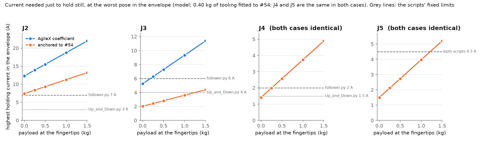
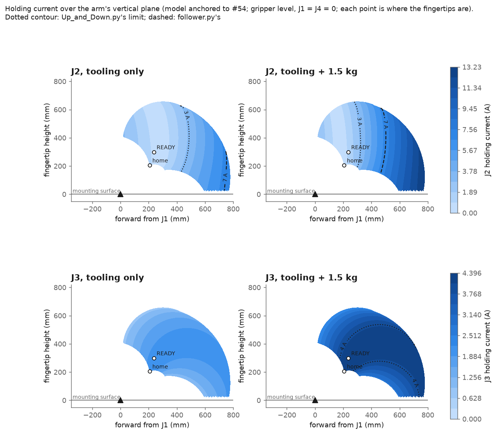
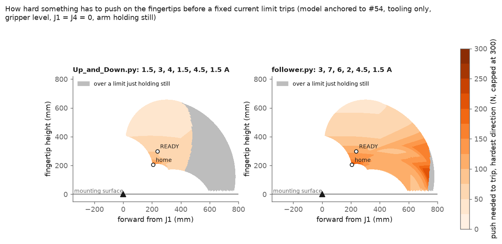

# PiPER cell: slowdowns, collision checks and joint currents (DRAFT)

**Status:** draft, written 2026-11-28 at sgbaird's request on
[PR #23](https://github.com/vertical-cloud-lab/robot-arms/pull/23), for the same review as the
rest of this folder. Nobody has reviewed it. It's analysis only: nothing moved the arm, and
nothing ran on a Pi.
**What it's for:** the [SOP](sop.md#d-powered-runs-and-the-workspace-clear-rule) requires a
person at the E-stop for every run. This file asks what the arm's own checks would have to do
before a run could go ahead **remotely with nobody at the cell**. It covers how fast the arm
should move, how it should check for collisions, and what current each joint motor should draw
at each pose and load.
**Numbers:** marked as in the rest of the folder ([`README.md`](README.md#how-numbers-are-marked)).
The model's numbers come from [`analysis/joint_currents.py`](analysis/joint_currents.py), and all
of them are in [`analysis/joint_currents.json`](analysis/joint_currents.json).
**What's changed since 2026-10-10:** the rest of this folder describes the arm as it was then.
Since then the arm has been driven from mpzy, which switches the arm's power through a relay
([`arm_power.py`](https://github.com/vertical-cloud-lab/robot-arms/blob/41a21f8/PiPER%20Sandbox%20Scripts/Arm%20Control/arm_power.py)).
A Raspberry Pi and an HQ camera are now mounted on the gripper, along with custom finger
sleeves. Main also has two scripts that move the arm,
[`Up_and_Down.py`](https://github.com/vertical-cloud-lab/robot-arms/blob/41a21f8/PiPER%20Sandbox%20Scripts/Arm%20Control/Up_and_Down.py)
and the teleop
[`follower.py`](https://github.com/vertical-cloud-lab/robot-arms/blob/41a21f8/PiPER%20Sandbox%20Scripts/Teleoperation/follower.py).
This file uses those scripts as of main at `41a21f8`.

## Summary

1. **A fixed current limit sees very different forces at different poses.** Take
   `follower.py`'s limits and the model scaled to this arm's readings. Before a limit trips,
   something has to push on the fingertips with anywhere from about 40 N (arm raised) to over
   200 N (arm stretched forward, pushed along its length), in the direction that's hardest to
   detect. At 6% of the poses in the arm's vertical plane, a limit is already exceeded just
   holding still. `Up_and_Down.py`'s tighter limits suit only the poses near home where it
   works: they trip holding still across half the plane.
2. **Use an expected current instead.** Trip when a joint's current is more than a margin away
   from what that pose, load and acceleration should draw. Set the margin from a measured
   baseline.
3. **The model can't supply the baseline.** For J3 it predicts 2.6 times the current the arm
   drew in #54, and up to 1.7 times for J2 (§2.2). Its shapes are useful: how current grows
   with reach and payload. Its absolute amps aren't, until measurement M3 calibrates them.
4. **Payload uses up J4's and J5's margins first.** With 0.5 kg in the gripper, J5 needs up to
   2.7 A and J4 2.6 A. J4's limits are 1.5 and 2 A. With 1.5 kg, J5 needs 5.2 A, over both
   scripts' 4.5 A. At full horizontal stretch J2 needs about 7.4 A with nothing in the gripper,
   just over `follower.py`'s 7 A.
5. **Moving slowly is what allows tight thresholds.** At `follower.py`'s 360°/s² acceleration,
   accelerating the arm alone adds up to 4.2 A on J1 and J2 when stretched. At
   `Up_and_Down.py`'s gentle profile it adds 0.2 A. So the slowdowns and the collision
   sensitivity are the same design choice.
6. **Nobody has read the firmware's own collision protection on this arm.** It has levels 0–8
   per joint, and 0 is off. AgileX's demo that "reads" the level first sets all six joints to
   0. Don't run it.
7. **The checks alone can't justify unattended runs.** None of them is safety-rated. An
   unattended run also needs guarding that keeps people out of the reach. §5 lists the
   proposed conditions.

## 1. What the arm and the scripts check today

| Check | Where | What it does | What's missing for an unattended run |
|---|---|---|---|
| Firmware collision protection | Joint drivers, set with CAN `0x47A` and queried through `0x477` → `0x47B` (piper_sdk 0.6.2 `CrashProtectionConfig`, `ArmParamEnquiryAndConfig(0x02, …)`) | Levels 0–8 per joint. 0 means no collision detection. The SDK doesn't say which end of 1–8 is the most sensitive `[unverified]` | **Never read on this arm.** Another user's arm read 0 ([piper_sdk#20](https://github.com/agilexrobotics/piper_sdk/issues/20)). AgileX's `demo/V2/piper_read_crash_protectation.py` calls `CrashProtectionConfig(0,0,0,0,0,0)` before it reads, so running it turns protection off |
| Collision and stall flags | Arm status `0x07` ("collision occurred"). Each driver's `collision_status` and `stall_status` bits in its low-speed feedback | `arm_fault()` in `Up_and_Down.py` stops on any non-zero arm status, so a firmware collision stop ends a run | The driver flags aren't read or logged |
| Fixed current limits | `Up_and_Down.py`: 1.5, 3, 4, 1.5, 4.5, 1.5 A (J1–J6). `follower.py`: 3, 7, 6, 2, 4.5, 1.5 A. Read from `GetArmHighSpdInfoMsgs()` every loop: 50 Hz and 200 Hz | A joint over its limit is a snag. `Up_and_Down.py` backs off 3° the way it came; `follower.py` holds where it is | The limits are the same at every pose and load (§2.4) |
| Lag | 4° (`Up_and_Down.py`), 10° (`follower.py`) between command and joint | Snag | In #54 the lag check alone took 0.35 s to see a jam |
| "Held up" | `Up_and_Down.py`: J5 carries less than 0.7 A of the gripper's roughly 1.5 A for 2 samples | Something under the gripper is holding it up | Only while the gripper hangs level |
| Speed and acceleration | `MotionCtrl_2` speed percent (15% and 40%), under each script's own profile: 12°/s peak in `Up_and_Down.py`; 45°/s and 360°/s² in `follower.py`, with returns at 12°/s | Two caps | Expressed per joint, not at the fingertips (§3) |
| Geometry | `follower.py`'s `--envelope` joint ranges. A floor check on the lowest point of the flange and fingertips while descending (≥ 5 mm) | Clamps targets | Nothing else in the cell is modelled, and only one point of the arm is checked (§4.1) |
| Lost link | No joint feedback for 0.5 s stops both scripts. In `follower.py`, no command for 0.15 s holds and 10 s parks | Stops or parks | No alert to a person |
| Power | `arm_power.py` cuts the relay only once the arm is parked | No drop at the end of a run | A crash or reboot of mpzy pulls GPIO17 low and cuts power **wherever the arm is**. It has no brakes, so a raised arm drops |

Nothing yet models the cell, sets thresholds from the pose, logs temperatures, limits how long
the arm may hold itself up after a stop, or tells a person that a run has stopped.

## 2. Joint currents against pose and load

### 2.1 Method

[`analysis/joint_currents.py`](analysis/joint_currents.py) computes the torque each motor needs
to hold the arm still against gravity. It also adds an acceleration term and works out how
hard a push has to be before a fixed limit trips. It's pure computation. Inputs:

- **Link masses, centres of mass and joint frames** come from AgileX's
  [`piper_description.urdf`](https://github.com/agilexrobotics/piper_ros/blob/ac41fcbcdda598f01b51cf6175ed9a24d0dacadc/src/piper_description/urdf/piper_description.urdf)
  `[unverified]`. They're CAD figures, not weighed on this arm: 3.65 kg moves, plus a 1.02 kg
  base, against the listing's 4.2 kg arm. The URDF's joints reproduce piper_sdk's DH kinematics
  (the table in `Up_and_Down.py`) to 0.14 mm. They also reproduce two things the scripts
  recorded: J5 = +5° holds the gripper level at home, and a 20° lift raises the wrist 94 mm.
- **Current to torque:** piper_sdk 0.6.2 converts with fixed coefficients: 1.18125 N·m/A for
  J1–J3 and 0.95844 N·m/A for J4–J6 (`ArmMsgFeedbackHighSpd.cal_effort`) `[unverified]`.
- **Tooling:** the gripper Pi, the camera, their mount, the sleeves and the cable haven't been
  weighed. The model's bare gripper needs 0.89 A on J5 to hold level. `Up_and_Down.py` records
  about 1.5 A there (#54), which fits 0.40 kg of tooling 60 mm past the flange `[unverified]`.
  Weighing it is measurement M4.
- **Payload:** a point mass 150 mm past the flange, the #19 photo estimate `[unverified]`. The
  URDF's link lengths add up to 627 mm from J2's axis to the flange. That suggests the listing's
  626 mm reach doesn't include the gripper, and the fingertips reach about 0.78 m `[unverified]`.
- **Envelope:** J2 0–180°, J3 −170–0°, J4 ±90° (teleop's jog range), J5 ±70°. Poses are left
  out when the elbow, wrist, flange or fingertips are within 20 mm of the mounting surface. That
  leaves 70,635 poses. J1 and J6 don't change the gravity load.
- **Not modelled:** friction, the gearboxes' reflected rotor inertia, cable drag, and how the
  controller reacts in a collision.

### 2.2 The model against this arm

#54 raised the arm from its rest to READY and back while logging currents. So each joint's peak
in that run bounds its holding current at both poses.

| Joint | Model at home, gripper level (A) | Model at READY (A) | #54 peak while moving (A) | Scale that fits #54 |
|---|---|---|---|---|
| J2 | 1.83 | 1.12 | 1.1 | ≤ 0.60 |
| J3 | 5.18 | 5.18 | 2.0 | ≤ 0.39 |
| J5 | 1.50 | 1.50 | 2.7 (that run also straightened J5 into a jam) | tooling fitted to it |
| J1, J4, J6 | ≈ 0 | ≈ 0 | 0.04, 0.2, 0.45 | nothing to fit: no gravity load |

**For J3, the model asks for at least 2.6 times what the arm drew.** If the model were right,
`Up_and_Down.py`'s 4 A limit on J3 would have tripped at home. Either AgileX's coefficient
understates J2's and J3's torque per amp, or the URDF overstates the forearm's mass or lever.
One run can't tell which, so the results come in two cases:

- **AgileX coefficient:** the URDF and the SDK as published. It predicts more current, so it's
  the cautious case for **false trips**.
- **Anchored to #54:** J2's and J3's currents are scaled by 0.60 and 0.39, which turns each amp
  into more torque. It's the cautious case for **how hard a collision can push before a
  trip**.

Measurement M3 replaces both.

### 2.3 Holding current at the worst pose, by payload

Values are anchored to #54, with the AgileX-coefficient case in brackets. J4 and J5 are the same
in both cases.

| Payload at the fingertips | J2 (A) | J3 (A) | J4 (A) | J5 (A) |
|---|---|---|---|---|
| None (tooling only) | 7.4 (12.3) | 2.0 (5.2) | 1.4 | 1.5 |
| 0.25 kg | 8.4 (13.9) | 2.4 (6.3) | 2.0 | 2.1 |
| 0.5 kg | 9.3 (15.5) | 2.8 (7.3) | 2.6 | 2.7 |
| 1.0 kg | 11.3 (18.8) | 3.6 (9.3) | 3.7 | 4.0 |
| 1.5 kg (rated) | 13.2 (22.0) | 4.4 (11.4) | 4.9 | 5.2 |
| `Up_and_Down.py` limit | 3 | 4 | 1.5 | 4.5 |
| `follower.py` limit | 7 | 6 | 2 | 4.5 |

- **Where the worst poses are.** J2's is the arm stretched straight out forward. J3's is the
  forearm horizontal. J4's is J4 turned to ±90° with J5 bent to ±70°, which tilts the wrist
  sideways; teleop's 1 and 2 keys reach that. J5's is the gripper horizontal.
- **Torque.** J2 needs 14.5 N·m at full stretch with only the tooling, and 26 N·m with 1.5 kg.
  piper_sdk accepts MIT-mode torque commands of up to ±18 N·m (`JointMitCtrl`). If that's the
  motors' limit, the 1.5 kg rating must apply closer in than full stretch `[unverified]`.
- **Per kilogram.** At the worst pose, each kilogram at the fingertips adds 3.9 A to J2 (6.5 A
  with AgileX's coefficient), 1.6 A to J3 (4.1), 2.3 A to J4 and 2.5 A to J5. A 0.5 kg object
  slipping out of the gripper changes J5's current by up to 1.2 A. That's large enough to
  detect (§4.2).
- **J1 and J6 carry no gravity load.** J1's axis is vertical, and the model's masses sit close
  to J6's axis. Their current is friction, acceleration and contact. The gripper Pi sitting
  about 35 mm off J6's axis `[unverified]` would add up to 0.14 A on J6.

The map shows the arm's vertical plane with the gripper level. Each point is where the
fingertips are, coloured by the current needed to hold them there. J2's current grows with
reach. `Up_and_Down.py`'s 3 A contour sits about 470 mm out with only the tooling, and
`follower.py`'s 7 A contour about 740 mm out. J3's current changes much less across the plane.

### 2.4 Acceleration

This is the extra current needed to accelerate at each script's rate, at the worst pose. It's a
lower bound: links are treated as point masses, and rotor inertia is left out.

| Acceleration | J1 (A) | J2 (A) | J3 (A) |
|---|---|---|---|
| `follower.py`, 360°/s², tooling only | 4.2 | 2.5 (4.2) | 0.4 (1.1) |
| `follower.py`, 360°/s², with 1.5 kg | 9.0 | 5.4 (9.0) | 1.2 (3.0) |
| `Up_and_Down.py`, 14°/s² peak (20° at 12°/s), tooling only | 0.17 | 0.10 (0.17) | 0.02 (0.04) |

At teleop's acceleration, a stretched-out arm needs more than `follower.py`'s 3 A on J1 just to
speed up or slow down. A fixed limit can't be tight while the arm accelerates like that. At
`Up_and_Down.py`'s pace, the acceleration term is lost in the noise.

### 2.5 How hard a push trips a fixed limit

The force needed depends on its direction. The map shows the direction that needs the most.
These are results from the model anchored to #54, with only the tooling and the arm holding still:

| Limits | Poses over a limit holding still | Push needed, hardest direction: 10th / 50th / 90th percentile | At READY: hardest / easiest direction |
|---|---|---|---|
| `Up_and_Down.py` | 48% | 0 / 32 / 68 N | 70 N / 7.5 N |
| `follower.py` | 6% | 45 / 88 / 144 N | 112 N / 12 N |

- **The hardest direction is along a stretched arm.** Near full stretch, a push along the arm's
  length barely loads any motor. The easiest direction is sideways, which J1 resists with no
  gravity load to hide it.
- **For scale only:** ISO/TS 15066 lists quasi-static contact limits of 140 N for hands and
  fingers and 65 N for the face `[unverified]`. This arm isn't a collaborative robot, and its
  checks aren't safety-rated, so these limits are a yardstick, not a claim.
- **The map is static.** In a moving collision the force overshoots the trip value: the arm
  keeps going for as long as detection takes, and the contact's stiffness turns that distance
  into force. §3 is about keeping that distance short.

## 3. Slowdowns

Speed matters three ways when nobody is at the E-stop:

1. **The arm moves on while a check notices.** In #54, J6's current rose from 0.1 A to 1.3 A
   in 40 ms of a jam and peaked at 16 A. The lag check alone took 0.35 s.
2. **Braking takes room.**
3. **Acceleration loosens the current thresholds** (§2.4).

The fingertips' speed is the joint speed times their distance from the axis, up to about 0.78 m:

| Fingertip speed | Example | Travel during detection: 40 ms / 0.35 s | Braking at 360°/s² |
|---|---|---|---|
| 0.61 m/s | J1 at 45°/s (teleop's cap), stretched out | 24 mm / 210 mm | 38 mm |
| 0.25 m/s | ISO 10218-1's "reduced speed" `[unverified]` | 10 mm / 88 mm | 6 mm |
| 0.16 m/s | J1 at 12°/s (`Up_and_Down.py`'s peak), stretched out | 7 mm / 57 mm | 3 mm |
| 0.05 m/s | Proposed approach speed | 2 mm / 18 mm | < 1 mm |

**Proposed speed tiers for unattended runs.** These values are for the review team to set:

| Tier | Where | Fingertip speed | Joint acceleration | Current check |
|---|---|---|---|---|
| Transit | Free space, at least 100 mm from everything in the cell model (§4.1) | ≤ 250 mm/s | ≤ 60°/s² | Expected current plus margin |
| Approach | Within 100 mm of the table, a fixture or a pick or place target | ≤ 50 mm/s | ≤ 30°/s² | A tighter margin, and the lag limit at 2° |
| Contact | The last 10 mm of a grasp or place | ≤ 10 mm/s | — | Stop on a current rise. Grip with a capped gripper effort |
| Near a limit | Within 10° of a firmware limit or a known cable stop (J6 jammed at −55° in #54) | Half the tier's | — | — |

- **Cap the speed at the fingertips,** computed with the forward kinematics the scripts already
  have (`UD.fk`). A MOVE J percent moves the fingertips about 6–23 mm/s, depending on reach
  (1.67°/s per percent, from the arm notes on the PR #20 branch). Keep `MotionCtrl_2`'s percent
  as a second cap, as both scripts do.
- **Use smooth profiles,** like `Up_and_Down.py`'s raised cosine. Avoid steps: a step in speed
  is a spike of acceleration.
- **Teleop's 45°/s and 360°/s² are for supervised sessions only.** So is the uncapped "high
  follow" mode the Teleoperation README lists as a next step.

## 4. Collision checks

Collision checks come in three layers: one before a move (geometry), one during it (current and
lag), and one after a detection (the response).

### 4.1 Before a move: check the whole path against a model of the cell

- **Model the arm as capsules.** A capsule is a segment with a radius, placed with `fk()`. Use
  one each for J2→J3, J3→J5, J5→flange and flange→fingertips, plus a box for the gripper Pi and
  camera. The radii come from CAD or a tape measure `[to measure]`.
- **Model the cell as boxes.** Include the mounting surface, a keep-in box (the dome or the
  enclosure's walls), and keep-out boxes: the printer and its travel, the shelf, the
  transformer zone plus its 190 mm `[unverified]`, camera mounts and the CubXL. Measure them as
  built `[to measure]`, and measure again whenever something moves.
- **Check every planned path before enabling the motors,** sampled at 1° of joint motion or
  less. Check each streamed setpoint again before sending it, which costs one `fk()` call.
- **Include self-collision** (the forearm against the base and the upper arm) and the J6 cable
  stop.
- **Reject a failing target; don't clip it.** Clipping turns a path into one nobody planned.
  In an unattended run, a failed check ends the run.
- **Today:** only `follower.py` checks geometry, and only the lowest point of the gripper
  against the floor.

### 4.2 During a move: expected current, not fixed limits

- **Residual.** For each joint, take the measured current minus the expected current at this
  pose, velocity, acceleration and load. Get the expected current from measurement M3's
  baseline map, or from the model scaled joint by joint to M3.
- **Trip** when a residual stays beyond its margin for 2 samples in a row, as
  `Up_and_Down.py`'s held-up check already does. A proposed margin: 4 standard deviations of
  M3's scatter at that pose, plus the acceleration term.
- **What changes.** The threshold rises with reach and load, where fixed limits false-trip
  (J2 at full stretch, J4 and J5 with a payload). Near home it falls well below today's limits,
  where they're loose.
- **Payload check.** At the start of each carry, check that J5's holding current has risen by
  the expected payload share. A sudden drop of that size mid-carry means the object fell.
- **Keep the lag check,** and set it per tier (proposed: 2° in approach).
- **Firmware collision protection as a backstop:**
  1. Read the level. The query sends a CAN frame but no motion. Run it under its own request
     (M2).
  2. In a supervised test, choose a level that doesn't trip on the cell's normal moves but does
     trip on a soft obstacle (M5).
  3. Read it back at the start of every unattended run.
  - Never run `piper_read_crash_protectation.py`.
- **Log the driver flags** (`collision_status`, `stall_status`, `driver_overcurrent`) and the
  drivers' and motors' temperatures, all from the low-speed feedback.
- **End-load setting.** The firmware takes "no load", "half load" or "full load"
  (`ArmParamEnquiryAndConfig(…, 0xAE, 0x00–0x02)`). Whether that changes the collision
  thresholds isn't documented `[unverified]`.

### 4.3 After a detection

1. **Stop, back off a few degrees the way the move came** (as `Up_and_Down.py` does), **then
   hold.** Don't cut power: the arm drops (H6).
2. **Tell a person.** Post a comment on a GitHub issue or in the lab channel, with the last
   seconds of the trace and a camera frame.
3. **Don't retry automatically.** A person looks at the trace and the camera, then decides.
4. **Holding is not forever.** Holding heats the motors `[to measure]` (M7), and a reboot of
   mpzy drops the arm. This draft proposes that the arm never parks itself after a detected
   collision. It may park itself after a lost link with no collision, if the path home passes
   §4.1. The review team should decide.
5. **Log every run.** Record the commanded and measured angles, each joint's current and
   residual, and the driver flags, at 50 Hz or faster. `Up_and_Down.py`'s `trace_loop` already
   writes the first three.

## 5. Remote, unattended runs: proposed conditions

None of the checks above is safety-rated, so they can't be what makes it acceptable for a
person to be near the arm. An unattended run is acceptable only if **nobody can reach the arm
while it has power** (U1). The software checks then protect the cell, the arm and the work, and
they let a person decide what to do after a stop.

| # | Condition | Status |
|---|---|---|
| U1 | **Guarding.** An enclosure that keeps people out of the reach whenever the arm has power, with an interlock on its door. The canvas dome doesn't qualify (H9). The review team decides what the interlock does: cut power at once (the arm drops) or stop the run first | Not built |
| U2 | **A model of the cell as measured, and the path check in §4.1** on every move, covering every link | Not written |
| U3 | **Expected-current thresholds from the M3 baseline (§4.2),** the payload check, and the firmware collision level read back each run | Not written. M2, M3 and M5 first |
| U4 | **Speed tiers (§3),** capped at the fingertips | Not written |
| U5 | **No surprise power cuts.** mpzy doesn't reboot or update during runs; check that `unattended-upgrades` is absent on it, as it is on 76zj. A UPS for mpzy `[proposed]`. The arm is raised only while it has to be | Not checked |
| U6 | **A person can watch from anywhere:** a camera they can open, the residuals logged, and an alert on every stop | Partly: mpzy's camera streams into teleop sessions |
| U7 | **Start conditions checked by the script, not a person:** the arm parked (`arm_power.py check`), the firmware limits and collision level read back, the enclosure closed, today's baseline moves within tolerance, nobody visible on the camera | Not written |
| U8 | **Stop on anything unexpected, with no automatic retry** | Partly: both scripts stop on snags |
| U9 | **A named job with a declared payload and a maximum length,** and a log of who started it | Not written |
| U10 | **Temperatures logged, with a stop above a limit** `[to measure]` (M7) | Not written |
| U11 | **A short list of who can start one** (SOP §A.8) | Not written |
| U12 | **The review team re-rates H4, H9, H15 and H16,** and approves unattended runs in writing | Not done |

## 6. Measurements to take first

Each one needs its own explicit request, with the workspace clear and someone at the E-stop.
None is done.

| # | What | Why |
|---|---|---|
| M2 | Read the collision protection level of each joint: a read-only query, no motion | Is protection on at all? |
| M3 | Baseline currents. Hold the arm still for 1 s at each pose on a grid inside the cell's envelope, moving between poses at 10°/s or slower. Do it with the usual tooling, and with test masses of 0.25 and 0.5 kg in the gripper. Repeat 3 times | Scales the model joint by joint. Measures friction and scatter. Sets the margins in §4.2 |
| M4 | Weigh the tooling. Measure the fingertip length and the tooling's offset from J6's axis | Replaces the 0.40 kg fit, the 150 mm and the 35 mm |
| M5 | Bring the arm up against a foam block at the approach speed, at each candidate collision level and current margin | Do the checks trip, and how hard has the arm pushed by then? |
| M6 | Time from contact to stop, with the current and lag checks at 50 and 200 Hz | The detection time §3 assumes |
| M7 | Motor and driver temperatures over a one-hour hold at READY | How long the arm can safely hold itself up after a stop |
