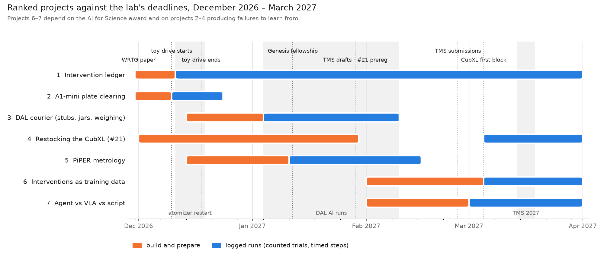

# Vision-enabled 6-DOF arm projects: the November 2026 update

This update answers the [2026-11-28 request on issue #1](https://github.com/vertical-cloud-lab/robot-arms/issues/1):
an extensive and thorough update on high-impact, timely projects for the lab's AgileX PiPER cell. It covers the
latest literature, the future work that earlier papers asked for, and the current state and goals of the arm cell,
byu-vcl and digital-alloy-lab (DAL). Everything here is a snapshot as of 2026-11-28.

**How it was built.** Six parallel surveys covered the robot-arms, byu-vcl, DAL and other org repositories (every issue
and PR listed, about 260 threads read in full), the literature from May to November 2026 (80 checked entries), and the
stated future work of 29 central papers, checked against the 11,095 works that cite them since January 2025. A
seventh condensed the 24 Edison answers already on record so they would not be asked again. Then this round sent new
high-effort Edison queries one at a time, each written against the answers before it (U1 to U6, in
[`../edison-6dof/`](../edison-6dof/)). Separate agents checked their load-bearing claims against the papers' full
text, read through a tunnel that exits from BYU's network. The survey notes are in [`surveys/`](surveys/) and the
checks are in [`verification.md`](verification.md).

## The short version

1. **The cell has barely started, and the lab's own analyses ask for the same thing the literature does: measured
   handling.**
   - The cell: the PiPER has done 10 tape-pick attempts and a few teleop sessions, and nothing since 11-14. Most of
     its cameras are offline, and its E-stop has never been tested.
   - byu-vcl's digital twin says robot transport doesn't bind and its handling times are stand-ins.
   - DAL's schedule says the 10–15 person-hours after each atomizer run are the bottleneck, and none of it is timed.
2. **The field's most-repeated unmet request is measured reliability.** 14 of 29 central papers ask for it, and ADePT
   (2026) asks explicitly. Nobody has yet published interventions per operation for an arm in a real SDL, or a
   time-and-motion breakdown of an atomize → sieve → SEM workflow. **Projects 1 and 2 below produce both, starting
   this month.**
3. **What's new since September:**
   - Coding agents now beat VLAs on manipulation benchmarks but take minutes per task (AMP1, CaP-X, ACE-CaP-0).
   - The PiPER became the default low-cost arm in lab-manipulation papers, and none reports its accuracy.
   - Independent SO-101 numbers came in well below launch claims, and success detection became an off-the-shelf part.
   - Cloud-lab and metals-SDL funding landed, including CMU automating Al powder on the same rePOWDER atomizer DAL uses.
   - Liverpool and LLNL are working on the same questions.
4. **Printer tending is not new, but measuring it is.** BU's BEAR did it with a UR5e in 2020, MAMA BEAR ran 25,387
   experiments, and SmartLab ran it remotely. None of them reports a handling success rate; the only number is 20 of
   21 prints removed in a 2022 IEEE RAM paper. Nobody reports how often a plate-clear check is wrong. A $2.5k arm
   clearing consumer printers with logged interventions is new, and the December toy drive is the occasion.
5. **For DAL, the PiPER is a courier, not a process tool.** It can move sealed jars, weigh, check labels and move SEM
   stubs and coupons between purpose-built stations. It stays out of the atomizer and open powder until an EHS review.
6. **Robots restocking consumables** is future work in 6 of the 29 papers. The only precedent is rack transfers into a
   GC station (Burger's thesis, 464/464). Restocking a gantry liquid handler's deck (vials, carriers, tip racks) is
   unclaimed, and the CubXL campaign already preregisters exactly that, so frame it that way.
7. **"An agent designs the fixture and writes the workflow, and the arm runs it"** (the AI for Science proposal) has
   no published precedent in lab automation. AI-designed tools and fingers have been printed and tested outside labs
   (RobotSmith 2025, Xu et al. 2024, and RoboBuilder's 135 agent-designed robots). The control half is crowded:
   frozen agent code already reached 221/240 on PiPER X arms (ACE-CaP-0). The lab-fixture half is open. Freeze code once it works, run at least 25 trials per condition, and
   include a human-expert baseline.
8. **Interventions as training data.** Learning from teleoperated takeovers is established (RaC, TRANSIC, HACTS). Doing
   it in a lab workflow is not: a scripted arm, takeovers with the SO-101 leader, and the intervention rate tracked with
   its denominator across a campaign. LeRobot already ships the pieces.
9. **A PiPER metrology paper would be widely cited.** An Annin AR4 study (Oct 2026) took the "first sub-$5k arm" claim,
   but there is still nothing on the PiPER that everyone now uses.
10. **Edison's "no published evidence" claims need checking.** Two of U1's failed: printer tending (BEAR) and remote
    operation (TeleopLab, PUPPET). A-Lab's headline numbers were revised by a 2026 correction, and several headline
    results turned out to be simulated or design targets ([section 5](#5-corrections)).

**First, the safety gates:** test the E-stop end to end, stop a Pi reboot from dropping the arm mid-move, and get the
hazard analysis reviewed.

## 1. Where the lab stands

### The PiPER cell (robot-arms)

- **The arm has done little physical work, and nothing since 2026-11-14.**
  - What it has done: tape-roll picks (6 of 10 executed grasps succeeded, with code changing between attempts),
    up/down cycles, relay power tests, and the first sessions with jss265's SO-101 leader arm driving the PiPER (34 ms
    median round trip).
  - It has never gripped a vial, a carrier or an auger. There is no repeatability, success-rate or intervention data
    yet ([hardware check](https://github.com/vertical-cloud-lab/robot-arms/blob/c8b3408/docs/protocol/hardware-and-safety-check.md)).
- **The cameras are mostly down.** Only the fixed front camera on the Pi that drives the arm works. The wrist Pi has
  been offline since 11-11 and the back-camera Pi since 11-06 ([PR #81](https://github.com/vertical-cloud-lab/robot-arms/pull/81)).
  - No camera has an intrinsic or hand-eye calibration on hardware.
  - The one on-hardware tag test read 25 mm tags at about 1 m but 0 of 48 10 mm tags ([PR #40](https://github.com/vertical-cloud-lab/robot-arms/pull/40)).
- **The flagship study is ready to register, but nothing on the bench exists yet.** The CubXL loading campaign
  ([#21](https://github.com/vertical-cloud-lab/robot-arms/issues/21), [PR #89](https://github.com/vertical-cloud-lab/robot-arms/pull/89))
  is an OSF preregistration: open-loop versus AprilTag-corrected carrier and vial loading, at least 300 loads per cell,
  a 21-level capture envelope and ISO 9283-style repeatability. In all that is 5,760 transfers and about 660 human
  resets. The dock, carriers and finger inserts are CAD only, and the realistic first counted block is 2027-03-05.
- **The arm's own limits shape every task.**
  - Grasps: J5 stops at ±70°, so there is no straight-down grasp near the table.
  - Wrist cable: it limits J6 to about a 90° window.
  - Zeroing: J1 has jumped by multiples of about 7.95° on enable, and was re-zeroed by 15.2° on 11-14.
  - Gripper: the force overshoots (1 N·m commanded, 4.9–7.2 N·m peaks), and the motor overheated once mid-carry.
- **Safety is mostly on paper.** The E-stop has been installed since late October but never tested. A reboot of the arm
  Pi cuts power mid-move, and the arm has no brakes. The hazard analysis ([PR #23](https://github.com/vertical-cloud-lab/robot-arms/pull/23))
  has not been reviewed, and unattended runs are "no for now".
- **The newer directions are mostly simulated or agentic:**
  - a MuJoCo twin with AprilTag and auger-swap scenarios ([PR #77](https://github.com/vertical-cloud-lab/robot-arms/pull/77));
  - Apple's AMP1 reproduced on CaP-Gym with a simulated PiPER, now extended to A1-mini print removal, auger swap and
    atomizer charging ([PR #87](https://github.com/vertical-cloud-lab/robot-arms/pull/87));
  - printer tending ([#86](https://github.com/vertical-cloud-lab/robot-arms/issues/86));
  - a livestream with on-device face blurring ([PR #81](https://github.com/vertical-cloud-lab/robot-arms/pull/81)).
- **The team's priority and the paper's differ.** jss265's semester priority is swapping augers on the powder doser
  ([#42](https://github.com/vertical-cloud-lab/robot-arms/issues/42)). That is force-limited: the clip pull-out is
  estimated at 12–40 N against about 15 N at the flange, and has never been measured. Meanwhile powder-doser
  [#203](https://github.com/vertical-cloud-lab/powder-doser/issues/203) is moving the tap collar so augers lift
  straight out, and the multi-doser carousel is being designed to need no arm at all.
- **The WRTG 316 proposal** (jss265, due 12-01) frames the lab's question as which published tests show whether a
  low-cost arm can serve as an "automated manual manipulator" ([`docs/wrtg-316/`](../wrtg-316/)).

### byu-vcl: what the lab is building toward

- **A "vertical cloud lab" for alloy discovery,** with an aluminium campaign (FLAIME, for DOE's Genesis Mission) and a
  copper campaign (the ONR YIP). The current design uses two MiR250 + UR12e mobile manipulators rather than the PiPER
  ([#303](https://github.com/vertical-cloud-lab/byu-vcl/issues/303)).
- **The lab's own analysis says transport doesn't bind and handling times are guesses.** byu-vcl's digital twin
  ([#407](https://github.com/vertical-cloud-lab/byu-vcl/issues/407), [PR 410](https://github.com/vertical-cloud-lab/byu-vcl/pull/410))
  found:
  - "Transport doesn't bind … the robots are 1–2 % busy."
  - What binds is "money, the atomizer, DED, the 30-day immersion and decision time … about 250 results a run wait
    a median of 77 h for a person."
  - "The handling times are stand-ins. Nobody has timed a MiR250 + UR12e at our instruments."
- **The throughput goal** is to go from about one alloy tested per day to ten ([PR 318](https://github.com/vertical-cloud-lab/byu-vcl/pull/318)).
- **The AI for Science application** (submitted 11-06, [#325](https://github.com/vertical-cloud-lab/byu-vcl/issues/325))
  asks "can a language-model agent design and validate this connecting hardware, and the robot workflows around it,
  well enough that the alloy loop runs with minimal human handling, with full provenance and traceability?" It puts
  fixtures (cup station, press nest, cup carrier, SEM stub holder) in months 1–2 and an **arm cell in months 2–4**.
- **The most fully specified arm task is CubXL vial and carrier handoff** ([#266](https://github.com/vertical-cloud-lab/byu-vcl/issues/266)):
  a 3 mm lead-in dock, an 8 + 1 carrier of 0.53–0.66 kg, a ±1.15 mm worst-case error budget, and 200-swap pass criteria.
- **The most timely task is clearing printer plates.** For the ME toy drive (first delivery Dec 10, last day Dec 18,
  [#399](https://github.com/vertical-cloud-lab/byu-vcl/issues/399)), sgbaird wrote "we will probably try
  auto-removing them via a ping to robot-arms" ([PR 402](https://github.com/vertical-cloud-lab/byu-vcl/pull/402)).
  Today people clear every plate, and an agent won't send a print until a camera frame shows the plate clear.
- **Constraints:**
  - The CubXL Pi is overloaded and dropped off on 11-17.
  - The OT-2 "needs new direction".
  - Budget is tight, and metal-powder safety rules apply.
  - Two people did hands-on hardware work in byu-vcl over the last two weeks, and the semester is ending.

### DAL: where the hours go

- **FLAIME's loop:** CALPHAD → AMAZEMET rePOWDER ultrasonic atomizer → LPBF → density, hardness, tensile and
  corrosion. Cost-aware BOFN/pKGFN chooses the next experiment.
- **The campaign** plans 40 atomizer runs and a paper targeted for Feb 28, 2027, realistically March–May
  ([DAL #277](https://github.com/vertical-cloud-lab/digital-alloy-lab/issues/277)).
- **The atomizer has been down since a cup failure on 11-13.** Restart is targeted for Dec 11–18, then about 20 Al
  runs from Jan 4 to Feb 9.
- **The bottleneck is the work after each run.** DAL's own schedule says "The atomizer isn't the bottleneck; the work
  after each run is. One run takes about 10–15 person-hours from charge to SEM", and none of it has been timed
  ([DAL #256](https://github.com/vertical-cloud-lab/digital-alloy-lab/issues/256)).
- **Arm-ready steps, ranked by the DAL survey:**
  1. post-run powder workup: the mass balance, loading the sieve shaker, splitting, jars and labels, and 5 g oxygen
     samples;
  2. SEM stub logistics, at 7–8 stubs per run (12.7 mm pin stubs in 3.4 mm holes);
  3. charge kitting from bar slugs and master-alloy pieces;
  4. an Archimedes density and Vickers hardness station.
- **Keep the arm out of the atomizer.** Only three trained operators may touch it, and a transducer slip costs $5–10K.
- **Aluminium powder is a combustible metal** (NFPA 484, now NFPA 660). DAL's guidance keeps unrated electronics out
  of the powder enclosure, so any cell handling powder needs an EHS review first.
- **FLAIME already plans to replace each human handoff with a robot in Phase II.** It notes a private door between the
  powder lab and the microscopy center.

### The rest of the org

- **powder-doser:** augers (Ø25 × ~250 mm; 53 g empty, ~155 g full) are filled and swapped by hand. 25 standalone
  dosers are being built.
- **tensegrity-optimization:** the drop tower is in a shared lab elsewhere and has been halted since its
  accelerometer broke on 10-19.
- **caliber:** this is about SEM/EDS acquisition settings, and the SEM belongs to a department facility.
- **custom-induction-furnace:** its 20 mm crucible is loaded with tweezers.
- **digital-wetlab:** "The OT-2 has no gripper", so 96-well plates move by hand.
- **CubOS:** a fork of Ursa Labs' gantry software, with a SiLA 2 / HTTP API.
- **borysgroup/aurora-cloud-infra:** the PiPER came from there, unused ("aurora does not need it"). The wrist-camera
  mount there (#5) is specified but not built.

Full notes: [`surveys/robot-arms.md`](surveys/robot-arms.md), [`surveys/byu-vcl.md`](surveys/byu-vcl.md),
[`surveys/dal.md`](surveys/dal.md), [`surveys/org.md`](surveys/org.md).

## 2. What changed in the literature since September

Most items below are 2026 preprints; the full list, with what each reports, is in
[`surveys/lit-latest.md`](surveys/lit-latest.md).

1. **Coding agents overtook vision-language-action models (VLAs) on manipulation benchmarks, but they are slow.**
   - Apple's AMP1 ([arXiv:2611.09892](https://arxiv.org/abs/2611.09892), Nov 6) has a frontier model write Python for
     the arm. It reports 85.6% on RoboLab-120 against 49.2% for the best VLA, and 104/108 real trials against 27.8%
     for π0.5, at 280 s per task and about $1.39 per episode. It is Franka-only, with calibrated depth.
   - CaP-X/CaP-Gym ([arXiv:2603.22435](https://arxiv.org/abs/2603.22435), ICML 2026) is now the shared benchmark.
   - WetRobo ([arXiv:2609.18435](https://arxiv.org/abs/2609.18435)) had a coding agent drive **PiPER** arms across two
     wet labs, with small trial counts: cap lifting went 10/10 in each lab on repeat runs, and a VLA scored 0/10 in
     the second.
2. **The PiPER became the default low-cost arm in lab-manipulation papers,** and none of them reports its accuracy or
   repeatability:
   - RoboSynChallenge ([arXiv:2608.12416](https://arxiv.org/abs/2608.12416)): π0.5 reached 33–38.5% on pipette and
     sample-loading tasks.
   - Robo-MLT ([arXiv:2611.13039](https://arxiv.org/abs/2611.13039)): 82% and 70% from about 1,000 demonstrations
     per task.
   - TVF-DiT: powder transfer, over only 10 trials per task.
   - LoRA-SP at ICRA 2026.
3. **Independent numbers for the SO-101 are far below launch claims.**
   - A failure benchmark ([arXiv:2606.08881](https://arxiv.org/abs/2606.08881)): π0.5 56% and SmolVLA 33% with 100
     demonstrations per task.
   - Cowling ([arXiv:2610.37170](https://arxiv.org/abs/2610.37170)): ACT went from 1/40 to 37/40 between 12 and 100
     demonstrations.
   - RoboColosseum ([arXiv:2611.02497](https://arxiv.org/abs/2611.02497)): SO-101 rankings were the least
     reproducible across sites.
4. **Lab-specific VLA benchmarks multiplied, and all show low success.** Examples are LabDex, SciVLABench, DexBioLab and
   Labference. In Labference, VLAs ignore the balance reading, so dosing to a target mass needs an explicit controller
   layer.
5. **Success and failure detection became an off-the-shelf part.**
   - DeepMind's Gemini Robotics ER 2 model card (July 30) shows 82.4% video success detection, but in a vendor chart
     with no sample size.
   - Robometer and TOPReward ship inside LeRobot.
   - LIRA's fine-tuned edge VLM caught 195 of 200 hand-placed errors ([Zhou et al. 2025](https://doi.org/10.1038/s42004-025-01770-1)).
6. **LeRobot churned.**
   - v0.7.0 (Nov 5) replaced `async_inference` with a policy server.
   - Python 3.12 has been required since v0.5.
   - The PiPER is still supported only through third-party plugins.
   - LeRobot ships a HIL-SERL pipeline in which an **SO-101 leader arm can take over mid-episode** and the
     intervention rate is logged ([docs](https://huggingface.co/docs/lerobot/hilserl)).
7. **Cloud-lab and metals money landed in July–August 2026.**
   - NSF's Programmable Cloud Laboratories got $380M, plus up to $20M from Astera, and includes metals nodes.
   - CMU's Materials Innovation Cloud Lab starts by automating **Al-alloy powder production on an AMAZEMET rePOWDER,
     the same atomizer DAL uses** ([CMU news](https://engineering.cmu.edu/news-events/news/2026/08/07-accelerate-materials-discovery.html)).
   - Texas A&M is building a $24.9M metals SDL open to U.S. academics ([TAMU news](https://stories.tamu.edu/news/2026/08/05/texas-am-to-build-self-driving-laboratory-for-metals-open-to-researchers-nationwide/)).
   - DOE Genesis Phase I made 278 awards.
8. **Robots now load crucibles and arc melters:**
   - AlloyBot (preprint, [10.21203/rs.3.rs-9761885/v1](https://doi.org/10.21203/rs.3.rs-9761885/v1)): designed for
     about one alloy an hour, with three alloys validated;
   - NIMS's COBOTTA + Quantos cell;
   - A-Lab follow-ups under inert gas.

   Metallographic preparation stays manual in academic labs except BAM's UR5e-based RASI. Printer farms use
   sheet-swapping harvesters (Prusa's automatic sheet changer).
9. **The Liverpool and LLNL groups are moving on the same questions.**
   - Liverpool: LIRA; closed-loop rack insertion ([RackInsert](https://doi.org/10.1109/case69030.2026.11704402));
     tool–policy co-design for powder weighing ([arXiv:2609.39797](https://arxiv.org/abs/2609.39797)); FLIP at ICRA
     2026; RobInHood.
   - LLNL (Gongora, of BU's BEAR): a teleoperation interface for SDL fault recovery on a UR3e
     ([arXiv:2611.18496](https://arxiv.org/abs/2611.18496), Nov 13), and an OSTI report of SO-101 vial placement with
     ACT (not checked here).
10. **The safety baseline moved.**
    - ISO 10218:2025 and R15.06-2025 add cybersecurity requirements for networked robots.
    - LabSafety Bench: no model reaches 70% on hazard identification.

    So an LLM or VLM cannot be the safety layer.

## 3. Future work the field keeps asking for

From 29 central papers' own limitations and future-work sections, with every citing work since January 2025 screened
([`surveys/future-work.md`](surveys/future-work.md)):

| Rank | Still open (Nov 2026) | Papers stating it | Closest follow-ups (all partial) | Fit for this lab |
|---|---|---|---|---|
| 1 | **Quantified reliability**: per-operation failure or intervention rate, MTBI, assisted vs unassisted lifetime, with confidence intervals | 14 of 29 | LIRA's 600/600 operations with no interval; IBM RoboRXN's multi-year report (not an arm); [ADePT 2026](https://doi.org/10.1038/s42004-026-01932-9) now explicitly asks for per-step error rates | Cheap to generate: log every cycle and every human touch |
| 2 | **Low-cost arms validated for lab tasks** ("the type of robot arm remains unknown", Harazono 2024) | 7 | [AR4Calib](https://doi.org/10.1016/j.mfglet.2026.08.019) (Annin AR4, Oct 2026), Forte (Humanoids 2025), WetRobo | Nothing on the PiPER |
| 3 | **Powder and solid handling** across powder types and small masses | 6 | Liverpool's FLIP and tool–policy co-design, SCU-Hand, all on a Franka or bespoke hardware with chemistry powders | Metal AM powders on a low-cost arm: open, but safety-gated |
| 4 | **Robots restocking consumables** and preparing setups | 6 | Self-Building Labs (layout and skills only) | **No follow-up found.** CubXL vials and tips, OT-2 tip racks and printer plates are all restocked by hand |
| 5 | **Hardware for structural and solid-state materials** (dispensing, high temperature, mechanical testing, microstructure) | 5 | NIMS 2026, AlloyBot, AIMD-L | No low-cost version exists; this is DAL's loop |
| 6 | Perception without touch calibration (markerless, transparent, reflective; vision-based station registration) | 5 | LIRA, RackInsert, [quARtet](https://arxiv.org/abs/2610.01072) multi-tag marker | Fiducials on fixtures remain the pragmatic route |
| 7 | Safety for unattended and remote operation | 5 | Mostly simulation and benchmarks | No certified pre-flight check for remote users |

### The earlier opportunities, checked again

| # | Opportunity from September | Status now | What remains new |
|---|---|---|---|
| 1 | First measured intervention-rate / MTBI dataset for an arm in a real SDL | **Not scooped**, but Liverpool and LLNL are close | A ≥500-cycle campaign with a LabRobFail-compatible taxonomy, exact intervals and assisted/unassisted lifetime |
| 2 | Metrology of a sub-$5k arm | **Partly scooped** by AR4Calib (Annin AR4, error 51 → 6.0 mm, validated with dial indicators per ISO 9283) | A full ISO 9283 study of a *commercial* sub-$5k arm (the PiPER) in lab poses, with drift and traceable ground truth |
| 3 | Vision-corrected primitives, open-loop vs corrected | **Partly**: RackInsert (Franka, 83.1%), quARtet (UR5e), Fontenot 2026 (xArm, no open-loop baseline) | Per-primitive success with intervals, open-loop and corrected, on a low-cost arm |
| 4 | Cloud-operated frugal SDL with reported uptime | **Partly**: [SmartLab](https://doi.org/10.1093/jcde/qwaf034) made and tested 90 printed specimens remotely; no uptime anywhere | Uptime and intervention statistics for remote users |
| 5 | Wrist-camera handling of metal powders | **Not scooped** | Al-alloy powders, a low-cost arm, combustible-dust handling |
| 6 | Generative gripper design → print → measure | **Largely scooped as a concept** (tool–policy co-design, soft-gripper co-design, Dextra) | Measure-redesign-reprint iteration for labware on a low-cost arm, with long-term validation |
| 7 | Lightweight tool changer | **Partly**: [Any-ttach](https://arxiv.org/abs/2605.30569) (96% swaps, printed PLA) and SwapBot, both on heavier arms | A changer budgeted for a 1.5 kg payload, with swap statistics |
| 8 | Station recalibration with fiducials | **Partly**: LIRA (industrial arm, no external ground truth) | Low-cost fixed arm, tag bundles, external dial-indicator truth, drift over time |

## 4. What this round's Edison queries found

All are `LITERATURE_HIGH` tasks, sent one at a time. Each was written after the previous one returned and was read.
The verbatim answers and every trajectory artifact are under [`../edison-6dof/`](../edison-6dof/). Corrections from
checking the full text are in [section 5](#5-corrections) and [`verification.md`](verification.md).

**U1: stated future work, then and now** ([`u1-…`](../edison-6dof/u1-future-work-then-and-now/answer.md), `84b03519`)
- **What it did:** mined the limitations and future work of 17 central arm-SDL papers.
- **What recurs:** open-loop manipulation with no error detection (LIRA); recovery that is still hard-coded; transparent
  and reflective labware (ORGANA); slow and failure-prone solid dispensing (Jiang 2023: 23.1% aggregate failure across
  13 solids); and above all no per-operation reliability figures.
- **Its ranking of what is still open:** standardized intervention reporting; recovery beyond retry; open-loop vs
  corrected comparisons; independent metrology of sub-$5k arms; an arm tending printers or powder equipment in a
  closed loop; remote-user outcomes.
- **Two of its "no published evidence" claims were wrong on checking:** printer tending (BEAR) and remote outcomes
  (TeleopLab, PUPPET, 5G latency studies). See section 5.

**U2: automating the hands-on steps of the alloy and powder loop** ([`u2-…`](../edison-6dof/u2-alloy-powder-workflow-automation/answer.md), `41170e8f`)
- **The headline gap:** no published system automates post-atomization workup with measured throughput, recovery or
  cross-contamination control. That covers collecting, sieving six fractions, splitting, jarring, labelling and
  sealing O/N/H samples.
- **There is no published time-and-motion breakdown** for atomization followed by characterization. Its first
  recommendation is to "timestamp every container transition and weigh operation for 10–20 runs".
- **What exists:**
  - EMSBot: electrostatic powder deposition on SEM stubs from a modified Ender-3, from the A-Lab group.
  - AutoEMX: automated SEM-EDS, about 100 spectra in 20–45 min per sample.
  - RASI at BAM: a UR5e with a grinder/polisher, up to 150 metallographic slices a day.
  - AlloyBot (preprint): an arm with pellet dispensers and an arc melter. It is designed for about one alloy an
    hour, but only three alloys were validated, and it deliberately avoids powders.
- **Its verdict for the PiPER:** a courier between purpose-built modules.
  - Within reach: sealed jars, weighing, identity checks, SEM stubs, pucks and coupons.
  - Out of reach: sieve stacks, plug pressing (tonnes), sectioning, mounting, polishing force and tensile gripping.
- **Safety:** no peer-reviewed guidance applies NFPA 660 or ATEX to robots handling open combustible metal powder.
  Raspberry Pis and unrated drives don't belong in a classified area.

**U3: interventions as the reliability metric and as training data** ([`u3-…`](../edison-6dof/u3-interventions-as-metric-and-data/answer.md), `27ec77e4`)
- **Definitions to borrow:**
  - California DMV disengagement reports: initiator, cause, normalization by exposure.
  - Fleet-DAgger's return on human effort: reward per minute of human help. It was tested with four YuMi arms and
    two remote supervisors over the Internet.
  - Sirius's intervention sample ratio.
- **What interactive learning achieves on research arms:** HIL-SERL reached 100% on its tasks in 1–2.5 h of
  real-world training, with interventions falling toward zero, while HG-DAgger averaged 49.7%; it used Franka arms,
  and one task took 6 h. RaC (IEEE T-RO 2026) scored 61/100 against 22/100 for HG-DAgger, though on a simulated
  task. Genie Centurion cut one person's intervention rate across two robots from 47% to 27%.
- **What nobody has published:**
  - interactive learning on an SO-100/101, Koch or PiPER;
  - interactive learning in any lab;
  - the intervention log of a scripted lab arm used to train a recovery policy;
  - a preregistered campaign whose controller improves during the campaign.
- **Its statistical recipe:** blocks with the controller frozen inside each, piecewise negative-binomial rates with
  change points at planned updates, and confidence sequences for monitoring.
- **Latency:** at the lab's 34 ms median, jitter is the risk rather than the median (Bray 2024: grasping still
  works at 240 ms).

**U4: robotic printer tending and design–print–test loops** ([`u4-…`](../edison-6dof/u4-printer-tending-and-print-test-loops/answer.md), `2dc50277`)
- **BU's BEAR line:**
  - BEAR (2020): a UR5e, five MakerGear printers, a scale and an Instron, in a closed loop.
  - MAMA BEAR (2024): 25,387 experiments, 13,250 of them valid, with about 60% uptime. An arm camera checks the bed
    is clear, with up to 10 scraper retries before it disables the printer and calls a person. PLA and PETG parts are
    removed at 30 °C, because pulling them off a hot bed deformed them. BEAR (2020) retrieved PLA below 40 °C.
  - Neither reports a handling success rate or a plate-check false-clear rate. A 2022 IEEE RAM paper
    (Detect-Remove-Replace) reports a robot removing 20 of 21 prints and swapping the steel sheet, which U4 missed.
- **SmartLab (2025)** lifts the whole bed with suction, swaps to fingers and places parts in a tensile tester (268 µm,
  0.19°). It made and tested 90 specimens, and 21 students in Tanzania ran two full cycles remotely. Its battery
  lasted 8 cycles.
- **Simpler mechanisms:**
  - A 2020 WPI undergraduate project flexed Prusa sheets: 15.5–16 N to break the magnetic hold, 6.8 N to slide. That
    is above the PiPER's roughly 15 N grip, so peel from an edge. Its cycle only ever ran on an empty bed; Covid
    stopped real removals. Scraping chipped small parts.
  - ATCAM ejected 3,000 coupons with a printed spring the toolhead cocks.
- **No peer-reviewed study** gives throughput, uptime or cost for a robot-tended farm, and nobody has measured PLA
  adhesion on textured PEI (PETG on PEI took 53 ± 8 N to tear off).
- **Its plan for the A1 minis:** cool to room temperature, slide the magnetic sheet off, flex it, and approach from
  the side because of J5.

**U5: agent-written robot code and agent-designed hardware** ([`u5-…`](../edison-6dof/u5-agent-written-code-and-designed-hardware/answer.md), `f666c15c`)
- **Systems that ran model-written code on real lab hardware:**
  - Coscientist on an OT-2: it hallucinated a heater-shaker API call, then fixed it from the docs.
  - CLAIRify, MATTERIX (9/12 picks, 9/10 pours) and LabscriptAI (a 96.7% simulator pass rate; a preprint).
  - WetRobo on PiPER arms. In its first lab, adapting a door-opening task took 2 h 40 min and reusing the code took
    3 min 27 s; the door task failed in the second lab. Cap lifting went 10/10 in both labs on repeat runs, against
    0/10 for a VLA in the second lab.
  - ACE-CaP-0, on two AgileX PiPER X arms: frozen agent code scored 221/240 on eight real tasks, with no human or
    agent during evaluation.
  - **SPINE** ([arXiv:2607.13049](https://arxiv.org/abs/2607.13049)): an agent diagnosed and restored teleoperation
    faults on **four PiPER arms**, fixing 5/5 scenarios 38% faster than humans, with a novice doing the physical steps.
- **Safeguards with numbers,** mostly via one survey (Li et al., [arXiv:2611.22291](https://arxiv.org/abs/2611.22291));
  the checked numbers match their primary papers:
  - NeSyRo: an SMT solver plus a PDDL precondition check raised real-robot success from 10.6% to 57.5% and cut
    irreversible actions from 53 to 7.
  - RoboGuard: cut jailbroken unsafe execution from over 92% to below 3%, on a ground vehicle rather than an arm.
  - LEASH: staged gates.
  - Chemist Eye: a VLM safety monitor in *Digital Discovery*, at 88% hazard spotting (97% in the preprint).
  - Against all of these: LabSafety Bench finds no model above 70% on realistic hazard identification, and one
    learned verifier was wrong on 91% of later rollouts (in simulation).
- **Frozen versus regenerated code:** there is no controlled comparison, but the indirect evidence favours freezing
  code once it works and regression-testing it when the skill library changes.
- **The biggest gap for the AI for Science proposal:** no published study has a language model design a lab fixture,
  holder, gripper or adapter that was then printed and tested on a real lab robot. CADSmith, IterCAD and AgentsCAD
  stop at geometry. The check confirmed this for lab automation. Outside labs, AI-designed tools and gripper fingers
  have been printed and tested on real robots (RobotSmith 2025, Xu et al. 2024). **"An agent designs the fixture and
  writes the workflow, and the arm runs it" has no precedent in a lab.**
- **Provenance:**
  - WetRobo keeps trials as git branches.
  - "La Agente Óptima" appends every state transition to a SHA-256 hash-chained ledger.
  - No agent-lab paper engages ISO 10218:2025's cybersecurity clauses.
- **Its evaluation design:**
  - conditions: human expert, scripted, and agent;
  - at least 25 trials per task per condition, with intervals;
  - sealed judges and injected faults;
  - expectations: 75–92% physical success, 2–5 iterations to a first fixture fit, and 10–15% of simulated successes
    failing on hardware.

**U6: measured handling times for byu-vcl's twin, and robots restocking consumables** ([`u6-…`](../edison-6dof/u6-handling-times-and-restocking/answer.md), `6304f40d`)
- **No SDL paper publishes per-operation handling times with spread.** The best available:
  - NIMS's structural-metals cell (Xie et al. 2026), on a DOBOT Magician E6 desktop cobot: about 60 s to load the
    furnace, 40 s to weigh and move a sample to XRD, and 180 s to recover a fractured sample. No variance is given,
    and the logged run took 1 h 30 min.
  - A 2018 mobile-robot round trip over 50 runs: 11 min 26 s with fine pose correction, 15 min 32 s without.
  - LLNL's MARS cell (a UR5e on a rail): 86.2 min per experiment in dry runs, with transport sub-operations varying
    only 2.2%. Its campaign failure rate fell from 29–43% to 4.4–7.2% after gripper fixes.
  - U6 also lists per-step times for Lunt et al.'s PXRD workflow, but they are an artifact. Edison subtracted chapter
    marks in a sped-up demonstration video (see section 5).
- **Its "gaps" are the twin's inputs:**
  - no validated discrete-event model of an SDL built on measured handling times;
  - no sensitivity analysis splitting throughput into handling, instrument and decision time;
  - **no published measurement of how long people take to make the next decision in an SDL.** byu-vcl's 77 h median
    has no published counterpart.
- **Asynchronous and pipelined Bayesian optimization** cut the algorithm's own latency (ELF-BO, PipeBO, non-blocking
  expert feedback, PROTOCOL for cloud labs). None measures the human's.
- **Restocking consumables:** no published system has a robot restock tips, vials, plates or powders with measured
  success. Seifrid 2022, Moran 2026 and others list it as future work, which confirms the citation analysis.
- **The method:**
  - a stopwatch study with 20–30 observations per element, at 95% confidence and ±5–10% precision;
  - work sampling with n = Z²P(1−P)/E² (384 random observations for ±5%) to split hands-on, waiting, transport,
    decision, rework and idle time;
  - validating the distributions against 2–3 real campaigns before they go into the twin.

**U7: cameras that verify outcomes and log interventions** ([`u7-…`](../edison-6dof/u7-cameras-that-verify-and-log/answer.md), `0d3b4d1d`)
- **Fine-tuning matters more than model size.** LIRA's fine-tuned VLM on a Jetson AGX Orin judged placements 97.5%
  correctly (195/200), against 86.3% for a YOLOv11 classifier and 42.9% for a zero-shot VLM.
- **General success detectors are mediocre:**
  - Guardian-8B recognized 91% of successes but only 76% of failures, pooled over four test sets, one of them
    simulated. As a gate, that lets 24% of failures pass as successes.
  - Robometer reached F1 0.81 on 100 trajectories.
  - Across 2,197 attempts from 14 sources, the best of 13 detectors reached 0.77 balanced accuracy, and **none passed
    0.60 on contact-rich assembly** (FailBench, 2026).
  - Changing the camera viewpoint cost a fine-tuned model up to 7.8 points.
- **So a "seated or not" check on a vial or stub insertion can't be trusted to a general model.** Use fiducials or
  fixture geometry for that, and keep vision for coarse outcomes such as plate clear, object present or spill.
- **Hand detection on a Pi 5 with a Hailo accelerator** runs at about 280 ms end to end (3.5 fps). That is fine for
  logging interventions. No deep-learning camera system is certified under ISO 13849 or IEC 61496, so cameras can log
  but cannot be the safety function.
- **Bounding a gate's false-clear rate.** Conformal prediction bounds a check's false-negative rate at ε. U7 says
  that takes about 1/ε deliberately bad examples, but the paper's practical figure for a 5% target is about 30 "not
  clear" plates; with 20 the gate flags nearly everything (Luo et al., IJRR). The bound assumes exchangeability, so
  it breaks under lighting changes or camera drift. Nobody has published a plate-check false-clear rate.
- **Calibration:** targetless wrist-plus-fixed calibration (AnchorHEC) reaches about 1.2–1.35 cm and 1.1–1.5° on a
  real robot with 15 poses, too coarse for millimetre tasks. Nothing is published on how often IMX477-class cameras drift or need
  recalibrating. Periodic self-checks against fixture tags are the practical route.
- **Privacy:** face blurring costs person detectors a few points of mAP, and hands aren't blurred.

**U8: a hard novelty check of the six claims behind the ranked projects** ([`u8-…`](../edison-6dof/u8-novelty-check-of-six-claims/answer.md), `c7a6638a`)

| Claim | Verdict | Closest prior work | How to state it |
|---|---|---|---|
| Per-operation handling times with spread, intervention rates and a validated SDL twin, across a materials loop (project 1) | **Survives** | MATTERIX (sim-to-real checks, no timing distributions); a pharmaceutical-QC lab twin built on processing times (Lopes 2020) | Keep the conjunction: operation-level times with spread, intervention rates, and a twin validated against them |
| A sub-$5k arm clearing consumer printer plates, with an interval over many trials and a measured false-clear rate (project 2) | **Survives** | A KUKA arm on an Ender 3 V2 (10/10 removals, 10/10 bed cleans, no vision); a 16-printer farm sorter with an industrial arm (98.7% grasping); Detect-Remove-Replace (20/21) | A combined benchmark: arm under $5k, many trials with a binomial interval, and a false-clear rate measured on deliberately uncleared plates |
| A robot restocking consumables into a lab instrument over hundreds of operations (project 4) | **Narrow it** | Burger's thesis: 464/464 rack transfers into and out of a GC headspace station over 71 iterations | Restocking replaceable consumables (tip racks, plates, vial carriers) into the deck of a **gantry liquid handler** |
| ISO 9283-style metrology of the PiPER or SO-100/101 against traceable ground truth (project 5) | **Survives** | A PiPER thesis that only repeats the ±0.1 mm spec; Chajón 2026 (UR3); AR4Calib (Annin AR4) | Name the arms; measure accuracy and repeatability at several poses and approach directions, with uncertainty |
| An LLM agent designing a lab fixture that is printed and validated on a real lab robot, against human-designed parts (project 7) | **Narrow it** | RoboBuilder ([arXiv:2611.23855](https://arxiv.org/abs/2611.23855)): agents designed 135 robots with printed parts; 0 of 15 simulation-passing designs worked at first, rising to 73% and then 93% after redesign from failure videos | Lab-specific fixtures, holders or instrument adapters, with predefined fit and function criteria and a matched human-designed baseline |
| Takeovers during scripted lab-arm operation used to train a recovery policy, with the intervention rate tracked (project 6) | **False as written** | RaC, TRANSIC, HACTS and Mandlekar 2020 all learn from teleoperated takeovers | First in a scientific lab workflow: takeovers interrupt a scripted or fiducial-guided arm, train a recovery policy, and the intervention rate (with denominator and interval) is tracked across the campaign |

<!-- U9 -->

## 5. Corrections

Checked against full text by separate agents ([`verification.md`](verification.md)):

- **U1 said no publication shows an arm unloading 3D printers inside a closed loop. Wrong.** BEAR (Gongora et al.
  2020, [10.1126/sciadv.aaz1708](https://doi.org/10.1126/sciadv.aaz1708)) did it with a UR5e: "the robotic arm
  retrieved the structure when the bed temperature was below 40°C", and the loop ran "without a human in the loop".
  MAMA BEAR ([10.1038/s41467-024-48534-4](https://doi.org/10.1038/s41467-024-48534-4)) ran 25,387 experiments. So
  this lab can't claim the first arm to tend printers in a loop. It can claim the first low-cost arm on consumer
  printers with measured intervention rates and remote users.
- **U1 said no publication reports measured remote-operation outcomes for a lab arm. Overstated.** Peer-reviewed
  studies from 2020 measured remote-control latency for lab cobots over 4G and 5G (19–22 ms on 5G). Two preprints go
  further: TeleopLab ([arXiv:2509.05547](https://arxiv.org/abs/2509.05547)) had remote students drive a UR5e to load
  a tensile tester, and PUPPET ([arXiv:2611.26350](https://arxiv.org/abs/2611.26350)) compared remote with in-person
  operation. What is still missing is a peer-reviewed remote-versus-local study of a science-lab arm over the Internet.
- **Fontenot et al. 2026:** U1 calls 98.5% the "corrected" rate. It is the uncorrected first-attempt rate (128/130);
  100% came from discarding and replacing the substrate.
- **Hernández-del-Valle et al. 2026:** the 1.05% error rates cover one moulding-and-sprue-cutting cell, not the whole
  workflow. The "8 load/unload operations" are tray handoffs.
- **LIRA's inspection rate is 97.5%** (195/200 errors placed by hand). The 97.9% figure is an offline test-set result.
- **"Zhang 2026" (PiPER in Isaac Sim)** is an undergraduate report whose vision-guided grasp never worked.
- **Smaller points:**
  - Dezaki 2026 is solution-based synthesis, and doesn't say the furnace is loaded at 1600 °C.
  - Hamm 2024's 0.02 mm is a controller specification, not a measurement.
  - The ADePT and Moran quotes are paraphrases, though the substance holds.

- **A-Lab's headline numbers changed.** A [January 2026 Author Correction](https://doi.org/10.1038/s41586-025-09992-y)
  revised the result to 36 of 57 targets (63%) from 353 experiments. U2 quotes the original 41 of 58 (71%) from 355.
- **AlloyBot's rates are targets, not results.** U2's two citations are one system, described in a preprint and an MS
  thesis. "Less than one hour of daily maintenance", "better than 1 at.%" and "24 alloys a day" are design objectives
  and schedule capacity. Three alloys were validated, and the system avoids powders.
- **Von Rohr 2024:** both "quotes" in U2 are Edison's paraphrase, and the flowability sentence is miscited to it.
- **LabRobFail's levels.** U3 calls the severity scale "L1–L4". The paper's L1–L3 are reasoning levels; severity is
  four named levels, and the appendix names them differently from the main text. Its failure data are all simulated.
- **RaC's 61/100 vs 22/100 is from a simulated task.** The paper is in IEEE T-RO 42 (2026),
  [10.1109/TRO.2026.3706552](https://doi.org/10.1109/TRO.2026.3706552).
- **HIL-SERL** reached 100% on 13 tasks on Franka arms. Nearly all trained in 1–2.5 h, and one took 6 h. U3's "UR5" is
  unsupported.
- **U3's count-model citations are crossed.** Jovan et al. 2022 exists, but it counts people over a 48-day mobile-robot
  deployment, not interventions, and has no negative-binomial model. Both sentences cite Paz 2020 by mistake.
- **"No human-in-the-loop work on SO-101-class arms" needs care.** No peer-reviewed study was found. But LeRobot's
  HIL-SERL guide and Capuano et al. 2025 show SO-100/SO-101 interventions in practice, so the open part is a measured,
  published campaign.
- **Unverified:** Sirius's 0.32 intervention ratio, 2.80 interventions per trajectory and 15.28 steps per intervention
  appear only in the journal version, which couldn't be opened.
- **U4 has MAMA BEAR's bed temperature backwards.** It says bed heating was introduced after height-check failures.
  In fact, removing parts from a hot bed deformed them, and the fix was cooling to 30 °C. BEAR (2020) does give a
  release temperature ("below 40°C"). MAMA BEAR's 25,387 experiments include 13,250 valid ones, at about 60% uptime.
- **U4's sheet-flexing source** is a 2020 WPI undergraduate project report ([digital.wpi.edu](https://digital.wpi.edu/downloads/bg257h749)),
  not peer reviewed. Its automated cycle only ran on an empty bed. The 15.5–16 N to break the magnetic hold is above
  the PiPER's roughly 15 N grip, not "well within" it.
- **U4 missed a success count:** Detect-Remove-Replace (IEEE Robotics & Automation Magazine, 2022) reports a robot
  removing 20 of 21 prints and swapping the steel sheet. Its claim of no farm-scale throughput, uptime or cost data
  still stands.
- **AMP1's real-robot result is 104/108 on a Franka,** at 280 s per task against 62 s for π0.5. U5's "9/9 each, 94–208
  s" covers four of its twelve real tasks.
- **ACE-CaP-0 ran on two AgileX PiPER X arms,** which makes it closer to this lab than U5 suggests.
- **WetRobo:** the door-opening task failed in the second lab. Cap lifting went 10/10 in both labs on repeat runs; the
  VLA scored 0/10 in the second lab.
- **Chemist Eye is peer reviewed** (*Digital Discovery*). Its journal abstract says 88% hazard spotting; 97% is the
  preprint's figure.
- **LabscriptAI's figures mix versions.** The 96.7% on 90 tasks is from the September 2026 version, while "CV < 5%,
  R² > 0.999" is from the 2025 versions; the newer one gives R² 0.985–0.999.
- **U5's safeguard numbers come via a survey,** Li et al. ([arXiv:2611.22291](https://arxiv.org/abs/2611.22291)). They
  match their primary papers, but RoboGuard was tested on a ground vehicle, and the 699-rollout verifier was in
  simulation.
- **U5's "no AI-designed lab hardware" holds for lab automation** as far as the check could search. AI-designed tools
  and gripper fingers have been printed and tested on real robots outside labs (RobotSmith 2025; Xu et al. 2024).
  The search budget ran out before this and U4's gap claims were fully searched.
- **U6 says no publication reports a robot idle fraction.** U1's own source does: Burger et al. 2020 report the robot
  "charged but idle" about 32% of the time, waiting for the GC (checked). MAMA BEAR's roughly 60% uptime is a
  utilization figure too. U6 also repeats A-Lab's uncorrected 41 of 58 targets.
- **U7 couldn't find two sources that exist.** Fontenot et al. 2026 is in *Digital Discovery*
  ([arXiv:2512.06038](https://arxiv.org/abs/2512.06038)), and quARtet is an arXiv preprint
  ([2610.01072](https://arxiv.org/abs/2610.01072)). It also couldn't recover the 82.4% video success-detection
  figure for Gemini Robotics ER, so treat that figure as the vendor's claim.
- **U6's per-step times for Lunt et al. (≈12–88 s) are an artifact.** The paper gives no per-operation times. Edison
  subtracted chapter marks in a supplementary video that runs about 10× fast, and one "door close" also includes the
  X-ray scan.
- **U6's claim that no paper reports a robot idle fraction is wrong.** Burger et al. 2020 report the robot "charged but
  idle" about 32% of the time. They also report about 28 min per batch spent loading and unloading, and a person
  alerted when vials ran out, which is a restocking data point.
- **U6's other timing sources, corrected:**
  - Xie et al. 2026: the NIMS cell's arm is a DOBOT Magician E6 desktop cobot, and its logged run took 1:29:38.
  - Ahlquist 2024 (MARS): the arm is a UR5e on a rail, and the timings come from dry runs.
  - Crain 2025: 84 XRD samples in 24 h is the tray's capacity, not a measured campaign.
- **U7's vision numbers, corrected:**
  - The SuccessVQA viewpoint drop is up to 7.8 points, and its "in-domain" test set includes the training episodes.
  - Guardian's 91/76% pools four test sets, one simulated.
  - The conformal-prediction gate needs about 30 bad examples for a 5% false-clear bound, not 20.
  - AnchorHEC's 1.00° figure uses 25 poses; at 15 it is 1.11–1.48°.
  - The Pi 5 + Hailo hand-tracking latency (~280 ms) could only be checked against the abstract, and its fps figures
    are Edison's arithmetic.
- **Gemini Robotics ER 2's 82.4%** is from DeepMind's model card (2026-07-30), a vendor chart with no sample size or
  method.
<!-- CORRECTIONS-U8 -->

## 6. Ranked projects

The ranking weighs how often the field asks for the result, how fast the literature is closing in, how directly it
serves byu-vcl and DAL, and whether the cell can do it from where it stands today (a barely-exercised arm, one working
camera, two hands-on people, the semester ending). One thread runs through the top of the list. **Both of the lab's own
analyses say the missing input is measured handling, and the field's most-repeated request is measured reliability.**
The first projects therefore produce those numbers.

**Before any of them: the safety gates.** The E-stop has never been tested. A reboot of the arm Pi cuts power mid-move
on an arm with no brakes. The hazard analysis is unreviewed. Test the E-stop end to end, make power loss land the arm
somewhere harmless, and get PR #23 reviewed. Keep the arm out of the atomizer and out of any open-powder enclosure
until BYU's industrial hygienist has reviewed the cell (U2; DAL's own guidance).

### 1. The intervention ledger: time and log every human touch, starting now

**What.** A small, shared schema for every handling step and every human intervention, filled in from the PiPER cell,
the printers, the CubXL and DAL's post-run workup. Each record carries:
- what was attempted;
- how long it took;
- whether a person stepped in, who started it (operator or system) and why;
- a LabRobFail failure category and severity;
- the time to recover.

The arm isn't needed to start. The same ledger takes the arm's own trials once they begin.

**Why it ranks first.**
- **The field asks for it more than anything else:** 14 of 29 central papers, and ADePT 2026 explicitly. Still nobody
  publishes interventions per operation for an arm in a real SDL (U1, `surveys/future-work.md`).
- **There is no time-and-motion breakdown** of an atomize → sieve → split → SEM workflow anywhere (U2), so DAL's
  10–15 person-hours per run is a plausible guess.
- **byu-vcl's twin runs on stand-in handling times** and finds people's decision time (median 77 h) binding. Measured
  hands-on time and decision latency would replace its biggest guesses. U6 found nobody has published:
  - per-operation handling times with spread;
  - a discrete-event model of an SDL validated against measurements;
  - a measured human decision latency.

  All three come straight out of this ledger.
- **U3 supplies the method:**
  - from driving disengagements: who initiated it, its cause, normalized by exposure;
  - from fleet learning: return on human effort;
  - for the statistics: blocks with the controller frozen inside each, negative-binomial rates, and confidence
    sequences for monitoring as the campaign runs.

**Ties.** DAL's Jan 4 – Feb 9 run block (about 20 runs) is enough to time each workup step. robot-arms #21 already
codes failures with LabRobFail. Every agent session is already recorded on GitHub, so the decision delays are partly
logged today.

**Method (U6).** Use stopwatch timing with 20–30 observations per element, plus work sampling (384 random
observations gives ±5% at 95% confidence) to split hands-on, waiting, decision, rework and idle time.

**First two weeks.** Write the schema as an issue template plus a tiny timestamping script. Log the next printer
plate clears (who, when, how long the part sat), the CubXL's manual loads, and DAL's restart runs (Dec 11–18).

**Publishable unit.** A data paper on where the hours go in an alloy SDL, with intervention rates and exact
intervals, as the intended companion to DAL's campaign paper. It would also back the Genesis fellowship (Jan 12) and
TMS (Feb 26).

**Risk.** Logging fatigue. Use the cameras to detect events automatically and have people confirm them (see
"Cross-cutting" below).

### 2. Clearing A1-mini plates: the arm's first reliability dataset

**What.** The PiPER clears the A1-minis' magnetic PEI plates for the toy drive (first delivery Dec 10, last day Dec 18).
Every clear is a logged trial: success or failure, its cause, the time it took, and whether a camera check correctly
called the plate clear.

**Why.**
- **It is the most timely task in the org.** sgbaird has already proposed it ([PR 402](https://github.com/vertical-cloud-lab/byu-vcl/pull/402)).
- **It is safe.** There's no powder, the parts weigh grams, and the workflow already refuses to print until a frame
  shows the plate clear.
- **It is literature-new in the ways that matter (U4).**
  - BEAR, MAMA BEAR and SmartLab tend printers with industrial arms, but none reports a handling success rate or a
    false-clear rate.
  - The one success count is 20 of 21 prints removed (Detect-Remove-Replace, IEEE RAM 2022).
  - No research group has published a low-cost arm tending consumer printers since 2023, and no study gives
    robot-tended farm throughput or cost.
- **It is the cheapest way to produce the arm's first real intervention numbers.**

**How.** U4 and the thesis rig it found:
- cool to room temperature (MAMA BEAR removes PLA and PETG at 30 °C);
- peel the magnetic sheet from an edge: breaking a Prusa sheet's full hold took 15.5–16 N, just above the PiPER's
  roughly 15 N grip, while sliding took 6.8 N;
- flex the sheet to release the parts, return it, and verify with a camera frame;
- approach from the side, because J5 can't reach straight down.

The A1-mini placement must also respect J1's −20° to +60° window.

**First two weeks.** Measure the peel force with a hand force gauge, cold and at 35 °C. Script peel → flex → return
with a printed fixture, and run 20 empty cycles before real prints. Log every attempt to the ledger.

**Novelty after U8.** This survives as a combined benchmark. Prior work used a KUKA on an Ender 3 V2 (10/10, no
vision), an industrial farm sorter (98.7% grasping) and Detect-Remove-Replace (20/21). Nobody has paired an arm
under $5k with many trials, a binomial interval and a false-clear rate measured on deliberately uncleared plates.

**Publishable unit.** A short paper on a $2.5k arm tending consumer printers: N clears, the success rate with an
exact interval, the intervention log, and the camera check's false-clear rate. Add the first PLA-on-textured-PEI
adhesion-versus-temperature data, which U4 found missing. It also de-risks DAL's NSF EAGER print-farm concept
(50× A1 mini + UR5e) and becomes the specimen-handling front end for tensegrity design–print–test later (the BEAR
template).

**Risk.**
- The wrist camera Pi is offline, so use the working fixed camera.
- An A1 mini has one plate, so the cycle must return it.
- PETG took 53 ± 8 N to tear off PEI in one study, far beyond the arm, and PLA has never been measured. Start with
  PLA and measure it first.

### 3. The arm as DAL's courier: SEM stubs, sealed jars and weighing

**What.** Between purpose-built stations, the PiPER moves:
- SEM stubs and stub holders (7–8 stubs per run: 12.7 mm pin stubs into 3.4 mm holes);
- sealed powder jars, on and off the balance;
- labelled sample containers, with identity checked by camera.

It never handles open powder.

**Why.**
- **U2's verdict:** the PiPER fits as a courier, and nobody has published robotic logistics for AM-powder
  characterization with metrics.
- **The DAL survey ranks the SEM stub step the best first demo.**
- **The AI for Science plan already lists an SEM stub holder fixture** in months 1–2.
- **Existing modules cover the steps around it.** EMSBot (powder onto stubs) and AutoEMX (automated SEM-EDS, about
  100 spectra in 20–45 min, Nat Commun 2026) are the reference points, and AutoEMX bears directly on caliber's
  SEM/EDS acquisition-settings work.
- **Stub insertion is also a clean primitive** for an open-loop versus fiducial-corrected comparison (opportunity 3).

**Ties.** DAL's Jan–Feb runs. FLAIME Phase II replaces handoffs one for one, and the proposal notes the door to the
microscopy center.

**Constraint.** The SEM belongs to a department facility, so the arm works in the powder lab and a person carries the
holder. Keep open-powder dispersion out of the arm's scope until the EHS review.

### 4. Restocking the gantry instruments: the CubXL campaign, reframed

**What.** Run the preregistered CubXL loading campaign (#21, PR #89) as what the literature calls **robots restocking
consumables**: vials and carriers into the CubXL, and later tip racks for the CubXL and OT-2.

**Why.**
- **Six of the 29 central papers name restocking as future work.** Neither the citation screen nor U6 found any
  system that restocks consumables with measured success.
- **Unattended SDL runs are often consumable-limited** (Ada: 40–60 experiments).
- **byu-vcl's #266 already specifies the task** (a 3 mm lead-in dock, an 8 + 1 carrier, a ±1.15 mm error budget), and
  the preregistration and power analysis are written.

**What has to happen.** Decide where the cell and a CubXL deck meet. Print the dock, the carriers and the finger
inserts. Register the preregistration by its 2027-01-29 target, with the introduction framed around restocking and
intervention rate. The first counted block is 2027-03-05. The CubXL talk at TMS (submissions due Feb 26) can report
the pilot.

**Novelty after U8.** Burger's thesis already has 464/464 rack transfers into a GC headspace station. Claim restocking
replaceable consumables into the deck of a gantry liquid handler (vial carriers, tip racks, plates), measured item by
item over hundreds of operations.

**Risk.** There is no CubXL near the cell, and its Pi is already overloaded, so don't add load to it.

### 5. PiPER metrology with traceable ground truth

**What.** The first ISO 9283-style characterization of the commercial PiPER: pose repeatability and accuracy at 5
poses × 30 cycles × 2 payloads, against 0.001 mm dial indicators. Add the arm's quirks as reportable results:
- J1 zero jumps in multiples of about 7.95°;
- drop-and-settle at power-off, 0.15–1.55°;
- drift over hours.

Do the SO-101 alongside if there's time.

**Why.**
- **The PiPER is now the default low-cost arm in lab-manipulation papers,** and none of them reports its accuracy or
  repeatability (RoboSynChallenge, Robo-MLT, WetRobo, TVF-DiT, LoRA-SP). That points to high citation value.
- **AR4Calib (Oct 2026) narrowed the claim** from "first sub-$5k arm" to the PiPER and SO-101 specifically.
- **A Pi camera alone can't certify a 0.1 mm claim:** Chajón 2026 measured 0.15–0.27 mm by camera against 0.011 mm by
  dial indicator.

**Ties.** This is registration B of the CubXL preregistration and the test-selection question of the WRTG paper. It
can run in January while DAL's runs are on.

**Risk.** The fixture has no owner. Several groups use the PiPER, so someone may publish first.

### 6. Interventions as training data: human-gated learning with the SO-101 leader

**What.** During scripted fixture-plus-fiducial operation (projects 2–4), a person takes over with the SO-101 leader
whenever the arm fails. Each takeover goes in the ledger and also becomes training data for a recovery policy, in
the RaC / HIL-SERL style. The intervention rate is reported over time, with a preregistered block design that freezes
the controller inside each block.

**Novelty after U8.** Learning from teleoperated takeovers is prior art (RaC, TRANSIC, HACTS, Mandlekar 2020). The
claim is the lab version: a scripted or fiducial-guided arm, takeovers training a recovery policy, and the
intervention rate tracked with its denominator and interval across the campaign.

**Why. U3 found no published human-in-the-loop learning on any of these:**
- an SO-101, a Koch or a PiPER;
- any lab task;
- a scripted lab arm's intervention log used as training data;
- a preregistered campaign whose controller improves.

**Why now.**
- **The parts exist.** LeRobot ships HIL-SERL with an SO-101 leader taking over mid-episode and the intervention rate
  logged, and this lab's teleop already runs at 34 ms median.
- **LLNL's teleoperated SDL fault-recovery work** ([arXiv:2611.18496](https://arxiv.org/abs/2611.18496), UR3e) shows
  the topic is live, but it doesn't use interventions as data.
- **It turns cloud users into supervisors.** Fleet-DAgger's return on human effort is the metric for remote people
  correcting several robots.

**Risk.**
- The PiPER enters LeRobot only through third-party plugins, and LeRobot changes fast (pin versions).
- The learner needs a GPU.
- It depends on projects 2–4 producing real failures to learn from.

### 7. Agent, VLA or script: the same lab tasks on the PiPER

**What.** Run the AMP1/CaP-style coding agent (already reproduced in simulation, [PR #87](https://github.com/vertical-cloud-lab/robot-arms/pull/87))
against a fine-tuned VLA and against scripted-plus-fixtures on the same real primitives:
- plate clear;
- vial seat;
- stub insert.

Use N ≥ 20 per cell, and record the time and money per run. Extend it to the AI for Science question of whether an
agent can also design the fixture.

**Why.** No real-lab comparison of a coding agent and a VLA on a low-cost arm with repeated trials exists.
- AMP1's 104/108 is on a Franka.
- ACE-CaP-0 shows frozen agent code reaching 221/240 on PiPER X arms, but on general tasks, not lab ones.
- WetRobo's lab tasks on the PiPER have few trials. This is the experimental core of the AI for Science arm cell, and the
lab already runs hundreds of agent sessions a month.

**Risk.** It is crowded and moving fast (Apple, NVIDIA, Berkeley, Tsuda's lab). Agent runs take minutes and cost about
a dollar each. Reliability is far below campaign grade, so keep fixtures as the backstop.

**Novelty after U8.** RoboBuilder already had agents design and build 135 robots with printed parts. Only 0 of its
first 15 simulation-passing designs worked on hardware, before redesign from failure videos raised that to 93%, so
expect early fixtures to fail too. Claim lab-specific fixtures with predefined fit and function criteria, against a
human-designed baseline.

**What U5 adds to project 7.**
- **Novelty:** the fixture half is unprecedented, so pair every agent-designed fixture with a human-designed one under
  matched trials.
- **Code:** freeze the workflow code once it passes, regression-test it, and report how long adaptation took against
  reuse (WetRobo's 2 h 40 min against 3 min 27 s is the benchmark).
- **Size:** at least 25 trials per task per condition.
- **Operations:** SPINE shows an agent can already repair PiPER teleoperation faults with a novice's hands, which fits
  how this lab runs.
- **Provenance:** the lab's GitHub record of every session already covers most of what the literature asks for. A
  hash-chained ledger of physical state transitions would close the rest.

### Held back, and why

- **Wrist-camera handling of metal powder.** It is not scooped, but it is safety-gated (NFPA 660; no rated
  electronics). Liverpool is moving fast on non-metal powders. Start with non-combustible surrogates on the doser if
  at all.
- **The auger swap** (the team's stated priority). Measure the clip pull-out force first (estimated 12–40 N against
  about 15 N available), and coordinate with powder-doser #203. If augers will lift straight out, the swap becomes a
  pick-and-place inside the arm's force budget. It then belongs with restocking (project 4).
- **A generative gripper loop as a standalone paper.** It is largely scooped as a concept. Fold the novel part
  (measure, redesign and reprint for labware on a low-cost arm) into project 7.
- **A tool changer.** Any-ttach and SwapBot exist. Build one only if the auger or stub work needs it.

### Cross-cutting: make the camera the logger (going beyond AprilTags)

AprilTags on fixtures remain the right way to localize; 25 mm tags work, and multi-tag cubes such as quARtet fix pose
flips. The step beyond is to make the fixed cameras watch outcomes:
- **Success and failure detection** with an off-the-shelf model: Robometer and TOPReward ship in LeRobot, and Gemini
  Robotics ER 2's model card shows 82.4% on video, a vendor figure with no sample size.
- **The plate-clear check:** BEAR's equivalent has no published false-clear rate.
- **Automatic intervention events**, where a hand enters the cell or the arm stops, are proposed to the ledger for a
  person to confirm.

Validate each against the human ledger. That makes projects 1 and 2 sustainable, and the agreement rate is itself a
result. U7 gives the guardrails:
- **Fine-tune on the lab's own frames.** LIRA's fine-tuned VLM scored 97.5% where a zero-shot VLM scored 42.9%.
- **Bound the plate check's false-clear rate** with conformal prediction: about 30 deliberately not-clear plates for a
  5% bound, re-checked whenever the lighting or camera changes.
- **Don't ask vision to judge contact-rich outcomes.** No detector passed 0.60 balanced accuracy on contact-rich
  assembly.
- **Cameras log; they are not the safety function.**

### Summary

| # | Project | Start | Serves | Literature status | First output |
|---|---|---|---|---|---|
| 1 | Intervention ledger | now | byu-vcl twin, DAL campaign, every arm study | most-requested, unpublished | timed DAL runs and plate clears by mid-December |
| 2 | A1-mini plate clearing | Dec | byu-vcl toy drive, DAL EAGER concept, tensegrity later | precedent on industrial arms only; no success or false-clear rates | N logged clears and a success rate by Dec 18 |
| 3 | DAL courier (stubs, jars, weighing) | Jan | DAL campaign, caliber, AI for Science fixtures | no robotic AM-powder logistics with metrics | stub-holder loading during the Jan–Feb runs |
| 4 | Restocking the CubXL (reframed #21) | Mar (register Jan 29) | byu-vcl CubXL, TMS | stated by 6 papers, no follow-up | first counted block Mar 5 |
| 5 | PiPER metrology | Jan | everyone using a PiPER, WRTG test selection | partly scooped (AR4), nothing on PiPER | ISO 9283 dataset |
| 6 | Interventions as training data | spring | cloud supervisors, LeRobot community | unpublished on low-cost arms and in labs | a HIL pilot on one primitive |
| 7 | Agent vs VLA vs script | spring | AI for Science arm cell | open on low-cost arms in real labs | N ≥ 20 per cell on 3 primitives |

## 7. Calendar, December 2026 – March 2027

The chart is drawn by [`make_timeline.py`](make_timeline.py) from the table below; the bar spans are proposals, not
commitments.

| Date | Event | What the arm work can feed |
|---|---|---|
| now | safety gates: E-stop test, power-loss behaviour, PR #23 review | everything |
| Dec 1 | WRTG 316 paper due (jss265); DAL freezes its burden metric | project 5's test list |
| Dec 1–18 | toy drive (Dec 10 first delivery, Dec 18 last day) | project 2: logged plate clears |
| Dec 11–18 | DAL atomizer restart target | project 1: start timing workup steps |
| ~Dec 21 | Bambu S1 3D scanner arrives (approved 11-28) | object models for grasping and the twin |
| Jan 4 – Feb 9 | DAL's ~20 Al runs | projects 1 and 3; project 5 in parallel |
| Jan 12 | Genesis Mission graduate fellowship applications (topic 11-A, lab robotics) | projects 1–2 as evidence |
| Jan 29 | TMS drafts to co-authors; CubXL preregistration target | project 4 registration |
| Feb 12–28 | DAL data freeze and campaign-paper target | project 1 data paper as companion |
| Feb 26 | TMS preprints and submissions | projects 2 and 4 pilots |
| Mar 5 | first counted block of the CubXL campaign | project 4 |
| Mar 14–18 | TMS 2027, Orlando | talks |
| AI for Science months 2–4 (if funded) | arm cell | projects 6–7 |

## 8. Limits of this update

- **The Edison answers are machine syntheses.** The load-bearing claims of U1–U5 were checked against full text, and
  the rest were not. Where a publisher blocked automated access (RSC, ACS, Elsevier, Wiley and ChemRxiv often do), a
  check rests on the abstract or on Edison's quoted passage, and [`verification.md`](verification.md) says so.
- **Many of the 2026 items are preprints or press releases,** marked as such in [`surveys/lit-latest.md`](surveys/lit-latest.md).
- **The surveys are agent-compiled snapshots of fast-moving repositories.** Check a claim against its linked thread
  before acting on it.
- **No hardware was touched.** The only contact with lab machines was a read-only status check of the second camera
  Pi (its `can0` was down, so the arm was off) and a rate-capped SSH SOCKS tunnel through it, so papers could be read
  through BYU's network. Nothing was installed or changed on it.
- **The rankings are judgment calls.** They weigh the evidence above against the lab's stated goals and capacity as
  of 2026-11-28. A change in funding (Genesis, AI for Science) or in who is working on the arm would reorder them.

## Files

- [`README.md`](README.md): this synthesis.
- [`verification.md`](verification.md): Edison claims checked against full text.
- [`surveys/`](surveys/): the survey notes it rests on (lab repositories, latest literature, future-work mining, and
  the digest of earlier Edison answers).
- [`../edison-6dof/`](../edison-6dof/): every Edison answer for issue #1, with trajectory artifacts and a provenance
  table.
