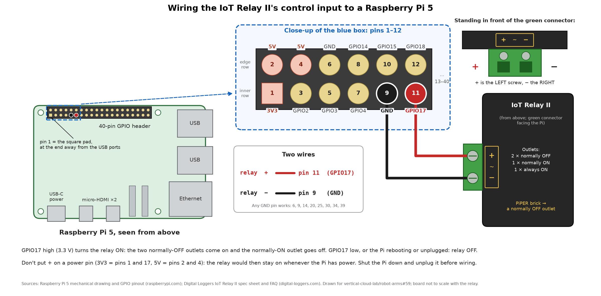

# IoT Relay II → Raspberry Pi 5

The Digital Loggers IoT Relay II that switches the PiPER's power
([#43](https://github.com/vertical-cloud-lab/robot-arms/issues/43)) takes two wires from the Pi's
40-pin header ([#59](https://github.com/vertical-cloud-lab/robot-arms/issues/59)):

| IoT Relay II green terminal | Wire | Raspberry Pi 5 header |
| --- | --- | --- |
| `+` (left screw, facing the connector) | red | pin 11, GPIO17 |
| `−` (right screw) | black | pin 9, GND |



- **Finding the pins.** Pin 1 is the square pad, at the end of the header farthest from the USB
  ports, on the inner row. The inner row holds the odd pins (1, 3, 5, …) and the row along the
  board's edge holds the even pins. Pins 9 and 11 are the 5th and 6th pins of the inner row,
  side by side. Running `pinout` on the Pi prints the same header.
- **`+` goes to a GPIO pin, not to a power pin.** On 3V3 (pins 1, 17) or 5V (pins 2, 4) the relay
  would stay on whenever the Pi has power, and the Pi could not switch it off.
  - The relay runs off its own plug. The green terminal is a control input, not a power input:
    Digital Loggers' FAQ says "positive (+) to the trigger voltage, ie a logic level GPIO pin".
  - The 5V pins can't be turned off from software, and they stay live after `sudo shutdown`.
    Raspberry Pi's bootloader docs note that even in the lowest-power halt "5V will still be on".
- **`−` can go on any GND pin:** 6, 9, 14, 20, 25, 30, 34 or 39. Pin 9 is used here because it sits
  next to pin 11. Pin 6 works just as well.
- **Why many Pi tutorials say "5V on pin 4, GND on pin 6".** They use 3-pin relay boards marked
  `VCC`, `GND` and `IN`. Those boards take their power from pins 2/4 and 6, and a third wire runs
  from `IN` to a GPIO pin. The IoT Relay II has no `VCC`, and its `+` does the job of `IN`.
- **No driver needed.** The input takes 3–48 V DC (or 12–120 V AC), draws a few mA at most and is
  optically isolated, so a 3.3 V GPIO pin drives it directly. DC polarity matters.
- **Off by default.** GPIO17 is pulled down at boot, so the relay stays off while the Pi starts.
  Driving GPIO17 high turns the two normally-OFF outlets on and the normally-ON outlet off. The
  PiPER's power brick goes in a normally-OFF outlet.
- Wire it with the Pi shut down and unplugged.

Test it with a lamp in a normally-OFF outlet before plugging in the arm's brick:

```bash
pinctrl set 17 op dh   # relay on
pinctrl set 17 op dl   # relay off
pinctrl get 17         # show the pin's state
```

The pin holds its state until it is changed or the Pi reboots. The PiPER has no brakes, so only
switch its power off with the arm at its rest pose.

Redraw the diagram with `python docs/wiring/iot_relay_pi5.py` (needs matplotlib).

Sources: Raspberry Pi's [GPIO pinout](https://www.raspberrypi.com/documentation/computers/raspberry-pi.html#gpio),
[`POWER_OFF_ON_HALT`](https://www.raspberrypi.com/documentation/computers/raspberry-pi.html#POWER_OFF_ON_HALT) (5V stays on)
and [Pi 5 mechanical drawing](https://datasheets.raspberrypi.com/rpi5/raspberry-pi-5-mechanical-drawing.pdf);
Digital Loggers' [spec sheet](https://www.digital-loggers.com/iot2spec.pdf) and
[FAQ](https://www.digital-loggers.com/iot2faqs.html).
