# PiPER auger swap on the powder doser (issue #42)

The PiPER pulls a spent auger out of the powder doser, strips the tethered tap collar
off it in a finger fixture, drops it in a bin, takes a fresh auger from a rack, threads
it back through the collar and presses it into the doser. The auger is held by
**compliant snap clips with a funnel mouth, not the old screw-and-nut clamp**.

| | What holds the auger during the pull | Who supplies the pull-out force | Fidelity |
|---|---|---|---|
| **Strategy 1**: custom tool, two servos | hook + thin finger on a lift carriage | the tool: its legs push on the doser while the carriage lifts | **high** |
| **Strategy 2**: custom tool, one servo | same; a wheel's crank pin lifts and a face cam closes the hook | the tool, the same way | medium |
| **Alternative A**: stock gripper + two-shell sleeves + tilt-lock pin | printed cradles that wrap 180° of the tube on each finger | the arm; a pin on the board stops the mounting plate tipping | **high** |
| **Alternative A, custom fingers**: minimal fingers on the gripper's own carriages + tilt-lock pin | the same cradle, built into the finger | the arm, with the same pin | **high** |
| **Alternative B**: stock gripper + the same sleeves | the same sleeves | the arm; the doser's tilt servos hold the plate | high (sleeves), medium (sequence) |

The finger fixture, sleeves, custom fingers, pin and Strategy 1 tool are high fidelity (round 2, [PR #44](https://github.com/vertical-cloud-lab/robot-arms/pull/44)):
real fasteners, fits and print orientations, and built against the real parts (AgileX's own gripper STEP, the doser's STEP files).
Strategy 2 is unchanged from round 1.

## The PiPER gripper's finger interface

Measured from AgileX's own gripper STEP (the file [PR #10](https://github.com/vertical-cloud-lab/robot-arms/pull/10) uses;
`agilex.py` fetches it, it is not committed because it has no licence). No AgileX document gives these.

| | What it is | Numbers |
|---|---|---|
| Rail | HIWIN MGNR07R size | 7.0 × 4.8 mm, Ø2.4 + Ø4.2 counterbored holes at 15 mm pitch |
| Carriage (one per finger) | HIWIN MGN07C size | 17 × 22.5 × 6.5 mm; **4 × M2**, 2.5 mm thread depth, on a **12 × 8 mm** rectangle (12 across the rail, 8 along it) |
| Finger on the carriage | 4 × Ø2.4 clearance through 6 mm, so **M2 × 8** | the finger sits in a 1 mm deep, 17.3 mm wide slot over the block's sides |
| Linkage arm pivot | slotted **M3 shoulder screw**, Ø2.5 tap hole 5.5 mm deep in the finger | a **Ø9 × 4 mm spacer with a Ø4 bore** (the shoulder) between the finger and the arm; pivot 14.65 mm beside the carriage centre (across the rail) and 1.25 mm off it along the travel |
| Grip face | the "slight curve" | flat for the first 36 mm from the finger's base, then an **R51.5 bend**, a **5.1° ramp** over 20 mm, and flat again for the last 10 mm: the tip half stands **2 mm** closer to the other finger. A 2 mm pad covers it all |
| Finger | | 56 mm wide at the carriage, 20 mm at the tip, 71 mm long, 24.5 mm deep at the carriage, 7 mm at the tip; a 17.3 mm channel down the back |
| J6 flange (for the custom tool) | | Ø57, 6 × M3 countersunk on a **Ø27** bolt circle; on the J6 side a 240° arc slot (Ø44–55.5, 3.8 mm deep) with Ø5.75 round ends at r 24.9 |

AgileX's STEP is the 0–100 mm gripper (164 mm finger plate). The older 0–70 mm one (about 145 mm) also runs on MGN7 carriages, but check
the hole pattern on the lab's unit before printing, as [#4](https://github.com/vertical-cloud-lab/robot-arms/issues/4) asked for the camera mount.

## Finger fixture (tap-collar nest)

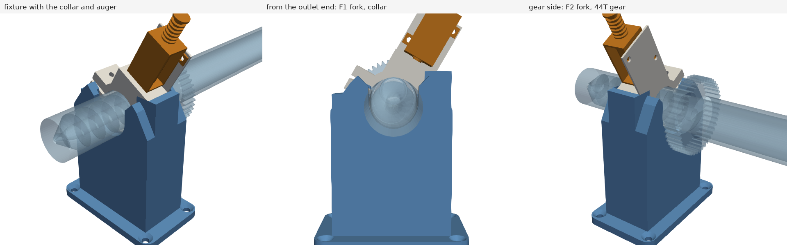

The collar (17 mm long, with the solenoid on top, so top-heavy toward +X) sits in a nest between **two thin forks**:

- **Gear-side fork F2, 8 mm.** It fits the **15.9 mm gap between the collar and the 44T gear** with 1 mm to the collar and 6.9 mm to the gear,
  so the new auger can be pushed in until the collar is in its place on the tube. It strips the collar when the old auger is pulled out,
  and has a 2 mm × 45° lead-in on its outer face for the new auger's tip.
- **Outlet-side fork F1, 6 mm**, 1 mm from the collar's other face. With F2 it stops the collar tipping about the tube's cross axis.
- **U-slots 25.5 mm wide** in both forks, open at the top with a 6 mm lead-in: the Ø25 tube passes through, the collar (R16.75 and up) can't.
  The slot floors hold the tube 0.25 mm low, the same as the collar's bore when the collar rests in the nest, so the tube goes straight into the bore.
- **The nest is the collar's own underside.** Its profile is the lowest point of the collar and solenoid at every x (from their STEP files),
  offset 0.25 mm and open upward. The collar drops in and lifts out vertically, but can't roll, and a post under the solenoid platform takes its weight.
- Base 80 × 49 mm with 4 × M4 countersunk wood screws. It prints base-down with no supports; 155 cm³ solid, so print it at 15–20 % infill.

The auger axis sits 75 mm above the board, as before, so Strategy 1's legs clear the board at the fixture.

## Alternative A, two ways

Both grip the tube 180° on each side, so the pull-out bears on the cradle walls. Neither depends on friction. The arm still supplies the
12–40 N pull, which is Alternative A's weakness (see Answers below). They grip the tilt-lock pin's grab bar the same way.

| | Two-shell sleeves on the stock fingers | Custom fingers |
|---|---|---|
| GIF | 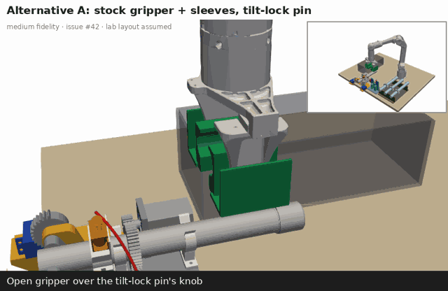 | 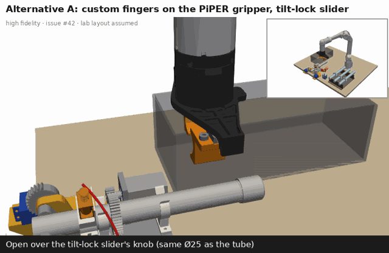 |
| Tube axis from the J6 face | 135 mm | **89 mm** |
| Gripper command (pad-to-pad width) to hold a Ø25 tube | 34.5 mm | 24.0 mm |
| Command to release | 70 mm | 60 mm (never below 22: the fingers meet) |
| Printed parts per finger | main shell 22.9 cm³ + fixing shell 6.7 cm³ | 15.7 cm³ |
| Hardware per finger | 2 × M3 × 10 + 2 × M3 × 12 countersunk (ISO 10642), 4 × M3 × 5.7 heat-set inserts | 4 × M2 × 8 (the stock screws), 1 × M3 × 5.7 heat-set insert; the stock shoulder screw and spacer |

The custom-finger GIF lands every frame on its IK target (0.00 mm). The sleeves hold the tube 46 mm further from J6, and from the assumed base position
the arm runs out of reach on 40 transit frames near the bin and the rack, missing by up to 5.8 mm. Every contact move (pin, pull, strip, re-thread,
re-seat) is exact. The Strategy 1 GIF is exact on every frame.

### Two-shell sleeves (stock fingers)

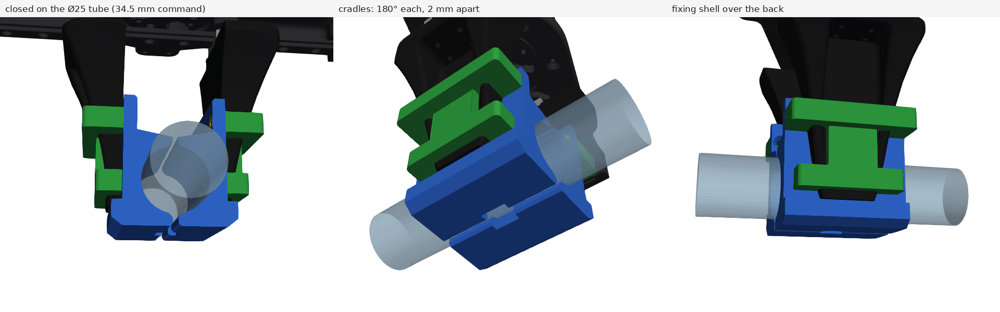
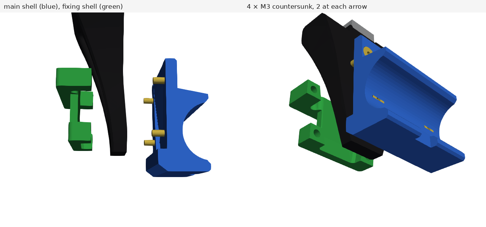

- **Main shell (blue).** It sits on the grip face, carrying a Ø25.2 half-bore with a tooth above and a jaw below that wrap 180° of the tube. Its inner face is the pad's
  own surface, cut from AgileX's finger with 0.15 mm clearance. The 2 mm step and ramp stop it sliding toward the tip, and a lip over
  the fingertip stops it sliding the other way. With both sleeves on the tube, their faces stand 2 mm apart, so all the grip force goes into the tube.
- **Fixing shell (green).** Two 8 mm bands go round the finger's sides and back at the two arrows, joined by a spine that follows the curved back and drops
  into the back's channel, which locks it sideways. 0.2 mm clearance.
- **Screws: 4 × M3 countersunk, two at each arrow.** They run along the finger travel, beside the finger (4.3 mm outside each edge), through the main shell and into
  heat-set inserts in the bands' legs. The upper pair is 30.5 mm from the fingertip, M3 × 10 through a 5 mm web. The lower pair sits in the bottom of the cradle,
  7.5 mm from the tip, M3 × 12; their heads sit below the half-bore's surface.
- **Printing:** the main shell on its outer web with the cradle up, the fixing shell on its back. Neither needs supports.

### Custom fingers

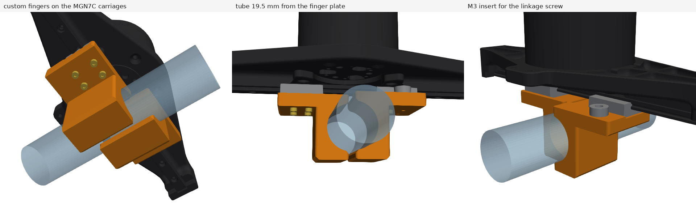

- Each finger is a 32 × 35 × 38 mm block that replaces the stock finger. It goes on the same MGN7C carriage with the same four M2 × 8 screws, in the same 1 mm locating
  slot, and takes the linkage arm's shoulder screw in an M3 heat-set insert, with the stock Ø9 spacer between the two.
- The cradle is 19.5 mm in front of the finger plate, against 65.5 mm with the sleeves, so the moment on the carriages and on J6 is much smaller. It is the same
  180° half-bore with tooth, jaw and 2 mm gap.
- Prints on its side face with no supports; the half-bore is a horizontal arch.
- Make the gripper's lower limit 22 mm (two fingers meet below that) and use 24 mm to hold the tube.

### Tilt-lock pin

- A **Ø8 h6 steel shaft, 96 mm long**, slides in a Ø8.2 bore in a printed housing on the board. The housing has 2 × M4 countersunk wood screws.
- Pushed in, its chamfered tip lies 0.5 mm above the mounting-plate floor's +X edge, over 16 mm of it, so the plate can't tip up while the arm pulls.
  The pin carries up to ≈0.8 × the pull (10–33 N), because it sits further from the hinge than the clips.
- An **M6 ball spring plunger** in the housing's top drops into two grooves on the shaft, at locked and free, so the pin stays where the arm leaves it.
- The **handle** clamps on the shaft with an M3 × 16 pinch screw and nut. A post carries a **Ø25 × 34 mm grab bar** 75 mm above the board,
  along the tube direction. The sleeves and custom fingers grip it in their cradles exactly as they grip the tube, and push or pull it along the finger travel.
- Checked against the mounting plate, baseplate and +X servo and pinion with the pin in and out: no interference.

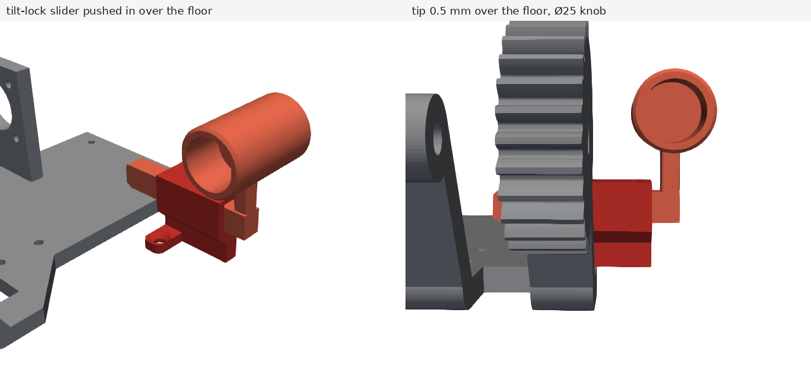

## Strategy 1, high fidelity: two-servo tool with a Pi 5 and two cameras

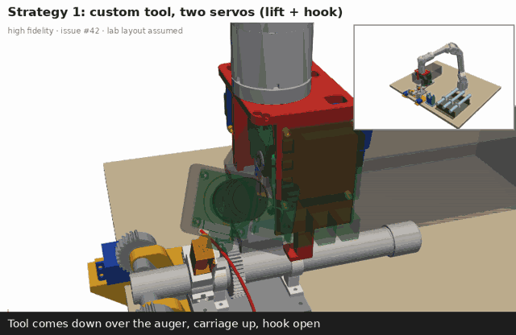

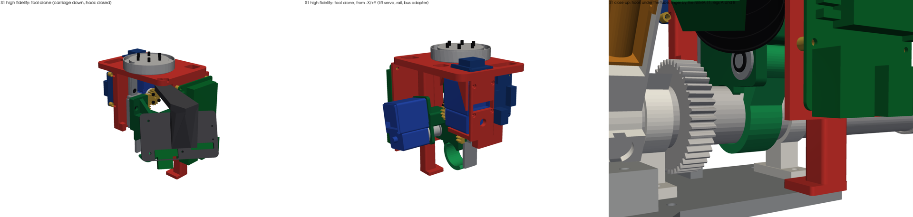

`s1_tool.py` builds it, checks it and exports `cad/s1_two_servo_tool.step` (56 solids). The motion, contact points and frames are round 1's, so it runs the same sequence.

**Load path.** Leg A presses on the NEMA 11 plate and leg B on the mounting-plate floor. The frame carries that load to the guide rail and the lift pinion,
and the rack and carriage take it down to the hook under the tube. The 12–40 N snap force closes inside the tool; the arm only carries the tool's weight.

| | Part | Notes |
|---|---|---|
| J6 adapter | Al 6061, Ø57 × 10.5, a copy of the stock gripper's flange | 6 × M3 × 8 countersunk (ISO 10642) into J6 on the Ø27 circle; the J6 side has the stock 240° arc slot (Ø44–55.5) and Ø5.75 ends; 4 × M3 into the deck. A PETG or PA-CF print also works with washers at ≈0.3 N·m |
| Frame | one PETG print, deck down, 4 perimeters, 40 % gyroid | 107 × 76 × 6 deck with lightening windows and a cable hole; leg A wall (10 mm) carrying the rail on 4 × M3 heat-set inserts; leg B post + 3.5 mm floor pad; the lift-servo cradle; the Pi plate |
| Guide | HIWIN MGN9H block on a 70 mm MGNR9 rail | 4 × M3 × 8 into the wall, 4 × M3 × 10 through the carriage; 28 mm stroke, the block stays on the rail at both ends |
| Lift | **Feetech STS3215-C018** (12 V), 18T m1 20° involute pinion (pitch Ø18, brass or PA12) on its horn, m1 rack 40 mm on the carriage | 40 N × 9 mm = 0.36 N·m against 2.94 N·m stall (8×); the 28 mm stroke is 178° of output, 0.66 s unloaded. The rack stays in mesh over the whole stroke |
| Carriage | PETG | plate on the MGN9H block; its Ø26 underside is a **presser** that pushes the new auger into the clips (round 1's carriage had nothing over the tube); two F686ZZ bearings for the hook shaft |
| Finger | 3 mm 304 stainless, 16 wide, 1.2 mm lead-in | 2 × M3 × 8 countersunk into inserts; 0.9 mm from the tube, 1.6 mm from the NEMA 11 |
| Hook | PETG jaw (R13–R17, 25° to −128°), Ø6 h6 D-shaft 41.5 mm in the two F686ZZ, Al hub, DIN 6799 e-clip | **Hook servo: a second STS3215-C018**, coaxial with the pivot behind the rear clip (there is no room for a servo case at the pivot itself) |
| Pi 5 | Raspberry Pi 5 + Active Cooler, vertical on the +X plate, M2.5 standoffs | top edge 18.5 mm below the flange face |
| Servo bus | Waveshare Bus Servo Adapter (A) on leg A's outer face | USB-C to the Pi; both servos on one half-duplex TTL bus with position, load, current and temperature feedback |
| Power | Pololu D36V50F5 (5 V, 5.5 A) on the deck for the Pi; a 24 → 12 V buck for the servos (not modelled) | fed from J6's XT30 (2+2) port, 24 V / 2 A max |
| Cameras | PR #10's: Raspberry Pi HQ Camera + the 6 mm CS lens, and the Camera Module 3 Wide | on a PETG pod at the +X/−Y corner, both aimed at the jaw 41° down from the open side, clear of both legs |

**Why two STS3215s.** When the carriage lifts, the tube pushes down on the jaw through its centre, 20 mm from the pivot. That pushes the hook open
with 0.24 N·m at 12 N and **0.8 N·m at 40 N**. An STS3032 (0.44 N·m stall) can't hold that; the C018 holds it at 27 % of stall.
One servo type also means one horn, one spare and one protocol.

**Checks** (`python s1_tool.py`, about 4.5 min): **0 interferences** with all 32 parts against the doser (mounting plate, NEMA 11 and pinion, baseplate,
collar base, auger with gear and cap, collar and solenoid, both clips) and each other. That holds seated with the hook closed, lifted 28 mm, and with the hook
open at s = 28, 14 and 0. Both legs touch their faces with a 0.000 mm gap. The smallest designed gaps are the finger to the tube (0.9 mm), the presser and jaw
to the tube (0.5 mm) and the hook servo to the tube (3.3 mm).

**Mass: ≈0.62 kg** on the arm with realistic infill (679 g with solid prints): 2 × STS3215 110 g, Pi 5 + cooler 69 g, HQ Camera + lens 95 g,
MGN9 53 g, Al adapter 41 g, the rest printed parts and hardware. With the auger, 0.7–0.8 kg, inside the 1 kg left with the gripper off.
Dropping the HQ Camera and lens (keeping the CM3 Wide) saves 95 g.

**Watch:**
- **J6 clocking** comes from the STEP-to-URDF mapping, not an arm. If the arc-slot key doesn't line up, rotate the pattern.
- **Close focus.** The 6 mm lens focuses no closer than 0.2 m, but the jaw is ≈60 mm away. Adjust the HQ Camera's back focus by ≈+0.7 mm, or let the CM3 Wide (autofocus) do the close-up.
- **Size.** The tool is 181 mm across x, because the cameras sit out at the corner to see past leg B.
- **Round-1 numbers.** The real STEPs corrected three of them. The NEMA 11 plate top is at z 61.35, not 61.2. Round 1's hook arm cut 2.1 mm³ into the tube, so the new jaw is trimmed to R13. Round 1's full-height leg B was in the opening hook's path, so the new post sits at y ≥ 9.

### Recommended servos and electronics to buy

| Item | Part | Qty | Price (each) | Where |
|---|---|---|---|---|
| Lift and hook servos | **Feetech STS3215-C018**, 12 V, 30 kg·cm (2.94 N·m) stall, 360° with multi-turn mode, 12-bit magnetic encoder, position/load/current/temperature feedback, 55 g | 2 (+1 spare) | $21.99 | [Waveshare SKU 22414](https://www.waveshare.com/st3215-servo.htm?sku=22414), [RobotShop](https://www.robotshop.com/products/feetech-12v-30kgcm-magnetic-encoding-servo-sts3215) |
| Bus adapter | Waveshare Bus Servo Adapter (A), USB-C to the Pi, 42 × 33 mm | 1 | $4.99 | [Waveshare](https://www.waveshare.com/bus-servo-adapter-a.htm) |
| 12 V rail | Pololu D36V50F12 (24 → 12 V, 4.5 A) | 1 | $39.95 | [Pololu 4095](https://www.pololu.com/product/4095) |
| 5 V rail | Pololu D36V50F5 (5 V, 5.5 A), modelled; or the smaller D24V50F5 (6–38 V in, 5 A) | 1 | $39.95 / $32.95 | [Pololu 4091](https://www.pololu.com/product/4091), [Pololu 2851](https://www.pololu.com/product/2851) |
| Wrist power | Amass XT30PW(2+2) to mate J6's XT30 port (check its gender first) and a ≤2 A fuse | 1 | | [datasheet](https://atta.szlcsc.com/upload/public/pdf/source/20240112/A815AE62CB016131F8636555ECBDABF7.pdf) |
| Compute and cameras | Raspberry Pi 5 + Active Cooler, HQ Camera + 6 mm CS lens, Camera Module 3 Wide (as in [#10](https://github.com/vertical-cloud-lab/robot-arms/pull/10)) | 1 each | | |
| Guide and bearings | HIWIN MGN9H block + MGNR9 rail (70 mm), 2 × F686ZZ, Ø6 h6 D-shaft | | | |

- **Why not the 7.4 V STS3215-C001 + STS3032** (the cheapest pair on one 7.2 V rail)? The C001 lifts fine (1.91 N·m stall), but the STS3032 can't hold the hook's 0.8 N·m.
  If the clips measure under ≈20 N, the C001 + STS3032 pair on a 7.2 V Pololu D30V33MAS works and draws less.
- **Why not PWM servos?** 28 mm on a 9 mm pinion is 178° of output, the whole travel of a 180° PWM servo (the MG996R does about 120°). PWM servos also give
  no load feedback, and that feedback is how the tool sees the clips let go or a jam.
- **Power budget.** J6 gives 24 V × 2 A = 48 W. Lifting at 40 N with the hook holding takes ≈0.3 + 0.7 A at 12 V; with the Pi 5 and cameras (≈7 W) that is
  ≈1 A from the 24 V port. Two stalled C018s plus the Pi would draw ≈3.3 A, so cap the torque (register 48): 60 % on the lift (≈1.8 N·m) and 40 % on the
  hook (≈1.2 N·m, 1.5× its need) keep a double stall at ≈1.8 A.
  AgileX reserves the end CAN pins for its own devices, so the Pi talks over the network and the tool uses the power pins only.
- **Software:** Feetech's [FTServo_Python](https://github.com/ftservo/FTServo_Python) or LeRobot's Feetech driver (it drives the same STS3215s on the SO-101).

## Files

- `geometry.py`: round-1 CadQuery parts in the doser's layout frame: funnel clip, rack, bin, Strategy 2 tool, old sleeves and pin.
- `hifi.py`: the high-fidelity parts: finger fixture, two-shell sleeves, custom finger, tilt-lock pin, and their fasteners.
- `agilex.py`: fetches AgileX's gripper STEP and holds what was measured from it (carriage, pivot, frames).
- `s1_tool.py`: the high-fidelity Strategy 1 tool (see above).
- `scene.py`: fetches the doser STEP files and `layout.py` from
  [powder-doser `7f5b3b7`](https://github.com/vertical-cloud-lab/powder-doser/tree/7f5b3b7/cad/full-assembly)
  and the PiPER URDF/meshes from
  [`agilexrobotics/piper_ros`](https://github.com/agilexrobotics/piper_ros/tree/ac41fcbcdda598f01b51cf6175ed9a24d0dacadc/src/piper_description).
  It has PiPER forward kinematics and IK from the URDF.
- `animate.py`: the GIFs in `renders/`, with the PiPER posed by IK every frame and the tool pointing down.
  The stock-gripper GIFs draw AgileX's gripper from its STEP; Strategy 1 draws `s1_tool.py`'s parts.
  Run `xvfb-run -a python animate.py s1 alt_a alt_a_cf alt_b`.
- `clip_force.py`: a rough curved-beam estimate of the clips' snap force.
- `export_step.py`, `onshape_upload.py`, `cad/`, `onshape/`: STEP exports and the Onshape document (see `onshape/onshape_document.json`).
  `cad/stl/` has the printable parts: the fixture, sleeve shells, custom finger, pin housing and handle (print `_x2` files twice).
  `cad/doser_compliant_clips.step` (29 MB) and the AgileX reference copies are regenerated by `export_step.py` and are not committed.

## Assumptions

- **Cell layout.** The PiPER base is at (220, 400) mm in the doser frame. The finger fixture is 150 mm to +X of the auger, the rack is at x = 240–360, and the bin
  is at x = −185…−65, all on the doser's board. None of this is measured; move it once the cell is laid out.
- **Doser.** It is PR 170's current-design assembly with the two bolted brackets replaced by clips: Ø25.1 bore, 17 mm mouth, 2 mm wall, 10 mm wide
  (Sam's multi-doser numbers), plus a 35° funnel lip.
- **Grip windows.** Between the 44T gear and the rear clip, the NEMA 11 body is only **5.5 mm** from the tube on −X. Strategy 1 therefore uses a 3 mm fixed finger
  on that side and a hook from the open +X side. The stock gripper's fingers are 56 mm wide and can't fit that 41 mm window, so Alternatives A and B grip the free
  tube behind the rear clip instead (y ≈ 216).
- **Gear.** Lifting the auger rolls the 44T gear off the 20T pinion over the first ~12 mm, which turns the auger ~30°. Either disable the stepper driver during a swap
  so the pinion can turn, or rely on the hook or cradles cradling the tube rather than clamping it.
- **Tap collar.** Its bore is Ø25.4 on a Ø25 tube: 0.2 mm a side. A 1 mm × 45° chamfer at both ends of the bore (a doser-repo change) would make re-threading far
  more forgiving than any fixture can.
- **Gripper version.** The STEP is AgileX's 0–100 mm gripper; see above.

## Answers

**Does the 1.5 kg rating include the stock gripper?** Yes. The manual says the arm has "a 1.5kg payload at the end"
and lists Effective Load 1.5 kg and Weight 4.2 kg. The two-finger gripper (500 g) is an optional accessory
that bolts to the flange. In the URDF, links base→link6 add up to 4.16 kg (the 4.2 kg arm) and
`gripper_base` plus the fingers are another 0.50 kg. The rating is what the flange may carry, and the gripper
counts against it (ISO 9283 convention). With the gripper on, 1.0 kg is left near the base and 0.5 kg at
the 1 kg reach. Take it off and the whole 1 kg goes to the new tool and the auger.

| Carried by the arm | Tool | + auger, cap (+ powder) | Under the 1 kg rating? |
|---|---|---|---|
| Strategy 1 (high fidelity) | ≈0.62 kg (2 × STS3215, Pi 5 + cooler, HQ Camera + 6 mm lens, CM3 Wide, MGN9 guide, Al adapter, printed frame/carriage/pod at ≈60 % of solid, cables) | ≈0.1–0.2 kg | yes |
| Strategy 2 | ≈0.25 kg (one 20–25 kg·cm servo + wheel and gears instead of two servos) | ≈0.1–0.2 kg | yes |
| Alternatives A/B, sleeves | ≈0.54 kg (stock gripper 0.50 + two two-shell sleeves ≈40 g printed at 50 % + 8 screws and inserts) | ≈0.1–0.2 kg | yes |
| Alternative A, custom fingers | ≈0.50 kg (the custom fingers weigh about what the stock ones do, 25 g each in the URDF) | ≈0.1–0.2 kg | yes |

**With a snap clip the limit is force, not mass.** `clip_force.py` estimates 6–21 N per clip to pull the
auger out (PETG to PLA, μ 0.2–0.35), so 12–40 N for the pair. The whole rating is only ≈15 N at the flange,
and the PiPER has no brakes. The clips can't simply be made soft either: the 20T pinion pushes the 44T gear
up or down with ≈10 N of tooth force (9.5 N·cm stepper on a 10 mm pitch radius), and the clips have to hold
it in mesh. The funnel lowers the push-in force and makes placement forgiving, but it doesn't change pull-out.

## Ranking (1 = best)

| | Complexity (1 = simplest) | Weight on the arm (1 = lightest) | Feasibility / recommendation |
|---|---|---|---|
| **Strategy 1**: two servos | 3 | 1 (tie) | **1** |
| **Strategy 2**: one servo, wheel | 4 | 1 (tie) | 2 |
| **Alternative A**: custom fingers or sleeves, + pin | 2 | 3 (tie) | 3 |
| **Alternative B**: sleeves, doser servos hold | 1 | 3 (tie) | 4 |

1. **Strategy 1.** The legs push on the NEMA 11 plate and the floor while the carriage lifts, so the
   12–40 N snap force closes inside the tool. Lift and hook are separate, so it is easy to tune and can
   back out of a jam. The STS3215-C018 on a 9 mm pinion gives ≈110 N at its rated torque and ≈330 N at
   stall (12 V), and it reports load, so the tool can see the clips let go. Costs: power at the wrist (J6's
   24 V / 2 A port covers it); a 3 mm finger in the 5.5 mm gap by the stepper (place it within ±1 mm);
   and pushing the new auger in still loads the arm, because the feet can only push. A hook under the
   floor edge at x = 34 would close that force inside the tool too.
2. **Strategy 2.** It has the same force advantage, and the crank sits near bottom dead centre exactly
   where the clip force peaks. But the cam fixes the order of moves, so the tool can't re-grip without
   cycling the whole stroke, and it is harder to design and tune. Getting 360° of wheel from a 180° servo
   needs a 2:1 step-up, so the servo needs ≈0.8 N·m at the peak, which is more than an MG996R's margin.
   The bigger servo cancels the weight saving. Build it after Strategy 1 has proven the geometry.
3. **Alternative A.** It is the least new hardware, and the pin keeps the doser safe. The 180° cradles
   make the grip itself positive. But the arm still has to pull 12–40 N on top of a 0.5 kg gripper, 2–4×
   its rating. It only works if the clips measure under ≈5 N each, which fights the ≈10 N gear-mesh force,
   and it needs two extra moves per swap. Of its two versions, the custom fingers are the better one: the
   tube sits 89 mm from the J6 face instead of 135 mm, which shortens the lever on the carriages and on
   J6. They also don't depend on the stock fingers' exact shape, and the arm reaches every pose in the GIF.
4. **Alternative B.** It has the same arm-force problem. On top of that, the two tilt servos must hold
   ≈2–4 N·m at the hinge, against 3.6–4.4 N·m stall (2 × MG996R through 14T:28T). The plate will rock and
   may stall. It is still a good first experiment: a luggage scale on the auger measures the real clip force.

**Before building anything, measure the printed clip's pull-out force.**

## Onshape

[PiPER auger-swap end effectors (robot-arms #42)](https://cad.onshape.com/documents/a2afbff32210cfef4035e3a7/w/656f6668acfca73fa886bbb8), in vcl-shared > 6DOF Robot Arm. Part Studios: [doser + clips + finger fixture](https://cad.onshape.com/documents/a2afbff32210cfef4035e3a7/w/656f6668acfca73fa886bbb8/e/84da4bd471ae162bb09fd705), [Strategy 1 tool](https://cad.onshape.com/documents/a2afbff32210cfef4035e3a7/w/656f6668acfca73fa886bbb8/e/dde328d002bdd126c1aa604f), [Strategy 2 tool](https://cad.onshape.com/documents/a2afbff32210cfef4035e3a7/w/656f6668acfca73fa886bbb8/e/62b0ce943acc1c2d5951923b), [Alt A sleeves + pin](https://cad.onshape.com/documents/a2afbff32210cfef4035e3a7/w/656f6668acfca73fa886bbb8/e/0cddbb996c8dc474b02a109d), [Alt A custom fingers + pin](https://cad.onshape.com/documents/a2afbff32210cfef4035e3a7/w/656f6668acfca73fa886bbb8/e/4d6e11d16ea5da425da28134), [Alt B sleeves](https://cad.onshape.com/documents/a2afbff32210cfef4035e3a7/w/656f6668acfca73fa886bbb8/e/c35cc3f6cc387f21bf7cd736), [AgileX gripper, sleeve pose](https://cad.onshape.com/documents/a2afbff32210cfef4035e3a7/w/656f6668acfca73fa886bbb8/e/4b031882d11b4ae954b45ec7), [AgileX gripper, custom-finger pose](https://cad.onshape.com/documents/a2afbff32210cfef4035e3a7/w/656f6668acfca73fa886bbb8/e/a66cfbff4e42ef06e9f2db39). Assemblies: [Strategy 1](https://cad.onshape.com/documents/a2afbff32210cfef4035e3a7/w/656f6668acfca73fa886bbb8/e/4b0e2b44f7762a4ba874dfba), [Strategy 2](https://cad.onshape.com/documents/a2afbff32210cfef4035e3a7/w/656f6668acfca73fa886bbb8/e/4c0d62fbf6e4fb0beda072f9), [Alternative A](https://cad.onshape.com/documents/a2afbff32210cfef4035e3a7/w/656f6668acfca73fa886bbb8/e/c32900085919816e940d424b), [Alternative B](https://cad.onshape.com/documents/a2afbff32210cfef4035e3a7/w/656f6668acfca73fa886bbb8/e/55472b6c00b0741d6cf2e8af), [Alternative A custom fingers](https://cad.onshape.com/documents/a2afbff32210cfef4035e3a7/w/656f6668acfca73fa886bbb8/e/5a5c127205394e863e2a013d).

The parts are imported STEP solids (no feature history). `python export_step.py && python onshape_upload.py` re-syncs them in place. The two AgileX gripper Part Studios are AgileX's own STEP, placed where the sleeves or custom fingers hold the tube. They are only in the (private) Onshape document, not in this repo.

| Strategy 1 | Alternative A, sleeves | Alternative A, custom fingers |
|---|---|---|
| 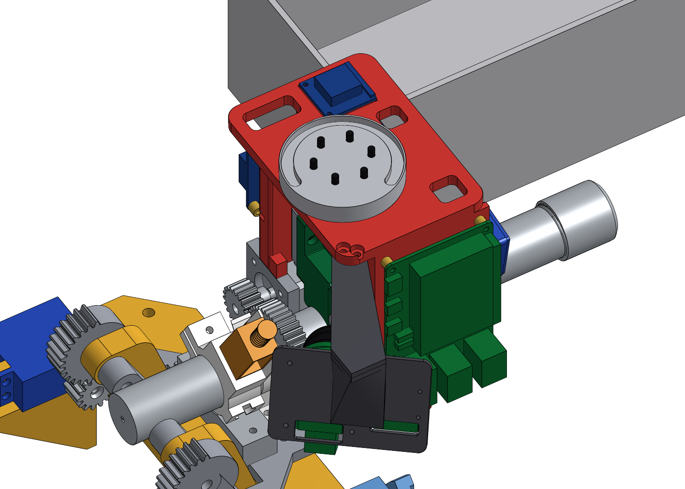 | 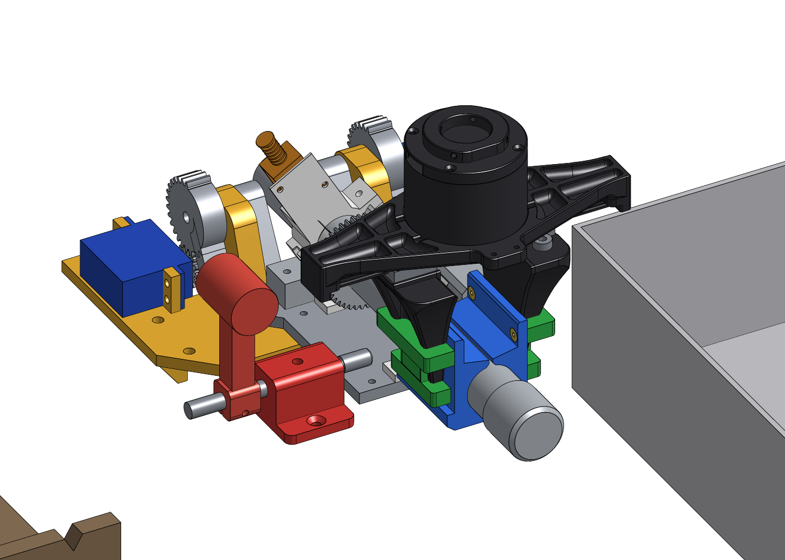 | 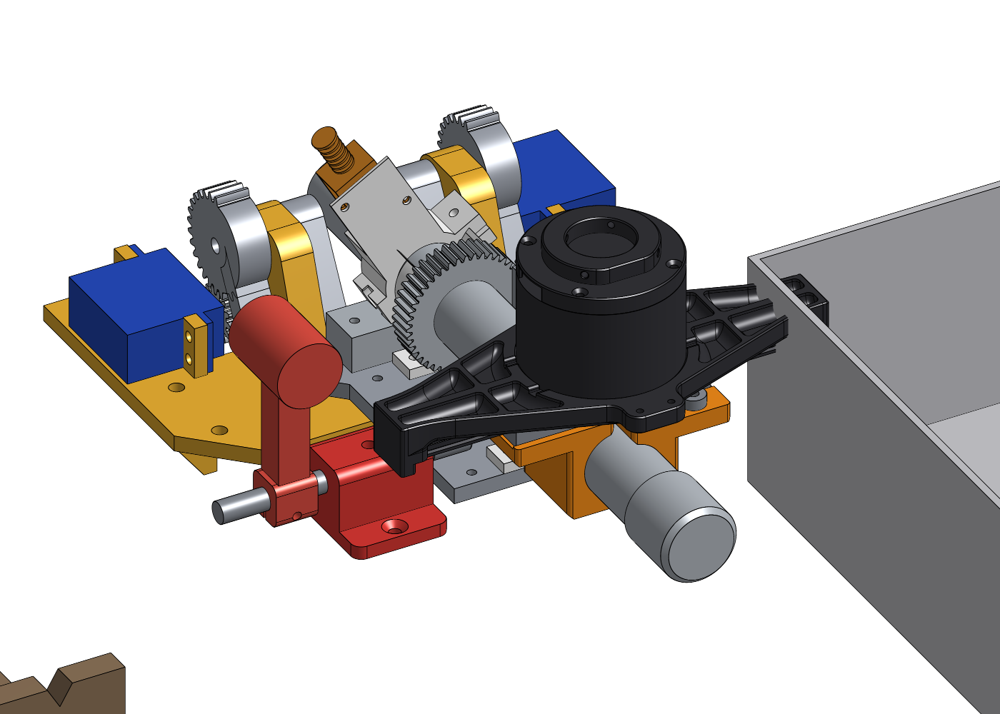 |

## Sources

- [AgileX gripper STEP](https://cdn.shopify.com/s/files/1/0673/6848/5000/files/AgileX_Gripper-1-STP.STEP?v=1782224095) (sha256 `6e6c9bb0…`, as PR #10 fetched it): every finger, carriage and flange number above.
- [HIWIN MGN catalog](https://damencnc.com/userdata/file/3455-3_HIWIN_MGN_and_MGW_Product_Catalog_2023.pdf), pp. 97–99: MGN07C (W 17, L 22.5, B 12, C 8, M2 × 2.5) and MGNR07R.
- [PiPER user manual](https://cdn.shopify.com/s/files/1/0551/0630/6141/files/PIPER_Product_User_Manual.pdf?v=1791860528), §2.9: "The end joint reserves the XT30 2+2 interface … Voltage: 24V, current: 2A MAX"; the end CAN is for AgileX's own devices only.
- [PiPER quick-start manual (AgileX, via Generation Robots)](https://static.generation-robots.com/media/agilex-piper-user-manual.pdf):
  "1.5kg payload at the end", Effective Load 1.5 kg, Weight 4.2 kg, two-finger gripper 500 g, 40 N rated / 50 N max.
- [AgileX PiPER product page](https://global.agilex.ai/products/piper): "1.5 kg end-effector payload".
- [PiPER URDF (piper_ros)](https://github.com/agilexrobotics/piper_ros/blob/ac41fcbcdda598f01b51cf6175ed9a24d0dacadc/src/piper_description/urdf/piper_description.urdf): link masses and joint limits.
- Payload vs. reach curve: [issue #7 comment](https://github.com/vertical-cloud-lab/robot-arms/issues/7#issuecomment-6089393258).
- Feetech STS3215-C018 (12 V) [datasheet](https://www.feetechrc.com/Data/feetechrc/upload/file/20260622/6391772519923113075854851.pdf) and C001 (7.4 V) [datasheet](https://www.feetechrc.com/Data/feetechrc/upload/file/20260622/6391772523943436695270694.pdf); [Waveshare ST3215 page and drawing](https://www.waveshare.com/st3215-servo.htm); STS3032 [datasheet](https://www.feetechrc.com/Data/feetechrc/upload/file/20260622/6391772539739757769932408.pdf).
- [TheRobotStudio SO-ARM100 STS3215 STEP](https://github.com/TheRobotStudio/SO-ARM100/blob/main/STEP/SO100/STS3215_03a.step) (horn and hole cross-check); [LeRobot SO-101](https://huggingface.co/docs/lerobot/so101).
- [Waveshare Bus Servo Adapter (A)](https://www.waveshare.com/bus-servo-adapter-a.htm); [Pololu D36V50F5](https://www.pololu.com/product/4091), [D36V50F12](https://www.pololu.com/product/4095), [D24V50F5](https://www.pololu.com/product/2851).
- Raspberry Pi 5, HQ Camera, 6 mm CS lens and Camera Module 3 Wide: the official drawings as used in PR #10's `piper-camera-mount/cad/piper_mount.py` and `lenses.py`.
- [Feetech STS memory table](https://ftservo.github.io/ftservo-wiki/reference/parameter/memory-sts/) (torque limit, current readout).
