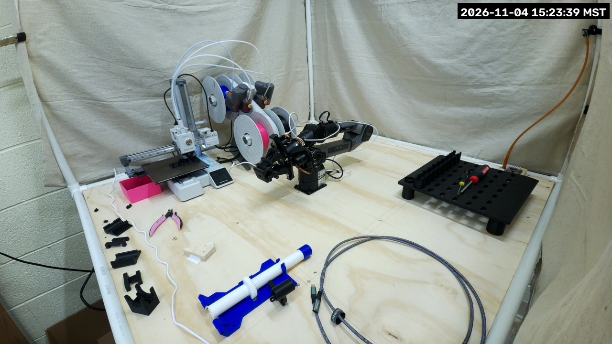
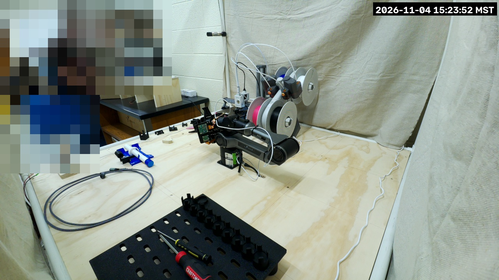
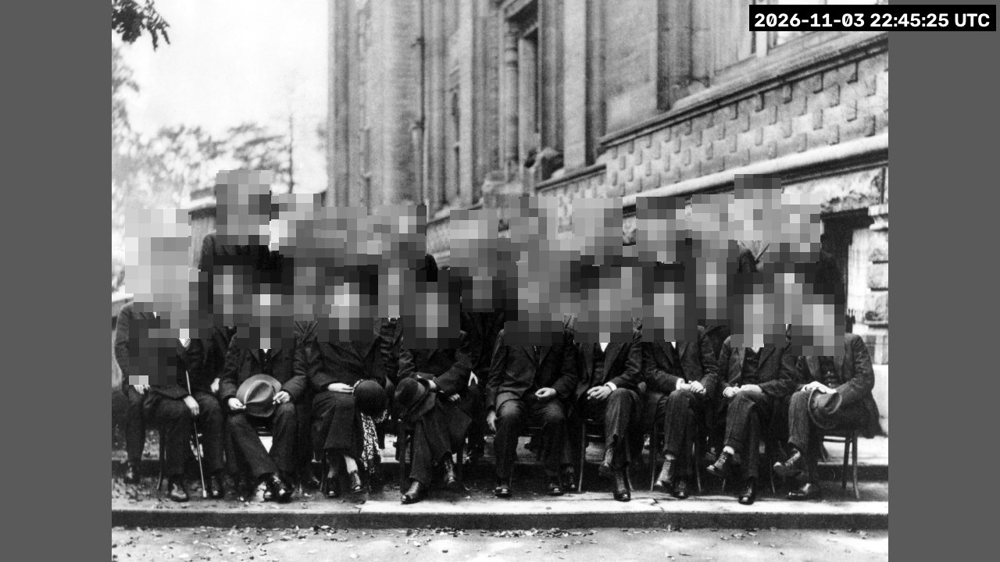
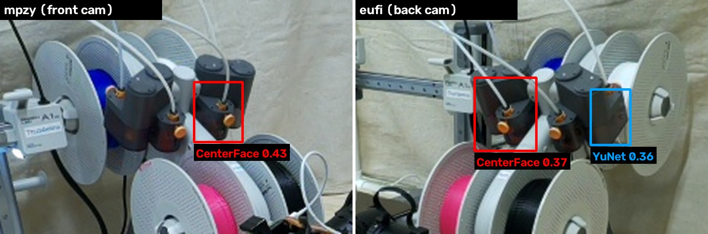

# PiPER cell livestream

The cell streams to the *BYU VCL Hardware Streams* YouTube channel through the lab's streaming
Lambda ([`vertical-cloud-lab/streamingLambda`](https://github.com/vertical-cloud-lab/streamingLambda)),
like the byu-vcl stream cams. **Both of the cell's fixed cameras stream, publicly** (since
2026-11-03 22:48 UTC). A restart of a Pi's service goes back to the broadcast that was live, so
its link keeps working, if a frame went out less than 10 minutes before (`BROADCAST_REUSE_SEC`).
After a longer stop, or a change to `WORKFLOW_NAME` or `PRIVACY_STATUS`, a start ends that
camera's broadcast and makes a new one, so each camera's playlist is its stable link:

| Pi | Camera | `WORKFLOW_NAME` | Playlist | Fixed masks |
| --- | --- | --- | --- | --- |
| mpzy | Camera Module 3 Wide, front-left post, looking into the cell | `PiPER arm front cam` | [*PiPER arm front cam Livestreams Playlist*](https://www.youtube.com/playlist?list=PLEplFHLNPMWo) | none |
| eufi | imx708 wide (the one `camera.json` calibrates), back-right post, looking diagonally across the cell | `PiPER arm back cam` | [*PiPER arm back cam Livestreams Playlist*](https://www.youtube.com/playlist?list=PLf8bu3tmddbw) | two, over the lab |

Broadcasts are titled *&lt;WORKFLOW_NAME&gt; stream picam, &lt;UTC time&gt;*. mpzy's camera sees
only the printer, the arm, the tool rack, the backdrop and the wall. eufi's looks towards the open
front-left corner, so the top-left third of its view is the rest of the lab, and two fixed masks
cover it:




**Workflow names must not overlap.** The Lambda's `end` ends every live broadcast whose title
contains the caller's `WORKFLOW_NAME` (case-insensitive), and `create` files a broadcast into
the first playlist whose title contains it, making `<WORKFLOW_NAME> Livestreams Playlist` with
the broadcast's privacy if there is none. So no Pi's name may appear in another's titles. The
first broadcasts (unlisted, 2026-11-03 18:00 to 22:48 UTC) used plain `PiPER arm` and are in the
[*PiPER arm Livestreams Playlist*](https://www.youtube.com/playlist?list=PLAoVUnZkte3E). **Never
use plain `PiPER arm` again**, since its `end` would end both cameras' broadcasts. A camera that
moves keeps its name; a new one (76zj's, say) needs a name of its own, such as `PiPER arm gripper
cam`. A new name makes a new playlist on its first start.

### mpzy's camera is loaded explicitly, not auto-detected

The firmware's `camera_auto_detect` missed this camera when mpzy booted on 2026-11-03, after the
arm relay was wired (#59). The camera itself was fine: loading its overlay by hand
(`sudo dtoverlay imx708 cam0`) brought it up with no reboot. So mpzy's `/boot/firmware/config.txt`
now has `camera_auto_detect=0` and, under `[all]`, `dtoverlay=imx708,cam0` (CAM/DISP 0). The
previous file is `/boot/firmware/config.txt.bak-2026-11-03-issue61`. **If a camera is moved to
CAM/DISP 1, swapped for another sensor or added, add or edit a `dtoverlay=` line there** (for
example `dtoverlay=imx708` for CAM/DISP 1), or nothing will detect it.

`device.py` also waits for libcamera to list a camera before it calls the Lambda. If the Pi comes
up without one, it logs `No camera found` every minute and leaves YouTube alone.

## Pipeline

`rpicam-vid` (raw I420, 1280×720 at 5 fps from the full-field 2304×1296 sensor mode) →
[`device.py`](device.py) → `ffmpeg` (libx264 ultrafast, 1.5 Mb/s, 2 s keyframes, silent AAC) → RTMP.

`device.py` handles every frame in Python, on the Pi, before anything is encoded or leaves it:

1. **Faces, with two detectors on every frame.** Every box either one finds is grown by 60 %
   (more upwards, for hair), pixelated, and held for 8 frames after it was last seen, so a miss
   of a frame or two stays covered.
   - **deface's CenterFace**: the model and decoder from the
     [`deface`](https://github.com/ORB-HD/deface) package (1.5.0, MIT, `centerface.onnx` sha256
     `09189dea…f5aefbc`), on a 640×360 copy of each frame, at deface's own default threshold of
     0.2. deface is built for anonymizing and is tuned to blur anything that might be a face.
     It is installed `--no-deps` with a pinned hash ([`requirements-deface.txt`](requirements-deface.txt)):
     `deface.centerface` needs only numpy and OpenCV, and with `backend="opencv"` it never imports
     onnxruntime. Its CLI's dependencies (opencv-python, scikit-image, imageio) aren't needed.
     (onnxruntime was no faster on a Pi 5: 118 ms a frame against OpenCV's 130 ms.)
   - **OpenCV's YuNet** (`face_detection_yunet_2023mar.onnx`, 230 kB, from
     [opencv_zoo](https://github.com/opencv/opencv_zoo/tree/main/models/face_detection_yunet),
     sha256 `8f2383e4…52fa4`), on a 960×540 copy at threshold 0.5.
   - **Strict rects** (`STRICT_RECTS`): small fixed areas around objects that the detectors
     take for faces. A box centred in one is blurred only if it scores at least 0.6 (CenterFace)
     or 0.7 (YuNet). See [False positives](#false-positives).
2. **Fixed masks.** `MASK_RECTS` are always pixelated, for parts of a view that look past the
   cell into the lab, since neither detector sees the back of a head. They belong to one camera's
   view: none for mpzy, two for eufi (see `my_secrets_example.py`). **Redo them whenever that
   camera moves.**
3. **Timestamp**, lab local time, top right.

It fails closed: if deface isn't installed, either model file is missing, `FACE_DETECTORS` is
empty or names an unknown detector, a rectangle isn't a valid `(x0, y0, x1, y1)` of fractions, or
a strict threshold is below its detector's normal one, it exits before going live. A frame whose
blur step raises is dropped rather than sent.

**Test.** A public-domain group photo (the 1927 Solvay conference) fitted into a 1280×720 frame
and put through `FaceBlur` as the stream does. CenterFace found 35 boxes and YuNet 31, which
covers all 29 faces; YuNet's extras and CenterFace's are background:



### False positives

**The A1 mini's AMS lite feeders look like a face** to both detectors: a dark housing with two
orange tube couplers for eyes. From 2026-11-03 22:48 to 2026-11-04 22:20 UTC this kept a block
pixelated over the printer's top spool in both views. Scores measured on unblurred frames, on
the Pi, at the stream's size:



| | CenterFace (threshold 0.2) | YuNet (threshold 0.5) |
| --- | --- | --- |
| mpzy, 50 live frames, 2026-11-04 | 0.25 to 0.38, every frame | under 0.3 |
| eufi, 50 live frames, 2026-11-04 | up to 0.30, 46 of 50 frames | 0.45 median, up to 0.54 |
| older stills, 2026-11-03 | 0.43 (mpzy), 0.37 (eufi) | 0.27 (mpzy), 0.36 (eufi) |
| for comparison: faces of people in the lab, eufi, same 50 frames (under its masks) | mostly 0.74 to 0.86 | mostly 0.80 to 0.92 |

Since 2026-11-04 each view has one **strict rect** around the feeders (`STRICT_RECTS`; about
135×100 px on mpzy and 135×85 px on eufi), where a box needs 0.6 from CenterFace or 0.7 from
YuNet. That clears the feeders with a margin of about 0.16 on each detector, and leaves the
thresholds everywhere else as they were. Why not raise the thresholds everywhere instead: on six
public-domain group photos placed into a 1280×720 frame at three sizes, raising CenterFace from
0.2 to 0.5 left 40 of 231 blurred boxes unblurred, and a dozen or so of those were real faces
(small, in profile, or cut off by the frame edge).

The cost: a real face centred in a strict rect, with CenterFace scoring 0.2 to 0.6 *and* YuNet
under 0.7, isn't blurred. That means someone's head right in front of the feeders, from that
camera, turned well away or mostly hidden. **Redo a strict rect whenever its camera or the AMS
lite moves**: a rect left over empty table only raises the thresholds there, and if the feeders
move out of it, they are pixelated again. Each Pi's log reports what the strict rects skipped
every 2 minutes (`strict rects skipped centerface N (max S), yunet N (max S)`), so a score
creeping towards the strict threshold shows up there.

In mpzy's view, YuNet also scores the black cable loop on the arm's elbow 0.47 against its 0.5
threshold, so a small patch of the arm may be pixelated for a moment.

**Load.** Each Pi uses its whole cap of 2 of the 4 cores, holding 4.5 to 4.7 fps of the 5
requested: about 190 ms a frame for the two detectors on 2 OpenCV threads (130 ms CenterFace,
65 ms YuNet), plus ffmpeg. RAM is about 200 MB (mpzy keeps about 375 MB of its 1 GB
available). mpzy also drives the arm, so the unit runs the stream at `Nice=10` with
`CPUQuota=200%`, which leaves the arm the other two cores, and sets `OOMScoreAdjust=500` so the
OOM killer takes the stream before anything that drives the arm. There is no memory cap, because
Raspberry Pi kernels boot with `cgroup_disable=memory`. For a lighter stream, lower `FRAME_RATE`
or drop `"yunet"` from `FACE_DETECTORS` (CenterFace alone takes about 130 ms a frame). The last frame
sent is saved to `/tmp/picam-stream-latest.jpg` every 30 s for checking over SSH.

## Install

On the Pi, from a copy of this directory with a `my_secrets.py` (from
[`my_secrets_example.py`](my_secrets_example.py); `LAMBDA_FUNCTION_URL` is the repo secret of
the same name):

```bash
./install.sh                      # ffmpeg, ~/picam-stream/{device.py,venv (+deface),my_secrets.py}, the unit
sudo systemctl enable --now picam-stream.service
```

`device.py` reads `my_secrets.py` only at start: `sudo systemctl restart picam-stream.service`
after an edit. That goes back to the same broadcast unless the edit changed `WORKFLOW_NAME` or
`PRIVACY_STATUS`.

## The camera is held by the stream

libcamera gives a camera to one process at a time, so anything else that opens a streaming Pi's
camera (run recordings like #54's on mpzy, `piper_vision.py` or calibration stills on eufi) fails
while the stream runs.

**For a still, don't stop the stream.** The last frame sent, faces already pixelated, is in
`/tmp/picam-stream-latest.jpg`, refreshed every 30 s:

```bash
ssh … 'cat /tmp/picam-stream-latest.jpg' > frame.jpg
```

**Anything that needs the camera itself:** stop the stream, use the camera, and start it again
within 10 minutes. The restart then goes back to the same broadcast, so the link people have
keeps working; viewers just see the video pause. After a longer stop the start makes a new
broadcast with a new link (the playlist link still works).

```bash
sudo systemctl stop picam-stream.service    # ... use the camera ...
sudo systemctl start picam-stream.service
```

How it works: `device.py` keeps the live broadcast's ingest URL in `~/picam-stream/broadcast.json`
(mode 600, since it holds the stream key) and writes the time of the last frame sent there every
30 s. The Lambda makes broadcasts with `enableAutoStop` off, so YouTube keeps one live through a
gap in its video. A start waits for the clock to be set by NTP before trusting that time. If a
broadcast it went back to fails three times within a minute of starting (ended in YouTube Studio,
say), it deletes the file and exits, and systemd starts over with a new broadcast.

The stream never touches the CAN bus, the relay or the arm.
