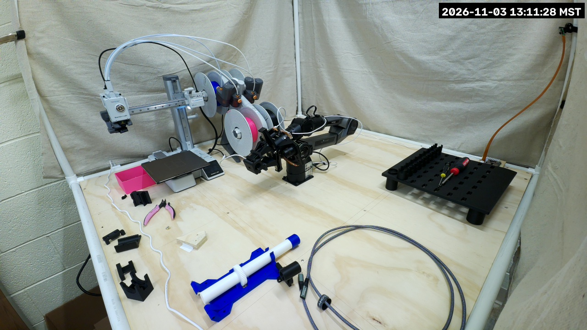

# PiPER cell livestream

The cell streams to the *BYU VCL Hardware Streams* YouTube channel through the lab's streaming
Lambda ([`vertical-cloud-lab/streamingLambda`](https://github.com/vertical-cloud-lab/streamingLambda)),
like the byu-vcl stream cams. Broadcasts are titled *PiPER arm stream picam-piper, &lt;UTC time&gt;*
and go into the
[*PiPER arm Livestreams Playlist*](https://www.youtube.com/playlist?list=PLAoVUnZkte3E). Every
start of the service makes a new broadcast (and ends the old one), so the playlist is the
stable link.

## Which camera

**mpzy's Camera Module 3 Wide streams** (since 2026-11-03 20:06 UTC). It is fixed on the cell's
front-left post and looks into the cell, so all it sees is the printer, the arm, the tool rack,
the backdrop and the wall. It needs no fixed masks, only face blurring.



The first broadcasts that day came from **eufi's camera** (the arm Pi's imx708 wide, on the
back-right post, which `camera.json` calibrates). It looks diagonally across the cell towards the
open front-left corner, so its top-left third sees the rest of the lab and needed two fixed masks
([a frame as sent](../docs/images/picam-piper-stream-masked-2026-11-03.jpg)). Its unit is still
installed on eufi but disabled, which leaves eufi's camera free for the vision scripts.

**Run one Pi at a time.** Both use `WORKFLOW_NAME = "PiPER arm"`, and the Lambda's `end` ends
every live broadcast whose title contains the workflow name, so starting one ends the other's
broadcast. To stream both, give them workflow names that are not substrings of each other.

### mpzy's camera is loaded explicitly, not auto-detected

The firmware's `camera_auto_detect` missed this camera when mpzy booted on 2026-11-03, after the
arm relay was wired (#59). The camera itself was fine: loading its overlay by hand
(`sudo dtoverlay imx708 cam0`) brought it up with no reboot. So mpzy's `/boot/firmware/config.txt`
now has `camera_auto_detect=0` and, under `[all]`, `dtoverlay=imx708,cam0` (CAM/DISP 0). The
previous file is `/boot/firmware/config.txt.bak-2026-11-03-issue61`. **If a camera is moved to
CAM/DISP 1, swapped for another sensor or added, add or edit a `dtoverlay=` line there** (for
example `dtoverlay=imx708` for CAM/DISP 1), or nothing will detect it.

`device.py` also waits for libcamera to list a camera before it calls the Lambda. If the Pi comes
up without one, it logs `No camera found` every minute and leaves YouTube alone.

## Pipeline

`rpicam-vid` (raw I420, 1280×720 at 10 fps from the full-field 2304×1296 sensor mode) →
[`device.py`](device.py) → `ffmpeg` (libx264 ultrafast, 1.5 Mb/s, 2 s keyframes, silent AAC) → RTMP.

`device.py` handles every frame in Python before anything is encoded:

1. **Faces.** OpenCV's YuNet detector (`face_detection_yunet_2023mar.onnx`, 230 kB, from
   [opencv_zoo](https://github.com/opencv/opencv_zoo/tree/main/models/face_detection_yunet),
   sha256 `8f2383e4…52fa4`) runs on a 960×540 copy of each frame. Each face box is grown by 60 %
   (more upwards, for hair), pixelated, and held for 8 frames after the face was last seen, so a
   miss of a frame or two stays covered.
2. **Fixed masks.** `MASK_RECTS` are always pixelated, for parts of a view that look past the
   cell into the lab; the detector does not see the back of a head. They belong to one camera's
   view: none for mpzy, two for eufi (see `my_secrets_example.py`).
3. **Timestamp**, lab local time, top right.

It fails closed: without the model file it exits before going live, and a frame whose blur step
raises is dropped rather than sent.

**False positives.** In mpzy's view, the black cable loop on top of the arm's elbow scores 0.47
as a face against the 0.5 threshold, and the filament feeder's orange knobs score 0.33. When the
loop scores over 0.5, a small patch of the arm is pixelated for a moment. That's left as it is,
since raising the threshold would also miss real faces.

**Load on mpzy**, which drives the arm: 1.3 to 1.6 cores for Python (2 OpenCV threads) plus
0.2 for ffmpeg, holding 10 fps, and about 200 MB of RAM (about 380 MB of mpzy's 1 GB stays
available). The unit caps the stream at 2 of the 4 cores (`CPUQuota=200%`), runs it at
`Nice=10`, and sets `OOMScoreAdjust=500` so the OOM killer takes the stream before anything
that drives the arm. There is no memory cap, because Raspberry Pi kernels boot with
`cgroup_disable=memory`. The last frame sent is saved to `/tmp/picam-stream-latest.jpg` every
30 s for checking over SSH.

## Install

On the Pi, from a copy of this directory with a `my_secrets.py` (from
[`my_secrets_example.py`](my_secrets_example.py); `LAMBDA_FUNCTION_URL` is the repo secret of
the same name):

```bash
./install.sh                      # ffmpeg, ~/picam-stream/{device.py,venv,my_secrets.py}, the unit
sudo systemctl enable --now picam-stream.service
```

`device.py` reads `my_secrets.py` only at start: `sudo systemctl restart picam-stream.service`
after an edit (which starts a new broadcast).

## The camera is held by the stream

libcamera gives a camera to one process at a time, so anything else that opens mpzy's camera
(run recordings like #54's, stills for calibration) fails while the stream runs. Stop the stream
first and start it again afterwards. Each start is a new broadcast, so the playlist link is the
one to share.

```bash
sudo systemctl stop picam-stream.service    # ... use the camera ...
sudo systemctl start picam-stream.service
```

The stream never touches the CAN bus, the relay or the arm.
