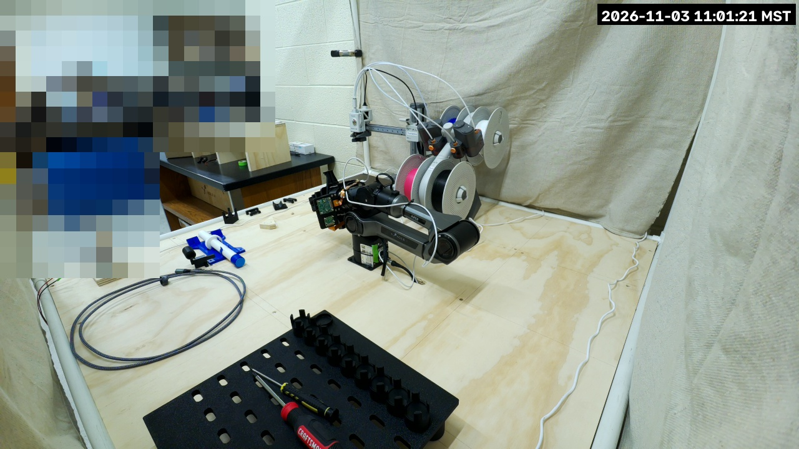

# PiPER cell livestream

The arm Pi's camera (imx708 wide, the one `camera.json` calibrates) streams to the *BYU VCL
Hardware Streams* YouTube channel through the lab's streaming Lambda
([`vertical-cloud-lab/streamingLambda`](https://github.com/vertical-cloud-lab/streamingLambda)),
like the byu-vcl stream cams. Broadcasts are titled *PiPER arm stream picam-piper, &lt;UTC time&gt;*
and go into the
[*PiPER arm Livestreams Playlist*](https://www.youtube.com/playlist?list=PLAoVUnZkte3E). Every
start of the service makes a new broadcast (and ends the old one), so the playlist is the
stable link.



## Pipeline

`rpicam-vid` (raw I420, 1280×720 at 10 fps from the full-field 2304×1296 sensor mode) →
[`device.py`](device.py) → `ffmpeg` (libx264 ultrafast, 1.5 Mb/s, 2 s keyframes, silent AAC) → RTMP.

`device.py` handles every frame in Python before anything is encoded:

1. **Faces.** OpenCV's YuNet detector (`face_detection_yunet_2023mar.onnx`, 230 kB, from
   [opencv_zoo](https://github.com/opencv/opencv_zoo/tree/main/models/face_detection_yunet),
   sha256 `8f2383e4…52fa4`) runs on a 960×540 copy of each frame. Each face box is grown by 60 %
   (more upwards, for hair), pixelated, and held for 8 frames after the face was last seen, so a
   miss of a frame or two stays covered.
2. **Fixed masks.** `MASK_RECTS` are always pixelated. Two cover the top-left third of the view,
   which looks past the cell into the lab; the detector does not see the back of a head, so this
   is what keeps passers-by out.
3. **Timestamp**, lab local time, top right.

It fails closed: without the model file it exits before going live, and a frame whose blur step
raises is dropped rather than sent.

On the Pi 5 the blur step takes about 75 ms a frame (2 OpenCV threads), and the service uses
about 1.3 cores for Python plus 0.2 for ffmpeg, holding 9.9 fps. The last frame sent is saved
to `/tmp/picam-stream-latest.jpg` every 30 s for checking over SSH.

## Install

On the Pi, from a copy of this directory with a `my_secrets.py` (from
[`my_secrets_example.py`](my_secrets_example.py); `LAMBDA_FUNCTION_URL` is the repo secret of
the same name):

```bash
./install.sh                      # ffmpeg, ~/picam-stream/{device.py,venv,my_secrets.py}, the unit
sudo systemctl enable --now picam-stream.service
```

`device.py` reads `my_secrets.py` only at start: `sudo systemctl restart picam-stream.service`
after an edit (which starts a new broadcast).

## The camera is shared with the arm's vision scripts

libcamera gives a camera to one process at a time, so `piper_vision.py`, `piper_pick_tape.py`
and anything else that opens the camera fails while the stream runs. Stop the stream first and
start it again afterwards:

```bash
sudo systemctl stop picam-stream.service    # ... run the vision script ...
sudo systemctl start picam-stream.service
```

The stream never touches the CAN bus or the arm.
