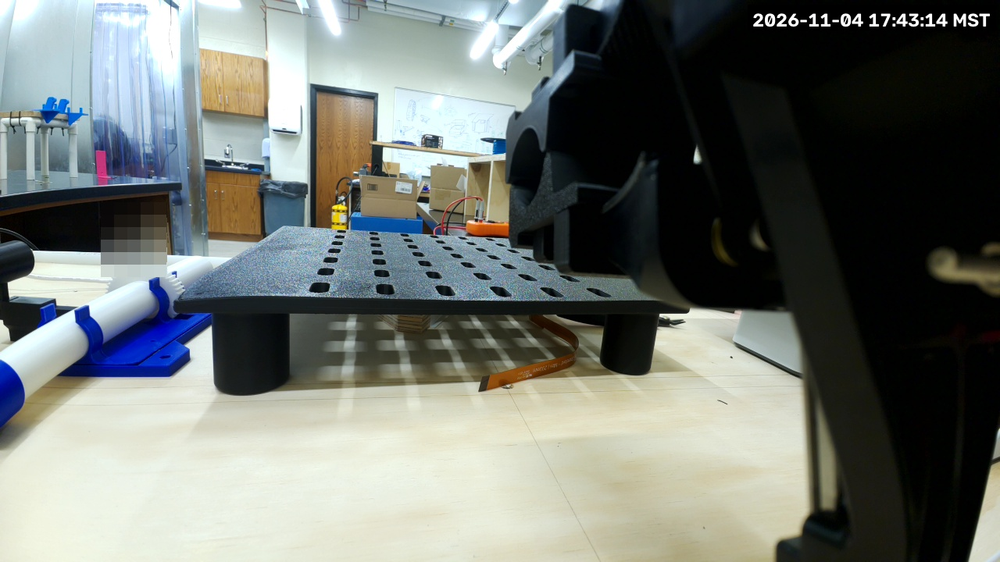
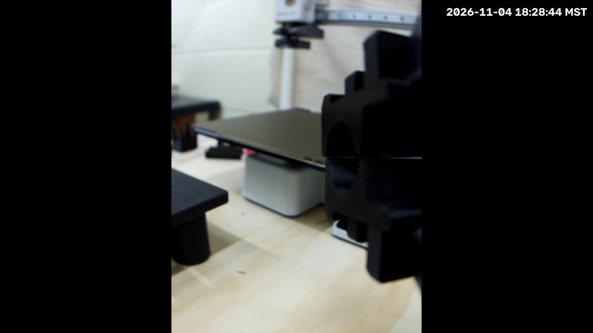
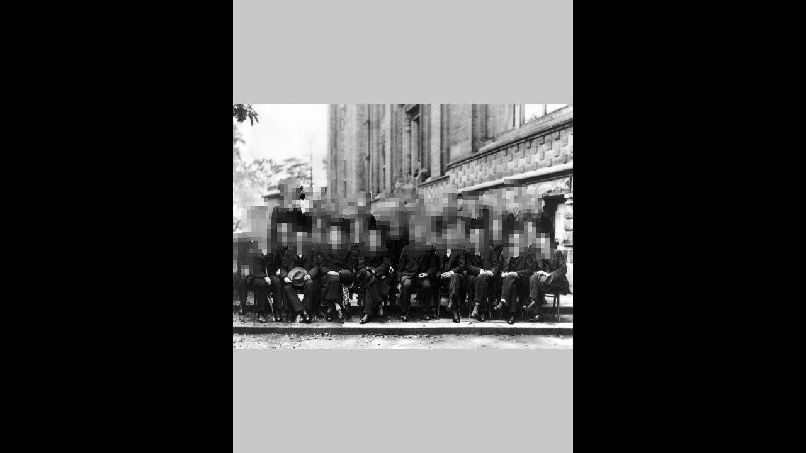

# PiPER cell livestream

The cell streams to the *BYU VCL Hardware Streams* YouTube channel through the lab's streaming
Lambda ([`vertical-cloud-lab/streamingLambda`](https://github.com/vertical-cloud-lab/streamingLambda)),
like the byu-vcl stream cams. **All four cameras stream publicly, with faces blurred on the Pi**:
the cell's two fixed cameras since 2026-11-03 22:48 UTC, and the two gripper cameras on 76zj since
2026-11-05 02:05 UTC (unlisted from 00:42 UTC; see
[Gripper cameras](#gripper-cameras-two-streams-on-76zj)). A restart of a Pi's service goes back to the broadcast that was live, so
its link keeps working, if a frame went out less than 10 minutes before (`BROADCAST_REUSE_SEC`).
After a longer stop, or a change to `WORKFLOW_NAME` or `PRIVACY_STATUS`, a start ends that
camera's broadcast and makes a new one, so each camera's playlist is its stable link:

| Pi | Camera | `WORKFLOW_NAME` | Playlist | Fixed masks |
| --- | --- | --- | --- | --- |
| mpzy | Camera Module 3 Wide, front-left post, looking into the cell | `PiPER arm front cam` | [*PiPER arm front cam Livestreams Playlist*](https://www.youtube.com/playlist?list=PLEplFHLNPMWo) | none |
| eufi | imx708 wide (the one `camera.json` calibrates), back-right post, looking diagonally across the cell | `PiPER arm back cam` | [*PiPER arm back cam Livestreams Playlist*](https://www.youtube.com/playlist?list=PLf8bu3tmddbw) | two, over the lab |
| 76zj | Camera Module 3 Wide (`imx708_wide`) on the gripper, `picam-stream@wide` | `PiPER arm gripper wide cam` | [*PiPER arm gripper wide cam Livestreams Playlist*](https://www.youtube.com/playlist?list=PLRPgT4muESmY) (the playlist is unlisted) | none: it moves |
| 76zj | HQ Camera (`imx477`) on the gripper, `picam-stream@hq` | `PiPER arm gripper HQ cam` | [*PiPER arm gripper HQ cam Livestreams Playlist*](https://www.youtube.com/playlist?list=PLFzagkscTGCM) (the playlist is unlisted) | none: it moves |

Broadcasts are titled *&lt;WORKFLOW_NAME&gt; stream picam, &lt;UTC time&gt;*. mpzy's camera sees
only the printer, the arm, the tool rack, the backdrop and the wall. eufi's looks towards the open
front-left corner, so the top-left third of its view is the rest of the lab, and two fixed masks
cover it:


**Workflow names must not overlap.** The Lambda's `end` ends every live broadcast whose title
contains the caller's `WORKFLOW_NAME` (case-insensitive), and `create` files a broadcast into
the first playlist whose title contains it, making `<WORKFLOW_NAME> Livestreams Playlist` with
the broadcast's privacy if there is none. So no Pi's name may appear in another's titles. The
first broadcasts (unlisted, 2026-11-03 18:00 to 22:48 UTC) used plain `PiPER arm` and are in the
[*PiPER arm Livestreams Playlist*](https://www.youtube.com/playlist?list=PLAoVUnZkte3E). **Never
use plain `PiPER arm` again**, since its `end` would end every camera's broadcast. A camera that
moves keeps its name; a new one needs a name of its own that neither contains nor is contained in
another's (`PiPER arm gripper` would end both gripper streams). A new name makes a new
playlist on its first start, with that broadcast's privacy.

## Gripper cameras: two streams on 76zj

76zj (Pi 5, 8 GB, active cooler) has two cameras on the gripper: a Camera Module 3 Wide
(`imx708_wide`) and an HQ Camera (`imx477`). Each has its own stream, from one install:
`picam-stream@wide.service` and `picam-stream@hq.service`, instances of the template unit
[`picam-stream@.service`](picam-stream@.service). The instance name picks the settings file,
`~/picam-stream/my_secrets_wide.py` or `my_secrets_hq.py`, and keeps each stream's
`broadcast-<name>.json` and `/tmp/picam-stream-<name>-latest.jpg` apart. Each settings file names
its camera by sensor (`CAMERA_SENSOR = "imx708_wide"` or `"imx477"`), not by index, because
libcamera renumbers the cameras when one is missing. A stream whose camera isn't there waits for
it and leaves YouTube alone.

**The HQ stream shows the whole sensor, upright** (since 2026-11-05 01:29 UTC). The HQ camera is
mounted on its side, so its raw picture has the table along the left edge. Its settings use the
imx477's full-field 2028×1520 mode (4:3) and `CAMERA_ROTATION = 270`, a quarter turn
anticlockwise. The upright picture is 540×720, with black bars at the sides of the 1280×720
stream. Until then it used the 16:9 2028×1080 mode, which leaves out the top and bottom 15% of
the sensor, and libcamera trimmed another 3% off each side to fit 16:9. So it showed about two
thirds of the sensor, turned 90°.

| As sent, 2026-11-05: wide | HQ, upright, whole sensor (01:31 UTC) |
| --- | --- |
|  |  |

- **No fixed masks or strict rects.** These cameras move with the arm, so nothing stays put in
  their view. Face blurring with both detectors covers the whole frame. The wide camera looks
  across the table into the lab (door, sink, benches), which is why both streams started out
  **unlisted**.
- **Public since 2026-11-05 02:05 UTC.** sgbaird approved that on the condition that face blurring
  is active, which was checked first (see the next bullet). `PRIVACY_STATUS = "public"` in both
  settings files, and each restart ended the unlisted broadcast and started a public one:
  `ruxhMLJqZh0` (wide) and `f2l5Qgu7Dik` (HQ). **The two playlists are still unlisted.** The
  Lambda sets a playlist's privacy only when it makes the playlist (here, with the first,
  unlisted broadcasts) and can't change it, and no token in this repo can either. Anyone with a
  playlist link can open it, but it isn't listed on the channel until someone with access to
  the channel changes its visibility in YouTube Studio. The broadcasts in them are public.
- **Face blurring checked before going public** (2026-11-05, 02:01 to 02:07 UTC):
  - Both streams had started with both detectors loaded, and each 2-minute log line showed boxes
    from both. Someone was working at a bench in view of both cameras, and the wide stream
    reported 700 boxes in two minutes.
  - In the frames sent at 02:07 UTC, after the switch, that person's head is pixelated in both
    views. Those frames aren't committed, because they show a person.
  - **Known-face test.** The 1927 Solvay conference photo (public domain, 29 faces) went through
    the installed `device.py`'s `FaceBlur` on 76zj, once with each stream's settings, letterboxed
    into that stream's picture:

    | Settings | Photo width (faces across) | Boxes (CenterFace + YuNet) | Faces pixelated |
    | --- | --- | --- | --- |
    | wide, 1280×720 picture | 994 px (about 25 px) | 36 + 30 | all 29 |
    | wide | 596 px (about 15 px) | 21 + 29 | 28 of 29: one in the back row was missed |
    | HQ, 540×720 picture | 540 px (about 14 px) | 36 + 31 | all 29 |
    | HQ | 324 px (about 8 px) | 14 + 0 | fewer than half |

    

    So very small faces, people far from the camera, are the limit. The wide stream's detectors
    see the picture at half (CenterFace) and three-quarter (YuNet) scale, and missed one face at
    about 15 px. The HQ stream's see it at nearly full size, and caught every face at about
    14 px but fewer than half at about 8 px.
- **What face blurring doesn't cover.** It finds faces, not people. At 02:01 UTC, before the
  switch, the HQ stream showed the same person from behind: out of focus, and not pixelated,
  because the back of a head isn't a face to either detector. Bodies, clothes and screens in
  view aren't blurred either. On eufi, fixed masks cover the part of the view that looks into
  the lab, but the gripper cameras move, so they have none.
- **The HQ camera's focus.** Its C/CS-mount lens is focused by hand. When the stream started
  (2026-11-05 00:42 UTC) the picture was a blur; by 01:20 UTC someone had focused it.
- **Load.** Two streams fill the Pi's 4 cores (each stream about 1.8 cores, at its
  `CPUQuota=200%`), so each sends 3.2 to 3.5 distinct frames a second of the 5 requested; ffmpeg
  repeats frames to keep 5 fps. With the fan running at about 5000 rpm the SoC sat at 60 °C,
  unthrottled. 76zj doesn't drive the arm, so nothing else needs those cores. For more frames,
  stop one stream. Since the HQ stream shows the whole sensor (half as much area again as
  before), CenterFace, the slower detector, runs on 480×640 instead of 640×360. That is a third
  more pixels, for about the same detail per face. YuNet runs on 540×720 instead of 960×540.
  The HQ stream now sends about 2.9 frames a second, against 3.2 before.
- **In the wide view, CenterFace marks a dark patch under the bench at the far left** (above the
  white PVC tee) as a face, so a small block there is pixelated while the gripper is at rest.

**First broadcasts.** The wide stream's first broadcast (`vLmLXshOKYg`, about a minute) missed its
playlist because of a temporary YouTube error (`409 SERVICE_UNAVAILABLE` from `playlistItems`),
so it was ended and the stream restarted with a new one, which made it in.

### mpzy's camera is loaded explicitly, not auto-detected

The firmware's `camera_auto_detect` missed this camera when mpzy booted on 2026-11-03, after the
arm relay was wired (#59). The camera itself was fine: loading its overlay by hand
(`sudo dtoverlay imx708 cam0`) brought it up with no reboot. So mpzy's `/boot/firmware/config.txt`
now has `camera_auto_detect=0` and, under `[all]`, `dtoverlay=imx708,cam0` (CAM/DISP 0). The
previous file is `/boot/firmware/config.txt.bak-2026-11-03-issue61`. **If a camera is moved to
CAM/DISP 1, swapped for another sensor or added, add or edit a `dtoverlay=` line there** (for
example `dtoverlay=imx708` for CAM/DISP 1), or nothing will detect it.

`device.py` also waits for libcamera to list a camera before it calls the Lambda. If the Pi comes
up without one, it logs `No camera found` every minute and leaves YouTube alone.

## Pipeline

`rpicam-vid` (raw I420, 1280×720 at 5 fps from the full-field 2304×1296 sensor mode) →
[`device.py`](device.py) → `ffmpeg` (libx264 ultrafast, 1.5 Mb/s, 2 s keyframes, silent AAC) → RTMP.

**Shape and rotation.** libcamera crops a sensor mode to the shape of the size it is asked for, so
`device.py` asks `rpicam-vid` for the mode's own shape, which keeps the mode's whole field of view.
It then turns the picture by `CAMERA_ROTATION`, if set, and scales it to the largest size of that
shape that fits the stream. Whatever is left of the 1280×720 frame is black. A 16:9 mode in a
16:9 stream fills the frame exactly, so the cell cameras and the wide gripper camera are
unchanged. Asked sizes are rounded up to a width that's a multiple of 64, because `rpicam-vid`
pads each raw row to that. Measured on 76zj: three 720×540 frames came to 1,866,240 bytes, the
size of 768×540 ones. The face detectors run on the upright picture, without the bars, so
`MASK_RECTS` and `STRICT_RECTS` are fractions of the upright picture. For the HQ stream that is
`rpicam-vid` 768×576 from the 2028×1520 mode, turned to 576×768 and scaled to 540×720.

`device.py --preview /tmp/frame.jpg` (with `PICAM_INSTANCE=<name>` on 76zj) saves one frame made
by the stream's own code, so it is turned and blurred, then exits without calling the Lambda.
Stop that camera's stream first and start it again within 10 minutes. Use it to check a new
camera position, rotation or mask before going live.

`device.py` handles every frame in Python, on the Pi, before anything is encoded or leaves it:

1. **Faces, with two detectors on every frame.** Every box either one finds is grown by 60 %
   (more upwards, for hair), pixelated, and held for 8 frames after it was last seen, so a miss
   of a frame or two stays covered.
   - **deface's CenterFace**: the model and decoder from the
     [`deface`](https://github.com/ORB-HD/deface) package (1.5.0, MIT, `centerface.onnx` sha256
     `09189dea…f5aefbc`), on a 640×360 copy of each frame, at deface's own default threshold of
     0.2. deface is built for anonymizing and is tuned to blur anything that might be a face.
     It is installed `--no-deps` with a pinned hash ([`requirements-deface.txt`](requirements-deface.txt)):
     `deface.centerface` needs only numpy and OpenCV, and with `backend="opencv"` it never imports
     onnxruntime. Its CLI's dependencies (opencv-python, scikit-image, imageio) aren't needed.
     (onnxruntime was no faster on a Pi 5: 118 ms a frame against OpenCV's 130 ms.)
   - **OpenCV's YuNet** (`face_detection_yunet_2023mar.onnx`, 230 kB, from
     [opencv_zoo](https://github.com/opencv/opencv_zoo/tree/main/models/face_detection_yunet),
     sha256 `8f2383e4…52fa4`), on a 960×540 copy at threshold 0.5.
   - **Strict rects** (`STRICT_RECTS`): small fixed areas around objects that the detectors
     take for faces. A box centred in one is blurred only if it scores at least 0.6 (CenterFace)
     or 0.7 (YuNet). See [False positives](#false-positives).
2. **Fixed masks.** `MASK_RECTS` are always pixelated, for parts of a view that look past the
   cell into the lab, since neither detector sees the back of a head. They belong to one camera's
   view: none for mpzy, two for eufi (see `my_secrets_example.py`). **Redo them whenever that
   camera moves.**
3. **Timestamp**, lab local time, top right.

It fails closed: if deface isn't installed, either model file is missing, `FACE_DETECTORS` is
empty or names an unknown detector, a rectangle isn't a valid `(x0, y0, x1, y1)` of fractions, or
a strict threshold is below its detector's normal one, it exits before going live. A frame whose
blur step raises is dropped rather than sent.

**Test.** A public-domain group photo (the 1927 Solvay conference) fitted into a 1280×720 frame
and put through `FaceBlur` as the stream does. CenterFace found 35 boxes and YuNet 31, which
covers all 29 faces; YuNet's extras and CenterFace's are background:


### False positives

**The A1 mini's AMS lite feeders look like a face** to both detectors: a dark housing with two
orange tube couplers for eyes. From 2026-11-03 22:48 to 2026-11-04 22:20 UTC this kept a block
pixelated over the printer's top spool in both views. Scores measured on unblurred frames, on
the Pi, at the stream's size:


| | CenterFace (threshold 0.2) | YuNet (threshold 0.5) |
| --- | --- | --- |
| mpzy, 50 live frames, 2026-11-04 | 0.25 to 0.38, every frame | under 0.3 |
| eufi, 50 live frames, 2026-11-04 | up to 0.30, 46 of 50 frames | 0.45 median, up to 0.54 |
| older stills, 2026-11-03 | 0.43 (mpzy), 0.37 (eufi) | 0.27 (mpzy), 0.36 (eufi) |
| for comparison: faces of people in the lab, eufi, same 50 frames (under its masks) | mostly 0.74 to 0.86 | mostly 0.80 to 0.92 |

Since 2026-11-04 each view has one **strict rect** around the feeders (`STRICT_RECTS`; about
135×100 px on mpzy and 135×85 px on eufi), where a box needs 0.6 from CenterFace or 0.7 from
YuNet. That clears the feeders with a margin of about 0.16 on each detector, and leaves the
thresholds everywhere else as they were. Why not raise the thresholds everywhere instead: on six
public-domain group photos placed into a 1280×720 frame at three sizes, raising CenterFace from
0.2 to 0.5 left 40 of 231 blurred boxes unblurred, and a dozen or so of those were real faces
(small, in profile, or cut off by the frame edge).

The cost: a real face centred in a strict rect, with CenterFace scoring 0.2 to 0.6 *and* YuNet
under 0.7, isn't blurred. That means someone's head right in front of the feeders, from that
camera, turned well away or mostly hidden. **Redo a strict rect whenever its camera or the AMS
lite moves**: a rect left over empty table only raises the thresholds there, and if the feeders
move out of it, they are pixelated again. Each Pi's log reports what the strict rects skipped
every 2 minutes (`strict rects skipped centerface N (max S), yunet N (max S)`), so a score
creeping towards the strict threshold shows up there.

In mpzy's view, YuNet also scores the black cable loop on the arm's elbow 0.47 against its 0.5
threshold, so a small patch of the arm may be pixelated for a moment.

**Load.** Each Pi uses its whole cap of 2 of the 4 cores, holding 4.5 to 4.7 fps of the 5
requested: about 190 ms a frame for the two detectors on 2 OpenCV threads (130 ms CenterFace,
65 ms YuNet), plus ffmpeg. RAM is about 200 MB (mpzy keeps about 375 MB of its 1 GB
available). mpzy also drives the arm, so the unit runs the stream at `Nice=10` with
`CPUQuota=200%`, which leaves the arm the other two cores, and sets `OOMScoreAdjust=500` so the
OOM killer takes the stream before anything that drives the arm. There is no memory cap, because
Raspberry Pi kernels boot with `cgroup_disable=memory`. For a lighter stream, lower `FRAME_RATE`
or drop `"yunet"` from `FACE_DETECTORS` (CenterFace alone takes about 130 ms a frame). The last frame
sent is saved to `/tmp/picam-stream-latest.jpg` every 30 s for checking over SSH.

## Install

On the Pi, from a copy of this directory with a `my_secrets.py` (from
[`my_secrets_example.py`](my_secrets_example.py); `LAMBDA_FUNCTION_URL` is the repo secret of
the same name):

```bash
./install.sh                      # ffmpeg, ~/picam-stream/{device.py,venv (+deface),my_secrets*.py}, the units
sudo systemctl enable --now picam-stream.service
```

On a Pi with more than one camera, write one `my_secrets_<name>.py` per camera instead (letters,
digits and `_` in the name; set `CAMERA_SENSOR` in each) and start
`picam-stream@<name>.service` for each. `install.sh` copies every `my_secrets*.py` it finds next
to it except the example, and installs both units.

`device.py` reads its settings only at start: `sudo systemctl restart picam-stream.service` (or
`picam-stream@<name>.service`) after an edit. That goes back to the same broadcast unless the edit
changed `WORKFLOW_NAME` or `PRIVACY_STATUS`.

## The camera is held by the stream

libcamera gives a camera to one process at a time, so anything else that opens a streaming Pi's
camera (run recordings like #54's on mpzy, `piper_vision.py` or calibration stills on eufi, the
gripper cameras on 76zj) fails while the stream runs. On 76zj each camera has its own unit, so
stop only the one you need: `picam-stream@wide.service` or `picam-stream@hq.service`, and its
still is `/tmp/picam-stream-wide-latest.jpg` or `/tmp/picam-stream-hq-latest.jpg`.

**For a still, don't stop the stream.** The last frame sent, faces already pixelated, is in
`/tmp/picam-stream-latest.jpg`, refreshed every 30 s:

```bash
ssh … 'cat /tmp/picam-stream-latest.jpg' > frame.jpg
```

**Anything that needs the camera itself:** stop the stream, use the camera, and start it again
within 10 minutes. The restart then goes back to the same broadcast, so the link people have
keeps working; viewers just see the video pause. After a longer stop the start makes a new
broadcast with a new link (the playlist link still works).

```bash
sudo systemctl stop picam-stream.service    # ... use the camera ...
sudo systemctl start picam-stream.service
```

How it works: `device.py` keeps the live broadcast's ingest URL in `~/picam-stream/broadcast.json`
(mode 600, since it holds the stream key) and writes the time of the last frame sent there every
30 s. The Lambda makes broadcasts with `enableAutoStop` off, so YouTube keeps one live through a
gap in its video. A start waits for the clock to be set by NTP before trusting that time. If a
broadcast it went back to fails three times within a minute of starting (ended in YouTube Studio,
say), it deletes the file and exits, and systemd starts over with a new broadcast.

The stream never touches the CAN bus, the relay or the arm.
