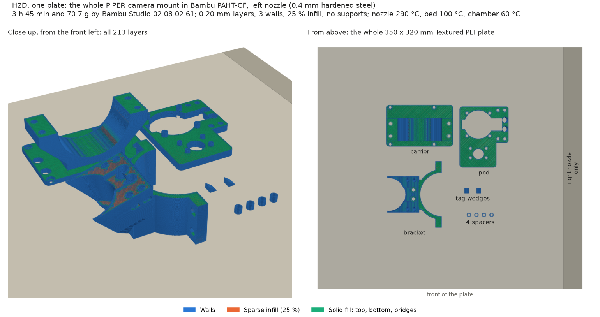

# Sliced for a Bambu Lab A1 mini, in PLA

[`piper_camera_mount_A1mini_PLA.3mf`](piper_camera_mount_A1mini_PLA.3mf) is a Bambu Studio project
with every printed part on **one plate**, already sliced: bracket, pod, carrier, the four Pi 5
spacers and both tag wedges. Open it in Bambu Studio or send it from Bambu Handy.
[`slice_a1mini.py`](slice_a1mini.py) makes it headless with the Bambu Studio **02.08.02.61**
command-line slicer, and writes the numbers to [`report.json`](report.json). It is the OT-2 lid
mount's script from [#234](https://github.com/vertical-cloud-lab/byu-vcl/pull/234)
(`ot2-overhead-camera/lid-mount/slice`, whose README covers the CLI's traps), by way of the Pi 5
dual-camera mount's in [#238](https://github.com/vertical-cloud-lab/byu-vcl/issues/238).

- **Parts** come from [`../exports`](../exports) as exported: in print orientation, centred on
  x = y = 0, standing on z = 0.
- **Positions** are `PRINT_LAYOUT` in [`../cad/render.py`](../cad/render.py), the centre of each
  part's footprint on the 180 × 180 mm bed. The script imports it, so a change there moves the part
  in both the slice and `renders/print_layout.png`.
- **Settings** are Bambu's system presets `Bambu Lab A1 mini 0.4 nozzle`, `0.20mm Standard @BBL A1M`
  and `Bambu PLA Basic @BBL A1M` (220 °C). On top go **3 walls and 25 % infill**, the **Textured PEI**
  plate at 65 °C, Auto circle contour-hole compensation **on** and supports **off**. The filament
  colour is black, which only changes the preview.

**For the H2D in PAHT-CF** there is a second one-plate project,
[`piper_camera_mount_H2D_PAHT-CF.3mf`](piper_camera_mount_H2D_PAHT-CF.3mf); see
[The H2D in PAHT-CF](#the-h2d-in-paht-cf-one-plate-slice_h2dpy) below.

## Running it

From the repo root:

```bash
# Bambu Studio for Linux: the AppImage, extracted to ~/bambu/squashfs-root (needs no FUSE)
mkdir -p ~/bambu && curl -L -o ~/bambu/BambuStudio.AppImage \
  https://github.com/bambulab/BambuStudio/releases/download/v02.08.02.61/BambuStudio_ubuntu24.04-v02.08.02.61-20260820225108.AppImage
chmod +x ~/bambu/BambuStudio.AppImage && (cd ~/bambu && ./BambuStudio.AppImage --appimage-extract > /dev/null)
sudo apt-get install libwebkit2gtk-4.1-0 libgstreamer-plugins-base1.0-0 libwayland-server0

# optional, for the plate thumbnails the printer's screen shows: a headless Wayland display and OSMesa
sudo apt-get install weston libosmesa6 gcc
export XDG_RUNTIME_DIR=/tmp/xdg && mkdir -p -m 700 $XDG_RUNTIME_DIR
weston --backend=headless --socket=wayland-bambu --idle-time=0 &
export WAYLAND_DISPLAY=wayland-bambu

python piper-camera-mount/slice/slice_a1mini.py --bambu ~/bambu/squashfs-root   # -> .3mf, report.json (~10 s)
python piper-camera-mount/slice/overhangs.py                                    # -> overhangs.json (needs trimesh)
```

- **Re-run both** whenever `cad/piper_mount.py` re-exports the STLs. Each output records the first 12
  hex digits of every STL's SHA-256, so a stale one is easy to spot. The slice needs `cadquery` and
  `pyvista` only because it imports `render.py`.
- **Layout check.** Before slicing, each part's footprint (its STL's bounding box, centred on its
  `PRINT_LAYOUT` point) is checked against the bed and the other parts. Any clash is printed and
  recorded in `layout_warnings`; the fix is a new position in `PRINT_LAYOUT`. Bounding boxes are
  conservative, so a clash may be a near miss.
- **The two tag wedges** are two entries in the CLI's assemble list, so Studio names both
  `tag_wedge_1`. One entry with `"count": 2` would name them apart, but the CLI then adds the second
  position to the first.
- **Run to run**, Bambu's time estimate moves by up to about 0.4 % and the G-code's travel order
  changes. Filament use doesn't.

## report.json

| Key | What it is |
|---|---|
| `plates[].print_time_s`, `filament_g`, `filament_m` | Bambu's estimate for the plate, and the PLA it takes |
| `plates[].feature_time_s` | Bambu's time per feature. `Travel` is also counted inside the others: leave it out and the rest add up to `print_time_s` |
| `plates[].toolpath_outside_bed` | Whether any part's toolpath leaves the 180 × 180 mm bed (Bambu's own `outside` flag) |
| `plates[].support_used` | Whether supports were generated. False, since they're off |
| `support_necessity_checks_run`, `support_necessity_flags` | With supports off, Bambu checks every object for floating regions and cantilevers over 6 mm, and warns *"It seems object X has … Please re-orient the object or enable support generation."* The flags are those warnings; empty means nothing was flagged. In 02.08.02.61 the check ignores ordinary overhangs and bridges, hence `overhangs.py` |
| `plates[].slicer_warnings` | Every `found … slicing warnings` line the CLI logged for the plate |
| `plates[].gcode_warnings` | Warnings stored in the 3MF. `not_support_traditional_timelapse` is on every single-colour A1 mini print, and only matters if the job is sent with timelapse on |
| `layout`, `layout_warnings` | Each part's footprint on the bed and its height, and any part that leaves the bed or overlaps another |

## overhangs.json

[`overhangs.py`](overhangs.py) works on the STLs alone, without the slicer. For each part, in print
orientation, it adds up the downward-facing triangles more than 45° from vertical, leaving out the
faces on the bed, and finds the largest edge-connected patch of them. It reports that patch's area,
its flattest face (90° is a flat ceiling) and its bounding box in the STL's own frame. Faces drawn at
exactly 45°, like the carrier's gussets, are counted separately as `at_limit_mm2`. Hole tops,
nut-slot roofs and counterbore roofs all show up: they print as short bridges.

## The H2D in PAHT-CF, one plate (`slice_h2d.py`)

[`piper_camera_mount_H2D_PAHT-CF.3mf`](piper_camera_mount_H2D_PAHT-CF.3mf) is the same job for the
lab's H2D, in the material the main README picks for the parts that stay on the arm
([Material](../README.md#material-paht-cf-on-the-h2d)). [`slice_h2d.py`](slice_h2d.py) makes it with
the same CLI and writes [`report_h2d.json`](report_h2d.json), whose keys are `report.json`'s plus the
nozzle and temperatures.



- **One plate, 3 h 45 min and 70.4 g** by Bambu's estimate: 213 layers to 42.6 mm, with no supports,
  no slicer warnings, nothing flagged by Bambu's support check and no toolpath off the bed.
- **Settings:** Bambu's system presets `Bambu Lab H2D 0.4 nozzle`, `0.20mm Standard @BBL H2D` and
  `Bambu PAHT-CF @BBL H2D`, with the A1 mini's overrides on top (3 walls, 25 % infill, circle
  compensation on, supports off, Textured PEI). From the presets: nozzle 290 °C, plate 100 °C,
  chamber 60 °C.
- **The left nozzle.** The H2D's status on 2026-09-27 showed a 0.4 mm hardened-steel hotend on the
  left and a 0.6 mm TPU High-Flow hotend on the right, which shouldn't run carbon fibre. Left alone,
  the CLI groups the filament itself ("Auto For Flush") and puts it on the right, Bambu's main
  extruder. So the plate is set to "Manual" with filament 1 on extruder 1, the left; the G-code
  reads `filament_map = 1`, and `slice_info.config` has the filament on `extruder_id="1"`. The CLI
  takes this from the plate's own settings (`plate_params` in the assemble list). Set in the
  process preset, it reaches the project settings but not the slice.
- **Positions** are `PRINT_LAYOUT` again, moved by (85, 70) mm so that the A1 mini's 180 × 180 mm
  square sits in the middle of the 350 × 320 mm bed. Each footprint is also checked against the left
  nozzle's reach, x 0 to 325 mm (`extruder_printable_area` in the machine preset). The set takes
  about a quarter of the plate.
- **Pictures:** [`plate_view.py`](plate_view.py) draws `../renders/h2d_plate.png` and
  [`../renders/h2d_plate_build.gif`](../renders/h2d_plate_build.gif) from the plate's own G-code,
  coloured by Bambu's feature labels. The times in the GIF are Bambu's, from its `M73` lines. The 3MF
  also carries Studio's own plate thumbnails.

```bash
python piper-camera-mount/slice/slice_h2d.py --bambu ~/bambu/squashfs-root   # -> .3mf, report_h2d.json (~15 s)
xvfb-run -a python piper-camera-mount/slice/plate_view.py                    # -> renders/h2d_plate.png, .gif (~1 min)
```

**Before sending it:**

- **Check three settings in Studio.** On every CLI-sliced project so far, Studio has reset wall
  loops (3 → 2), sparse infill (25 → 15 %) and circle compensation (on → off) when opening it
  ([2026-10-08](print_2026-10-08/README.md#what-the-gui-changed-and-the-check)). The likely cause is
  that the CLI leaves the project's `different_settings_to_system` list empty. On opening a project,
  Studio selects the system preset of the same name and applies only the settings that list names. So
  `slice_h2d.py` now names the three there (`mark_overrides`), and Studio should keep them. That
  hasn't been tried in the GUI yet. If any of them reads 2, 15 % or off, set it back and re-slice. The
  plate should come back at 70.35 g and 213 layers.
- **Check the filament is on the left nozzle** in the plate's filament grouping, and that the left
  hotend is still the 0.4 mm hardened steel one. Studio reads the nozzles from the printer. The 27
  September reading is still the latest. A read-only status request from CI on 2026-10-12, through
  the arm Pi, reached the printer but was refused as not authorized (MQTT CONNACK 5), so the stored
  `H2D_ACCESS_CODE` looks out of date.
- **Dry the PAHT-CF:** 80 °C for 8 to 12 h in the AMS HT, as the main README says.

## Three setups, each part alone (`slice_configs.py`)

[`slice_configs.py`](slice_configs.py) slices the mount for the material question, with the same CLI
and the same overrides (3 walls, 25 % grid infill, supports off):

| Setup | Printer and nozzle | Process | Filament |
|---|---|---|---|
| `h2d_pahtcf_06` | H2D, 0.6 mm hardened steel (Bambu's recommendation for PAHT-CF) | 0.30mm Standard | Bambu PAHT-CF |
| `h2d_pahtcf_04` | H2D, 0.4 mm hardened steel (fitted now) | 0.20mm Standard | Bambu PAHT-CF |
| `a1m_pla_04` | A1 mini, 0.4 mm | 0.20mm Standard | Bambu PLA Basic |

Plate 1 is the whole job, and plates 2 to 6 hold one part each, centred on the bed. So each part's
mass comes from its own G-code, split by feature, in
[`slice_configs.json`](slice_configs.json). Each part's G-code also goes to `build_<setup>/` (ignored
by git), where [`../sim/sliced_fea.py`](../sim/sliced_fea.py) reads it to model the part as printed.

## Has it been printed? (`print_2026-10-08/`, `print_2026-10-13/`, `a1mini_history/`, `print_history_2026-10-24/`)

**The first PLA set went to the A1 mini on 2026-10-08.** It was sent at 12:39 UTC from Bambu
Studio on a CI runner, as one plate, in black PLA Basic on Textured PEI. The record is in
[`print_2026-10-08/`](print_2026-10-08/README.md): pre-flights, the file Studio sent, `print.json`
and camera frames.

**A second PLA set, with the O43 cradle, went to the A1 mini on 2026-10-13.** It is
`piper_camera_mount_A1mini_PLA.3mf` as of `b6e2da0`, uploaded unchanged to the printer's SD card over LAN and
started at the touchscreen by jss265, in black PLA Basic from A3. When the session handed over it was
at layer 18 of 213, with no error, and due to finish near 22:08 UTC. The record is in
[`print_2026-10-13/`](print_2026-10-13/README.md).

**The first set's bracket is out of date.** On 2026-10-12 the bracket's lens cradle was widened from O33
to O43, so the 6 mm lens's thumbscrews clear it at any angle ([The pod seat](../README.md#the-pod-seat)).
The plate and `report.json` here are the new bracket; `print_2026-10-08/sent/` keeps what was printed.
Only the bracket changed: alone it is 1 h 19 min and 36.2 g on the A1 mini (`slice_configs.py`,
`a1m_pla_04`, plate 2).

**Both sets' pod and bracket are out of date now.** The 13 October pod didn't take the HQ Camera:
the housing's shoulders, the screws in them and its lock block hit it (#4). On 2026-10-23 the pod's
pocket was recut to clear them by 1.0 mm, and the bracket's seat now stays 1.5 mm from them
([The HQ Camera in the pod](../README.md#the-hq-camera-in-the-pod)). Both plates and reports here
have the new pair. Alone, on the A1 mini, the pod is 37 min and 14.2 g and the bracket 1 h 19 min and
36.2 g (`a1m_pla_04`, plates 3 and 2). Either set's carrier, spacers and tag wedges are still current.

**The pod's hole for the Camera Module 3 Wide changed on 2026-10-27.** The Wide's square lens
housing couldn't pass the round hole. The hole is now an 11.4 mm square, moved 4.94 mm to where
Raspberry Pi's drawing puts the housing, and the pod is otherwise unchanged
([The Camera Module 3 Wide in the pod](../README.md#the-camera-module-3-wide-in-the-pod)).
- **Re-sliced for it:** the A1 mini plate, `report.json` and `overhangs.json` here. The plate is
  2 h 48 min and 85.48 g, 14 s and 0.02 g more, and only the pod's STL changed.
- **Not re-sliced:** the H2D plate and the per-part slices (`slice_configs.json`), which still have
  the round hole.

**On 2026-10-28 the hole ran on over the flex below the Wide's housing,** 1.0 mm clear of it on
every side and through the plate ([The flex below the housing](../README.md#the-flex-below-the-housing)).
Only the pod's STL changed.
- **Re-sliced for it:** the A1 mini plate (2 h 48 min, 85.27 g), `report.json` and `overhangs.json`;
  and the H2D PAHT-CF plate (3 h 45 min, 70.20 g, the left 0.4 mm nozzle) and `report_h2d.json`,
  which had still carried the round hole.
- **Not re-sliced:** the per-part slices (`slice_configs.json`).

Before that, nothing of the mount had been printed. [`a1mini_history/`](a1mini_history/README.md)
lists everything the A1 mini printed from July to the morning of 2026-10-08, from Bambu's cloud and
the printer's own SD card, with the two read-only scripts that fetch it.

**Nothing has been printed in PAHT-CF yet.** The H2D plate above was sliced on 2026-10-12, with the
O43 cradle, and re-sliced on 2026-10-23 with the new pod and bracket.

**Checked in Bambu Studio on 2026-10-24** ([`print_history_2026-10-24/`](print_history_2026-10-24/README.md)).
- The two A1 mini sets are still the only prints of the mount. Neither the cloud history nor
  either printer's storage has another.
- Against this branch as it was then (`9e00fd1`), the 13 October set matched part for part, and the
  8 October set differed only in its bracket.
- Later that day `claude/issue-4-20261023-1814` was merged in (`99fba43`), with the pod and bracket
  that clear the HQ Camera housing. So neither set's pod or bracket is current now.
