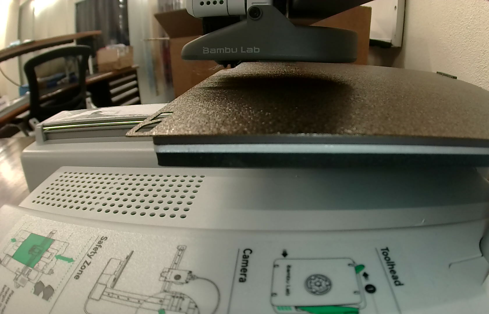
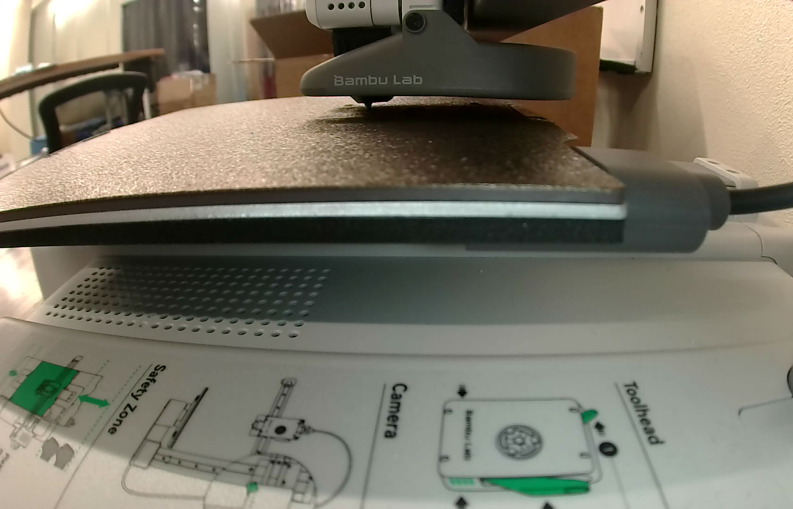
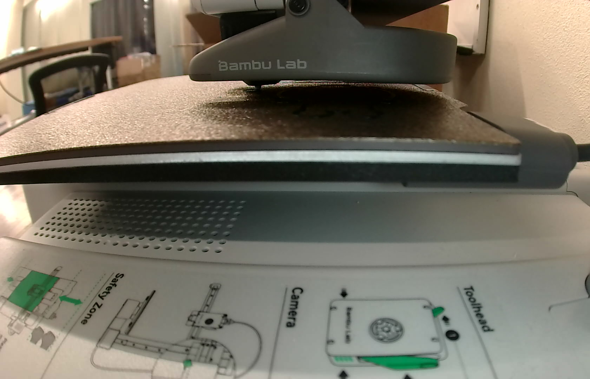
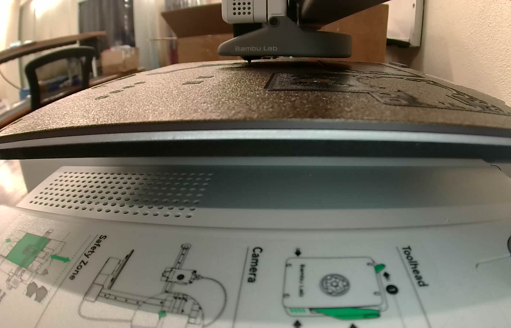
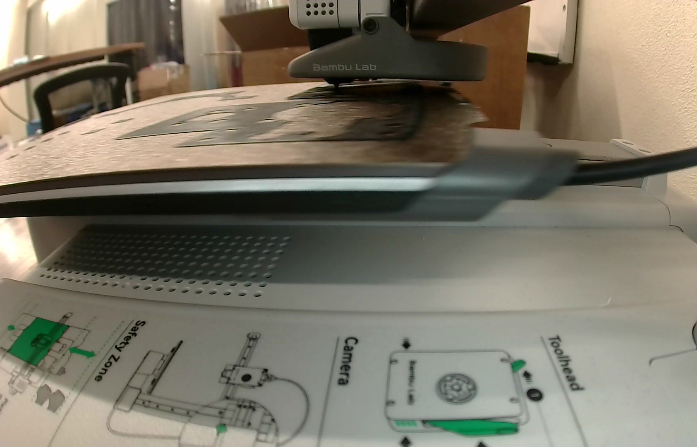
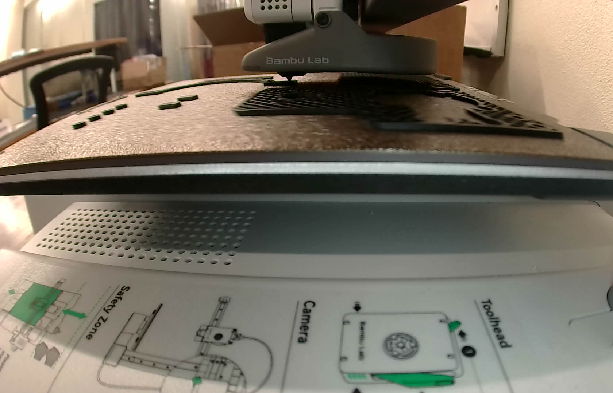
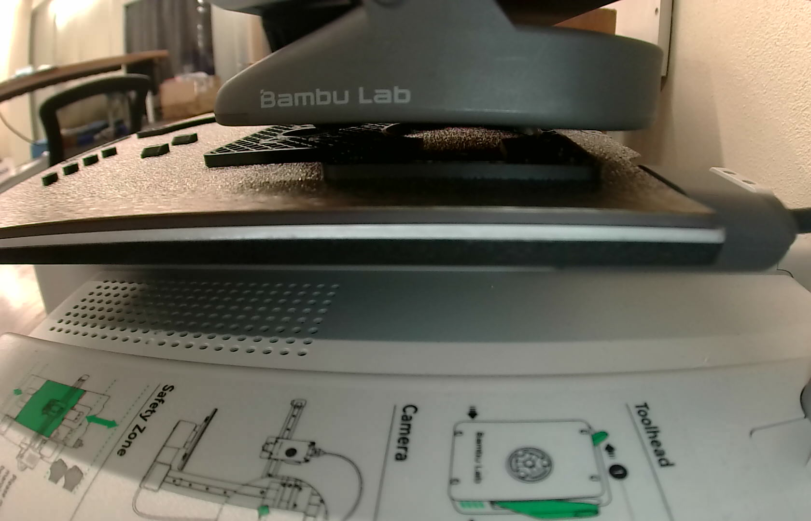
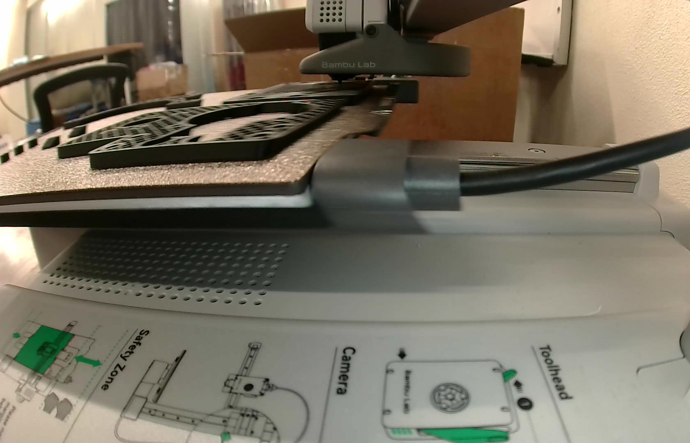

# The PiPER mount in black PLA on the A1 mini (2026-10-13)

This is the second PLA set, and the first with the Ø43 lens cradle. Every printed part is on one
plate:
- the bracket;
- the pod;
- the carrier;
- the four Pi 5 spacers;
- both tag wedges.

The first set ([`../print_2026-10-08/`](../print_2026-10-08/README.md)) has the old Ø33 cradle.

The plate is [`../piper_camera_mount_A1mini_PLA.3mf`](../piper_camera_mount_A1mini_PLA.3mf) as of
`b6e2da0`: 213 layers to 42.6 mm, 85.84 g, and an estimate of 2 h 47 min 43 s. It went out in
black Bambu PLA Basic from AMS slot A3, on the Textured PEI plate. It was asked for on
[PR #10](https://github.com/vertical-cloud-lab/robot-arms/pull/10#issuecomment-6152645350):
"make the print on the A1 mini. Use the black filament."

**How it was sent: a person started it at the printer.** This is route 1 of the
[runbook](https://github.com/vertical-cloud-lab/byu-vcl/blob/claude/ot2-lid-camera-mount-20260925/bambu/README.md)
(byu-vcl, branch `claude/ot2-lid-camera-mount-20260925`).
- `bambu_print.py upload` put the committed 3MF on the printer's SD card over LAN, through the
  arm Pi, as `piper_mount_A1mini_black.gcode.3mf`. The bytes are unchanged. The MD5 read back
  matched.
- jss265 opened it on the touchscreen, checked the plate and started it.
- **So the printer ran the committed CLI slice.** No GUI re-slice was involved. Earlier prints
  came through Bambu Studio, which resets three of the project's settings on opening
  (`../print_2026-10-08/README.md`); none of that applies here.
- **No login code went into the thread.** Bambu Studio was set up on the runner as the remote
  option, and Bambu e-mailed a login code at 19:03:42 UTC. Nobody posted the code, so it expired
  unused. Studio was closed and its screen recording deleted, since it showed the login page.

## Outcome

- Running by 19:21:29 UTC, 11 s after jss265's `Started`. The printer was loading **tray 2
  (0-based), A3, the black PLA Basic** (`ams.tray_now = 2`), with no print error or HMS alert.
- **Start sequence:**
  - filament change;
  - vibration sweep;
  - nozzle wipe;
  - bed levelling;
  - extrusion calibration.

  Timelapse was off. It took 5.3 min from the first status read to layer 1.
- Layer 1 ran from 19:26:49 to 19:34:14: 7.4 min, against 7.5 min for the same plate on
  8 October. Nozzle 220 °C and bed 65 °C held on target.
- Layers 2 to 18 took 31.3 min (30.9 min on 8 October).
- **The session watched to layer 18 of 213** (27 %, 121 min left at 20:07:26), then handed
  over to jss265. In 872 status samples there was no print error, HMS alert or temperature
  alarm.
- The finish should be near 22:08 UTC. This record stops before then.
- The frames show the first layer flat on the plate, then the parts building with no strings or
  lifting.

| Start (heating) | Layer 1 begins | Layer 1, mid | Layer 1, end |
|---|---|---|---|
|  |  |  |  |
| **Layer 2** | **Layer 7** | **Layer 13** | **Layer 18** |
|  |  |  |  |

## Timeline (UTC)

| Time | Step |
|---|---|
| 18:43:04 | Request |
| 18:48:11 | Read-only pre-flight. Every automatic check passed; the verdict was HUMAN-DECISION, as always. The gantry was parked high after a 435-layer job, and the plate looked empty |
| 18:49:58 | Frame posted |
| 18:55:40 | Job uploaded to the SD card root, MD5 read back |
| 19:03:42 | Bambu Studio's *Log In* pressed; Bambu e-mails the code |
| 19:04:21 | Asked for either the code with `plate clear`, or a start at the printer and `started` |
| 19:21:18 | jss265: `Started` |
| 19:21:29 | Status read: `RUNNING`, this job, tray 2 |
| 19:26:49 | Layer 1 |
| 19:34:14 | Layer 2 |
| 19:49:59 | Layer 10 |
| 20:05:32 | Layer 18 |
| 20:07:26 | Handed over: layer 18, 27 %, 121 min to go by the printer |

## Files

| File | What |
|---|---|
| `20261013T184811Z_*` | Pre-flight: redacted status, checks and camera frame |
| `20261013T192129Z_*` | The first status read after the start |
| `print.json` | Route, file and MD5s, filament slot, start sequence, estimates, timeline, who started it |
| `watch.jsonl.gz` | Every status sample from `bambu_print.py watch` |
| `frames/` | Key frames from the printer's camera, named `<UTC>_L<layer>` |

## Things the next print should know

- **Route 1 is the quick one when someone is in the lab.** It takes upload, a tap on the
  touchscreen and `started`, with no login code. The file runs exactly as committed.
- **The plate check then happens in person.**
- **CI can't stop a print that a person started**, and can't stop one while the printer is on
  Bambu's cloud. Whoever starts it holds the stop.
