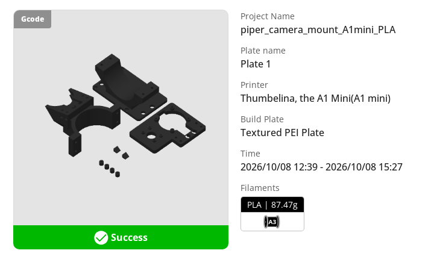
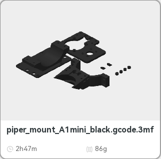
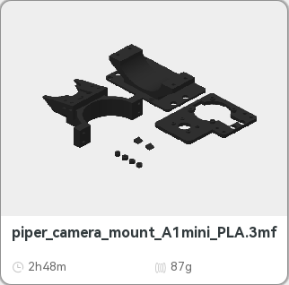

# Which wrist-camera parts have been printed (checked 2026-10-24)

The request was on [PR #10](https://github.com/vertical-cloud-lab/robot-arms/pull/10): "check to
see if the wrist camera models that were printed correspond to the latest versions contained in
this pull request. Don't print anything, just log into Bambu studio and check for print
history". **Nothing was sent to a printer.**

**How it was read.** Bambu Studio 02.08.02.61 ran on the runner of a `@claude-print` run.
- It logged in to the lab's account at 00:09:36 UTC. Bambu asked for the authenticator code, and
  the first one worked.
- Two places were read:
  - *Home → Print History*: every job sent through Bambu's cloud.
  - *Device → each printer → Storage → Model*: the job files on the printer's own storage,
    read through Bambu's cloud.
- Afterwards Studio was signed out and closed, and its config was deleted.

## The answer

The mount has been printed twice, both times on the A1 mini in black PLA. Neither printer has
any other job of it.

| Set | Where Studio shows it | File on the A1 mini | Plate it came from | Against this branch (`19c3112`) |
|---|---|---|---|---|
| **2026-10-08**, 12:39–15:27 UTC | Cloud history: `piper_camera_mount_A1mini_PLA`, Success, 87.47 g PLA from A3, Textured PEI | `piper_camera_mount_A1mini_PLA.3mf`, 2h48m, 87 g | `801431a`'s plate (MD5 `8d2fe312…`, the same file as byu-vcl `b3dba57`), re-sliced in Studio | **Bracket out of date** (the Ø33 cradle). Pod, carrier, the 4 spacers and both tag wedges are current |
| **2026-10-13**, from 19:21 UTC | Storage only: it was started at the touchscreen, and those jobs don't reach the cloud history | `piper_mount_A1mini_black.gcode.3mf`, 2h47m, 86 g | `b6e2da0`'s plate (MD5 `173714ec…`, read back after upload; still the same bytes here) | **All six parts current** |

| 13 Oct file on the SD card | 8 Oct file on the SD card |
|---|---|
|  |  |

- **No job of the mount on the H2D.** Its cloud history has none, and its storage holds five files,
  all from August ([`h2d_storage_models.png`](h2d_storage_models.png)). Nothing has been
  printed in PAHT-CF.
- **Two other camera mounts are in the history but aren't from this PR:**
  - `RaspberryPiCameraMount(NEW)`: 2026-10-07, 7.11 g;
  - `top cam mount`: 2026-10-08, 34.78 g.

## How the parts were matched

[`compare_printed.py`](compare_printed.py) reads the meshes in each plate's 3MF and the STLs in
`exports/` at a commit. It compares triangle count, volume and surface area, which don't change
when a part is moved or turned on the plate. The output is
[`mesh_compare.json`](mesh_compare.json).

| Part | This branch's STL | In the 8 Oct plate | In the 13 Oct plate |
|---|---|---|---|
| Bracket | 9,242 triangles, 51,819.91 mm³ | 9,360 triangles, 57,058.11 mm³: **the Ø33 cradle** | same |
| Pod | 17,034, 18,845.56 mm³ | same | same |
| Carrier | 9,244, 52,588.61 mm³ | same | same |
| Spacers (4, one mesh) | 4,032, 442.15 mm³ | same | same |
| Tag wedges (2) | 12, 123.97 mm³ each | same | same |

**Matching the files on the printer.** Studio can't download a model file from a printer's
storage. The Model tab offers only *Delete* and *Print*, and neither was clicked. So each file was
matched by four things:
- its name;
- Studio's time and weight;
- its thumbnail, which looks the same as `Metadata/plate_1.png` in the committed plate
  ([`thumbnails_sd_card_vs_committed.png`](thumbnails_sd_card_vs_committed.png); left to right: the 13 Oct
  card, `b6e2da0`'s plate, the 8 Oct card, the 8 Oct sent file);
- the MD5 read back after the 13 Oct upload.

## Newer than this PR

**[`claude/issue-4-20261023-1814`](https://github.com/vertical-cloud-lab/robot-arms/tree/claude/issue-4-20261023-1814)
(2026-10-23) changes the pod and the bracket again.**
- It models the HQ Camera housing's shoulders, screws and lock block from Raspberry Pi's drawing
  RP-008200.
- Its commit `fb291f6` says the pod printed on 13 October hits that housing:
  - 225 mm³ at the shoulders and foot;
  - 73 mm³ at the screws;
  - 2.5 mm³ at the lock block.
- There the pod is 18,226.2 mm³ and the bracket 51,757.4 mm³. The carrier, spacers and tag wedges
  are unchanged.
- If that branch lands, both printed sets need a new pod and bracket. Its commit gives the pod
  alone as 37 min and 14.2 g on the A1 mini, and the bracket alone as 1 h 19 min and 36.2 g.

## Files

| File | What |
|---|---|
| `history.json` | What Studio showed: - the mount's jobs; - the cloud history from 2026-09-26 on; - the A1 mini's storage back to 2026-10-07; - the H2D's storage |
| `compare_printed.py`, `mesh_compare.json` | The mesh check above |
| `*.png` | Crops of Studio's pages. The sidebar, which shows the account name, is left out |
