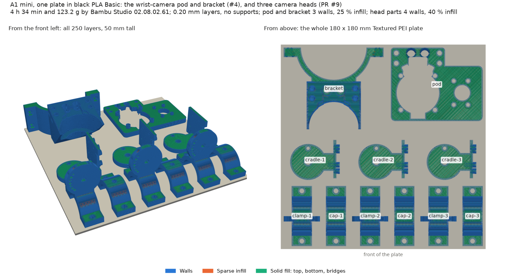
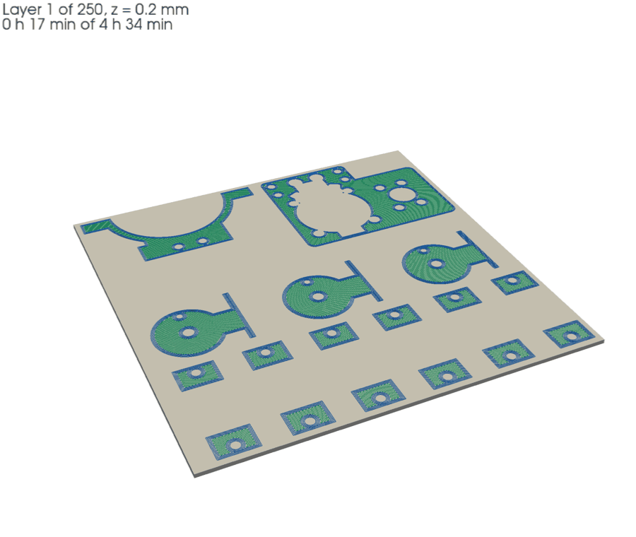

# #45: the new wrist-camera pod and bracket, and three camera heads, on one A1 mini plate

Asked for on [#45](https://github.com/vertical-cloud-lab/robot-arms/issues/45): the pod from
[#4](https://github.com/vertical-cloud-lab/robot-arms/issues/4#issuecomment-6371671549), if it was the only
part that changed, and three each of the head clamp, clamp cap and head cradle from
[PR #9](https://github.com/vertical-cloud-lab/robot-arms/pull/9#issuecomment-6409456872), all on the A1 mini.
**Nothing has been sent to a printer.**





## The pod wasn't the only part that changed: the bracket did too

Since the set printed on 2026-10-13, #4's latest
([`claude/issue-4-20261023-1814`](https://github.com/vertical-cloud-lab/robot-arms/tree/claude/issue-4-20261023-1814)
at `27db133`) changed two of the five printed parts. [`what_changed.py`](what_changed.py) compares
each part's STL with the 13 Oct plate's (`b6e2da0`; PR #10's print-history check matched that plate's
meshes to those STLs). Its output is [`what_changed.json`](what_changed.json).

| Part | Changed? | What changed |
|---|---|---|
| **Pod** | **Yes** | 622 mm³ cut away: the HQ Camera's pocket now clears the tripod mount's shoulders, the screws in them and the lock block by 1.0 mm |
| **Bracket** | **Yes** | 63 mm³ cut away: two 30.5 mm³ pockets in the seat, one each side, and 1.6 mm³ at the middle, so the seat stays 1.5 mm from the tripod mount's front face. The printed bracket overlaps the camera by 3.8 mm³ (#4) |
| Carrier, 4 spacers, tag wedges | No | The same files, byte for byte |

So this plate has both the pod and the bracket. If you'd rather keep the printed bracket and file
its seat instead, [`issue45_A1mini_PLA_no-bracket.3mf`](issue45_A1mini_PLA_no-bracket.3mf) is the same plate
without it.

## It fits on one plate

| | [`issue45_A1mini_PLA.3mf`](issue45_A1mini_PLA.3mf) (recommended) | [`..._no-bracket.3mf`](issue45_A1mini_PLA_no-bracket.3mf) |
|---|---|---|
| Parts | pod, bracket, 3 × (head clamp, clamp cap, head cradle) | the same without the bracket |
| Time (Bambu's estimate) | 4 h 34 min | 3 h 27 min |
| PLA | 123.2 g | 87.0 g |
| Layers | 250, to 50.0 mm (the head clamps) | the same |

- **Printer and material:** A1 mini, 0.4 mm nozzle, **black Bambu PLA Basic** (AMS slot A3 in the
  last two mount prints), Textured PEI plate at 65 °C, nozzle 220 °C.
- **Settings:** Bambu's `0.20mm Standard @BBL A1M` with the mount's overrides: 3 walls and 25 %
  infill, circle compensation on, supports off. The nine head parts carry PR #9's **4 walls and 40 %
  infill** as per-object settings; [`report.json`](report.json) shows them in the 3MF.
- **Layout:** the clamps and caps along the front, the cradles behind them (each head's three parts
  in one column), the bracket and pod at the back. The bracket and pod are turned 90° about z;
  nothing else is changed. Every footprint is at least 5 mm from the next and 2.5 mm from the edge.
- **Per part,** from the G-code ([`per_object.json`](per_object.json)): pod 14.5 g, bracket 34.6 g,
  and each head 24.7 g (clamp 10.3, cap 6.1, cradle 8.3).
- **Checks:** no toolpath leaves the bed, no supports, no brim. Studio's thumbnails are embedded, so
  the printer's screen shows the plate. The only G-code warning is Bambu's usual timelapse note.

## Before sending

- **Bambu flags the three caps.** Its support check says each cap "has floating cantilever". The
  overhang is the top of the pipe bore: a Ø27.2 mm half-round lying on its split face, steeper than
  45° for its top 4 mm. The head clamp has the same bore and isn't flagged. PR #9 specifies both
  without supports, and this plate follows it. Expect some sag along the top of each cap's bore,
  which is where it bears on the pipe; trim or sand it if a cap doesn't seat. The other option is
  supports under the caps only, which would mark the same surface.
- **PR #9 asked for the heads in PETG.** This plate is all PLA, so it can be one job. Putting PETG
  heads and PLA mount parts on one plate would mean a filament change on every layer. If the heads
  should be PETG, they need a plate of their own (the last status read, on 13 October, showed
  white PETG Basic in slot A4).
- **Studio may reset three settings on opening** a CLI-sliced project (walls 3 → 2, infill 25 →
  15 %, circle compensation off). This 3MF names them in `different_settings_to_system`, which should
  stop that, but it hasn't been tried in the GUI. If they change, set them back and re-slice. The
  plate should come back at 123.15 g and 250 layers.

## Sending it

A plain `@claude` run can't log in to the lab's Bambu account, so it can't send this. Sending goes
through `@claude-print` and its approval (see CLAUDE.md). Comment on #45:

> @claude-print print `print-jobs/issue-45-a1mini/issue45_A1mini_PLA.3mf` from branch
> `claude/issue-45-20261026-2208` on the A1 mini, in the black PLA Basic (A3), as the next job

The workflow then posts the approval link in the thread.

## Files

| File | What |
|---|---|
| `parts/*.stl` | The five parts, byte for byte as exported: `pod` and `bracket` from `piper-camera-mount/exports/` at `27db133`; `head-clamp`, `clamp-cap` and `head-cradle` from `robot-arm/enclosure/cameras/models/` at `5b3d6b1` |
| [`slice_a1mini.py`](slice_a1mini.py) | Places and slices the plate with the Bambu Studio 02.08.02.61 CLI (PR #10's `slice_a1mini.py`, adapted). Writes the 3MF and `report.json` |
| [`plate_view.py`](plate_view.py) | Draws `plate.png` and `plate_build.gif` from the plate's own G-code, and writes `per_object.json` |
| [`what_changed.py`](what_changed.py) | The printed-vs-latest check above |
| `glxshim.c` | PR #10's OpenGL shim, for headless thumbnails |

To regenerate, with Bambu Studio's AppImage extracted to `~/bambu/squashfs-root` (PR #10's slice
README covers the setup, Weston and OSMesa):

```bash
cd print-jobs/issue-45-a1mini
python slice_a1mini.py --bambu ~/bambu/squashfs-root
python slice_a1mini.py --bambu ~/bambu/squashfs-root --skip bracket
xvfb-run -a python plate_view.py
python what_changed.py
```

Bambu's time estimate moves by up to about 0.4 % from run to run; the filament doesn't.
