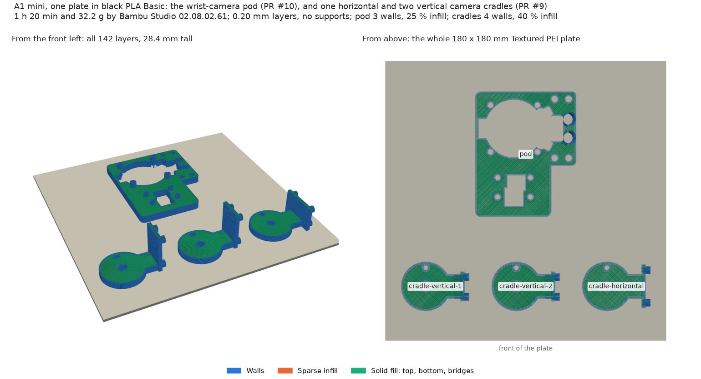
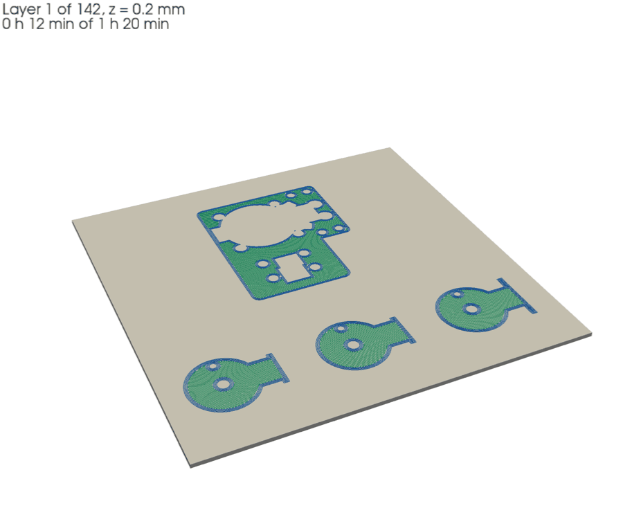

# #52: the wrist-camera pod and three camera-head cradles on one A1 mini plate

Asked for on [#52](https://github.com/vertical-cloud-lab/robot-arms/issues/52): one
`head-cradle-horizontal` and two `head-cradle-vertical` from
[PR #9](https://github.com/vertical-cloud-lab/robot-arms/pull/9#issuecomment-6479167957), and only the
pod from [PR #10](https://github.com/vertical-cloud-lab/robot-arms/pull/10#issuecomment-6480158077),
on the A1 mini (Thumbelina), in black PLA if possible (the approval's note).





## The plate

| | [`issue52_A1mini_PLA.3mf`](issue52_A1mini_PLA.3mf) |
|---|---|
| Parts | pod, 2 × vertical cradle, 1 × horizontal cradle |
| Time (Bambu's estimate) | 1 h 20 min (the GUI says 1 h 19 min: Studio's stock acceleration limits) |
| PLA | 32.24 g (10.64 m): pod 14.2 g, vertical cradles 6.1 g each, horizontal cradle 5.9 g ([`per_object.json`](per_object.json)) |
| Layers | 142, to 28.4 mm (the vertical cradles) |

- **Printer and material:** A1 mini, **0.4 mm nozzle** (read from the printer on 28 Oct), **black
  Bambu PLA Basic** (AMS slot A3), Textured PEI plate at 65 °C, nozzle 220 °C.
- **Settings:** Bambu's `0.20mm Standard @BBL A1M` with the mount's overrides: 3 walls, 25 %
  infill, circle compensation on, supports off. The three cradles carry PR #9's **4 walls and 40 %
  infill** as per-object settings; [`report.json`](report.json) shows them in the 3MF.
- **Layout:** the three cradles along the front, 14 mm apart; the pod centred behind them. Nothing
  is turned: every STL is in the print orientation it was exported in. Every footprint is at least
  5 mm from the next and 2.5 mm from the edge.
- **Checks:** no toolpath leaves the bed, Bambu's support check flags nothing (4 objects checked),
  no supports, no brim. The only G-code warning is Bambu's usual timelapse note. The CLI slice has
  no thumbnails (no Wayland display on the runner); Studio's GUI slice, which is what gets sent,
  makes its own.
- **The GUI keeps the settings.** Opened in Studio 02.08.02.61's GUI, the project kept 3 walls,
  25 % infill and circle compensation (preset marked modified). Its own slice came out at the same
  32.24 g, 142 layers and 28.40 mm top, with the same start G-code (`M620 S0A`, `M412 S1`,
  `M190 S65`), net extrusion within 0.11 mm of filament on every layer, and the same extrusion per
  object.

## Sources

The STLs in `stl/` are byte for byte the exports at these commits:

| Part | Branch | Commit | Path |
|---|---|---|---|
| `pod.stl` | `claude/issue-239-20260926-2347` (PR #10) | `ba6f819` | `piper-camera-mount/exports/pod.stl` |
| `head-cradle-horizontal.stl` | `claude/issue-229-20261001-2322` (PR #9) | `01e5a3e` | `robot-arm/enclosure/cameras/models/head-cradle-horizontal.stl` |
| `head-cradle-vertical.stl` | `claude/issue-229-20261001-2322` (PR #9) | `01e5a3e` | `robot-arm/enclosure/cameras/models/head-cradle-vertical.stl` |

This pod is newer than the one printed for #45 on 26 Oct (`27db133`): PR #10 has since added the
Camera Module 3 Wide's lens hole (`a4f85b5`) and run it on over the flex below the housing
(`7165e21`).

## Files

| File | What |
|---|---|
| [`slice_a1mini.py`](slice_a1mini.py) | Places and slices the plate with the Bambu Studio 02.08.02.61 CLI (#45's script, adapted). Writes the 3MF and `report.json` |
| [`plate_view.py`](plate_view.py) | Draws `plate.png` and `plate_build.gif` from the plate's own G-code, and writes `per_object.json` |
| `glxshim.c` | PR #10's OpenGL shim, for headless thumbnails |
| `print-20261028/` | The print run's camera frames and Device-page screenshots |

To regenerate, with Bambu Studio's AppImage extracted to `~/bambu/squashfs-root`:

```bash
cd print-jobs/issue-52-a1mini
python slice_a1mini.py --bambu ~/bambu/squashfs-root
xvfb-run -a python plate_view.py
```
