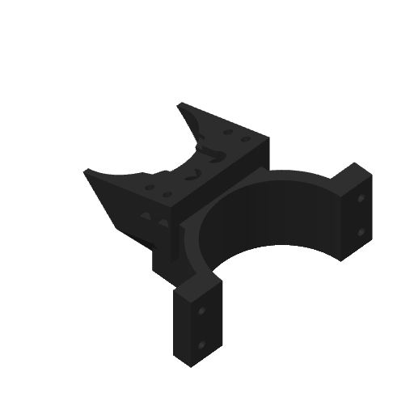

# #52: PR #10's bracket, bored out to Ø43, alone on one A1 mini plate

Asked for on [#52](https://github.com/vertical-cloud-lab/robot-arms/issues/52) ("now print this in
black PLA on the A1 mini (Thumbelina)"), pointing at
[PR #10's comment](https://github.com/vertical-cloud-lab/robot-arms/pull/10#issuecomment-6486121926)
that bored the bracket's lens cradle out to Ø43 the whole length of the lens. That comment says only
the bracket needs reprinting, so this plate is the bracket alone.



## The plate

| | [`issue52_bracket_A1mini_PLA.3mf`](issue52_bracket_A1mini_PLA.3mf) |
|---|---|
| Part | the bracket, centred on the bed, in the orientation it was exported in (72.4 × 88.0 mm, 42.7 mm tall) |
| Time (Bambu's estimate) | 1 h 18 min (the GUI says 1 h 17 min: Studio's stock acceleration limits) |
| PLA | 35.29 g (11.64 m) |
| Layers | 213, to 42.6 mm |

- **Printer and material:** A1 mini, **0.4 mm nozzle** (read from the printer on 29 Oct), **black
  Bambu PLA Basic** (AMS slot A3), Textured PEI plate at 65 °C, nozzle 220 °C.
- **Settings:** PR #10's own: Bambu's `0.20mm Standard @BBL A1M` with 3 walls, 25 % infill, circle
  compensation on, supports off.
- **Same as PR #10's per-part slice** of this STL (`slice/slice_configs.json`, `a1m_pla_04`, plate 2,
  sha256 `9cd30f700dce`): 35.29 g in both, 4668 s here against 4680 s there.
- **Checks:** no toolpath leaves the bed, Bambu's support check flags nothing, no supports, and the
  auto brim adds none. The only G-code warning is Bambu's usual timelapse note. The CLI slice has no
  thumbnails (no Wayland display on the runner); Studio's GUI slice, which is what was sent, has its
  own.
- **The GUI kept the settings.** Opened in Studio 02.08.02.61's GUI, the project kept 3 walls, 25 %
  infill and circle compensation (preset marked modified). Its own slice had the same 35.29 g, 213
  layers and 42.60 mm top, the same start G-code (`M620 S0A`, `M412 S1`, `M190 S65`), and net
  extrusion within 0.07 mm of filament on every layer. Only Studio's stock acceleration limits
  differ.

## Source

`stl/bracket.stl` is byte for byte `piper-camera-mount/exports/bracket.stl` at `1b7acd5` on
`claude/issue-239-20260926-2347` (PR #10), the same as at `6579f3c`, the commit that bored the cradle
out. Every bracket printed before that commit has the Ø33 strip the lens's aperture screw caught on.

## Files

| File | What |
|---|---|
| [`slice_a1mini.py`](slice_a1mini.py) | Places and slices the plate with the Bambu Studio 02.08.02.61 CLI (the 28 Oct #52 plate's script, adapted). Writes the 3MF and `report.json` |
| [`report.json`](report.json) | The CLI slice's numbers and checks |
| `glxshim.c` | PR #10's OpenGL shim, for headless thumbnails |
| `print-20261029/` | The print run: camera frames, Device-page screenshots, the sent file and `print.json` |

To regenerate, with Bambu Studio's AppImage extracted to `~/bambu/squashfs-root`:

```bash
cd print-jobs/issue-52-bracket-a1mini
python slice_a1mini.py --bambu ~/bambu/squashfs-root
```
