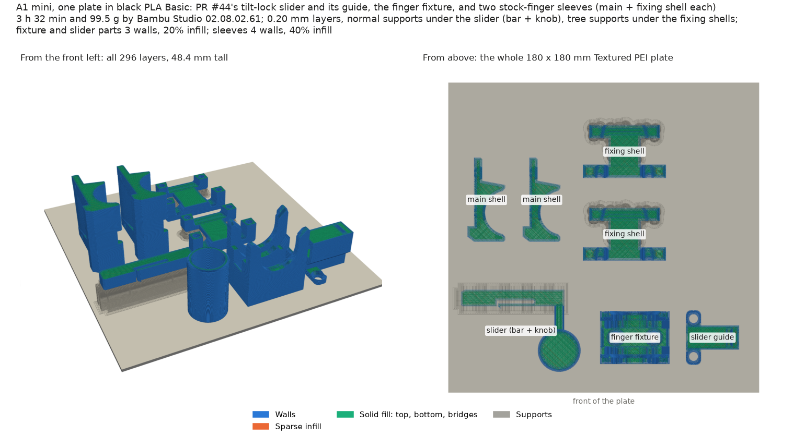

# #53: PR #44's slider, finger fixture and stock-finger sleeves on one A1 mini plate

Asked for on [#53](https://github.com/vertical-cloud-lab/robot-arms/issues/53#issuecomment-6511306990): from
[PR #44's round-4 comment](https://github.com/vertical-cloud-lab/robot-arms/pull/44#issuecomment-6508700624), "load
the build plate on Thumbelina (A1 mini) with the slider parts, the finger fixture, and also the two shell sleeves
needed to equip the stock gripper fingers ... Then send it to the printer to print on PLA black."

**Sent on 30 Oct 2026 at 00:15:49 UTC** from Bambu Studio's GUI in an approved `@claude-print` run, after the plate
check below. At 02:26 UTC it was at layer 151 of 296 (60 %), with Studio's estimated finish at 03:47 UTC; the run's
180 min limit ended the watching before that. The run's record is [`print-20261030/print.json`](print-20261030/print.json). An earlier run on 29 Oct
sliced PR #44's round 3 but sent nothing, because the requester asked to wait for round 4. Its record is
[`print-20261029/print.json`](print-20261029/print.json).



## The plate

| | [`issue53_A1mini_PLA.3mf`](issue53_A1mini_PLA.3mf) (CLI slice), sent as [`print-20261030/issue53_round4_A1mini_PLA_sent.gcode.3mf`](print-20261030/issue53_round4_A1mini_PLA_sent.gcode.3mf) |
|---|---|
| Parts | the **slider** (bar, latch beam, post and Ø25 T-knob) and its **guide**; the **finger fixture**; **2 × main shell** and **2 × fixing shell**, one of each per stock finger |
| Time (Bambu's estimate) | 3 h 29 min in the GUI (the CLI says 3 h 32 min: the GUI uses Bambu's stock acceleration limits) |
| PLA | 99.52 g (32.84 m), 6.06 g of it support: slider 15.8 g, guide 6.9 g, fixture 17.5 g, main shells 2 × 19.5 g, fixing shells 2 × 10.2 g |
| Layers | 296 to 48.4 mm (the main shells). 242 object layers at 0.20 mm; the slider's normal supports add their own layers |

- **Printer and material:** A1 mini, **0.4 mm nozzle** (read from the printer at 00:01:30 UTC on 30 Oct), **black Bambu PLA
  Basic** (AMS slot A3), Textured PEI plate at 65 °C, nozzle 220 °C.
- **Settings:** Bambu's `0.20mm Standard @BBL A1M`, circle compensation on, auto brim (none added).
  - Slider, guide and fixture: 3 walls, 20 % infill.
  - Sleeve shells: 4 walls, 40 % infill (per-object settings), for the grip and pull-out loads and the heat-set inserts.
  - Supports (per object, from the plate only): **normal** supports under the slider, with bridges left unsupported,
    and **tree** supports under the fixing shells. Nothing else is supported.
- **Checks:** no toolpath leaves the bed; Bambu's support check flags none of the unsupported parts. The only
  G-code warning is Bambu's usual timelapse note.
- **The GUI kept the settings.** Opened in Studio 02.08.02.61's GUI, the project kept 3 walls, 20 % infill and circle
  compensation (preset marked modified), and the per-object settings. Its own slice, which is what was sent, matched
  the CLI's: 296 layers, 99.52 g, 48.40 mm, the same start G-code (`M620 S0A`, `M190 S65`, `M109 S220`), and
  extrusion within 0.25 mm of filament on every layer. Only Studio's stock acceleration limits differ
  ([sliced](plate_studio_preview.png)). The sent plate G-code's MD5 is `ab7cf944b01cceccdf3e14bd74ae08c4`.

## Orientations and supports

| Part | On the bed | Supports | Why |
|---|---|---|---|
| Slider | standing on one end of its knob, as exported (PR #44 turned the STL) | normal, under the bar only | PR #44: the bar, latch beam and post lie in the layer plane, so the beam flexes along its layers; the bar is 16 mm off the bed |
| Guide | base-down, as exported | none | the tunnel roof is an 8.5 mm bridge |
| Finger fixture | base-down, as exported | none | no overhangs |
| Main shell | **stood on its −X end** (`y270`), so the cradle's half-bore is upright | none | below |
| Fixing shell | **on its back** (`x180`): split face, finger channel and insert holes up | tree | below |

- **Slider.** With tree supports (Bambu's default), the CLI also filled the knob's lower bore with supports
  under the hub, which PR #44 means to bridge the Ø19 bore. With normal supports and *don't support bridges*,
  the bore stays empty: only the bar gets supports, and the hub and the post (between the bar and the knob) print
  as bridges. Clean the bar's supported face well, because it slides in the guide with 0.25 mm a side.
- **Main shell.** PR #44's README says to print it on its outer web with the cradle up, but the cradle block stands
  13 mm proud of that face, so the web can't sit on the bed (see the round-3 notes in git history). The shell is a straight
  extrusion along the tube, so standing it on its end puts the whole profile in every layer: 505 mm² on the bed,
  a round half-bore, and the grip and screw loads along the layers. Round 4's 10 mm relief notch in the jaw leaves
  one 3.4 mm overhang (13 mm²) at the notch's top. Bambu's support check doesn't flag it. The M3 holes print horizontal.
- **Fixing shell.** Round 4 fixed this STL. Rounds 2 and 3 had 3.9 cm³ inside the stock finger, and that solid gave
  the old "split face" orientation its 664 mm² on the bed. With the finger channel cut out, no orientation is
  support-free (layer-by-layer check of every quarter turn):
  - on its split face it stands on the four leg feet (209 mm²), and the spine is a 15 mm cantilever over the channel;
  - stood on a band, the far band's leg feet hang 12 mm;
  - on its back (PR #44's choice) it rests on the taller band, and the shorter band and the spine sit 5.5 mm up.
  The last needs supports only under the outside of its back. The finger channel, the leg faces that meet the
  main shell, and the vertical insert holes all print clean.

## Material

PR #44 designs the slider and guide in **PETG**; #53 asks for **PLA**. By PR #44's own beam formula,
PLA's higher modulus (about 2.75 GPa against 2.0) makes the latch take about **9 N** to push in instead of
about 6.4 N, at the same 0.8 % strain. PLA takes that, but it is stiffer and more brittle than PETG, so it has less margin.

## Source

`stl/` is byte for byte PR #44's `end-effectors/auger-swap/cad/stl/` at `162706d` on
`claude/issue-42-20261026-0528` (round 4, 22:55 UTC on 29 Oct): `pin_slider.stl` (sha256 `7e36d3413e2f`),
`pin_guide.stl` (`bc8ecae86398`, unchanged since round 3), `finger_fixture.stl` (`85627a02933f`),
`sleeve_main_shell_x2.stl` (`ed0d632e8df8`) and `sleeve_fixing_shell_x2.stl` (`e707c4542cdd`); print the `_x2`
files twice. Hardware, from PR #44's README: 2 × M4 countersunk wood screws each for the fixture and the guide; per
sleeve, 2 × M3 × 10 and 2 × M3 × 12 countersunk (ISO 10642) and 4 × M3 × 5.7 heat-set inserts.

## Files

| File | What |
|---|---|
| [`slice_a1mini.py`](slice_a1mini.py) | Turns, places and slices the plate with the Bambu Studio 02.08.02.61 CLI (the #52 bracket's script, with quarter turns and per-object settings, supports included). Writes the 3MF and `report.json` |
| [`report.json`](report.json) | The CLI slice's numbers and checks |
| [`plate_view.py`](plate_view.py) | Draws `plate.png` from the plate's G-code (#52's, relabelled) and writes `per_object.json` |
| `glxshim.c` | PR #10's OpenGL shim, for headless thumbnails |
| `print-20261030/` | This print: camera frames (first, pre-Send, layer 1 and while printing), Device-page screenshots, Printer Parts, HMS, the Send dialog, the sent file and `print.json` |
| `print-20261029/` | The round-3 run that wasn't sent |

To regenerate, with Bambu Studio's AppImage extracted to `~/bambu/squashfs-root`:

```bash
cd print-jobs/issue-53-a1mini
python slice_a1mini.py --bambu ~/bambu/squashfs-root
xvfb-run -a python plate_view.py --no-gif
```
