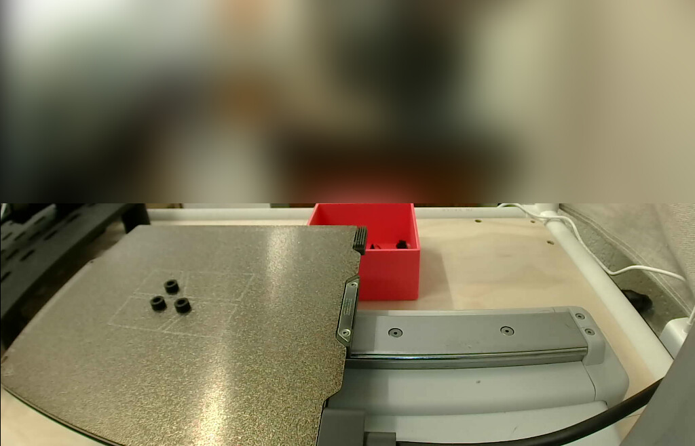

# #53: four 4 mm spacers on the A1 mini

Asked for on [#53](https://github.com/vertical-cloud-lab/robot-arms/issues/53#issuecomment-6510791024): "please make and
print 4 4mm tall spacers of thickness 2mm on A1 mini". Printed on Thumbelina (A1 mini) on 29 Oct 2026, in black PLA,
sent at 23:35:34 UTC and finished about 23:44:44. The run's record is [`print-20261029/print.json`](print-20261029/print.json).



All four printed (the [layer-20 frame](print-20261029/20261029T234434Z_L20_a1mini_camera_studio.jpg) shows them).
Someone took one off the plate as soon as the bed came forward, so this frame shows three.

## The spacer

| | |
|---|---|
| Shape | ring, **4.0 mm tall**, **2.0 mm wall** |
| Bore | **Ø4.2 mm** (a guess: the request gave none) |
| Outside | Ø8.2 mm |
| Count | 4, in one STL on a 16 mm grid |

The bore was chosen to slip over the stock AgileX M3 shoulder screw's Ø4 shoulder; the stock spacer there is
Ø9 × 4 mm with a Ø4 bore ([PR #44](https://github.com/vertical-cloud-lab/robot-arms/pull/44)'s
`end-effectors/auger-swap/README.md`). For another bore or wall:

```bash
python make_spacers.py --bore 3.4 --wall 2.0 --height 4.0 --count 4   # writes spacer.stl and spacers_x4.stl
```

## The print

- **Slice (Studio's GUI):** `0.20mm Standard @BBL A1M` with **3 walls** (so the 2 mm wall is all perimeters) and
  **auto circle contour-hole compensation on** (holes otherwise print 0.2–0.4 mm small). Bambu PLA Basic, black,
  from AMS slot A3. Textured PEI plate at 65 °C, nozzle 220 °C, no brim, no supports.
  20 layers to 4.00 mm, 0.78 g, 9 min 9 s (2 min 58 s of it printing).
- **Sent file:** [`spacers_x4_A1mini_PLA_sent.gcode.3mf`](spacers_x4_A1mini_PLA_sent.gcode.3mf), the 3MF Studio
  uploaded, with the account's `DesignerUserId` blanked. Its `plate_1.gcode` MD5 is
  `c73296d976549f66761e68522cf39a46`. Timelapse off; bed levelling and flow calibration on.
- **Plate check (CLAUDE.md's rule of 23 Oct):** first frame at 23:25:14 (plate empty), posted 23:26:39. The pre-Send
  frame at 23:30:55 showed someone working at the printer and a black slotted part just left of the plate, so it was
  posted (23:32:43) and the 90 s started again. The frame at 23:34:37 matched it, and nobody replied, so it was sent.
  The room above the plate is blurred in every frame because people were at the printer.

## Files

| File | What |
|---|---|
| [`make_spacers.py`](make_spacers.py) | Writes the ring STLs (standard library only) |
| [`spacer.stl`](spacer.stl), [`spacers_x4.stl`](spacers_x4.stl) | One ring; the four that were printed |
| [`spacers_x4_A1mini_PLA_sent.gcode.3mf`](spacers_x4_A1mini_PLA_sent.gcode.3mf) | The sliced file that was sent |
| `print-20261029/` | Camera frames and Device-page screenshots (first, pre-Send, while printing, finished), Printer Parts, HMS, the Device-page watcher's log (`monitor.jsonl`) and `print.json` |
