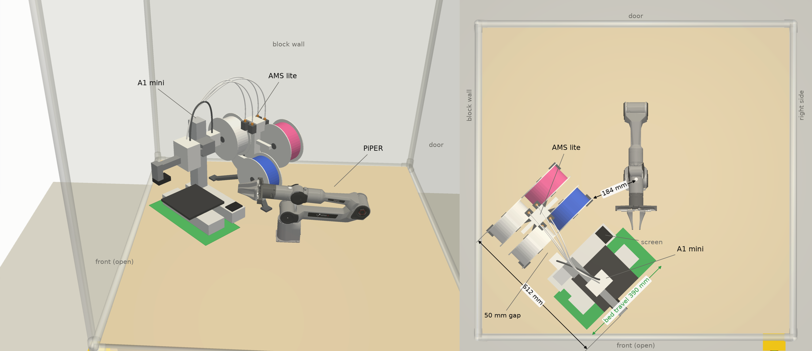

# A1 mini and AMS lite, turned 45° into the front-left corner

This is the layout sgbaird suggested on
[PR #9](https://github.com/vertical-cloud-lab/robot-arms/pull/9#issuecomment-6450325956): keep
Bambu's own arrangement, with the AMS lite 50 mm to the printer's right, and turn the pair 45°
into a corner. The table is not set up this way yet.

- The pair sits in the front-left corner, against the block wall. It is pushed in until the AMS
  lite and the back end of the bed's travel are each 15 mm from the plywood's edge.
- The printer faces J1 along the table's diagonal. The AMS lite is on the wall side, and the
  purge end points toward the open front.
- The bed sweeps 390 mm along the diagonal, out over the empty corner at the back and toward the
  arm at the front.
- The AMS lite comes within 184 mm of J1, and the printer within 194 mm (bed fully forward). All
  the numbers are in `layout.json`.
- The arm is parked with every joint at 0 and faces the open front, following jss265's
  correction on PR #9.

Sizes come from Bambu's A1 mini FAQ (358 mm for the printer, 612 mm with the AMS lite, 390 mm of
bed travel) and from retailers' listings of the AMS lite (397 × 208 × 342 mm). The shapes are
simplified; the sizes are not. The table, enclosure and arm come from
[`../cameras/build.py`](../cameras/build.py). The power strip is left out because it is mostly
hidden down the wall side.

To regenerate, run `xvfb-run -a python render.py`. It needs pyvista, trimesh, shapely,
matplotlib and pycollada.
