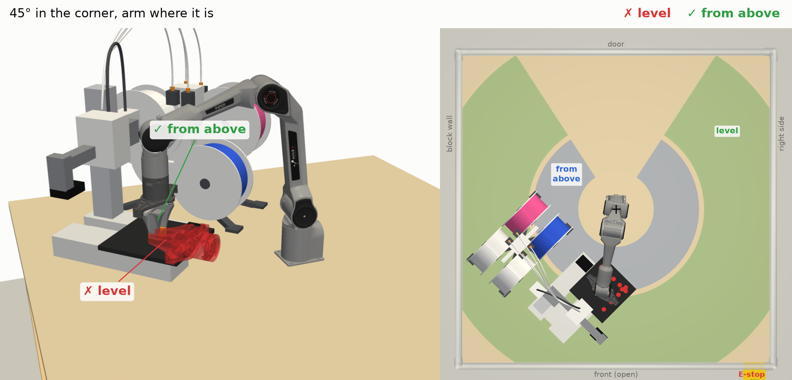
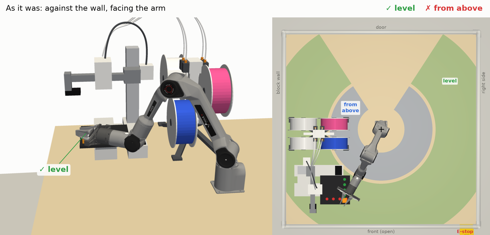
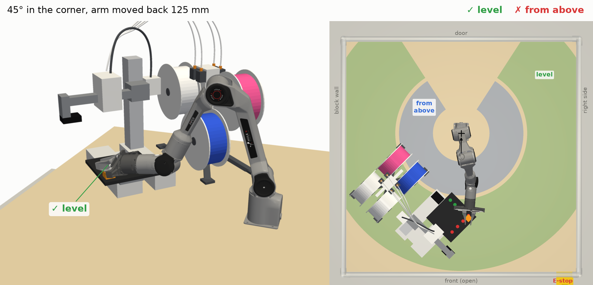
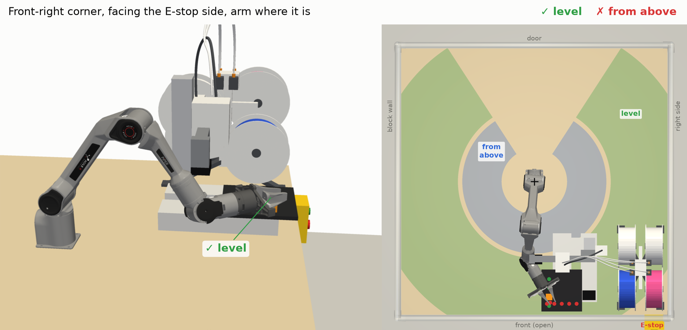
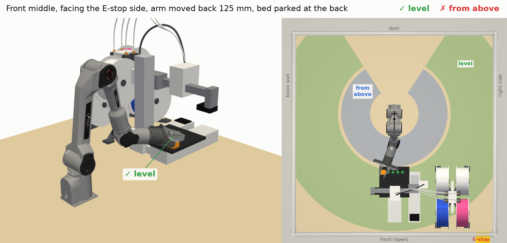

# A1 mini and AMS lite, turned 45° into the front-left corner

This is the layout sgbaird suggested on
[PR #9](https://github.com/vertical-cloud-lab/robot-arms/pull/9#issuecomment-6450325956): keep
Bambu's own arrangement, with the AMS lite 50 mm to the printer's right, and turn the pair 45°
into a corner. The table is not set up this way yet.

- The pair sits in the front-left corner, against the block wall. It is pushed in until the AMS
  lite and the back end of the bed's travel are each 15 mm from the plywood's edge.
- The printer faces J1 along the table's diagonal. The AMS lite is on the wall side, and the
  purge end points toward the open front.
- The bed sweeps 390 mm along the diagonal, out over the empty corner at the back and toward the
  arm at the front.
- The AMS lite comes within 184 mm of J1, and the printer within 194 mm (bed fully forward). All
  the numbers are in `layout.json`.
- The arm is parked with every joint at 0 and faces the open front, following jss265's
  correction on PR #9.

Sizes come from Bambu's A1 mini FAQ (358 mm for the printer, 612 mm with the AMS lite, 390 mm of
bed travel) and from retailers' listings of the AMS lite (397 × 208 × 342 mm). The shapes are
simplified; the sizes are not. The table, enclosure and arm come from
[`../cameras/build.py`](../cameras/build.py). The power strip is left out because it is mostly
hidden down the wall side.

To regenerate, run `xvfb-run -a python render.py`. It needs pyvista, trimesh, shapely,
matplotlib and pycollada.

## Taking the print off the bed: level, or only from above

jss265 put the printer against the wall so the gripper could take a print level with the bed, not
only from above, and found that the 45° corner allows only the second
([PR #9](https://github.com/vertical-cloud-lab/robot-arms/pull/9)). `access.py` checks this with the
arm's URDF and an IK solve for each layout below. The figures are drawn by `access_render.py`.

At bed height the PiPER can point its gripper straight down only within 0.33 m of J1. It can hold
the gripper level only from 0.35 m out (0.50 m if it must be dead flat) to 0.73 m. The reason is
the wrist: J5 stops at ±70°, so the forearm cannot be steep for a level grasp or shallow for one
from above. In the corner the bed's open edges are 0.24–0.40 m from J1, so only "from above" works
there. Against the wall they are 0.40–0.57 m away.

| Layout | Level grasps (of the spots tried) | From above, bed's middle | Screen, in from the front edge | What changes |
|---|---|---|---|---|
| 45° corner, arm where it is | 0 of 10 | yes | 408 mm, facing away (135°) | — |
| Against the wall (as it was) | 6 of 10, front edge and corner | no | 345 mm, facing the arm (90°) | nothing |
| 45° corner, arm 125 mm back | 6 of 10, front edge | no | 408 mm, facing away (135°) | re-drill the arm's mount |
| Front-right corner, facing the E-stop side | 4 of 10, purge-side edge | no | 67 mm, facing people (0°) | move the printer; the front camera post goes to the front-left corner |
| Front middle, facing the E-stop side, arm 125 mm back | 5 of 5, back edge | no | 67 mm, facing people (0°) | re-drill the arm's mount; end G-code parks the bed at the back; prints go at the back of the plate |

"125 mm back" is the smallest move, in 25 mm steps, at which the level grasp works at as many
spots as any move gets (the corner gets its first at 25 mm). All the numbers are in
`access.json`.

**What counts.**
- A level grasp has the fingers opening sideways, the tool axis flat or tipped down 10°, and the
  fingers 2 mm above the plate.
- The gripper's housing is 164 × 75 mm and sits lower than that, so it cannot go over the bed;
  only the 76 mm fingers do. The print therefore has to be within 35 mm of an open edge.
- The spots tried are 5 along the printer's front edge, 4 along the purge side and 1 at the front
  corner (the back edge for the front-middle layout).
- "From above" points the tool straight down with the fingertips 3 mm off the plate.
- A pose counts if every joint is at least 3° inside its URDF limit, and the arm clears the
  printer, the AMS lite, the plywood and its own base by 2 mm.
- The bed is fully forward except in the front-middle layout, where it is parked fully back.

**Not checked.**
- Only the final pose is checked, not the path in and out.
- The PTFE tubes and cables, a purge-waste bin and the camera posts are not modelled.
- The bed's height comes from the simplified model (82 mm), not a measurement.
- The arm's base and upper arm are a cylinder and a capsule for the self-collision check.
- In the front-right layout the purge waste falls on the arm's side.

To regenerate, run `python access.py && xvfb-run -a python access_render.py`. These also need
scipy and mapbox-earcut.
