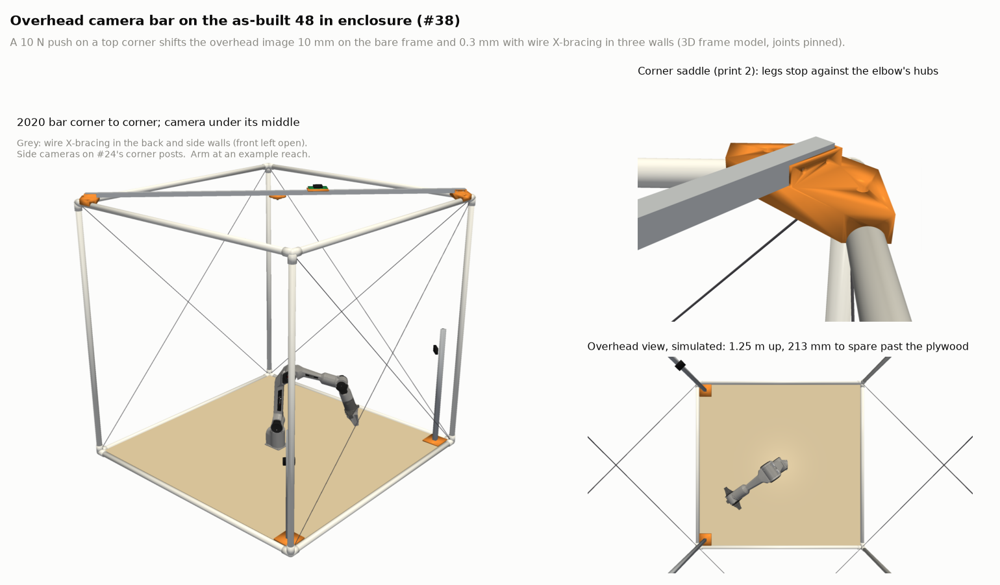
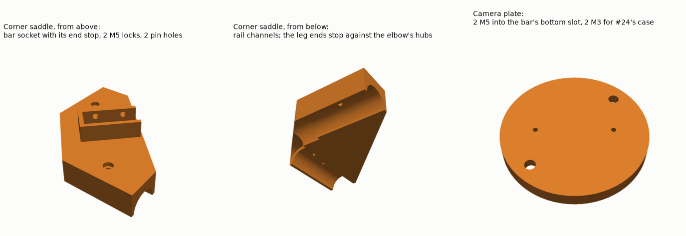

# Overhead camera bar for the as-built enclosure

The enclosure Chris built ([#38](https://github.com/vertical-cloud-lab/robot-arms/issues/38)) needs
something across its top to hold the overhead camera from
[#24](https://github.com/vertical-cloud-lab/robot-arms/issues/24), and the cameras need to go back to
the same place every time. This folder models the frame as built and adds the following:

- a 2020 aluminium bar from corner to corner across the top
- two printed saddles that locate the bar against the corner elbows
- the overhead camera, which hangs under the bar's middle
- the stiffness of the frame, with and without bracing

| File | What it is |
|---|---|
| [`build.py`](build.py) | The as-built frame, the saddle and camera plate, the 3D frame model, and every export below |
| [`render.py`](render.py) | `camera-bar.png`, `overhead-view.png` and `parts.png` |
| [`models/corner-saddle.stl`](models/corner-saddle.stl) | The saddle, print two. It is in mm and exported in its print orientation |
| [`models/camera-plate.stl`](models/camera-plate.stl) | Holds #24's camera case under the bar. It replaces #24's `spacer_overhead` |
| [`models/frame-as-built.stl`](models/frame-as-built.stl) | The PVC frame from #38, in mm |
| [`camera-bar.glb`](camera-bar.glb) | The whole scene in colour, with the arm and #24's side cameras |
| [`camera_overhead.json`](camera_overhead.json) | The overhead camera's nominal pose, in the format `piper_twin.py` reads (#24) |
| [`bar-results.json`](bar-results.json) | Every number quoted here |

To regenerate, run `python build.py && xvfb-run -a python render.py`.

## Where the cameras were discussed

- **[#24](https://github.com/vertical-cloud-lab/robot-arms/issues/24) has the three fixed cameras:**
  one overhead, plus two side cameras at the end of the table the arm faces.
  - The [Oct 14 placement](https://github.com/vertical-cloud-lab/robot-arms/issues/24#issuecomment-6169873927)
    already said that if the dome went up, the overhead camera should hang "from a bar across its top rails".
  - The [fixture run](https://github.com/vertical-cloud-lab/robot-arms/issues/24#issuecomment-6326304174)
    (branch `claude/issue-24-20261021-2052`) designed printed corner posts for the side cameras and a
    boom for the overhead camera.
  - The [literature and cable check](https://github.com/vertical-cloud-lab/robot-arms/issues/24#issuecomment-6326320116)
    (branch `claude/issue-24-20261021-2053`) backs up the layout.
  - The conversation then moved to [PR #25](https://github.com/vertical-cloud-lab/robot-arms/pull/25).
- **[#4](https://github.com/vertical-cloud-lab/robot-arms/issues/4) and
  [PR #10](https://github.com/vertical-cloud-lab/robot-arms/pull/10) cover the two wrist cameras.**
- **[#33](https://github.com/vertical-cloud-lab/robot-arms/issues/33) and
  [#36](https://github.com/vertical-cloud-lab/robot-arms/issues/36) set up the two camera Pis** for
  the fixed cameras.

## Is the enclosure fixed to the plywood?

Yes. #38 says the bottom rails are screwed into the plywood's edge with #8 × 2 in screws, and the
arm is bolted to the same plywood. A camera on the frame is therefore tied to the arm's base
through these parts:

> arm → plywood → bottom rails → elbows → posts → top elbows → saddles → bar → camera

Two links in that chain are weak:

- **The sockets are dry-fit.** They can twist or slip and stay there.
- **The ¾ in PVC frame is very flexible.** In the model below, a 10 N hand on a top corner
  moves it 19 mm.

The fixes are to pin the sockets and brace three walls. Both are cheap, and the numbers are below.

## The bar

- **Bar:** 2020 extrusion with 6 mm slots, **1698 mm** long. It runs from the front-left top corner
  to the back-right one.
- **Saddles:** each one sits over a top corner, with a leg on each rail just past the elbow.
  - Locating: the end faces of both legs stop against the elbow's socket hubs, so a saddle fits only
    one way. Nothing needs measuring.
  - Holding: a #8 × ¾ in pan-head screw through each leg pins it into the rail.
  - The bar drops into the saddle's open socket with its end against the stop. Two M5 screws into
    drop-in T-nuts lock it.
- **Camera:** #24's `cam_case` hangs under [`camera-plate.stl`](models/camera-plate.stl).
  - The plate is #24's overhead spacer with its M3 holes turned 45°, so the image's long side still
    runs along the wall.
  - It bolts into the bar's bottom slot at the middle, **849 mm from either end**, straight above J1.
- **Lens height:** **1.25 m above the plywood.**
  - #24 scored the overhead camera at 1.2 m, and its literature run found that a little higher is
    slightly better.
  - The image covers ±1.46 m along the wall and ±0.82 m across it, which is 213 mm past each edge of
    the plywood ([`overhead-view.png`](overhead-view.png)).
- **Clearance:** the highest the fingertips can get is 0.89 m above the plywood, which leaves
  0.36 m below the lens.
- **Pi 5:** it sits on top of the bar on #24's `pi5_plate`, about 18 cm from the camera toward the
  back-right corner, so a 300 mm ribbon reaches round the bar with some slack. The cloth top lies
  over the bar and the Pi.
- **Light:** with the cloth top on, the cell will be dim. The bar's free side slot can also carry
  an LED strip in an aluminium channel. That lights the plywood from above and sits above the
  lens, out of the overhead camera's view.

### Why corner to corner, not across the middle

| | Corner to corner | Across the middle, on the rails' midpoints |
|---|---|---|
| Locating | The corners locate it | Measure, then pin |
| Static sag at the camera | 1.0 mm, all aluminium | 2.8 mm, mostly the PVC rails, which creep under a constant load |
| 10 N push on a front corner, with wire bracing | **0.3 mm** shift in the overhead image | 3.5 mm |

The last row is the main reason. A diagonal bar braces the top square, so three braced walls also
hold the open front wall. A bar across the middle doesn't brace the top, so the front corners stay
free to move.

## How far the camera moves

This is a 3D frame model of the cube as built: posts fixed at the plywood, every socket rigid (that
is, pinned), and the bar between two top corners. The load is a 10 N push on a top corner, about
what a hand on the frame gives while clamping cloth. "Image shift" is how far the point at the
image centre moves on the plywood: the camera's own movement plus its tilt times the height.

| Frame | Corner moves | Camera moves | Camera tilts | **Image shift** |
|---|---|---|---|---|
| Bare frame, diagonal bar | 19 mm | 12.7 mm | 4.6 mrad | **9.5 mm** |
| **Diagonal bar + wires in the back and side walls** | 0.6 mm | 0.4 mm | 0.14 mrad | **0.3 mm** |
| Bar across the middle | 20 mm | 12.9–13.4 mm | up to 3.2 mrad | **12–17 mm** |
| Bar across the middle + the same wires | 7.1 mm | 3.6 mm | 0.12 mrad | **3.5 mm** |

These shifts are elastic, so the frame springs back after a bump, if its joints don't slip. That
is why pinning the sockets comes first.

## What to do for repeatable camera positions

1. **Pin every socket.** Drive one #8 × ½ in pan-head screw through each fitting's socket into its
   pipe: 24 in all, from the outside, away from where the cloth clamps go. PVC cement also works
   if the frame will never come apart; screws can come out if it moves tables.
2. **Brace the back and both side walls with wire.**
   - Each of the three walls gets an X of 1/16 in vinyl-coated steel wire rope, six diagonals in
     all.
   - Loop each end around the post right next to its corner elbow and close it with a wire-rope
     clip. Put a small turnbuckle in each diagonal.
   - Tension them snug, not tight: just enough that a wire doesn't go slack when you push the frame,
     a few kilograms of pull. A ¾ in post buckles at about 270 N with pinned ends.
   - Leave the front open for loading.
3. **Put a drift check in the overhead view.** Stick four AprilTags, or #24's ChArUco board, to
   the plywood near its corners and keep those spots clear. The overhead camera can then re-solve
   its pose from them at the start of each session. They are on the board the arm is bolted to, so
   they catch any shift in the frame.
4. **Keep the side cameras on #24's corner posts, which are screwed to the plywood.**
   - That fixture design still fits inside the PVC corners. Each 2020 post is about 86 mm from the
     PVC post's axis.
   - The bottom elbows' hubs clear the feet's outer edges by only about 0.5–2 mm in this model, so
     test-fit one printed foot.
   - The posts hang on the plywood, not on the frame, so the frame's sway doesn't reach them.
   - **#24's overhead post, elbow and boom aren't needed any more:** `foot_overhead`,
     `elbow_overhead`, `spacer_overhead`, and the 1200 mm and 620 mm lengths of extrusion.
   - The literature run's other option, a 900 mm bar across the right-hand end, doesn't fit. Its
     cameras would sit outside the enclosure's wall, and moving them just inside it puts them at the
     edge of the fingertips' reach.

## Parts

| Item | Qty |
|---|---|
| 2020 aluminium extrusion, 6 mm slot, 1698 mm, square ends (cut from 2000 mm) | 1 |
| [`corner-saddle.stl`](models/corner-saddle.stl) | 2 |
| [`camera-plate.stl`](models/camera-plate.stl) | 1 |
| From #24: `cam_case`, `pi5_plate`, `ribbon_clip` | 1, 1, 2 |
| M5 drop-in T-nuts, and M5 × 10 button-head screws (saddles 4, plate 2, Pi plate 2) | 8 each |
| #8 × ¾ in pan-head sheet-metal screws (saddle pins) | 4 |
| #8 × ½ in pan-head sheet-metal screws (socket pins) | 24 |
| M3 × 12 (case ears), M2 × 6 (camera board), M2.5 × 6 (Pi), self-tapping | 2, 4, 4 |
| Camera Module 3 Wide, 300 mm Pi 5 camera cable, and one of the camera Pis | 1 each |
| 1/16 in vinyl-coated wire rope | about 12 m |
| Small turnbuckles (hook and eye, 1/4 in or M5) | 6 |
| 1/16 in wire-rope clips | 12 |

**Printing:** PETG, 0.2 mm layers, 4 walls, 40 % infill.

- Print the saddle as exported, with the rail channels down. They print as 27 mm arches; add
  supports under them if your printer sags on bridges.
- One saddle is about 180 cm³ solid, so about 100 g at those settings.

## Installing

1. **Pin the sockets** (step 1 above).
2. **Saddles.**
   - Set one on the front-left top corner and one on the back-right top corner. Push each one into
     the corner until both legs touch the elbow's hubs.
   - Drill 1/8 in pilots through the pin holes into the rails and drive the #8 × ¾ in screws.
   - Keep the cloth's spring clamps off the saddles' legs.
3. **Bar.**
   - Slide in the T-nuts first:
     - two in the side slot under each saddle's M5 holes
     - two in the bottom slot at the middle, for the camera plate
     - two in the top slot about 18 cm from the middle toward the back-right end, for the Pi
   - Lay the bar into both sockets with its ends against the stops, then tighten the four M5s.
4. **Camera.**
   - Screw the plate's centre to the bar's middle, with its two small holes running along the wall.
   - Hang the case under it with two M3 × 12, ribbon toward the Pi.
   - Clip the ribbon along the bar to the Pi.
5. **Wires.** Fit and tension the six diagonals (step 2 above).
6. **Check the view.** `rpicam-still -o view.jpg` on the camera's Pi should look like
   [`overhead-view.png`](overhead-view.png). If it comes out upside down, add `--rotation 180`.
7. **Calibrate.** [`camera_overhead.json`](camera_overhead.json) is the nominal pose from the CAD.
   The real pose still needs #24's ChArUco-on-the-gripper step.

## Assumptions

- **Frame:** #38's as-built numbers. 48.00 in pipes and a measured 5/8 in take-out give
  49.25 in between elbow centres, 50.30 in outside, 48.20 in inside and 48.50 in clear height. The
  model reproduces all of them ([`bar-results.json`](bar-results.json)).
- **The elbow's hubs are estimated, not measured:** 33 mm across and 36 mm from the corner's centre.
  The saddle leaves 0.5 mm there.
  - Measure one of Chris's elbows before printing both saddles.
  - If the hubs are longer, change `HUB_L` in `build.py` and re-run.
- **J1 is at the plywood's centre,** as #24 assumed.
- **Stiffness model:**
  - PVC E = 2.8 GPa.
  - Every joint is rigid. That is what pinning the sockets aims for, and unpinned dry-fit joints
    will be looser.
  - The 2020 section is nominal (I = 7000 mm⁴), and the wire's EA is 100 kN.
  - The plywood and table are rigid.

  Read the table as a comparison between options, not as a prediction.
- **Nothing has been built, printed or test-fitted.**
