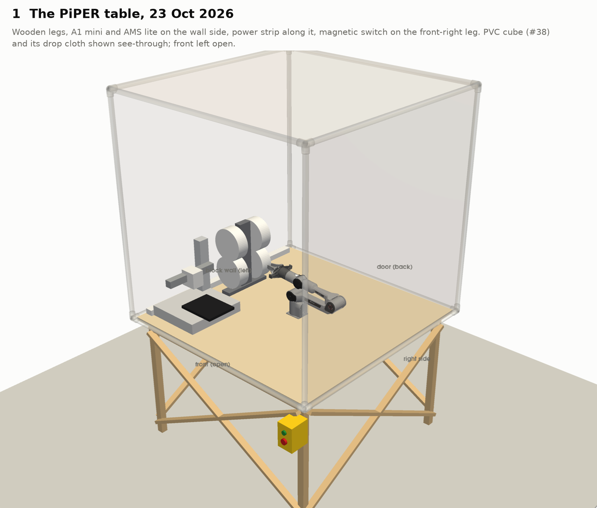
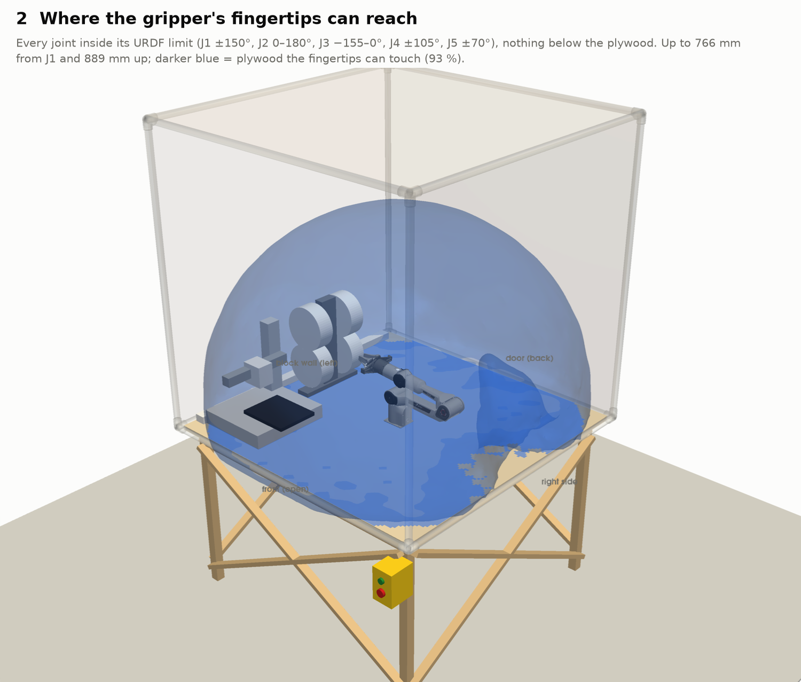
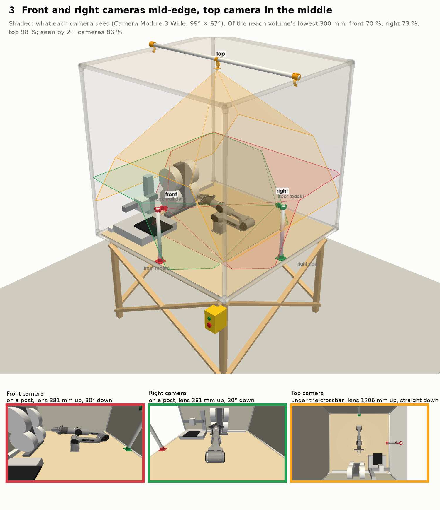
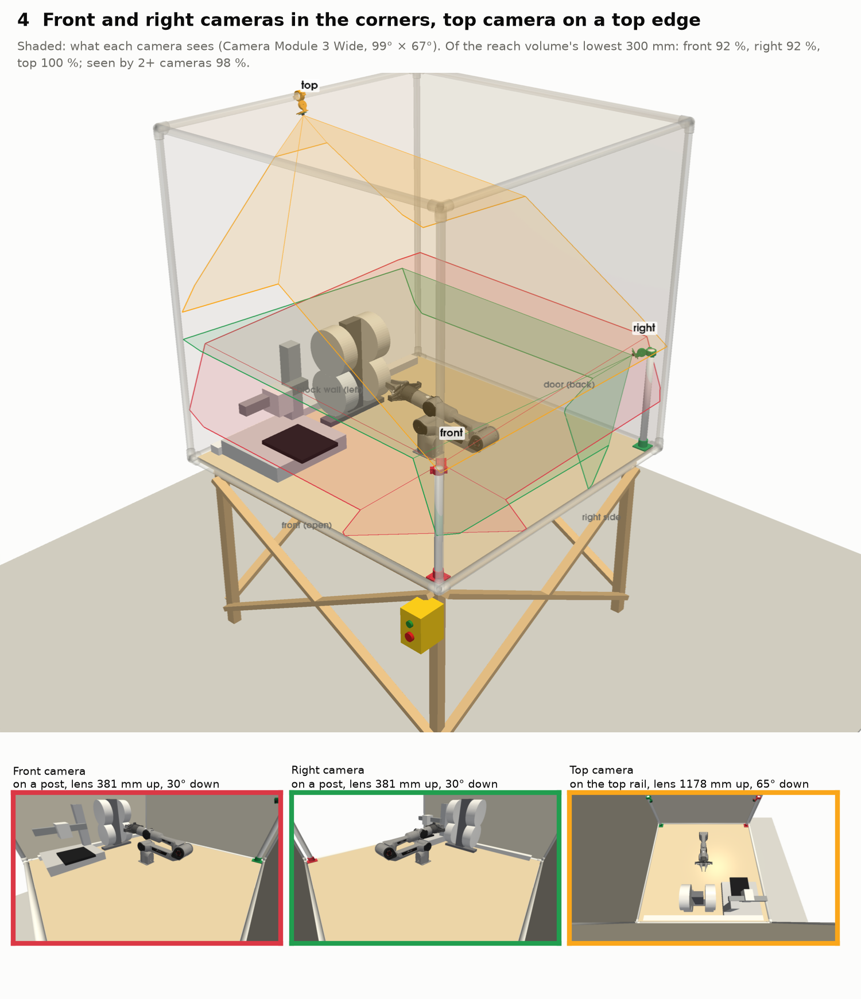
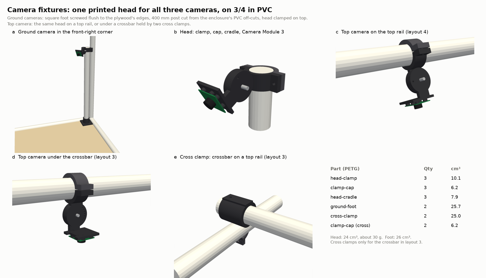
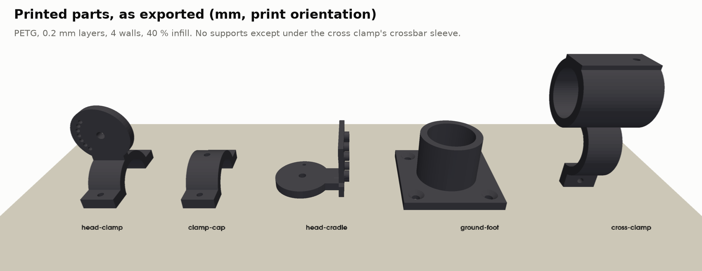

# PiPER table: reach and fixed cameras

Renderings of the PiPER table as it stood on 23 Oct 2026
([photo on PR #9](https://github.com/vertical-cloud-lab/robot-arms/pull/9)), with the arm's reach and
two layouts for the three fixed cameras, plus printable fixtures for them. The PVC cube from
[#38](https://github.com/vertical-cloud-lab/robot-arms/issues/38) and its drop cloth are drawn
see-through in every view.

| File | What it is |
|---|---|
| [`build.py`](build.py) | The table, the reach, the camera layouts, the printed parts and every number below |
| [`render.py`](render.py) | All the figures |
| [`models/*.stl`](models/) | The five printed parts, in mm, in their print orientation |
| [`cameras-edges.json`](cameras-edges.json), [`cameras-corners.json`](cameras-corners.json) | Nominal pose of each camera, in the format `piper_twin.py` reads (#24) |
| [`results.json`](results.json) | Reach, camera positions, tilts and coverage |
| `reach.npz` | The reach as a 20 mm voxel grid, and the plywood the fingertips can touch |

To regenerate, run `python build.py && xvfb-run -a python render.py`.

## Which side is which

I took the sides from the photo:

- **Front:** the open side you stand at, with the magnetic switch at its right end.
- **Left:** the block wall.
- **Back:** the door.
- **Right:** the side by the grey cabinet.

The arm faces the wall at J1 = 0 (its gripper points that way in the photo), and J1 is at the
plywood's centre.

**The A1 mini is where the photo shows it:** on the wall side, at the front-left corner, facing the
arm. The comment says front-right. If it moves there, layout 4's front camera should go in the
front-left corner instead. The feet and heads fit either corner.

## 1. The table

## 2. Reach

The blue volume is everywhere the fingertips can reach with every joint inside its URDF limit and no
link below the plywood. The darker blue on the plywood is where they can get within 30 mm of it.

- The fingertips reach up to **766 mm** from J1 and **889 mm** above the plywood.
- They can touch **93 %** of the plywood. They miss the far corners and the notch toward the right
  side, behind the arm, where J1 stops at ±150°.

## 3 and 4. Camera layouts

Both layouts use Camera Module 3 Wide: 99° × 67° with the nominal lens, no distortion. Coverage is
the share of the reach volume within 300 mm of the plywood (the "work zone") that falls inside a
camera's image. It ignores anything that blocks the view; the small images show what each camera
actually sees.

| | Layout 3: mid-edge, top in the middle | **Layout 4: corners, top on the wall-side rail** |
|---|---|---|
| Front camera | Post at the front edge's middle, 30° down | Post in the front-right corner, 30° down |
| Right camera | Post at the right edge's middle, 30° down | Post in the back-right corner, 30° down |
| Top camera | Under a crossbar at the centre, lens 1206 mm up, straight down | On the middle of the wall-side top rail, lens 1178 mm up, 65° down |
| Work zone seen by front / right / top | 70 % / 73 % / 98 % | **92 % / 92 % / 100 %** |
| Seen by 2 or more cameras | 87 % | **98 %** |
| Can the fingertips hit a post? | **Yes**, both: the posts are 582 mm from J1 | No, the posts are 46 mm out of reach |
| Extra parts | 1290 mm crossbar and 2 cross clamps | None |

**I recommend layout 4.** Each ground camera sees 92 % of the work zone instead of 70–73 %, almost all
of it is seen twice, the arm can't reach the posts, and no crossbar is needed. The corner cameras sit
90° apart, so between them they see both sides of whatever the gripper is holding. The top camera
is on the wall side, so it looks at the gripper's working side and is out of the way of anyone
reaching in from the front.

In layout 3, the front and right posts stand inside the arm's reach. They would need a keep-out
zone in software.

Before installing layout 4, two things need checking:

- **The plywood shelf in the photo** sits in the back-right corner. It has to move about 10 cm
  toward the middle to make room for that post.
- **Cables.** #39's plan puts the right and top cameras on mpzy, and they end up about 1.5 m apart in
  layout 4. One fix is a Pi on the middle of the back top rail, with 1 m camera cables to both
  cameras. The other is to give mpzy the two corner cameras (1.07 m apart) and eufi the top one.

## The fixtures

**All three cameras use the same printed head, and it clamps onto ¾ in PVC.**

- **Ground cameras:** a post of ¾ in PVC stands in a small printed foot. Two 400 mm posts can come
  from the enclosure's off-cuts: each 10 ft stick left about 24 in over.
- **Top camera, layout 4:** the head clamps straight onto the top rail.
- **Top camera, layout 3:** the head clamps onto a crossbar that rests on two top rails in two cross
  clamps.

The feet, posts and heads therefore move between layouts 3 and 4 unchanged.

- **Head (3 parts, about 24 cm³, 30 g):**
  - **Clamp:** a half ring with a hinge plate on it.
  - **Cap:** the other half ring. Two M3 bolts close the cap on any part of a pipe, so nothing has to
    come apart.
  - **Cradle:** carries the camera board on four standoffs, landscape or portrait. It pivots on an
    M4 bolt.
- **Locking the head (repeatability):**
  - Tilt is set by a 2 mm pin through one of seven index holes, every 15° from −45° to +45°, so it
    goes back to the same angle.
  - A #6 screw through the cap into the PVC stops the clamp from turning.
- **Ground foot:** 56 × 56 mm. Its edges go flush with the plywood's edges: two edges in a corner, one
  edge at a mid-edge mark. Four #8 screws hold it down, and a #6 screw pins the post in its socket.
  The post's axis ends up 28 mm in from each flush edge.
- **Cross clamp (layout 3 only):** a half ring over the top rail, closed by a cap from below, with a
  sleeve above for the crossbar.

### Parts

| Item | Layout 3 | Layout 4 |
|---|---|---|
| [`head-clamp.stl`](models/head-clamp.stl), [`head-cradle.stl`](models/head-cradle.stl) | 3 each | 3 each |
| [`clamp-cap.stl`](models/clamp-cap.stl) | 5 | 3 |
| [`ground-foot.stl`](models/ground-foot.stl) | 2 | 2 |
| [`cross-clamp.stl`](models/cross-clamp.stl) | 2 | none |
| ¾ in Sch 40 PVC: posts 400 mm | 2 | 2 |
| ¾ in Sch 40 PVC: crossbar 1290 mm (50¾ in, needs a new stick) | 1 | none |
| M3 × 16 + nut (clamp to cap) | 10 | 6 |
| M4 × 16 + nyloc nut (pivot); M2 × 12 + nut (tilt pin) | 3 each | 3 each |
| M2 × 6 self-tapping (camera board) | 12 | 12 |
| #6 × ½ in pan-head (pins into PVC) | 9 | 5 |
| #8 × ⅝ in flat-head wood screws (feet) | 8 | 8 |
| Camera Module 3 Wide | 3 | 3 |

**Printing:** PETG, 0.2 mm layers, 4 walls, 40 % infill. No part is bigger than 76 mm, so all of
them fit the A1 mini. The clamp and the cap print on their split faces and the cradle on its hinge
plate, none of them with supports. Only the cross clamp needs support, inside its crossbar sleeve.

### Installing layout 4

1. **Feet.** Set one foot in the front-right corner and one in the back-right corner, each with two
   edges flush with the plywood's edges. Drill ⅛ in pilots and drive four #8 × ⅝ in screws.
2. **Posts.** Push a 400 mm post into each socket, then pin it with a #6 screw through the socket's
   side hole.
3. **Heads.**
   - Screw each camera board to its cradle: landscape holes for the posts, portrait holes for the
     top camera, so its image's long side runs along the rail.
   - Bolt each cradle to its clamp with the M4.
   - Ground cameras: put the tilt pin in the hole two steps (30°) from the middle, on the side that
     tips the lens down.
4. **Ground heads.**
   - Clamp each head at the top of its post, flush with the top, aimed along the diagonal at the
     arm's base.
   - Tighten the two M3s, then pilot through the cap's side hole and drive the #6 pin.
5. **Top head.**
   - Clamp it at the middle of the wall-side top rail. Put the tilt pin in the middle hole.
   - Turn the head on the rail until the camera looks in and 65° below horizontal. The camera
     plate's face is then 25° from horizontal; a phone inclinometer on it works.
   - Pin it like the others.
6. **Check each view** with `rpicam-still -o view.jpg` against the small images under rendering 4.
   Then calibrate as in #24; the JSON poses are only the nominal ones from the CAD.

## Assumptions

- **Table:** the 48 × 48 in plywood and the cube are #38's as-built numbers, through
  `../camera-bar/build.py`. The legs, braces and the 30 in height are from the photo and only
  affect the pictures.
- **A1 mini, AMS lite, power strip and switch:** boxes and discs at their approximate sizes and
  places. Their placement only matters for what the cameras can see.
- **Reach:** the fingertip is 140 mm past the flange (`piper_fk.py`). The reach is sampled from
  1.5 million random joint sets and closed with a 20 mm grid. It ignores self-collision and anything
  on the table except the plywood.
- **Tilts:**
  - Ground cameras: the 15° index step that sees most of the work zone.
  - Top rail camera: the 5° step that does.
  - Both ground cameras' lenses are 381 mm above the plywood (400 mm post).
- **Not covered:**
  - The gripper camera and the HQ camera (#39), which these renderings don't place. The HQ camera's
    38 mm board would need its own cradle.
  - The shelf, the black rack, the box and the loose Pis in the photo.
- **Nothing has been printed, fitted or tested.** I didn't touch the arm or the Pis.
